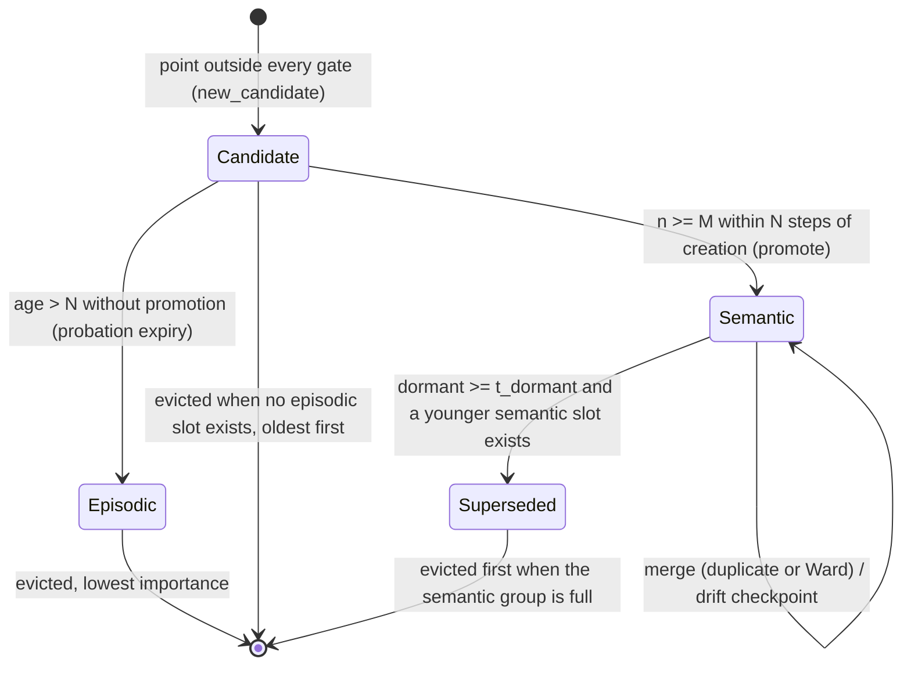

# uEngram explained

Each section has five parts: plain words, why it exists, the math, why this and not the obvious alternative, and where it lives in code. Symbols are defined where they first appear. Everything below describes the code as written, including the deliberate departures from `docs/PLAN.md` listed at the end.

Running example: a pump-and-engine monitor samples six sensors, packs 64 samples into a *window*, and has a few hundred slots of memory to remember "what has this machine been like?" for years.

---

## 1. Windows and channels

### Plain words
A window is one short snapshot of all sensors: a table with one row per sensor and one column per time sample. Everything downstream treats one window as one observation, like one photograph in a photo album.

### Why it exists
Single samples are noise; a vibration spectrum needs dozens of samples to exist at all. The window is the unit that the memory stores, scores, and forgets.

### The math
A window is $X \in \mathbb{R}^{C\times K}$ with $C=6$ channels (`rpm, oil_psi, coolant_temp, vib_x, vib_y, vib_z`) and $K=64$ samples; in-window time is $s_k = k/K$. CMAPSS uses $C=14$ sensors and $K=16$ cycles. A raw window costs $4CK$ bytes in float32 (1536 B on the synthetic stream); that is `raw_window_bytes`.

### Why this and not the obvious alternative
Per-sample memory would store 64x more items for the same information about the machine's *state*, and gives the frequency-domain features (section 2) nothing to work with.

### Where in code
`src/uengram/synth.py:make_window`, `src/uengram/cmapss.py:windows`.

---

## 2. DSP encoder

### Plain words
Instead of remembering raw waveforms, describe each window with a few numbers a mechanic would use: how high is each reading, how much does it wiggle, and how much energy sits in low vs high frequencies.

### Why it exists
The memory needs a compact vector per window so that "is this like something I have seen?" becomes a distance. A hand-built, deterministic encoder needs no training loop on the device and no GPU.

### The math
For each channel $c$ with samples $x_k$: mean $m=\frac1K\sum x_k$; $\log(\mathrm{std}+10^{-6})$; and four log band energies. With $\tilde x=x-m$, power $P_f=|\mathrm{rfft}(\tilde x)_f|^2/K$ for bins $f=1..K/2$, the bins are split into four contiguous equal-count bands $b$ and the feature is $\log(\sum_{f\in b}P_f+10^{-8})$. That is $6C$ features. Each feature is robust-standardised, $(F-\mathrm{median})/(\mathrm{IQR}/1.349)$, with IQR floored at $10^{-6}$ ($1.349$ makes IQR equal one standard deviation for Gaussian data). The result is whitened (section 4) to $d=16$ dimensions.

### Why this and not the obvious alternative
Logs make multiplicative changes (vibration doubling) additive, so a Euclidean or Mahalanobis distance treats "2x louder" and "half as loud" symmetrically. Median/IQR standardisation keeps the training anomalies from stretching the scale. Raw FFT bins would give a few-hundred-dimensional vector dominated by whichever band is loudest.

### Where in code
`src/uengram/encoders.py:band_features`, `DSPEncoder`.

---

## 3. CNN encoder

### Plain words
A tiny neural network is taught to squeeze a window into 16 numbers and then rebuild the window from them. Whatever it keeps in those 16 numbers is, by construction, what it needs to rebuild the window.

### Why it exists
It is the learned alternative to section 2, and the architecture doc's proposal. Having both shows that the memory logic does not depend on a particular encoder.

### The math
Per-channel standardisation first: $x\leftarrow (x-\mu_c)/\max(\sigma_c,10^{-6})$ with training statistics. Encoder: `Conv1d(C,32,5,s2)–GELU–Conv1d(32,64,5,s2)–GELU–AvgPool–Linear(64,16)`. Decoder: `Linear(16,128)–GELU–Linear(128,CK)`. Loss is the MSE on the standardised input, minimised with AdamW (lr $10^{-3}$, weight decay $10^{-4}$, 30 epochs, batch 128). The 16-d latents are then whitened. No L2 normalisation of the latent (section 14, correction 2).

### Why this and not the obvious alternative
The doc trains on unscaled channels, so a channel with large units (rpm) dominates the loss and the code would "learn rpm". The MLP decoder (not a transposed convolution) works for any $K$ so the same class serves $K=64$ and $K=16$.

### Where in code
`src/uengram/encoder_cnn.py:CNNEncoder`. Torch is imported lazily so the DSP path never needs it.

---

## 4. Whitening

### Plain words
Re-measure the 16 numbers so that, over normal training data, each one has spread exactly 1 and none of them moves in lock-step with another. After this, "how unusual is this point?" is just ordinary distance.

### Why it exists
The statistical machinery (chi-square gate, Bhattacharyya distance, Ward cost) assumes distances mean the same thing in every direction.

### The math
Training features $F\in\mathbb{R}^{N\times p}$, mean $m$, covariance $\Sigma=V\Lambda V^\top$ (`eigh`), top-$d$ eigenpairs. $z=(F-m)V_d\Lambda_d^{-1/2}$. Eigenvalues are floored at $10^{-8}\lambda_{\max}$. On training data $\mathrm{Cov}(z)=I_d$ exactly (tested to $10^{-6}$).

### Why this and not the obvious alternative
Without whitening, a Euclidean ball in feature space is an arbitrary ellipse relative to the data. Mahalanobis in the original space would need a $p\times p$ inverse per comparison; whitening pays that once.

### Where in code
`src/uengram/encoders.py:Whitener`.

---

## 5. Noise scale $\sigma_0$ via MAD of successive differences

### Plain words
To decide whether a point is "far", you need to know how jittery a single measurement normally is. Measure that jitter by comparing each window to the one right after it: slow changes (wear, a regime switch) cancel, jitter does not.

### Why it exists
The overall spread of the training data includes regimes (idle vs heavy) and wear, which are *not* noise. Using that spread as a gate would call everything inside the regime-to-regime range normal. $\sigma_0$ is the scale of within-state noise only.

### The math
$\Delta_t=z_{t+\ell}-z_t$ with lag $\ell$ (1 for synthetic; 16 for CMAPSS, so the compared windows do not overlap), restricted to pairs in the same group (the same engine unit). Per dimension $j$:
$$\sigma_{0,j}=\frac{1.4826\;\mathrm{median}|\Delta_j-\mathrm{median}(\Delta_j)|}{\sqrt2}.$$
$1.4826$ turns the median absolute deviation into a standard deviation for Gaussians; $\sqrt2$ because a difference of two independent noises has variance $2\sigma^2$. Floored at $10^{-6}$; fewer than 10 pairs raises.

### Why this and not the obvious alternative
A plain standard deviation of differences is inflated by every regime switch and anomaly (a handful of huge jumps). The median ignores them as long as they are a minority. Residual bias is small but real: if a fraction $\epsilon$ of differences are huge, the median of $|\Delta|$ moves up to the $0.5/(1-\epsilon)$ quantile of the clean distribution, which inflates the estimate by roughly 4% at $\epsilon=5\%$ and 16% at $\epsilon=10\%$. The test uses 5% persistent jumps and recovers $\sigma$ within 10%.

### Where in code
`src/uengram/stats.py:robust_noise_sigma`.

---

## 6. Memory slots and the state machine

### Plain words
Memory is a fixed number of slots. A brand-new kind of window gets a *candidate* slot on probation. If the same new kind keeps showing up quickly, it becomes a *semantic* slot: a habit ("this is what cruise looks like"). If it does not, it becomes an *episodic* slot: a flashbulb memory of a rare event, kept with its raw window. When a habit goes stale because the machine has moved on (a repair, a new operating mode), it is marked *superseded*: kept for history but no longer used for "what is normal now".

### Why it exists
A fixed memory must treat "routine, seen a million times" and "once, but important" differently, and must not let an old normal pollute the new normal.

### The math
Slot state (struct-of-arrays): mean $\mu\in\mathbb{R}^d$, variance state $S\in\mathbb{R}^d$, count $n$, kind, creation/last-seen times, surprisal, an id, a drift checkpoint $\mu_{ckpt}$, and `superseded_by`. Kinds: 0 empty, 1 candidate, 2 episodic, 3 semantic, 4 superseded. Group budgets: kinds $\{1,2\}\le B_{epi}$ and $\{3,4\}\le B_{sem}$ (defaults 64 and 192).

A bounded `lineage` ring (256 entries) records `checkpoint`, `supersede`, `merge` and eviction events, so the history of how the machine's normal moved survives even when the slots that held it are gone.

### Why this and not the obvious alternative
A single pool with a utility score (the doc's design) cannot distinguish "rare" from "stale", so it must either keep stale baselines or drop rare faults. Two budgeted groups give rare events their own protected space.

### Where in code
`src/uengram/engine.py:Engram`, `src/uengram/lifecycle.py`.

---

## 7. Novelty gate: Mahalanobis, the chi-square quantile, the exact tail, surprisal

### Plain words
A new window is compared to each slot, measuring distance in units of that slot's normal wobble. If it is within what a normal wobble would produce 99.99% of the time, it belongs to that slot. Otherwise it is novel. The "surprisal" is how many powers of ten unlikely the window was.

### Why it exists
It replaces a hand-picked "cosine > 0.9" with a threshold that has a meaning: a false-alarm probability.

### The math
For slot $k$ with mean $\mu_k$ and diagonal predictive variance $v_k$:
$$D^2_k=\sum_{j=1}^{d}\frac{(z_j-\mu_{k,j})^2}{v_{k,j}}.$$
For a point from the slot's own Gaussian, $D^2\sim\chi^2_d$. The gate is $D^2_k\le\tau=\chi^2_{d,\mathrm{isf}}(\alpha)$ with $\alpha=10^{-4}$ (`alpha_gate`; $\tau\approx 39.3$ at $\alpha=10^{-3}$ for $d=16$). For even $d$ the survival function is exact:
$$Q\!\left(\tfrac d2,\tfrac x2\right)=e^{-x/2}\sum_{k=0}^{d/2-1}\frac{(x/2)^k}{k!},$$
evaluated in log space. $\tau$ is found by bisection. Surprisal is $-\log_{10}Q$, capped at 300 decades. The prequential score reported for detection is $\min_k D_k^2$ computed *before* the slot update.

### Why this and not the obvious alternative
Cosine similarity on a sphere ignores magnitude (a 2x anomaly maps to the same point) and has no calibrated threshold. The closed form avoids a scipy dependency and keeps the tail accurate far out, where `1-cdf` underflows to zero and surprisal would be infinite. $d$ must be even; odd $d$ raises.

### Where in code
`src/uengram/stats.py:chi2_logsf, chi2_isf, surprisal`; gate in `src/uengram/engine.py:Engram.ingest`.

---

## 8. Absorption: exponentially weighted mean/variance, adaptive step, variance shrinkage

### Plain words
When a window fits a slot, the slot nudges its average toward the window. Early on (few windows) the nudge is large, so the average is exact; later the nudge floors at a fixed size, so the slot keeps tracking slow wear instead of freezing.

### Why it exists
Routine windows must cost no flash writes and no new slots, while the slot's idea of "normal" follows slow drift.

### The math
Finch's exponentially weighted update with step $\alpha$:
$$\delta=x-\mu,\quad \mu\leftarrow\mu+\alpha\delta,\quad S\leftarrow(1-\alpha)(S+\alpha\delta^2).$$
With $\alpha=1/n$ this reproduces the batch mean and population variance exactly (tested). Semantic slots use $\alpha_n=\max(1/(n+1),\beta_{min})$ with $\beta_{min}=0.01$: exact early, exponential forgetting with effective memory $\approx 2/\beta_{min}-1$ afterwards. Candidate and episodic slots use $1/(n+1)$.

A slot with $n=1$ has $S=0$, which would make its gate infinitely tight. The gate variance shrinks toward the noise scale with a conjugate prior of $\kappa_0=10$ pseudo-observations:
$$v=\frac{\kappa_0\sigma_0^2+n_{\mathrm{eff}}S}{\kappa_0+n_{\mathrm{eff}}},\qquad n_{\mathrm{eff}}=\min(n,n_{cap})\ \text{(semantic)},\ n\ \text{(otherwise)},$$
$n_{cap}=(2-\beta_{min})/\beta_{min}$. The gate then uses the predictive variance $v(1+1/n_{\mathrm{eff}})$, which adds the uncertainty of the slot's own mean; without it a slot built from two points rejects ~half of its own future points.

### Why this and not the obvious alternative
A fixed EWMA coefficient alongside a mass counter (the doc) is inconsistent: the counter says "exact mean" and the update says "forget". The adaptive step makes both statements true. The ablations `uengram_frozen` ($\beta_{min}=0$, never forgets) and `uengram_fixedvar` (gate always $\sigma_0^2$) show what each buys.

### Where in code
`src/uengram/stats.py:ew_update, shrunk_var`; `src/uengram/engine.py:Engram._absorb, _gate_var, _pred_var`.

---

## 9. M-of-N promotion

### Plain words
One strange window might be a glitch. Five similar strange windows within eight steps is a new operating mode. Like radar: a blip becomes a *track* only after repeated confirmation.

### Why it exists
It separates transients (a knock) from regime changes (new normal) with no labels. Transients stay episodic; regime changes become habits and can supersede old ones.

### The math
A candidate created at time $t_0$ is promoted at the first absorb at time $t$ where $n\ge M=5$ and $t-t_0\le N=8$. A candidate still unpromoted when $t-t_0>N$ becomes episodic (probation expiry). Sporadic recurrences 300 steps apart can never confirm (tested: 10 recurrences produce one episodic slot with $n=10$, never promoted). On promotion the slot's raw-window pointers are released, since a habit stores statistics, not exemplars.

### Why this and not the obvious alternative
A single threshold on slot count promotes any slot that eventually accumulates $n$ points, including a once-a-month fault. The time window is what encodes "this is the current state of the machine".

### Where in code
`src/uengram/engine.py:Engram._absorb` (promote) and the probation block in `ingest`.

---

## 10. Consolidation: Bhattacharyya duplicates, drift checkpoints, supersession

### Plain words
Every 200 steps the memory tidies up: it merges slots that turned out to describe the same state, writes a checkpoint when a habit has drifted far from where it was last saved, and retires habits that have been silent for a long time when a newer habit has taken over.

### Why it exists
Early in a stream, a regime can be split across several slots; duplicates waste budget. Slow drift needs an audit trail without a write per step. Without supersession, the pre-maintenance baseline would answer "what is normal now?".

### The math
(a) Duplicates: for diagonal Gaussians with $\bar v=(v_1+v_2)/2$,
$$D_B=\tfrac18\sum_j\frac{(\mu_{1j}-\mu_{2j})^2}{\bar v_j}+\tfrac12\sum_j\ln\frac{\bar v_j}{\sqrt{v_{1j}v_{2j}}}.$$
Merge the closest active semantic pair while $D_B\le 0.5$ (at most 20 per call) using exact mixture moments:
$n=n_1+n_2$, $\mu=(n_1\mu_1+n_2\mu_2)/n$, $\sigma^2=\frac{n_1(\sigma_1^2+\mu_1^2)+n_2(\sigma_2^2+\mu_2^2)}{n}-\mu^2$. The larger-$n$ slot survives.
(b) Drift: if $\|(\mu-\mu_{ckpt})/\sigma_0\|_2\ge\theta=3$, append a lineage `checkpoint`, write once, reset $\mu_{ckpt}=\mu$. A slow ramp of total size $\Delta$ in one direction yields about $\Delta/(\theta\sigma_0)$ checkpoints (4 in the test).
(c) Supersession: an active semantic slot $o$ with $t-t_{last}(o)\ge t_{dormant}$ and at least one active semantic slot $s$ with $t_{created}(s)>t_{last}(o)$ becomes kind 4, pointing at the $s$ with the smallest $D_B$. A dormant slot with no successor stays active, so an idle mode that simply has not occurred for a while is not retired.

### Why this and not the obvious alternative
Bhattacharyya accounts for both mean separation and variance mismatch, so two concentric Gaussians of different width are not called duplicates; plain centroid distance would. Supersession requires a successor, not just silence, to avoid forgetting rare-but-valid modes.

### Where in code
`src/uengram/lifecycle.py:consolidate, merge_slots`; `src/uengram/stats.py:bhattacharyya_diag, bhattacharyya_pairwise, merge_moments`.

---

## 11. Eviction: Ward cost and episodic importance

### Plain words
When a group is full, something must go. For habits, merge the two that are closest and least different in weight, losing the least detail. For flashbulb memories, drop the least surprising, least repeated, most faded one.

### Why it exists
A hard budget is the point. The policy decides what the budget remembers.

### The math
Semantic group full: evict the oldest superseded slot if any; otherwise Ward-merge the cheapest active pair, with cost
$$\frac{n_in_j}{n_i+n_j}\sum_k\frac{(\mu_{ik}-\mu_{jk})^2}{\sigma_{0,k}^2}.$$
This is exactly the increase in total within-cluster variance caused by the merge, so greedy Ward merging keeps the stored mixture closest to the data it summarises. Episodic group full: evict the kind-2 slot with the lowest
$$\text{importance}=\text{surprisal}\cdot(1+\ln n)\cdot2^{-(t-t_{last})/h_{epi}}$$
($h_{epi}=20000$); if there is no episodic slot, evict the oldest candidate.

### Why this and not the obvious alternative
The doc's density-based utility `mean(max(sim,0))·log1p(mass)` has no stated objective. Ward cost is the standard minimum-variance clustering criterion. Keeping the episodic and semantic budgets separate means a flood of routine states can never evict a seizure.

### Where in code
`src/uengram/lifecycle.py:make_semantic_room, make_episodic_room`; `src/uengram/stats.py:ward_cost_pairwise`.

---

## 12. Retrieval as a log-posterior

### Plain words
"Which memory best explains this window right now?" Score each slot by how well it fits, plus how much prior reason there is to believe it: how many windows it summarises and how recently it was seen.

### Why it exists
Retrieval should answer "what state is the machine in now" (current mode) or "has anything like this ever happened" (history mode), with one scoring rule rather than a hand-weighted sum.

### The math
Per slot, $\ell=-\tfrac12\big(D^2(q)+\sum_j\ln v_j\big)$ (Gaussian log-likelihood up to a constant). Current mode considers kinds 1-3 and adds a log-prior: semantic $\ln n-\ln2\cdot(t_{now}-t_{last})/h$ ($h=2000$ steps half-life), episodic/candidate $\ln n+\ln(1+\text{surprisal})$. History mode adds kind 4 and no prior. Ties go to the lower id.

### Why this and not the obvious alternative
The doc's `0.6·cos + 0.2·decay + 0.2·severity` adds three numbers with unrelated units, so the weights are meaningless and cannot be tuned except by trial. A log-posterior composes: likelihood and prior are in the same unit (nats).

### Where in code
`src/uengram/engine.py:Engram.recall`.

---

## 13. Write ledger

### Plain words
Flash memory wears out with writes. The ledger counts writes the same way for every method: direct writes count immediately, in-RAM state counts when it is flushed.

### Why it exists
"Zero flash writes" for RAM-only updates is optimistic: on power loss that state is gone. A fair comparison must charge for persistence.

### The math
`write_now(id, bytes)`: writes+1. `mark_dirty(id, bytes)`: remembers the latest dirty size for the id (overwrites). `delete(id)`: writes+1 with a 16-byte tombstone, drops the id from the dirty set. `tick(t)`: when $(t+1)\bmod F=0$ ($F=50$) writes += number of dirty ids, bytes += their sizes, then clears. So a slot updated every step costs at most $T/F$ writes, not $T$.

### Why this and not the obvious alternative
Counting only "appends" makes an in-place EWMA free; counting every update makes it cost one write per step. Periodic flush is how a real device behaves and charges every method under the same rule. Percent write reduction is reported against $T$ writes (one per window).

### Where in code
`src/uengram/ledger.py:WriteLedger`.

---

## 14. Baselines and the ten corrections to the doc's engine

### Plain words
Four comparison points: remember everything (naive), remember the last $B$ (FIFO), remember a uniform random $B$ (reservoir), and the architecture doc's own engine ported as written.

### Why it exists
Claims about a memory need something to lose to and something to beat. Naive has unbounded memory and is the quality ceiling for retrieval; FIFO is what a firmware ring buffer does; reservoir is the fair-sampling baseline; the doc's engine is the proposal being tested.

### The math (reservoir)
Algorithm R: item $t\ge B$ replaces a uniform slot with probability $B/(t+1)$. Every index ends up in the sample with probability $B/T$ (tested). Point stores use squared Euclidean distance; their novelty score is the minimum squared distance to stored items.

### Why these and not others
A kNN over everything is the standard way to detect novelty offline; beating it with $B=256$ is not the claim, matching it with a fraction of the storage is.

### The ten corrections (decisions used in this repository)
1. **Label leakage.** The doc derives severity from ground truth (`0.9 if labels[t]==2`). Here severity is surprisal from the chi-square tail and stores never see labels. The `reference_oracle` variant keeps the leak and is labelled non-deployable.
2. **Sphere.** Projecting onto the unit sphere throws away magnitude; the covariance there is singular in the radial direction. We work in whitened Euclidean $\mathbb{R}^d$.
3. **Inconsistent forgetting.** Fixed EWMA $\beta$ plus a mass counter contradict each other; use $\alpha_n=\max(1/n,\beta_{min})$.
4. **Arbitrary thresholds.** Cosine 0.90/0.75 become chi-square quantile gates on a calibrated noise scale.
5. **Mixed-scale utility.** `0.6·cos+0.2·decay+0.2·sev` becomes a log-posterior.
6. **Ad hoc density.** Replace it with Ward merge cost and partitioned budgets.
7. **No transient/regime distinction.** Add M-of-N confirmation.
8. **Free RAM writes.** All stores share one ledger that flushes dirty state periodically.
9. **Unscaled CNN input.** Standardise per channel first.
10. **Single seed, oracle severity.** Ten seeds, label-free stores, bootstrap CIs and paired differences.

### Where in code
`src/uengram/baselines.py`, `src/uengram/reference_baseline.py` (header comment: port of the doc's engine, logic unchanged apart from ledger accounting, ids, and unit-normalising its input).

---

## 15. Metrics and statistics

### Plain words
Detection is graded by how well the novelty score separates anomalies from normal windows. Retention is graded by whether the memory still holds the rare events afterwards. Distribution fidelity is graded by how well the stored items, taken together, look like the data they summarise. Everything is repeated over seeds and reported with a confidence interval.

### Why it exists
One run can win by luck. Anomalies are rare (a few percent), so accuracy-style numbers would reward "never flag anything".

### The math
**AUROC** is the probability a random anomaly outscores a random normal window: $(R_{pos}-n_{pos}(n_{pos}+1)/2)/(n_{pos}n_{neg})$ with average ranks for ties. It does not depend on the class ratio. **Average precision** is $\sum_k(R_k-R_{k-1})P_k$; it falls when many normal windows outrank anomalies, so it is the number that reflects the cost of false alarms under imbalance. Report both.

**Mixture MMD.** Squared maximum mean discrepancy with the RBF kernel $k(x,y)=e^{-\|x-y\|^2/2h^2}$ between two weighted diagonal-Gaussian mixtures is exact:
$$\mathbb{E}\,k=\prod_j\Big(\tfrac{h^2}{h^2+v_{1j}+v_{2j}}\Big)^{1/2}\exp\!\Big(-\sum_j\frac{(\mu_{1j}-\mu_{2j})^2}{2(h^2+v_{1j}+v_{2j})}\Big),$$
so uEngram's slots can be compared as Gaussians with their variances, and point stores as variance-0 point masses. The bandwidth $h$ is the median pairwise distance of the last 2000 embeddings, shared by all methods within a (seed, encoder). `mmd2_current` compares items active in the last 2000 steps to the last 2000 embeddings; `mmd2_history` compares all items to a uniform 2000-point subsample. The Reference engine stores unit-sphere centroids that live in a different space, so these are reported as n/a for it.

**Bootstrap.** Percentile bootstrap of the mean over seeds (2000 resamples, 95%). Paired differences resample seed indices jointly, so a seed that is hard for every method does not widen the CI of the difference. A `*` means the CI excludes 0. With 5-10 seeds, CIs are wide; treat them as indications, not proofs.

### Why this and not the obvious alternative
Accuracy/F1 alone hides the imbalance; plain MSE between centroids ignores spread; a normal-approximation CI on 10 seeds is unreliable for bounded metrics like recall.

### Where in code
`src/uengram/metrics.py`, `bench/evaluate.py`, `bench/report.py`.

---

## Deviations from `docs/PLAN.md`

- **Gate priority and predictive variance.** The plan chose the absorbing slot by minimum Gaussian NLL among all in-gate slots using the slot variance. Two defects appeared in the plan's engine tests: an episodic slot born from a tail point drifts to the nominal cluster and then captures roughly a third of routine points (flagged fraction 0.31 instead of $\le0.01$); and a slot with $n=1$ rejects a third of its own future points because its gate ignores the uncertainty of its mean (the sporadic-recurrence test passed for 12 of 20 seeds). Fixes: in-gate semantic slots take priority over episodic/candidate slots, and the gate uses $v(1+1/n_{\mathrm{eff}})$. After both, engine tests 3 and 4 pass for 20/20 seeds.
- **`alpha_gate = 1e-4`**, per the plan's contingency (era-0 false-flag rate was 0.068 at $10^{-3}$ and 0.030 at $10^{-4}$ in the quick run).
- **Provenance order.** The harness records a window under its item id before applying the ingest's merge/evict events, not after. An id merged away at the end of the same ingest (consolidation) would otherwise leave a ghost record. Ids are never reused, so the order is otherwise equivalent.
- **Noise-sigma test** uses persistent level jumps rather than isolated spikes: an isolated spike contaminates two successive differences, so the 5% rate gives 10% contamination and the MAD is biased 16% high, outside the 10% tolerance. Persistent jumps contaminate one difference each.
- The architecture notes now live at `docs/EdgeAIMemoryArchitecture.md`.
