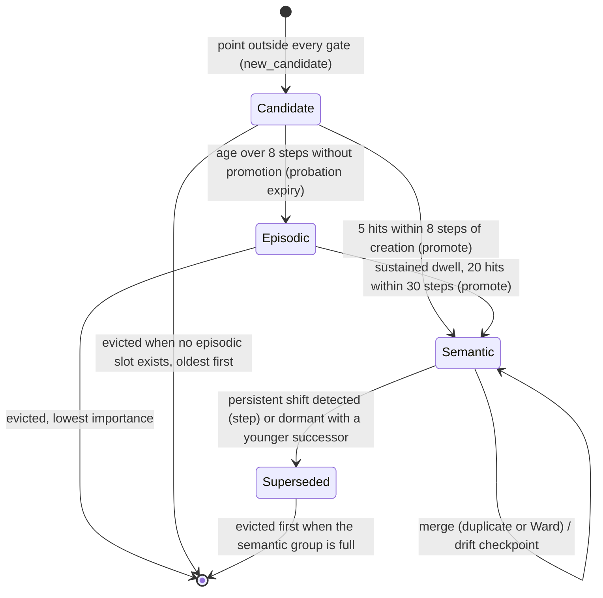

# uEngram explained

Each section has five parts: plain words, why it exists, the math, why this and not the obvious alternative, and where it lives in code. Symbols are defined where they first appear. Everything below describes the code as written, including the deliberate departures from `docs/PLAN.md` listed at the end.

Running example: a pump-and-engine monitor samples six sensors, packs 64 samples into a *window*, and has a few hundred slots of memory to remember "what has this machine been like?" for years.

---

## 1. Windows and channels

### Plain words
A window is one short snapshot of all sensors: a table with one row per sensor and one column per time sample. Everything downstream treats one window as one observation, like one photograph in a photo album.

### Why it exists
Single samples are noise; a vibration spectrum needs dozens of samples to exist at all. The window is the unit that the memory stores, scores, and forgets.

### The math
A window is $X \in \mathbb{R}^{C\times K}$ with $C=6$ channels (`rpm, oil_psi, coolant_temp, vib_x, vib_y, vib_z`) and $K=64$ samples; in-window time is $s_k = k/K$. CMAPSS uses $C=14$ sensors and $K=16$ cycles. A raw window costs $4CK$ bytes in float32 (1536 B on the synthetic stream); that is `raw_window_bytes`.

### Why this and not the obvious alternative
Per-sample memory would store 64x more items for the same information about the machine's *state*, and gives the frequency-domain features (section 2) nothing to work with.

### Where in code
`src/uengram/synth.py:make_window`, `src/uengram/cmapss.py:windows`.

---

## 2. DSP encoder

### Plain words
Instead of remembering raw waveforms, describe each window with a few numbers a mechanic would use: how high is each reading, how much does it wiggle, and how much energy sits in low vs high frequencies.

### Why it exists
The memory needs a compact vector per window so that "is this like something I have seen?" becomes a distance. A hand-built, deterministic encoder needs no training loop on the device and no GPU.

### The math
For each channel $c$ with samples $x_k$: mean $m=\frac1K\sum x_k$; $\log(\mathrm{std}+10^{-6})$; and four log band energies. With $\tilde x=x-m$, power $P_f=|\mathrm{rfft}(\tilde x)_f|^2/K$ for bins $f=1..K/2$, the bins are split into four contiguous equal-count bands $b$ and the feature is $\log(\sum_{f\in b}P_f+10^{-8})$. That is $6C$ features. Each feature is centered by its training median and divided by its IQR/1.349 scale; if that scale is at most $10^{-6}$, its training standard deviation is used instead, floored at $10^{-6}$ for a constant feature. The result is whitened (section 4) to $d=16$ dimensions.

### Why this and not the obvious alternative
Logs make multiplicative changes (vibration doubling) additive, so a Euclidean or Mahalanobis distance treats "2x louder" and "half as loud" symmetrically. Median/IQR standardisation keeps the training anomalies from stretching the scale. Raw FFT bins would give a few-hundred-dimensional vector dominated by whichever band is loudest.

### Where in code
`src/uengram/encoders.py:band_features`, `DSPEncoder`.

---

## 3. CNN encoder

### Plain words
A tiny neural network is taught to squeeze a window into 16 numbers and then rebuild the window from them. Whatever it keeps in those 16 numbers is, by construction, what it needs to rebuild the window.

### Why it exists
It is the learned alternative to section 2, and the architecture doc's proposal. Having both shows that the memory logic does not depend on a particular encoder.

### The math
Per-channel standardisation first: $x\leftarrow (x-\mu_c)/\max(\sigma_c,10^{-6})$ with training statistics. Encoder: `Conv1d(C,32,5,s2)–GELU–Conv1d(32,64,5,s2)–GELU–AdaptiveAvgPool1d(1)–Linear(64,16)`. Decoder: `Linear(16,128)–GELU–Linear(128,CK)`. Loss is the MSE on the standardised input, minimised with AdamW (lr $10^{-3}$, weight decay $10^{-4}$, 30 epochs, batch 128). The 16-d latents are then whitened. No L2 normalisation of the latent (section 14, correction 2). After a successful fit, the encoder restores the prior PyTorch thread count and deterministic-algorithm setting.

### Why this and not the obvious alternative
Per-channel standardisation prevents high-unit channels such as rpm from dominating the reconstruction loss. The MLP decoder (not a transposed convolution) works for any $K$, so the class serves $K=64$ and $K=16$.

### Where in code
`src/uengram/encoder_cnn.py:CNNEncoder`. Torch is imported lazily so the DSP path never needs it.

---

## 3b. Context encoder: predicting transitions from physics

### Plain words
After a speed change the coolant takes a few windows to warm up. A plain encoder sees each warm-up window as "temperature ramping", which never happens in steady running, so it looks like a fault. The context encoder asks instead: "given how fast it was warming a moment ago and what speed we just switched to, how much should it warm now?" Only the surprise in that answer is kept.

### Why it exists
In v1, 35% of normal windows within 4 steps of a regime change were flagged against 0.8% of steady windows, and the only features that moved were the coolant log-std and lowest band. A thermal fault is also a temperature ramp, so without a model the two are confused.

### The math
Fit a line to the coolant samples in each window: ramp $r_t$ = end minus start. Drive $u_t$ = mean rpm. A first-order lag $x_t = x_{t-1} + a\,(T_{eq}(u_t) - x_{t-1})$ with a quadratic equilibrium temperature $T_{eq}$ gives, between consecutive windows,
$$r_t = (1-a)\,r_{t-1} + a\,[T_{eq}(u_t) - T_{eq}(u_{t-1})] = b_0\,r_{t-1} + b_1\,\Delta u + b_2\,\Delta(u^2).$$
Slow wear shifts $T_{eq}$ by the same amount in both windows and cancels. $b$ is fitted by trimmed least squares (6 rounds, keep $|e| < 4\,$MAD) on the training stream. The feature is the residual $e_t = r_t - \hat r_t$, plus the log std of the linearly detrended coolant signal; they replace the channel's six spectral features. Encoding is sequential: if $|e_t|$ exceeds 5 robust scales the window is treated as faulty and does not update the context ramp, which is propagated as $b_0\,r_{t-1}$; the observed drive still advances to $u_t$, so the next prediction uses the actual drive change. Independent windows (`sequential=False`, e.g. the probe set) assume steady state, $\hat r = 0$.

### Why this and not the obvious alternative
Three simpler fits failed on the same data (`docs/IMPROVEMENT-ANALYSIS.md`): one-window least squares was pulled by fault windows (a seizure's 0.3 rpm is a high-leverage point); robust trimming discarded the transitions as outliers and learned "temperature never changes" ($b_0 = 0.99$); a one-window equilibrium model was confounded by wear ($a = 0.019$). The two-window form recovers $a = 0.523$ (truth 0.5) and equilibrium steps 0.234 / 0.141 (truth 0.25 / 0.15) from unlabelled data. This is residual generation by analytical redundancy ([Willsky 1984](https://willsky.lids.mit.edu/publ_pdfs/43_pub_IEEE.pdf); [Isermann](https://link.springer.com/book/10.1007/3-540-30368-5)).

### Where in code
`src/uengram/encoder_ctx.py:ContextEncoder`; selected with `--encoders ctx` in `bench/run_synth.py`.

---

## 4. Whitening and correlated sensors

### Plain words
Two re-measurements. First, rotate and rescale the features so that over all training data each direction has spread 1 and none moves in lock-step with another. Second, do the same for the *jitter inside one operating state*. Sensors that are physically tied together, such as a temperature and a pressure in the same fluid, jitter together. After the second step one physical wobble counts once, not once per sensor, and a change that breaks the usual relationship (temperature up, pressure not) stands out.

### Why it exists
The statistical machinery (chi-square gate, step detector, Bhattacharyya distance, Ward cost) treats the 16 dimensions as independent. If one fluctuation moves several dimensions, a per-dimension distance counts it several times and the gate fires too often.

### The math
PCA whitening: training features $F\in\mathbb{R}^{N\times p}$, mean $m$, covariance $\Sigma=V\Lambda V^\top$, top-$d$ eigenpairs, $y=(F-m)V_d\Lambda_d^{-1/2}$. PCA eigenvalues are floored at $10^{-8}\max(\lambda_{\max},10^{-12})$; noise-covariance eigenvalues are floored at $10^{-12}\max(\nu_{\max},10^{-12})$, so both roots remain finite even when the estimated covariance is all zero.

Noise whitening: estimate the within-state noise covariance $N$ of $y$ robustly from lag differences (section 5) and set $z = y\,N^{-1/2}$ with the symmetric root $N^{-1/2} = U\,\mathrm{diag}(\nu)^{-1/2}\,U^\top$ (minimal rotation). The noise in $z$ is then uncorrelated with unit variance (tested to 0.01), so the diagonal slot statistics count each correlated fluctuation once. This is the noise-adjustment step of the maximum-noise-fraction transform ([Green et al. 1988](https://doi.org/10.1109/36.3001)), applied after PCA so the kept subspace does not change.

Measured on the synthetic stream before this step: noise correlation between dimensions averaged 0.05 (DSP), 0.04 (context) and 0.22 (CNN), leaving 14.1, 14.6 and 7.4 effective independent dimensions of 16. Inside one regime, the per-dimension gate rejected 23 to 39% of normal windows in CNN space versus 0% with a full covariance. After noise whitening, the per-dimension gate rejects at most 0.08% of normal windows in 200-window state blocks (the slots' effective memory) versus 0% with a full per-slot covariance, so slots stay diagonal; a full covariance would cost $d^2 = 256$ numbers per slot for that difference.

### Why this and not the obvious alternative
- *Correlation across states is not noise.* Across operating states temperature and pressure both rise with load. That common cause is carried by the slot means, not the noise model. Estimating correlation from all data would mix the two; differences of consecutive windows cancel the state.
- *Global PCA alone is not enough.* It decorrelates the total spread, which is dominated by differences between states, and leaves within-state noise correlated (the CNN case above).
- *Per-slot full covariances* were measured to add almost nothing after noise whitening, at 16 times the memory.
- On CMAPSS FD001 the 14 sensors carry close to 2 independent signals (82% and 16% of standardised variance; healthy-life levels correlate up to 0.98 across engines, while noise couplings are at most 0.35, between s9 and s14, both core-shaft speed). Summing per-sensor deviations there would overcount the same degradation several times.

### Where in code
`src/uengram/encoders.py:Whitener, NoiseWhitener, fit_projection`; `src/uengram/stats.py:robust_noise_cov`.

---

## 5. Noise scale $\sigma_0$ and noise covariance from successive differences

### Plain words
To decide whether a point is "far", you need to know how jittery a single measurement normally is. Measure that jitter by comparing each window to the one right after it: slow changes (wear, a regime switch) cancel, jitter does not.

### Why it exists
The overall spread of the training data includes regimes (idle vs heavy) and wear, which are *not* noise. Using that spread as a gate would call everything inside the regime-to-regime range normal. $\sigma_0$ is the scale of within-state noise only.

### The math
$\Delta_t=z_{t+\ell}-z_t$ with lag $\ell$ (1 for synthetic; 16 for CMAPSS, so the compared windows do not overlap), restricted to pairs in the same group (the same engine unit). Per dimension $j$:
$$\sigma_{0,j}=\frac{1.4826\;\mathrm{median}|\Delta_j-\mathrm{median}(\Delta_j)|}{\sqrt2}.$$
$1.4826$ turns the median absolute deviation into a standard deviation for Gaussians; $\sqrt2$ because a difference of two independent noises has variance $2\sigma^2$. Floored at $10^{-6}$; fewer than 10 pairs raises.

The full noise covariance generalises this. With $D_t = \Delta_t/\sqrt2$, start from $C = \mathrm{diag}(\sigma_0^2)$ and repeat 5 times: keep the $D_t$ with $D_t^\top C^{-1} D_t \le q$, where $q$ is the $\chi^2_d$ 97.5% quantile, and set $C$ to their covariance times $c = 0.975 / P(\chi^2_{d+2} \le q)$. The factor $c$ undoes the shrinkage caused by trimming a Gaussian at Mahalanobis radius $q$. Tested: a correlated 4-d noise covariance is recovered within 0.08 under state switches every 50 steps and 3% persistent jumps. After noise whitening $\sigma_0 \approx 1$ in every dimension; it is still estimated by the MAD formula and passed to the engine.

### Why this and not the obvious alternative
A plain standard deviation of differences is inflated by every regime switch and anomaly (a handful of huge jumps). The median ignores them as long as they are a minority. Residual bias is small but real: if a fraction $\epsilon$ of differences are huge, the median of $|\Delta|$ moves up to the $0.5/(1-\epsilon)$ quantile of the clean distribution, which inflates the estimate by roughly 4% at $\epsilon=5\%$ and 16% at $\epsilon=10\%$. The test uses 5% persistent jumps and recovers $\sigma$ within 10%.

### Where in code
`src/uengram/stats.py:robust_noise_sigma, robust_noise_cov`.

---

## 6. Memory slots and the state machine

### Plain words
Memory is a fixed number of slots. A brand-new kind of window gets a *candidate* slot on probation. If the same new kind keeps showing up quickly, it becomes a *semantic* slot: a habit ("this is what cruise looks like"). If it does not, it becomes an *episodic* slot: a flashbulb memory of a rare event, kept with its raw window. When a habit goes stale because the machine has moved on (a repair, a new operating mode), it is marked *superseded*: kept for history but no longer used for "what is normal now".

### Why it exists
A fixed memory must treat "routine, seen a million times" and "once, but important" differently, and must not let an old normal pollute the new normal.

### The math
Slot state (struct-of-arrays): mean $\mu\in\mathbb{R}^d$, variance state $S\in\mathbb{R}^d$, count $n$, kind, creation/last-seen times, surprisal, an id, a drift checkpoint $\mu_{ckpt}$, and `superseded_by`. Kinds: 0 empty, 1 candidate, 2 episodic, 3 semantic, 4 superseded. Group budgets: kinds $\{1,2\}\le B_{epi}$ and $\{3,4\}\le B_{sem}$ (defaults 64 and 192).



On a step detection the old slot is superseded and a new semantic slot starts at the current window.

A bounded `lineage` ring (256 entries) records `checkpoint`, `supersede`, `merge` and eviction events, so the history of how the machine's normal moved survives even when the slots that held it are gone.

### Why this and not the obvious alternative
A single pool with a utility score (the doc's design) cannot distinguish "rare" from "stale", so it must either keep stale baselines or drop rare faults. Two budgeted groups give rare events their own protected space.

### Where in code
`src/uengram/engine.py:Engram`, `src/uengram/lifecycle.py`.

---

## 7. Novelty gate: Mahalanobis, the chi-square quantile, the exact tail, surprisal

### Plain words
A new window is compared to each slot, measuring distance in units of that slot's normal wobble. If it is within what a normal wobble would produce 99.99% of the time, it belongs to that slot. Otherwise it is novel. The "surprisal" is how many powers of ten unlikely the window was.

### Why it exists
It replaces a hand-picked "cosine > 0.9" with a threshold that has a meaning: a false-alarm probability.

### The math
For slot $k$ with mean $\mu_k$ and diagonal predictive variance $v_k$:
$$D^2_k=\sum_{j=1}^{d}\frac{(z_j-\mu_{k,j})^2}{v_{k,j}}.$$
For a point from the slot's own Gaussian, $D^2\sim\chi^2_d$. The gate is $D^2_k\le\tau=\chi^2_{d,\mathrm{isf}}(\alpha)$ with $\alpha=10^{-4}$ (`alpha_gate`; $\tau\approx 39.3$ at $\alpha=10^{-3}$ for $d=16$). For even $d$ the survival function is exact:
$$Q\!\left(\tfrac d2,\tfrac x2\right)=e^{-x/2}\sum_{k=0}^{d/2-1}\frac{(x/2)^k}{k!},$$
evaluated in log space. $\tau$ is found by bisection. Surprisal is $-\log_{10}Q$, capped at 300 decades.

The prequential novelty score is $\min_k D_k^2$ over **semantic** slots only, computed *before* the update (over all slots when promotion is disabled, since then no slot is "normal"). Episodic slots still absorb recurring faults, so a repeat knock joins the knock slot and is named by it, but a stored fault no longer makes the next one look familiar. v1 took the minimum over all slots; in the diagnostic (DSP, 3 seeds) this masking held AUROC at 0.64, and scoring against normal states only gave 1.00.

### Why this and not the obvious alternative
Cosine similarity on a sphere ignores magnitude (a 2x anomaly maps to the same point) and has no calibrated threshold. The closed form avoids a scipy dependency and keeps the tail accurate far out, where `1-cdf` underflows to zero and surprisal would be infinite. $d$ must be even; odd $d$ raises.

### Where in code
`src/uengram/stats.py:chi2_logsf, chi2_isf, surprisal`; gate in `src/uengram/engine.py:Engram.ingest`.

---

## 7b. Alarms: a calibrated threshold, separate from absorption

### Plain words
Two questions get two thresholds. "Which memory does this window belong to?" uses the statistical gate. "Should a person be told?" uses an alarm threshold set from a period known to be healthy, so that a chosen share (1%) of healthy windows alarm.

### Why it exists
The gate assumes Gaussian slots. Real score distributions are not exactly $\chi^2$ (transitions, wear, model error), so the gate's nominal false-alarm rate is not the real one. In v1 a flag meant "not absorbed by a semantic slot", which gave 6 to 12% false flags (v1 benchmark, DSP and CNN).

### The math
Split-conformal calibration ([Vovk et al.](https://www.springer.com/gp/book/9780387001524); [Bates et al. 2023](https://arxiv.org/abs/2104.08279)): run a fresh engine over a fault-free commissioning stream (synthetic: 4,000 windows, its own seed, no anomalies, no maintenance), keep its normal-state scores $a_1 \ldots a_m$ after a 200-window warm-up, and set the alarm threshold to the $\lceil(1-\alpha)(m+1)\rceil$-th smallest. For a new normal score exchangeable with the calibration scores, $P(\text{alarm}) \le \alpha$; here $\alpha = 0.01$. Alarm iff score > threshold; a NaN score (no normal state yet) never alarms.

### Why this and not the obvious alternative
Calibrating on the monitored stream itself would include its faults (2 to 3% of windows). With $\alpha = 1\%$ below that contamination rate, the threshold would land inside the fault scores and miss events. A commissioning period declared healthy is how deployments set alarm limits. The guarantee is marginal and assumes exchangeability; wear drift and maintenance break it, so the realised false-flag rate is reported separately for both eras.

### Where in code
`src/uengram/stats.py:conformal_threshold`; `EngramConfig.alarm_threshold`; `bench/common.py:calibrate_alarm`.

---

## 7c. Health: distance from a frozen healthy reference

### Plain words
The memory is built to follow slow wear: "normal" is whatever the machine does now. That is right for deciding what is routine and wrong for asking how far the machine has degraded, because the novelty score stays low while the machine wears out. A copy of the normal states taken while the machine is known to be healthy, frozen and never updated, answers the second question: how far is this window from the nearest healthy state?

### Why it exists
On CMAPSS every engine runs to failure. End-of-life windows are not novel to a memory that has absorbed the degradation of earlier units: v2 novelty separated end-of-life from healthy windows with AUROC 0.59 (both encoders). Distance to a healthy reference separates the same windows with AUROC 0.999 (seed 0, DSP and CNN; all seeds in `docs/RESULTS.md`).

### The math
Run an engine over a commissioning stream (CMAPSS: the first 30 windows of each of the 50 training units, assumed healthy, no labels). Freeze the means $\mu_k$ and predictive variances $v_k$ of up to $B_{ref}=32$ semantic slots with the largest $n$. Health score: $h_t=\min_k \sum_j (z_{tj}-\mu_{kj})^2/v_{kj}$; NaN without a reference. The reference costs $2d\cdot 4$ bytes per state, written once through the ledger.

### Why this and not the obvious alternative
Making the adaptive memory slower does not answer the question: its novelty still measures distance to everything stored, including the late-life states of earlier units (naive kNN novelty: AUROC 0.552, `docs/IMPROVEMENT-ANALYSIS.md` section 5). A supervised health index is as discriminative but needs run-to-failure labels; the frozen reference needs only a period declared healthy, like the alarm calibration (7b).

### Remaining useful life from health
RUL needs labels: a unit's RUL is known only once it has failed. A lookup table fitted offline on run-to-failure data maps health to RUL: 20 bins at the quantiles of $\log h$, each storing the mean $\log h$ and the mean RUL of its fitting windows; prediction interpolates linearly between bin centres and holds the end values outside them. On the device this is 20 pairs (160 bytes) and one interpolation after the health score. On CMAPSS the table is fitted on the stream units' windows, the same labels the memory-lookup RUL uses, and applied to the last window of each test unit (metric `rul_rmse_health`).

The alternative was to keep life-stage resolution inside the memory by storing every drift checkpoint (section 10) as a retrievable item that carries the RUL of the windows absorbed since the previous checkpoint. Measured on seed 0: checkpoints as items gave RMSE 35.5 (DSP) / 39.4 (CNN) with 32 / 46 extra items (5 to 7 KB); the health table gave 25.5 / 26.0 in 160 bytes. Checkpoint items each average a long stretch of life (prediction standard deviation 13.5 / 8.6 against a truth of 41.6), while the table follows the health score (33.6 / 33.4). Checkpoint items would also need RUL labels attached to windows inside the memory, which a device does not have when the windows arrive.

Health is one number, so units that have not yet started to degrade all get similar RUL; a regression on the full deviation vector could separate more (`docs/IMPROVEMENT-ANALYSIS.md` section 5: ridge health index on window mean/slope features, RMSE 18.5), but it is not implemented.

### Where in code
`src/uengram/engine.py:Engram.reference, Engram.set_reference, Engram.health`; `IngestResult.health` in `src/uengram/store.py`; `src/uengram/health.py:HealthRUL`; commissioning and the RUL table fit in `bench/run_cmapss.py:run_one`; metrics `health_auroc`, `health_ap`, `rul_rmse_health`, `rul_mae_health`.

---

## 8. Absorption: exponentially weighted mean/variance, adaptive step, variance shrinkage

### Plain words
When a window fits a slot, the slot nudges its average toward the window. Early on (few windows) the nudge is large, so the average is exact; later the nudge floors at a fixed size, so the slot keeps tracking slow wear instead of freezing.

### Why it exists
Routine windows must cost no flash writes and no new slots, while the slot's idea of "normal" follows slow drift.

### The math
Finch's exponentially weighted update with step $\alpha$:
$$\delta=x-\mu,\quad \mu\leftarrow\mu+\alpha\delta,\quad S\leftarrow(1-\alpha)(S+\alpha\delta^2).$$
With $\alpha=1/n$ this reproduces the batch mean and population variance exactly (tested). Semantic slots use $\alpha_n=\max(1/(n+1),\beta_{min})$ with $\beta_{min}=0.01$: exact early, exponential forgetting with effective memory $\approx 2/\beta_{min}-1$ afterwards. Candidate and episodic slots use $1/(n+1)$.

A slot with $n=1$ has $S=0$, which would make its gate infinitely tight. The gate variance shrinks toward the noise scale with a conjugate prior of $\kappa_0=10$ pseudo-observations:
$$v=\frac{\kappa_0\sigma_0^2+n_{\mathrm{eff}}S}{\kappa_0+n_{\mathrm{eff}}},\qquad n_{\mathrm{eff}}=\min(n,n_{cap})\ \text{(semantic)},\ n\ \text{(otherwise)},$$
$n_{cap}=(2-\beta_{min})/\beta_{min}$. The gate then uses the predictive variance $v(1+1/n_{\mathrm{eff}})$, which adds the uncertainty of the slot's own mean; without it a slot built from two points rejects ~half of its own future points.

### Why this and not the obvious alternative
A fixed EWMA coefficient alongside a mass counter (the doc) is inconsistent: the counter says "exact mean" and the update says "forget". The adaptive step makes both statements true. The ablations `uengram_frozen` ($\beta_{min}=0$, never forgets) and `uengram_fixedvar` (gate always $\sigma_0^2$) show what each buys.

### Where in code
`src/uengram/stats.py:ew_update, shrunk_var`; `src/uengram/engine.py:Engram._absorb, _gate_var, _pred_var`.

---

## 9. M-of-N promotion

### Plain words
One strange window might be a glitch. Five similar strange windows within eight steps is a new operating mode. Like radar: a blip becomes a *track* only after repeated confirmation. A rare-event slot that later turns into a place the machine *stays* (20 hits within 30 windows) is promoted too: operating states persist, fault bursts do not.

### Why it exists
It separates transients (a knock) from regime changes (new normal) with no labels. Transients stay episodic; regime changes become habits and can supersede old ones.

### The math
A candidate created at time $t_0$ is promoted at the first absorb where its last $M=5$ hits fall within $N=8$ steps; it cannot be older than $N$ then, so this is "5 within 8 steps of creation". A candidate still unpromoted when $t-t_0>N$ becomes episodic (probation expiry). An episodic slot is promoted when its last $M_r=20$ hits fall within $N_r=30$ steps (`m_reconfirm`, `n_reconfirm`); the engine keeps a ring of the last 20 hit times per slot. Synthetic regimes dwell about 33 windows (stay probability 0.97); fault events last at most 3 windows, so a back-to-back pair of events cannot reach 20 within 30. Sporadic recurrences 300 steps apart never confirm (tested). On promotion the slot's raw-window pointers are released, since a habit stores statistics, not exemplars.

Both rules were needed. v1's birth-only rule trapped a regime whose first visit was cut short: in one diagnostic seed, normal windows sat in episodic slots of up to 2,088 members and 36% of all windows were flagged. Allowing "5 in 8" at any time instead promoted a burst of two knock events into a normal state, after which knocks were familiar again (DSP AUROC 0.917 on seed 0). The sustained-dwell rule restores 1.000.

### Why this and not the obvious alternative
A single threshold on slot count promotes any slot that eventually accumulates $n$ points, including a once-a-month fault. The time window is what encodes "this is the current state of the machine".

### Where in code
`src/uengram/engine.py:Engram._absorb` (promotion rules) and the probation block in `ingest`.

---

## 10. Consolidation: Bhattacharyya duplicates, drift checkpoints, supersession

### Plain words
Every 200 steps the memory tidies up: it merges slots that turned out to describe the same state, writes a checkpoint when a habit has drifted far from where it was last saved, and retires habits that have been silent for a long time when a newer habit has taken over.

### Why it exists
Early in a stream, a regime can be split across several slots; duplicates waste budget. Slow drift needs an audit trail without a write per step. Without supersession, the pre-maintenance baseline would answer "what is normal now?".

### The math
(a) Duplicates: for diagonal Gaussians with $\bar v=(v_1+v_2)/2$,
$$D_B=\tfrac18\sum_j\frac{(\mu_{1j}-\mu_{2j})^2}{\bar v_j}+\tfrac12\sum_j\ln\frac{\bar v_j}{\sqrt{v_{1j}v_{2j}}}.$$
Merge the closest active semantic pair while $D_B\le 0.5$ (at most 20 per call) using exact mixture moments:
$n=n_1+n_2$, $\mu=(n_1\mu_1+n_2\mu_2)/n$, $\sigma^2=\frac{n_1(\sigma_1^2+\mu_1^2)+n_2(\sigma_2^2+\mu_2^2)}{n}-\mu^2$. The larger-$n$ slot survives.
(b) Drift: if $\|(\mu-\mu_{ckpt})/\sigma_0\|_2\ge\theta=3$, append a lineage `checkpoint`, write once, reset $\mu_{ckpt}=\mu$. A slow ramp of total size $\Delta$ in one direction yields about $\Delta/(\theta\sigma_0)$ checkpoints (4 in the test).
(c) Supersession: an active semantic slot $o$ with $t-t_{last}(o)\ge t_{dormant}$ and at least one active semantic slot $s$ with $t_{created}(s)>t_{last}(o)$ becomes kind 4, pointing at the $s$ with the smallest $D_B$. A dormant slot with no successor stays active, so an idle mode that simply has not occurred for a while is not retired. Supersession also happens immediately when the step detector (section 10b) fires.

### Why this and not the obvious alternative
Bhattacharyya accounts for both mean separation and variance mismatch, so two concentric Gaussians of different width are not called duplicates; plain centroid distance would. Supersession requires a successor, not just silence, to avoid forgetting rare-but-valid modes.

### Where in code
`src/uengram/lifecycle.py:consolidate, merge_slots`; `src/uengram/stats.py:bhattacharyya_diag, bhattacharyya_pairwise, merge_moments`.

---

## 10b. Step detector: recognising a repair or a new regime

### Plain words
A repair shifts the normal readings a little, often by less than the gate's width, so each window alone still "fits". Averaging the deviations of recent windows makes the shift obvious: noise averages out, a persistent shift does not. When the average says "this state moved", the memory starts a new state and retires the old one.

### Why it exists
In v1 the maintenance step (4.6 to 10 noise units, gate radius 6.8) was absorbed gradually, so the pre-maintenance baseline kept answering "what is normal now" (`stale_at1` 0.61 with DSP).

### The math
For each semantic slot, on every absorbed window: standardised innovation $e_t=(z_t-\mu)/\sqrt{v}$ (predictive variance, before the update), multivariate EWMA $Z_t=\lambda e_t+(1-\lambda)Z_{t-1}$, statistic $T^2=\frac{2-\lambda}{\lambda}\lVert Z_t\rVert^2$ ([Lowry et al. 1992](https://doi.org/10.1080/00401706.1992.10485232)). With no change and innovations independent in time, $e$ has unit-variance components (section 4) and $T^2$ is approximately $\chi^2_d$; section 10c restores this when the encoder's noise is correlated in time. Alarm when $T^2 > \chi^2_{d,\mathrm{isf}}(10^{-6}) = 58.3$ and the slot has $n \ge 2/\lambda$. $\lambda = 0.1$. Simulated in 16-d: about 1 false alarm per $10^6$ windows; median delay 8, 4 and 3 windows for persistent 3, 5 and 8 sigma shifts; a decaying transition ramp (6, 3, 1.5, 0.75 sigma) never alarms. On alarm: make room in the semantic group, start a new semantic slot at the current window (variance prior copied from the old slot), and supersede the old slot (lineage `supersede` with cause `step`, event `("supersede", old, new)`).

### Why this and not the obvious alternative
A per-dimension CUSUM needs a known shift direction and 32 one-sided charts whose false alarms add up; Crosier's multivariate CUSUM needs simulated thresholds. The MEWMA statistic is direction-free with an approximately $\chi^2$ threshold. A faster EWMA step ($\beta_{\min}$) would chase a repair over about $1/\beta$ windows instead of recognising it, and blur the before/after states.

### Where in code
`src/uengram/engine.py:Engram._step_detected`, `src/uengram/lifecycle.py:split_on_step`; ablation `uengram_nostep`.

---

## 10c. Calibrating the step detector to correlated noise

### Plain words
The step detector averages the last ~19 deviations of a state and assumes they are independent, so that noise averages out. When the encoder's noise is correlated in time (overlapping windows, slow transients), it does not average out, and the detector reads ordinary fluctuations as repairs. The engine measures once, on training data, how much more an average of the real noise varies than an average of independent noise, and shrinks the detector's input by that factor.

### Why it exists
CMAPSS windows of 16 cycles at stride 1 share 15 of their 16 cycles. On the 50 stream units the v2 engine fired 493 (DSP) and 356 (CNN) step changes (seed 0). Each one superseded a state; superseded slots are the first evicted when the semantic group is full, and the record of end-of-life windows went with them: end-of-life retention 0.40 (DSP) and 0.46 (CNN). On the synthetic stream the CNN latent superseded 155 states in 20,000 windows (DSP: 5).

### The math
For an EWMA $y_t=\lambda z_t+(1-\lambda)y_{t-1}$ of independent samples, $\mathrm{Var}(y)=\frac{\lambda}{2-\lambda}\mathrm{Var}(z)$. Correlation in time multiplies this by the inflation
$$f_j=\frac{\mathrm{Var}(y_j)}{\frac{\lambda}{2-\lambda}\mathrm{Var}(z_j)}.$$
For AR(1) wander with coefficient $\rho$ and variance $\tau^2$ on top of unit white noise, $f=\bigl(1+\tau^2\tfrac{1+a}{1-a}\bigr)/(1+\tau^2)$ with $a=\rho(1-\lambda)$, i.e. 5.3 for $\rho=0.9$, $\tau=1$. Estimation on the encoder's training latents: cut the sequence wherever a lag-1 difference has Mahalanobis $D^2>\chi^2_{d,\mathrm{isf}}(10^{-3})$ under the robust noise covariance (state switches, steps, fault onsets); restart the EWMA in each segment and skip its first $b=(2-\lambda)/\lambda=19$ samples; estimate both variances from robust lag-$2b$ differences within segments (section 5). The engine feeds $e_{tj}/\sqrt{\max(f_j,1)}$ to the MEWMA and keeps the threshold $\chi^2_{d,\mathrm{isf}}(10^{-6})$. Measured medians: CMAPSS DSP 6.6, CNN 2.5; synthetic DSP 0.96, ctx 1.00, CNN 1.19. Seed 0 effect on CMAPSS: 2 (DSP) and 6 (CNN) step changes, end-of-life retention 1.00 for both, 85% fewer writes.

### Why this and not the obvious alternative
- *Track wear with a level-plus-rate Kalman filter* (the first hypothesis: wear outruns a slot it visits only part of the time, and the lag looks like a step). Rates estimated from intermittent visits were weak, the rate uncertainty widened the gates of stale states, and faults hid behind them (context-encoder AUROC 1.00 to 0.82, seed 0). Learning the process noise from squared innovations ran away in one dimension (DSP: up to 600 times what its drift needs). A lag-feedback gain on the EW step took CNN supersessions only from 155 to 115. The CNN latent's slow motion inside one regime was not wear: its 25-window block means move 3 to 4 times the noise floor and back, with a path 3 to 10 times the net displacement.
- *A long-lag noise scale* ($\sigma$ at lag 19 over $\sigma_0$) under-corrects: for AR(1) at $\rho=0.9$, $\tau=1$ it gives a variance ratio of 1.9 where the inflation is 5.3, and leaves 18 to 57 false steps per 2,000 windows.
- *Unsegmented estimation.* Synthetic regimes last 24 windows (median), so 54% of lag-38 pairs straddle a switch and the MAD breaks down. $f$ came out 7 to 10 on the regime dimensions, and the first supersession after maintenance moved from 29 to 92 windows (DSP).
- *A lower `step_alpha`* rescales every dimension alike, whatever its correlation.

### Limits
On the synthetic stream the CNN still supersedes 101 states (seed 0, from 155). The cause is the coolant transient after each regime switch, which the CNN latent encodes at hundreds of noise units: $D^2$ between successive windows is 562, 166, 68 and 21 at 1, 2, 3 and 5 windows after a switch, while switches themselves are about 21,000. No label-free segmentation threshold separates those cases, and skipping a slot's first windows after re-entry only reached 120. The fix belongs in the encoder: the context encoder (section 3b) predicts the transient, and its successive-window $D^2$ after a switch is 16, the noise level.

On CMAPSS the false steps had been doing useful work for RUL lookup: they cut each degradation run into short segments, so a recalled item carried a narrow RUL range (seed 0: within-item RUL standard deviation 3.3 to 4.0 cycles over 193 items). Calibrated, the memory tracks degradation as drift of 9 to 17 states, each spanning nearly the whole life, and RUL lookup falls to the constant-prediction RMSE (42; v2 21 to 23). RUL now comes from the health score through a lookup table (section 7c); storing drift checkpoints as retrievable items was measured and rejected there.

### Where in code
`src/uengram/stats.py:ewma_inflation, _segments`; `Engram(step_inflation=...)`, `Engram._step_detected`; `bench/common.py:measure_step_inflation`, called by `bench/run_synth.py` and `bench/run_cmapss.py`.

---

## 11. Eviction: Ward cost and episodic importance

### Plain words
When a group is full, something must go. For habits, merge the two that are closest and least different in weight, losing the least detail. For flashbulb memories, drop the least surprising, least repeated, most faded one.

### Why it exists
A hard budget is the point. The policy decides what the budget remembers.

### The math
Semantic group full: evict the oldest superseded slot if any; otherwise Ward-merge the cheapest active pair, with cost
$$\frac{n_in_j}{n_i+n_j}\sum_k\frac{(\mu_{ik}-\mu_{jk})^2}{\sigma_{0,k}^2}.$$
This is exactly the increase in total within-cluster variance caused by the merge, so greedy Ward merging keeps the stored mixture closest to the data it summarises. Episodic group full: evict the kind-2 slot with the lowest
$$\text{importance}=\text{surprisal}\cdot(1+\ln n)\cdot2^{-(t-t_{last})/h_{epi}}$$
($h_{epi}=20000$); if there is no episodic slot, evict the oldest candidate.

The surprisal used here is the slot's **rarity** at creation: $-\log_{10}$ of the $\chi^2_d$ tail at the distance to the nearest stored slot of *any* kind. It is deliberately not the alarm score, which is measured against normal states only (section 7). A pattern that keeps recurring (a regime transition seen through the CNN encoder) is far from normal but close to its own earlier copies, so it ranks below a unique event such as a seizure. With the alarm score in this role, CNN transition candidates tied seizures at the 300-decade cap, and the older seizures were evicted: seizure recall was 0 versus 1.0 with rarity (seed 0, `docs/IMPROVEMENT-ANALYSIS.md` follow-up; regression test `test_unique_event_outlives_recurring_novelties_when_budget_overflows`).

### Why this and not the obvious alternative
The doc's density-based utility `mean(max(sim,0))·log1p(mass)` has no stated objective. Ward cost is the standard minimum-variance clustering criterion. Keeping the episodic and semantic budgets separate means a flood of routine states can never evict a seizure.

### Where in code
`src/uengram/lifecycle.py:make_semantic_room, make_episodic_room`; `src/uengram/stats.py:ward_cost_pairwise`.

---

## 12. Retrieval as a log-posterior

### Plain words
"Which memory best explains this window right now?" Score each slot by how well it fits, plus how much prior reason there is to believe it: how many windows it summarises and how recently it was seen.

### Why it exists
Retrieval should answer "what state is the machine in now" (current mode) or "has anything like this ever happened" (history mode), with one scoring rule rather than a hand-weighted sum.

### The math
Per slot, $\ell=-\tfrac12\big(D^2(q)+\sum_j\ln v_j\big)$ (Gaussian log-likelihood up to a constant). Current mode considers kinds 1-3 and adds a log-prior: semantic $\ln n-\ln2\cdot(t_{now}-t_{last})/h$ ($h=2000$ steps half-life), episodic/candidate $\ln n+\ln(1+\text{surprisal})$. History mode adds kind 4 and no prior. Ties go to the lower id.

### Why this and not the obvious alternative
The doc's `0.6·cos + 0.2·decay + 0.2·severity` adds three numbers with unrelated units, so the weights are meaningless and cannot be tuned except by trial. A log-posterior composes: likelihood and prior are in the same unit (nats).

### Where in code
`src/uengram/engine.py:Engram.recall`.

---

## 13. Write ledger

### Plain words
Flash memory wears out with writes. The ledger counts writes the same way for every method: direct writes count immediately, in-RAM state counts when it is flushed.

### Why it exists
"Zero flash writes" for RAM-only updates is optimistic: on power loss that state is gone. A fair comparison must charge for persistence.

### The math
`write_now(id, bytes)`: writes+1. `mark_dirty(id, bytes)`: remembers the latest dirty size for the id (overwrites). `delete(id)`: writes+1 with a 16-byte tombstone, drops the id from the dirty set. `tick(t)`: when $(t+1)\bmod F=0$ ($F=50$) writes += number of dirty ids, bytes += their sizes, then clears. So a slot updated every step costs at most $T/F$ writes, not $T$.

### Why this and not the obvious alternative
Counting only "appends" makes an in-place EWMA free; counting every update makes it cost one write per step. Periodic flush is how a real device behaves and charges every method under the same rule. Percent write reduction is reported against $T$ writes (one per window).

### Where in code
`src/uengram/ledger.py:WriteLedger`.

---

## 14. Baselines and the ten corrections to the doc's engine

### Plain words
Four comparison points: remember everything (naive), remember the last $B$ (FIFO), remember a uniform random $B$ (reservoir), and the architecture doc's own engine ported as written.

### Why it exists
Claims about a memory need something to lose to and something to beat. Naive has unbounded memory and is the quality ceiling for retrieval; FIFO is what a firmware ring buffer does; reservoir is the fair-sampling baseline; the doc's engine is the proposal being tested.

### The math (reservoir)
Algorithm R: item $t\ge B$ replaces a uniform slot with probability $B/(t+1)$. Every index ends up in the sample with probability $B/T$ (tested). Point stores use squared Euclidean distance; their novelty score is the minimum squared distance to stored items.

### Why these and not others
A kNN over everything is the standard way to detect novelty offline; beating it with $B=256$ is not the claim, matching it with a fraction of the storage is.

### The ten corrections (decisions used in this repository)
1. **Label leakage.** The doc derives severity from ground truth (`0.9 if labels[t]==2`). Here severity is surprisal from the chi-square tail and stores never see labels. The `reference_oracle` variant keeps the leak and is labelled non-deployable.
2. **Sphere.** Projecting onto the unit sphere throws away magnitude; the covariance there is singular in the radial direction. We work in whitened Euclidean $\mathbb{R}^d$.
3. **Inconsistent forgetting.** Fixed EWMA $\beta$ plus a mass counter contradict each other; use $\alpha_n=\max(1/n,\beta_{min})$.
4. **Arbitrary thresholds.** Cosine 0.90/0.75 become chi-square quantile gates on a calibrated noise scale.
5. **Mixed-scale utility.** `0.6·cos+0.2·decay+0.2·sev` becomes a log-posterior.
6. **Ad hoc density.** Replace it with Ward merge cost and partitioned budgets.
7. **No transient/regime distinction.** Add M-of-N confirmation.
8. **Free RAM writes.** All stores share one ledger that flushes dirty state periodically.
9. **Unscaled CNN input.** Standardise per channel first.
10. **Single seed, oracle severity.** Ten seeds, label-free stores, bootstrap CIs and paired differences.

### Where in code
`src/uengram/baselines.py`, `src/uengram/reference_baseline.py` (header comment: port of the doc's engine, logic unchanged apart from ledger accounting, ids, and unit-normalising its input).

---

## 15. Metrics and statistics

### Plain words
Detection is graded by how well the novelty score separates anomalies from normal windows. Retention is graded by whether the memory still holds the rare events afterwards. Distribution fidelity is graded by how well the stored items, taken together, look like the data they summarise. Everything is repeated over seeds and reported with a confidence interval.

### Why it exists
One run can win by luck. Anomalies are rare (a few percent), so accuracy-style numbers would reward "never flag anything".

### The math
**AUROC** is the probability a random anomaly outscores a random normal window: $(R_{pos}-n_{pos}(n_{pos}+1)/2)/(n_{pos}n_{neg})$ with average ranks for ties. It does not depend on the class ratio. **Average precision** is $\sum_k(R_k-R_{k-1})P_k$; it falls when many normal windows outrank anomalies, so it is the number that reflects the cost of false alarms under imbalance. Report both.

**Mixture MMD.** Squared maximum mean discrepancy with the RBF kernel $k(x,y)=e^{-\|x-y\|^2/2h^2}$ between two weighted diagonal-Gaussian mixtures is exact:
$$\mathbb{E}\,k=\prod_j\Big(\tfrac{h^2}{h^2+v_{1j}+v_{2j}}\Big)^{1/2}\exp\!\Big(-\sum_j\frac{(\mu_{1j}-\mu_{2j})^2}{2(h^2+v_{1j}+v_{2j})}\Big),$$
so uEngram's slots can be compared as Gaussians with their variances, and point stores as variance-0 point masses. The bandwidth $h$ is the median pairwise distance of the last 2000 embeddings, shared by all methods within a (seed, encoder). `mmd2_current` compares items active in the last 2000 steps to the last 2000 embeddings; `mmd2_history` compares all items to a uniform 2000-point subsample. The Reference engine stores unit-sphere centroids that live in a different space, so these are reported as n/a for it.

**Bootstrap.** Percentile bootstrap of the mean over seeds (2000 resamples, 95%). Paired differences resample seed indices jointly, so a seed that is hard for every method does not widen the CI of the difference. A `*` means the CI excludes 0. With 5-10 seeds, CIs are wide; treat them as indications, not proofs.

**Alarms and supersession.** `false_flag_rate_era0/era1` is the share of normal windows that alarm before and after maintenance, to compare with the calibrated $\alpha = 0.01$. `supersede_delay_maint` is the number of windows from maintenance until the first supersession of a slot that received windows in the 200 windows before maintenance (NaN if that never happens); supersessions of unrelated dormant slots do not count. `results/v1/` keeps the first benchmark; the report pairs uEngram v1 and v2 on the same seeds.

### Why this and not the obvious alternative
Accuracy/F1 alone hides the imbalance; plain MSE between centroids ignores spread; a normal-approximation CI on 10 seeds is unreliable for bounded metrics like recall.

### Where in code
`src/uengram/metrics.py`, `bench/evaluate.py`, `bench/report.py`.

---

## 16. Real-data benchmark: MetroPT-3 protocol (fixed before any result)

### Plain words
Synthetic data and the simulated CMAPSS engines cannot show that the memory works on a real machine. MetroPT-3 is seven months of logs from the air compressor of a metro train in Porto, with four reported air-leak intervals. The original protocol was committed in `434eea3` before any detection result. Its first smoke stopped during training-only calibration; the amendment below resolves that failure before examining failure-month scores. Splits, labels, methods and P1–P3 are not tuned to test outcomes.

### Data and windows
[MetroPT-3](https://archive.ics.uci.edu/dataset/791/metropt+3+dataset), 1 Feb to 1 Sep 2020, the 7 analog channels (TP2, TP3, H1, DV pressure, reservoirs, oil temperature, motor current) at about one sample per 10 s. The 8 binary valve channels are excluded: they are often constant within a window (zero spread) and mostly mirror the pressures and current. Windows are 60 samples (about 10 minutes), non-overlapping, and never span a logging gap longer than 60 s: 25,126 windows in 291 gap-free segments. Samples are treated as equally spaced (spacing 8 to 13 s).

### Splits
- Encoder fit and frozen healthy reference (section 7c): windows ending before 22 Feb. Step calibration uses only these commissioning windows, as specified in the amendment below.
- Alarm calibration: windows wholly within 22 Feb to 1 Mar. Every method's threshold is the split-conformal quantile at $\alpha=0.01$ of calibration scores after a 200-window warm-up (250 for Half-Space Trees), without failure labels. Calibration and test use separate fresh model states; MemStream's fitted encoder and initial memory are shared by independent clones.
- Test stream: 1 Mar to 1 Sep, 21,556 windows.

### Labels
A window is positive when it overlaps one of the four reported air-leak intervals (144, 41, 287 and 27 windows). It is a clean negative when it lies outside every [report start − 24 h, report end + 48 h]: a leak develops before it is reported and persists until repaired. Other windows are not scored. Maintenance times in the published table are inconsistent (the second report's maintenance date precedes it) and are not used.

### Methods
All methods see the same encoded windows (16-d latents; encoders `dsp` and `cnn`, seeds 0 to 4). DSP encoding is deterministic; its repetitions exercise stochastic reservoir, HST and MemStream baselines and do not create independent machines. Item stores use B = 256 (uEngram 192 + 64). This is not a byte-equated comparison with trees or neural-network memory.
- `naive`, `fifo`, `reservoir`, `reference_labelfree`, `uengram`, `uengram_frozen` as in the other benchmarks; uEngram with the measured step inflation and the frozen reference.
- Half-Space Trees ([Tan et al. 2011](https://www.ijcai.org/Proceedings/11/Papers/254.pdf), River implementation): River defaults (10 trees, height 8, window 250), feature limits = per-dimension min and max of the encoder-fit latents, score then learn on every window.
- MemStream ([Bhatia et al. 2022](https://arxiv.org/abs/2106.03837)), a port of the reference `memstream.py`: autoencoder Linear(16, 32) + tanh / Linear(32, 16) trained for 5,000 full-batch Adam steps (learning rate 0.01, input noise 0.001) on the first 256 encoder-fit windows, memory of 256 encodings initialised from them, score = minimum L1 distance to the memory, first-in-first-out memory update when score ≤ β. The reference picks β per dataset from labelled results; here β is the 99th percentile of the calibration-week scores against the initial memory, without updates.
- DenStream is not included: River's implementation clusters but gives no outlier score, and any score would be an invented rule.

### Metrics
- Window AUROC and AP of each method's score, positives against clean negatives; for uEngram also of the health score.
- Failure detected: at least one alarm window overlaps its report interval. Signed lead time uses the window's **end**, when the alert becomes available: first alert in [report start − 24 h, report end], relative to report start. Negative means earlier. An early alert is an association, not proof of predicting the leak; it does not by itself satisfy report-overlap detection.
- False-alarm episodes: alerts outside the buffered report intervals, merged when strictly less than 1 h apart, per week of observed clean-negative window time. Unreported windows are not independently verified healthy. Missing scores and HST's 250-window test warm-up are excluded from both scoring and observed exposure; logging gaps are not counted as observed uptime.
- Retention (stores): failures represented by at least one absorbed window's provenance in a live item at stream end. This does not prove that a raw fault exemplar survives or that a query retrieves it.
- Footprint and cost: live items, modelled persistent index/raw bytes and writes, ingest latency p99. HST/MemStream persistence and retention are n/a, not zero-cost detectors. MemStream's raw/encoded memory and encoder parameter bytes are recorded separately. Python RAM, encoder energy, real flash endurance and communication cost are not measured.

### Pass criteria (uEngram, `dsp` encoder)
P1: all 4 failures detected. P2: at most 1 false-alarm episode per week. P3: all 4 failures retained at the end of the stream. The same numbers are reported for the `cnn` encoder and every baseline. A difference between methods counts only when its paired 95% bootstrap CI over seeds excludes 0; with the deterministic `dsp` encoder most methods do not vary with the seed, so `dsp` comparisons are single runs.

### Pre-test amendment: commissioning innovation calibration
The raw-latent estimator in section 10c requires warmed-up lag-38 pairs inside uninterrupted state runs. Training-only diagnosis found 2,658 fit windows in 26 logging segments, but abrupt-change segmentation produced 1,000 runs, longest 36: there are no valid lag-38 pairs. Assuming inflation 1 would conceal missing evidence. For this benchmark only, collect the actual standardized semantic-slot innovations in visit order from a commissioning engine, with step splits held off during the declared-healthy fit. Each item identity has its own sequence; merges and logging gaps restart it. Apply an EWMA with the engine's $\lambda=0.1$, skip its first $\lceil(2-\lambda)/\lambda\rceil=19$ visits, and pool the remaining vectors $Y$. Estimate $f_j=\frac{2-\lambda}{\lambda}[1.4826\,\mathrm{median}(|Y_j|)]^2$. This directly measures the null EWMA scale relative to unit independent innovations, without subtracting a persistent commissioning bias or requiring long raw-state dwells. The engine still clamps $f_j$ below at 1. Fit each uEngram variant separately; fewer than 10 warmed-up samples is an error. The original synthetic and CMAPSS calibration paths remain unchanged.

This empirical variance match does **not** prove a $\chi^2$ sequential false-alarm rate under arbitrary dependence or non-Gaussian noise. The alarm calibration's exchangeability condition is also unverified. P2 therefore measures the actual reported-interval false-alarm burden rather than asserting a nominal guarantee.

Average precision now groups equal scores at one threshold. A constant score must have AP equal to prevalence, independent of label order; the earlier implementation did not. Historical synthetic/CMAPSS JSONL files are retained as originally generated and have not been recomputed for this correction. MetroPT uses the corrected metric.

### Where in code
`src/uengram/metropt.py` (download, cache, windows, labels), `src/uengram/stream_baselines.py` (Half-Space Trees, MemStream), `bench/metropt_calibration.py` (commissioning step calibration), `bench/metropt_eval.py` (window, event and false-alarm metrics), `bench/run_metropt.py` (splits, threshold calibration, streaming), `bench/report.py` (MetroPT tables and P1–P3).

---

## Deviations from `docs/PLAN.md`

- **Gate priority and predictive variance.** The plan chose the absorbing slot by minimum Gaussian NLL among all in-gate slots using the slot variance. Two defects appeared in the plan's engine tests: an episodic slot born from a tail point drifts to the nominal cluster and then captures roughly a third of routine points (flagged fraction 0.31 instead of $\le0.01$); and a slot with $n=1$ rejects a third of its own future points because its gate ignores the uncertainty of its mean (the sporadic-recurrence test passed for 12 of 20 seeds). Fixes: in-gate semantic slots take priority over episodic/candidate slots, and the gate uses $v(1+1/n_{\mathrm{eff}})$. After both, engine tests 3 and 4 pass for 20/20 seeds.
- **`alpha_gate = 1e-4`**, per the plan's contingency (era-0 false-flag rate was 0.068 at $10^{-3}$ and 0.030 at $10^{-4}$ in the quick run).
- **Provenance order.** The harness records a window under its item id before applying the ingest's merge/evict events, not after. An id merged away at the end of the same ingest (consolidation) would otherwise leave a ghost record. Ids are never reused, so the order is otherwise equivalent.
- **Noise-sigma test** uses persistent level jumps rather than isolated spikes: an isolated spike contaminates two successive differences, so the 5% rate gives 10% contamination and the MAD is biased 16% high, outside the 10% tolerance. Persistent jumps contaminate one difference each.
- The architecture notes now live at `docs/EdgeAIMemoryArchitecture.md`.

### v2 changes (after `docs/IMPROVEMENT-ANALYSIS.md`)

- Novelty scored against semantic slots only (section 7).
- Alarm threshold separated from the absorption gate and set by conformal calibration on a fault-free commissioning run (section 7b).
- Two-tier promotion: 5-of-8 probation for candidates, 20-of-30 sustained dwell for episodic slots (section 9).
- MEWMA step detector with immediate supersession (section 10b).
- Context encoder with a learned thermal-lag residual (section 3b).
- Robust full noise-covariance whitening in every encoder (section 4); the encoder test now pins "noise covariance = I" instead of "total covariance = I".
- `synth.generate(anomalies=False, maint_frac>=1)` provides the fault-free commissioning stream.

### v3 changes

- Step detector input scaled by the measured EWMA variance inflation of the encoder's training latents (section 10c).
- Frozen healthy reference and health score; CMAPSS commissioning from the first 30 windows of each training unit (section 7c).
- RUL from the health score through a 20-bin lookup table fitted on run-to-failure data (section 7c); drift checkpoints as retrievable RUL items were measured and rejected.
- Level-plus-rate Kalman wear tracking (`docs/IMPROVEMENT-ANALYSIS.md` item 9), learned process noise and a lag-feedback gain were implemented, measured and removed (section 10c).

## 17. Alarm-policy confirmation (protocol v2)

### Scope and decision, frozen before confirmation scores

MetroPT-3 has already been consumed by section 16 and is **development data**, not another held-out success claim. All alarm-policy development iterations, including counter/eligibility corrections and rejection of unavailable score channels, are recorded in `results/v2_dev.json`. `results/v2_development.jsonl` compares the final policies on all five development seeds. The source/protocol commit preceding `results/v2_metropt2.jsonl` and `results/v2_care.jsonl` is the freeze boundary. No policy, encoder, split, or acceptance criterion may be selected from those confirmation outcomes.

Decision: confirm **DSP on MetroPT2** and **tabular whitening on CARE**. CNN2 is implemented and trained, but is not the selected encoder: its five GPU seeds detect only 1–3 of the four development reports under the transferred policy, versus 3/4 for DSP. Passing a representation diagnostic is not evidence of useful fault detection. No best-seed selection or additional CNN alarm tuning is used.

### Alarm design and machine snapshots

An alarm is a decision about an abnormal condition requiring a response, not a complete state description. [ISA guidance](https://www.isa.org/intech-home/2019/january-february/features/applying-alarm-management) distinguishes alarms from advisory alerts, recommends state-dependent settings where necessary, and links contextual information to an alarm. Here the inputs are pressure, temperature, current, digital load state and recent history. A snapshot records the evidence for a decision; it does not establish a fault's cause.

`src/uengram/alarm.py` separates novelty, frozen-reference health, new-state advisories, and actionable episodes:

- Compressor state: loaded share of `DV_eletric`, with edges 0.05 and 0.4. Idle/offloaded, cycling and sustained load have separate calibration distributions when at least 100 eligible calibration windows exist; otherwise use the pooled distribution.
- The conformal order statistic is rank `ceil((1-alpha)*(n+1))`. It is infinite if that rank exceeds `n`; state-level support counts are reported, not silently called sufficient. A run with no finite threshold for any enabled channel fails calibration rather than reporting an all-quiet detector.
- Persistence is a capped up/down counter: increment on an exceedance, decrement by one otherwise, cap at `k`. It is not necessarily `k` consecutive exceedances. Disabled channels stay at zero. An alarm closes when both counters return to zero; an arbitrarily long deviation does not produce an arbitrarily long off-delay.
- A new memory candidate becomes an advisory when trusted health does not corroborate it. `health_needs_baseline` prevents judging an unknown operating state against an unrelated healthy state. Logging gaps pause counters and produce no observed alarm output, not an inference that the machine is healthy.
- Optional ACI changes the novelty quantile level only on eligible, inactive, healthy-looking observations. This gated, label-free score adaptation has **no demonstrated guarantee on fault false-alarm rates**, excluded windows, or event recall. uEngram's selected configuration does not use it.

Every observed episode has a frame archive: two preceding input windows, the opening window, and up to two subsequently observed windows. Missing context remains explicitly missing; context never crosses a logging segment. Post-context is collected only after it arrives and never affects the alarm decision. Archives contain model-input values, time bounds, state, thresholds, memory action, peak scores, feature deviations, and, for uEngram, the frozen reference and nearest reference index. Deviations are associations, not causal explanations.

`bench/freeze_frames.py` writes complete NPZ evidence under `~/.local/state/uengram/evidence`; each run records its path, SHA-256 and measured bytes. JSON previews contain at most 50 episodes, but the archive contains all episodes. These are decimated model inputs, not every native 1 Hz channel or a complete physical machine state. Evidence storage and the Python episode/advisory histories are **outside** the engine's 256-item memory budget; no end-to-end bounded-RAM or flash-endurance claim is made.

### Development selection and frozen configurations

For each method, sweep the grid in `bench/alarm_dev.py` on MetroPT-3, seed 0. First retain at most 1 false-alarm episode per clean observed week **and** at most 2% clean observed time in alarm. Maximize detected events; tie-break by smaller total persistence, fewer false alarms, fewer optional components, then larger alpha. Unsupported health-only baseline configurations are invalid, not zero-alarm successes. Five-seed evaluation follows selection; it is not used to pick a favorable seed.

| method | alpha | novelty k | health k | per-state | new-state advisory | ACI gamma | health needs own baseline |
|---|---:|---:|---:|---|---|---:|---|
| uEngram | 0.003 | 3 | 0 | yes | yes | 0 | yes |
| Half-Space Trees | 0.01 | 2 | 0 | no | no | 0.005 | no |
| MemStream | 0.01 | 3 | 0 | no | no | 0.005 | no |

These settings are in `bench/run_v2.py:FROZEN`. Health remains a diagnostic even though no selected policy uses it as a direct alarm branch. Advisory volume is reported separately and together with alarm openings: lowering critical alarm counts by relabeling notifications is **not** evidence of lower operator workload.

Each detector runs continuously into test, with no test-time restart. uEngram/HST ingest commissioning; uEngram's healthy reference freezes at its end. MemStream retains its section-16 initialization/training on the first 256 commissioning latents, then continues through calibration and test. All policies for a detector evaluate identical cached scores. The comparator `v1_rule` is novelty above the pooled alpha=0.01 calibration threshold, with persistence 1 and no advisory veto. It is a policy ablation on v2's continuous stream, **not a rerun of section 16's reset-at-test protocol**.

### Fresh confirmation datasets and preprocessing

**MetroPT2:** [Zenodo 7766691](https://doi.org/10.5281/zenodo.7766691), CC BY 4.0. `dataset_train.csv` (January–June 2022) and `MetroPT2.csv` (April–July 2022) are distinct recordings with different values at equal times. Their physical-machine independence is unverified; they must not be presented as two independently identified machines.

- Retain the first observation in each 10-second bin, using its measurement time to whole seconds, not the earlier bin start. Use the seven section-16 analog channels and the same digital state channels; do not mix the files' differently scaled Flowmeter values.
- January file: fit before January 22; calibrate January 22–29; test January 29 onward. Three reported failures: February 28–March 1, March 23, May 30–June 2, from [Veloso et al., Table 2](https://doi.org/10.1038/s41597-022-01877-3).
- April file: fit before May 19; calibrate May 19–26; test May 26 onward. Two failures and their LPS warning times are from [Jakobs, Veloso and Gama, Table 1](https://arxiv.org/abs/2502.07394): June 4 and July 11–14. Exact timestamps live in `src/uengram/metropt2.py`.
- Windows have 60 samples and do not cross logging gaps over 60 seconds. No detector tuning uses these test windows.
- Run uEngram once (deterministic DSP), HST and MemStream for seeds 0–4, for each recording. Compare both policies on each run.

**CARE to Compare:** [dataset version 15846963](https://doi.org/10.5281/zenodo.15846963), CC BY-SA 4.0; [Gück, Roelofs and Faulstich](https://arxiv.org/abs/2404.10320). All 95 event datasets, 36 assets and three farms are attempted. Models are separate per dataset; asset identities group uncertainty estimates, not encoder inputs.

**Post-confirmation count correction:** the frozen prose stated 44 anomaly
and 51 normal labels. The supplied `event_info.csv` tables actually contain
45 anomaly and 50 normal labels. No dataset was added, dropped or relabeled;
all 95 predefined datasets were attempted, and scoring used their supplied
labels throughout. `results/v2_confirmation_manifest.json` records the
per-farm counts and source-table hashes. This corrects descriptive prose,
not the registered cohort, model, thresholds or scoring rule.

- Use 10-minute averages, drop counters, map angles to sin/cos, retain missing values for commissioning-median imputation, drop commissioning-constant features, and fit robust scaling/PCA/noise whitening on commissioning only. CARE provides aggregates, not compressor waveforms; it uses `TabularEncoder`, not a fabricated CNN waveform input.
- Respect supplied train/prediction partitions. Calibration is the final 28 days of training; commissioning is earlier status-0 training rows. No event label, asset ID, timestamp or status ID is a sensor feature.
- **Test statuses are evaluation-only.** Farm A status labels use fault logs, including the preceding 14 days; using them to suppress runtime alarms would leak future fault information. Every observed prediction row advances the policy regardless of those retrospective labels. Only training statuses split noise-estimation runs. The metric mask cannot change prediction or persistence.
- Status 0 filters calibration and CARE scoring, following the reference-package convention used here. The paper's table also considers idle status 2 normal, so this is an explicit status-0 benchmark variant, not an identical reproduction of every published preprocessing choice. The code port is checked against the [reference event scorer](https://github.com/AEFDI/EnergyFaultDetector/blob/main/energy_fault_detector/evaluation/care_score.py); MIT attribution is retained.
- A prediction is available at the supplied row time; 600 seconds per row is nominal exposure accounting, not an independently verified vendor timestamp convention. Event membership uses the exact row timestamp, not interval overlap.
- Run uEngram, HST and MemStream with seed 0 on all 95 datasets. CARE uncertainty is across assets, not training seeds. No direct comparison of anomaly prevalence, sampling rate or physical units with MetroPT2 is claimed.

### Metrics, acceptance and failure handling

Retain section-16 buffered clean negatives and signed lead-time convention: positive lead means late. Count alarm **openings** on eligible clean windows, merging openings strictly less than one hour apart; continuing alarms contribute to duration-weighted clean alarm time, not additional openings. Exclude missing scores and logging gaps from observed exposure. Report advisory episodes, combined clean operator-event rate, and notifications per all observed week (including true faults and non-normal CARE statuses). This last rate does not require retrospective labels.

MetroPT2 primary criteria, separately per recording: **Q1** every reported event has an eligible alarm; **Q2** at most 1 false-alarm episode per clean observed week and at most 2% clean time in alarm; **Q3** every event survives in live provenance. Where published LPS times exist, **Q4** at least two hours' warning before every LPS warning. Provenance is neither raw-exemplar survival nor successful retrieval; report each criterion independently.

CARE reports the four sub-scores, their CARE aggregate, criticality detections (threshold 72), normal datasets flagged and observed alarm/notification burden. CIs use 2,000 asset-cluster bootstrap draws within farms, seed 12345; an asset's datasets remain together. Reject draws missing either class. Paired v2-minus-v1-rule CIs use the same draws. These are exploratory intervals without multiplicity correction or inference to unseen farms.

Numerical/quantile calibration failure is a failed run with its reason, never an implicit independence assumption or an all-quiet fallback. The runner finishes other tasks and exits nonzero. A CARE method missing any dataset has no aggregate score or CI; missing results are not silently removed to improve performance.

Secondary MetroPT2 analysis: parked share at least 0.9 using the fixed published parking/workshop polygons, stationary GPS and valid GPS quality. Compare loaded duty with a pooled commissioning/calibration parked-window alpha=0.01 threshold, persistence 3. Exposure is parked observed time, not all operating time. This is not a primary pass criterion: parked does not prove zero pneumatic demand, and a proper leak test still requires isolation/known demand and physical confirmation.

### CNN2 training, diagnostics and compute

`CNN2Encoder`: 24 epochs maximum, batch 128, five members, early-stopping patience 5, final chronological 15% of commissioning for validation. Shift/jitter views use NT-Xent plus auxiliary phase-invariant sensor statistics; no amplitude scaling augmentation. Select the member with greatest mean linear CKA and retain only that network for inference. State channels are optional, but the development state-conditioned candidate failed noise-covariance estimation and is rejected, not repaired with fabricated noise. After a successful fit, it restores the prior PyTorch thread count and deterministic-algorithm setting.

The provisional label-free gate requires finite validation loss, mean member CKA at least 0.98, minimum CKA at least 0.95, median noise/spread at most 1, and calibration outside-fit-range fraction at most 0.01. These development choices do not guarantee stable event detection, as the five-seed result demonstrates. Covariance trimming without enough inliers fails explicitly. DSP remains selected regardless of favorable individual CNN seeds.

`bench/colab_train.py` prepares label-free input archives and trains on the available device. It records input fingerprints, versions, gate results and timing, exports embeddings and a CPU-device checkpoint, and leaves authentication/resource allocation to Colab CLI. Only upload authorized data. Set `CUBLAS_WORKSPACE_CONFIG=:4096:8` before CUDA initialization; do not disable deterministic-algorithm errors to get a run through. See [PyTorch reproducibility guidance](https://docs.pytorch.org/docs/stable/notes/randomness.html). Never unpickle an untrusted checkpoint.

Colab CLI was exercised on a requested T4: five warmed fits took 17.4–18.2 seconds each; a fresh-session reusable-utility fit took 26.0 seconds. The measured full-size CPU fit was 68.4 seconds. These are observed fit times, not controlled same-framework hardware benchmarks or end-to-end upload/startup savings (cloud PyTorch 2.11/CUDA versus local PyTorch 2.14 CPU). The exported model was loaded on CPU and its 64-window inference compared with GPU embeddings. Both GPU sessions were terminated after artifact retrieval. Diagnostics and timing evidence are in `results/encoder_v2_gate.json`.

Confirmation commands: `python -m bench.run_v2 --streams metropt2 --methods uengram:dsp,hst:dsp,memstream:dsp --seeds 0-4 --jobs 2 --out results/v2_metropt2.jsonl`; `python -m bench.run_v2 --streams care --methods uengram:tab,hst:tab,memstream:tab --seeds 0 --jobs 2 --out results/v2_care.jsonl`. `python -m bench.report` regenerates the tables while retaining handwritten findings.

Required file layout: `data/metropt2/dataset_train.csv`, `data/metropt2/MetroPT2.csv`, and `data/care/CARE_To_Compare.zip`. Large data/cache directories may be symlinked to a data volume; scratch scores and evidence are not committed. Delete or change the cache directory when changing the encoder/scoring implementation: fingerprints identify inputs, not arbitrary future code revisions.

## 18. Exploratory follow-up: normalization, physical residuals and native evidence

All three compressor recordings have already been inspected. These runs are
development/exploratory replays, not independent confirmation. The v2 result
files and frozen alarm configurations remain unchanged. Fixing a measurement
or representation defect is not, by itself, proof of improved fault warning.

### Normal numerical experiments

- CNN3 reuses CNN2's architecture, objective, 24-epoch maximum, five members
  and chronological validation split. Both ablations use only commissioning
  prefix statistics. `range` divides by the larger of the IQR-derived scale
  and `(healthy maximum - healthy minimum) / 6`; `state` estimates IQR scales
  by observed duty bin, with that same full-range floor. The global center
  remains fixed, preserving absolute level shifts. A valid unseen duty bin
  uses the global scale without asserting healthy-state support. No clipping
  of out-of-range faults is performed. This range floor is a heuristic,
  not an estimate of physical sensor noise.
- Train both modes on each recording's own commissioning period, seeds 0–4,
  with COMP/DV_eletric/MPG conditioning. Exclude LPS and other equipment
  warning outputs from predictive inputs. Report raw-latent spectrum/rank,
  cross-member agreement, numerical failures and downstream metrics. The old
  CKA gate is diagnostic; high agreement is not an acceptance certificate.
- Physical marginal and conditional-ridge baselines use loaded pressure
  recovery, unloaded pressure decay, duty, oil-temperature rate, current and
  compressor-to-panel pressure difference. Slopes use actual decimated
  observation times and same-phase adjacent samples. Unsupported phase
  slopes remain missing. Fit coefficients and residual scales on commissioning
  only. Starting pressure, prior duty, controls and parked share where
  available are **demand proxies**, not measured customer air demand.
  A leak can itself affect these proxies, so conditioning can hide faults.
- Evaluate physical score thresholds at alpha 0.01/0.003, persistence
  1/3/6 and global/per-state calibration. Compare the frozen policy with
  no-veto and no-veto-plus-health variants on identical DSP/CNN scores.
  A separate DSP/physical union uses alpha 0.005 per channel and persistence
  1/3/6. Do not silently search further settings after looking at replay
  outcomes.
- Decision labels distinguish unobserved, in-reference, unresolved and alarm.
  A new candidate or unsupported state is not declared benign. Unresolved
  states do not count as detected faults; their workload is reported
  separately. In-reference does not certify physical health.
- Retain event detection, lead, false alarms per observed clean week and
  clean alarm-time share. Add window sensitivity, specificity, precision,
  F1 and balanced accuracy on the existing eligible labeled population.
  Do not advertise plain accuracy dominated by normal observations.

Select only on MetroPT3, with all five CNN seeds present: each seed must
detect at least one event, have at most one false-alarm episode per clean
week and at most 2% clean alarm time. Rank by mean events detected, worst
normalized alarm burden, balanced accuracy and then lower complexity.
Seed ranges describe encoder variation, not independent-machine confidence
intervals. Apply the identical selected configuration to both MetroPT2
recordings without tuning there; preserve outside-budget tradeoffs.

### Native-source snapshots

The original recorder preserves decimated model inputs, not all native
measurements. The new recorder scans the original CSV once for requested
same-segment context, retaining every observed source column and timestamp,
raw cell strings, source row indices/hashes and a complete-file SHA-256.
It does not interpolate missing rows or invent sensors. Original fractional
timestamps and the rounded model timestamp are both retained.

Identify the precise native observation corresponding to the last model
sample. Causal and post-decision context are separate; post-context becomes
available later and never feeds the decision. Missing matches, unsupported
time precision, gaps and clipped context are explicit. Published-report
diagnostic snapshots are labeled separately from actual predicted alarms.
These are observations of instrumented channels, not complete physical
machine states. Sensor timestamps also do not establish server receipt
time: the [dataset paper](https://pmc.ncbi.nlm.nih.gov/articles/PMC9747912/)
describes five-minute GSM transfers, whose latency is not measured here.

### Jev as a separately evaluated advisory layer

Freeze normal result-file and selected-trace hashes before sending machine
cases to Jev. The typed advisor receives only current/prior causal evidence,
numerical residuals/scores, calibration support and missingness; no fault
labels, report dates/IDs, absolute timestamps, file/asset identifiers,
future context or direct LPS/oil-level warning outputs. Candidate entry and
at most hourly reassessment define a cascade; it cannot recover faults
with no candidate evidence. Thresholds and prompt/schema are fixed before
advisory outcomes, not fitted to these consumed reports.

Compare whole-timeline event misses, false escalations, clean alarm time
and operator burden against the same frozen baseline. Preserve unavailable
responses explicitly, report request coverage/latency, and distinguish
conservative baseline preservation from advisory-only classification.
Probability calibration against coarse report intervals is exploratory,
not a safety guarantee. No equipment control is connected to this advisor.

Use the documented [OpenRouter Decisions API](https://openrouter.ai/docs/guides/community/jev)
(`POST /api/alpha/decisions`) or [TypeSafe API](https://docs.typesafe.ai/introduction), not chat completions
or the distinct Jev Router product. Schema-constrained output does not
guarantee correct diagnoses or calibration on industrial data. Missing
credentials, account credits or actual responses block empirical Jev
results; do not replace them with heuristics or fabricate scores.


### Laya comparison and hp inference

Laya is a separate open-weight model, not an accessible substitute result
for Jev. This experiment uses the English base checkpoint of
[`convaiinnovations/laya`](https://huggingface.co/convaiinnovations/laya),
with Laya 0.4.13, the same typed questions and a preregistered candidate
cascade. It does not use the poker-specific `leduc` checkpoint.
Compressor summaries are out of domain; model probabilities are not
established diagnostic probabilities.

`results/v3_laya_preregistration.json` freezes the model-file hashes,
causal state format, questions and rule before machine-case responses.
An elevation requires the `review` choice, its probability at least 0.80
and the TypeSafe Choice confidence formula at least 0.50; Laya's separate
confidence fields are descriptive only. Invalid or truncated answers are
unavailable, never healthy. Whole-timeline metrics compare the baseline,
baseline-preserving elevations and advisory-only classifications with
baseline preservation during unavailable assessments.

The first answers were computed on msi. Remaining inference runs on hp;
msi prepares requests and stores the answers through an SSH local forward.
hp uses four inference threads and RAM-backed `/tmp/laya-hp`, with the
server bound only to loopback. This is temporary hosting, not a runit
service: a reboot removes its environment and checkpoint cache.
The hp addendum records a different repository revision identifier but
byte-identical checkpoint files. Its 120-pair cross-host check found zero
probability differences and zero thresholded decision flips. Each merged
assessment records its host; existing msi answers take precedence.

```bash
# Optional Laya environment; torch resolves from the CPU-only index.
uv sync --extra cnn --extra baselines --extra laya

# Existing English laya-serve instance on hp, localhost:8000.
ssh -N -o ExitOnForwardFailure=yes -o ServerAliveInterval=30 \
  -L 127.0.0.1:18001:127.0.0.1:8000 hp

# In another terminal; reuse existing preregistrations and cached answers.
uv run python -u -m bench.laya_hosts run
uv run python -u -m bench.laya_hosts build
uv run python -u -m bench.advisory_report
```

The runner stops on an unavailable health endpoint or changed English
revision. Restore the same server/tunnel and rerun `run` to reuse cached
answers; do not overwrite preregistrations to bypass drift checks.
`build` verifies frozen code/baseline hashes and writes raw
`results/v3_laya.jsonl` and `results/v3_laya_summary.json` without new
inference. Use `bench.advisory_report` for the evaluated outputs
`results/v3_laya_evaluated.jsonl` and `results/v3_laya_evaluated_summary.json`:
the frozen scorer's notification field omitted baseline policy alerts.
The supplemental report replays existing numerical score caches, verifies
the frozen scores, thresholds, decision states and alarm flags, and restores
the original `alerts | opened` notification definition. Numerical alerts
remain visible in both advisory interpretations; assessment requests are
reported separately. This is an explicit post-answer reporting correction,
not a changed model, prompt or escalation rule.

Host-health checks are periodic rather than cryptographic per-response
attestations. The hp process remains controlled and startup-configured;
there is no documented model-reload API. Brier/ECE describe coarse
report-interval labels on selected candidate assessments, not calibration
for a deployed safety system. These consumed recordings remain exploratory,
not fresh confirmation.

### Domain dataset readiness (v4, no training)

Audited seven public candidates against the question: is there an
independent, compressor-semantics-matched, asset-disjoint cohort with
verified pointwise physical-fault labels, usable to fine-tune and then
evaluate Laya without reusing consumed data? **No.** MetroPT-3 and
MetroPT-2 are already consumed; their report intervals are company
maintenance proxies, not adjudicated pointwise fault truth, and asset
independence across recordings is unverified. The IIT Kanpur air
compressor set is lab-seeded, acoustic-only, and a single machine. The
Mendeley rotating-machine and SKAB sets are different equipment (bearing
testbench; water-pump loop), not air compressors. The SCANIA APS and
Component X sets are a different system and an anonymized component with
no established compressor identity. Full source citations, license
status (CC BY 4.0, GPL-3.0, or unverified) and the per-candidate blockers
are in `results/v4_dataset_audit.json`.

`bench/domain_dataset.py` exports development-only, weak report-association
examples from the already-frozen MetroPT traces, reusing the unchanged
Laya state builder and causal schedule. A candidate window is labelled
`reported_fault` only if fully inside a published report interval, and
`outside_report_buffer` only if the current, previous and every
strictly-prior reference window `StateBuilder` would use are all outside
the existing 24h-before/48h-after exclusion margins. A window whose
report overlap is partial, or whose context falls inside those margins
without full containment, is excluded rather than guessed. Identical
serialized inputs across streams deduplicate to one row; an identical
input with conflicting labels is dropped entirely, not resolved by
precedence. Every row has exactly `{state, questions, expected}`,
matching Laya's documented fine-tuning schema; all identifiers, trace
hashes, timestamps and dependency indices live only in a separate
`provenance.jsonl`, keyed by the same input hash. The question text
itself states this is a weak report-association proxy, not a verified
physical-health or operator-review judgment.

```bash
uv run python -m bench.domain_dataset \
  --freeze results/v3_normal_freeze.json \
  --out-dir ~/.local/state/uengram/domain_dataset \
  --manifest results/v4_domain_dataset_manifest.json
```

The run produced 2,503 distinct inference inputs (176 `reported_fault`,
2,327 `outside_report_buffer`), zero duplicate-conflict drops, and zero
truncated requests when checked against Laya's own tokenizer and
`items_from_rows` loader (`laya.evals.Dataset`, `laya.train.to_internal`).
`results/v4_domain_dataset_manifest.json` records
`independent_evaluation_eligible: false` and `production_ready: false`
with the exact missing prerequisites: independent asset-disjoint data,
adjudicated pointwise labels, and an untouched preregistered evaluation
split. This dataset is for weak-supervision development only; it does
not support a validated accuracy claim, and nothing here retrains or
changes the frozen Laya evaluation in `results/v3_laya_evaluated.jsonl`.

### v4: why no AlarmConfig closes the MetroPT3 recall/clean-time gap

A dedicated mechanism study (`docs/research-alarm-tradeoff.md`) replays the
frozen novelty/health scores through `AlarmPolicy` under 30+ configurations
to explain, not just report, the v2/v3 tradeoff above: detecting July 15's
air leak requires trusting the health channel for an unbaselined operating
state (`health_needs_baseline=False`) AND enabling its persistence counter
(`k_health>0`) together, an AND-gate rather than an additive effect; the
originally named "no-veto" fix (`new_state_alert=False`) is not the active
mechanism once the health channel is open. No single parameter, and no
explored 3-parameter grid, closes `alarm_time_share_clean` to the 2%
budget while keeping all 4 events detected. Harness: `bench/alarm_sensitivity.py`.

### v5: a per-modality two-condition alarm does not close it either

`docs/research-two-condition-alarm.md` replaces the pooled distance with
two conditions. Condition A: at least `m` modalities are in error. These are
physical channels with label-free conformal thresholds, plus a
sustained-load duty modality. Condition B: A has held for `k_hold`
consecutive windows (`bench/modality_alarm.py`).

None of 159 MetroPT3 configurations meets the budget. The reason is the
duty modality's run lengths, not a threshold:

- One healthy sustained-load run (309 windows) is longer than every event
  run, and five more are longer than the two short event runs.
- With `m=1`, detecting all 4 events forces `k_hold <= 41`, which means at
  least 3.05% clean alarm time.
- Reaching 2% forces `k_hold >= 78`, which loses July 15.

A closed form of the duty-only alarm matches the harness exactly. The
fallback-selected configuration (4/4, 0.32 false alarms per week, 3.11%)
was replayed unchanged on MetroPT2 and detected 0/3 and 0/2 events:

- Those failures happen while the compressor idles or cycles, so windows
  without loaded samples break the condition-A run before 40 windows.
- On the judgeable event windows, the physical channels were nearly always
  in error.

### v6: the actual alarm, gated by threshold-crossing errors

`docs/research-error-gated-alarm.md` keeps `AlarmPolicy` unchanged as the
alarm measure. It adds `A(t) = P(t) AND [at least m errors seen within the
last L hours]` (`bench/error_gated_alarm.py`).

The errors are the threshold crossings the MetroPT documentation defines:
`LPS` (pressure below 7 bar), `Oil_level` (oil below expected; healthy
value taken from calibration) and TP3 below 7 bar. The v5 calibrated
per-channel crossings are a comparison family.

On MetroPT3:

- The gate can only remove alarm time. All 1512 gated rows confirm this,
  though false alarms can rise when an error flickers.
- The May 29-30 failure has no dataset-defined error from 24 h before it
  to its end, so no dataset-gated alarm reaches 4/4. The best that meets
  both alarm budgets detects 3/4 (1.97% clean time, 0.21 false alarms per
  week).
- Calibrated crossings meet the full budget: 4/4, 1.06%, 0.95 false alarms
  per week. But those thresholds never fire in sustained load, which has no
  calibration baseline. A pure "idle or cycling within 6 h" gate gives 4/4
  at 1.25%, so the effect is mostly operating-state recency.

Replayed unchanged on MetroPT2, both selections detect nothing, because the
policy itself never opens there. Inside the Jan events the frozen scores
cross no threshold, while the dataset errors cover both Apr events and 0%
of clean windows.

### v7: what causes an alarm, defined and checked

`docs/research-alarm-definition.md` defines an alarm from ISA-18.2 /
IEC 62682 and from the published MetroPT practice (Jakobs et al. 2025:
threshold, then a low-pass persistence filter, then 0.5, which is an
exact 5-slice on/off-delay). An alarm needs all of:

- a valid window;
- a uEngram setpoint crossing;
- corroboration by at least m independent errors seen in the last L hours,
  voted three-valued (an unknown error is not a normal one);
- that corroborated crossing persisting through the on-delay;
- clearing only through the off-delay.

An independent audit reproduced every uEngram step exactly: conformal
setpoints, persistence counters, metrics and scoring causality. A second
independent implementation reproduced the v7 rows and per-event traces
exactly.

Corrections: a uEngram error with unknown evidence holds the counters,
instead of counting as normal. This removes the v6 recency artifact. v8
made the rule an exact Kleene AND: no error lowers the counter even when
the evidence is unknown. Persistence applies to the combined condition,
LPS and TP3 < 7 bar are one vote, and early warnings are reported
positive.

On MetroPT3, no configuration meets the budget. Within both alarm budgets,
the best rows reach 2/4 with dataset corroboration and 3/4 with the
calibrated crossings.

The per-event trace shows the cause. uEngram crosses its setpoint before
the May 29-30 and June 5-7 reports, but not for three windows in a row,
and dataset errors either never occur (May 29-30) or arrive 34 h into the
report (June 5-7). On MetroPT2, uEngram never crosses inside the April
events, although the oil-level error precedes both LPS warnings by 3.0 h
and 59.4 h.

### v8: how each component behaves, and why

`docs/research-alarm-components.md` profiles every component by operating
state, derives the false-alarm arithmetic exactly, and crosses eight
components in a 1,728-alarm factorial on MetroPT3. The components are α,
the health channel, the setpoint for a state without a reference, the
new-state veto, the persistence filter and its length, corroboration and
staleness.

- **The air leaks' signature is the operating state.** 492 of 495 event
  windows are sustained load, a state uEngram never saw before the test (0
  commissioning windows). So 87% of healthy sustained-load windows exceed
  the health setpoint.
- **Within sustained load, the scores carry no early warning.** AUROC,
  clean vs the 24 h before a report: health 0.07, novelty 0.35.
- **Exceedances cluster in time.** P(exceed | exceeded) = 0.30 vs 0.009
  otherwise. A two-state Markov model predicts 0.80 false alarms per week
  against 0.74 observed, while independence predicts 0.002. That is also
  why the filter type (counter, ISA timers, m-of-n, EWMA) barely matters.
- **No combination reaches 4/4 within budget.** Jul 15 is caught only by
  trusting health in sustained load, which costs at least 2.53% of healthy
  time. Commissioning sustained load online removes that catch, so it was
  the state, not the leak, being detected.

Fixes: Kleene corroboration (provably only removes alarm time), four
three-valued filters, veto-hold, unknown/online-commissioned states,
staleness, physically conditioned errors, an episode-based early-warning
metric, and a three-valued v5 hold. The v5 hold fix exposes calibration
drift that the old run reset had hidden. Every default reproduces the
earlier results byte for byte. Independent implementations reproduced the
v8 rows, the clustering arithmetic and the corrected v7 rows exactly.

### v9: independent SCANIA validation and the opt-in OR rule

The v9 remediation adds `AlarmLogic(combine="or", error_k=3)` as an opt-in
policy. It preserves the existing AND behavior when no evidence array is
provided, and it can independently persist a real external evidence stream
when one is supplied. A no-evidence OR run is required to match AND exactly.

The selected fresh dataset is SCANIA Component X, a 23,550-vehicle truck
component fleet with workshop-repair proximity labels. The frozen split uses
healthy training vehicles for commissioning and calibration and leaves the
validation vehicles untouched. Because SCANIA labels only the final readout's
relative time-to-repair class, evaluation uses each vehicle's final observed
row; it does not claim lead hours or false alarms per week.

On 5,046 validation vehicles, the AND/control alarmed 978 final rows, with a
19.287% class-0 alarm rate and 22.794% recall over classes 1–4. The
predeclared missingness tripwire in the OR run alarmed 1,049 final rows, with
20.713% class-0 alarm rate and 23.529% recall. The no-evidence OR control
matched AND exactly. SCANIA has no independent physical alarm channel, so this
OR evidence is a data-quality tripwire, not an independent component-failure
signal. Full protocol, integrity checks, metrics, and independent
recomputation: `docs/validation-scania-protocol.md` and
`docs/research-scania-validation.md`.
