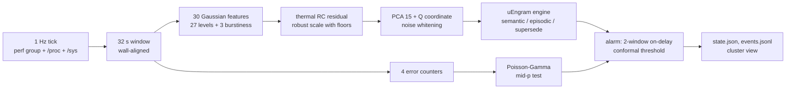

# uEngram for running Linux hosts (the Void cluster)

`src/uengram/host/` turns each node of the cluster (msi, hp, asus, lenovo, gigabyte) into a uEngram stream: a 1 Hz snapshot of the machine, 32-second windows, a whitened 16-d latent, and the unchanged uEngram engine (`engine.py`, `lifecycle.py`) as the node's memory. Research notes: `docs/research-host-state.md` (snapshot accuracy, PMU, RAPL, PSI, thermal, prior art). This page records every modelling decision, including where the proposal in `BuildinguEngramforVoidLinuxCluster.md` was changed and why.

## 1. Pipeline



## 2. The snapshot

| decision | reason |
|---|---|
| 1 Hz tick at wall second + 0.5 | coretemp caches the sensor for 1 s (`coretemp.c`: `last_updated + HZ`); `/proc/stat` CPU time has 10 ms (USER_HZ) granularity, so a 100 ms tick has ±10 % per CPU; RAPL updates every ~1 ms. Windows start at multiples of 32 s of wall time, 0.5 s away from every tick, so chrony offsets never move a tick into another window and nodes share window boundaries. |
| rates use the measured CLOCK_MONOTONIC interval | a late tick has a longer `dt`, not a wrong rate |
| counters are differenced, gauges are read | `/proc/stat`, `vmstat`, `diskstats`, `net/dev`, `snmp`, PSI `total`, RAPL energy, perf counts, throttle counts are counters; `MemAvailable` and temperature are gauges |
| RAPL unwrapped at `max_energy_range_uj`; other negative deltas = reset → null | |
| only `package-*` RAPL domains | core/uncore/dram are nested inside the package; `psys` (hp) covers the platform |
| `/proc/stat` total excludes guest, guest_nice | they are already counted in user, nice |
| only whole devices with a `device` link; only NICs with a `device` link | partitions, loop, zram, dm and lo/bridges would count the same bytes twice |
| `core_throttle_count` deduplicated per physical core, `package_throttle_count` per package | every SMT sibling exposes the same core counter |
| one perf group per CPU: cycles (leader), instructions, ref-cycles, branch-misses, cache-misses | a group is scheduled as a unit, so ratios inside it are co-temporal. Three fixed + three programmable counters fit even where the NMI watchdog holds fixed counter 1 (4 of 5 nodes), so nothing is multiplexed. `ref-cycles` can only use fixed counter 2: a second system-wide group that needs it (a second collector, `perf stat -a`) makes the two alternate at ~50 % each (observed: `pmu_running` 0.499), and the counts become scaled estimates. Below 25 % running in any tick of a window the PMU attributes of that window are missing, not wrong. |
| read time and collector CPU time recorded per tick | measured over ~1 h on all five nodes: 0.07–0.23 % of one core, 0.5–2 ms to read every source (p50); see §7 |
| collector is stdlib-only | workers have no numpy; recording needs only `python3` |

Privilege: system-wide counters need `perf_event_paranoid <= 0` or `CAP_PERFMON`, and RAPL `energy_uj` is root-only since CVE-2020-8694. The proposal's `sysctl kernel.perf_event_paranoid=1` is not enough: level 1 still forbids CPU-wide events for unprivileged users (`perf-security.rst`). The service runs as `kk` with exactly `CAP_PERFMON` and `CAP_DAC_READ_SEARCH`, granted by `setpriv` from runit; no sysctl changes.

## 3. Attributes: one owner, one modality, one statistical model

`schema.py` is the single source. Each measured field is *owned* by exactly one attribute; `schema.validate()` rejects a second owner, and `tests/test_host_schema.py` checks numerically that no feature is a function of the others (the Jacobian of the 30 Gaussian features with respect to all 32 x 34 (tick, field) inputs has full rank).

| modality | attribute | window rule | why this math |
|---|---|---|---|
| compute | cpu_busy | asin √(Σbusy/Σtotal) | fraction; angular transform stabilises binomial variance and is defined at 0 and 1 (logit is not) |
| compute | cpu_sys_share | asin √(Σsys/Σbusy) | kernel share of busy time |
| compute | cpu_pressure | asin √(ΣPSI cpu some µs / Σdt) | USE saturation; `total` deltas, not the smoothed `avg10` |
| compute | ctx_switch_rate, fork_rate | log1p(Σcount/Σdt) | non-negative rates that can be 0 |
| compute | ipc, freq_ratio, branch_mpki, llc_mpki | log(Σnum/Σden) | ratio of window sums; a mean of per-tick ratios is biased by near-idle ticks (Jensen) |
| memory | mem_used | asin √(mean gauge) | |
| memory | mem_pressure | asin √(PSI memory some) | |
| memory | page_scan, major_faults, swap_out | log1p(Σcount) | activity counts whose size and dependence on load matter |
| storage | disk_read_bps, disk_write_bps, disk_read_iops, disk_write_iops | log1p rate | |
| storage | disk_queue | log1p(Σweighted ms / Σdt ms) | Little's L, defined at zero I/O (latency is not) |
| storage | disk_busy | asin √(mean of per-tick max io_ticks/dt) | busiest device; saturates early on parallel devices |
| storage | io_pressure | asin √(PSI io some) | includes NFS waits |
| network | net_rx_bps, net_tx_bps, net_rx_pps, net_tx_pps | log1p rate | bytes and packets are independent (mean packet size varies) |
| network | tcp_retrans | log1p(Σcount) | depends on traffic, so it stays in the conditional (Gaussian) model |
| power_thermal | pkg_power | log(ΣJ/Σdt) | |
| power_thermal | thermal_residual | T̄_w − RC prediction | see §4 |
| compute / storage / network | cpu_busy.burst, disk_bytes.burst, net_bytes.burst | log(1.4826·MAD(Δs)/√2) | see §4 |
| memory / storage / network / power_thermal | oom_kills, disk_errors (SCSI command timeouts), net_faults, throttle_events | raw count → exact tail test | see §4 |

Not attributes (all are in `schema.EXCLUDED` with the reason): loadavg and PSI averages (pre-smoothed), PSI full lines (≤ some; CPU full is 0 by definition system-wide), `/proc/pressure/irq`, iowait (documented as unreliable), interrupt counts, procs_running/blocked (instantaneous), `scaling_cur_freq` and APERF/MPERF (= freq_ratio), ref-cycles rate (= busy), instructions per second (log ips = log ipc + log freq_ratio + log busy + const), cache-references, top-down slots (do not fit the counters with the NMI watchdog), uncore DRAM bandwidth (≈ llc_mpki·ips·64 B), nested RAPL domains, raw and per-core temperatures (explained by power, §4), fan/battery (on 1–2 nodes only), pswpin (also counted by pgmajfault), pgsteal, MemFree/Cached/SwapFree, disk latency and request size (Little's law and byte identities), TCP In/OutSegs, C-state residency, and SCSI `ioerr_cnt`. The last one was measured and rejected: it counts every command that completed with an error, including management pass-through, so smartd's 30-minute SMART poll adds one per disk on every node (observed at exactly 1800 s spacing on asus, lenovo, gigabyte), and media polling of msi's empty card reader added 0.47 per second. `disk_errors` therefore counts command timeouts (`iotmo_cnt`) on fixed disks, and a removable device without a medium is left out of all disk statistics. Media errors that fail fast without a timeout are not covered; smartd already reports those.

## 4. Is the mathematics applicable? Decisions per signal

1. **Error counters are not Gaussian.** OOM kills, SCSI I/O errors, NIC errors/drops and thermal throttles are zero in almost every window. Their robust variance is 0: in a Gaussian latent a single event is either invisible (one noise unit among 30 features) or infinitely surprising (scale 0). They get an exact test instead: Poisson rate with Jeffreys prior Gamma(½, 0), posterior frozen at commissioning, predictive negative binomial r = s + ½, q = n/(n+1), upper-tail mid-p `I_{1-q}(k+1, r) + P(X=k)/2` (`events.py`). After a day without OOM kills (n = 2700 windows) one OOM kill has p ≈ 9e-5.
2. **Periodogram band energies assume a stationary window.** Host activity is step-like; one job start inside a window gives a 1/f² spectrum whatever the process does, so uEngram's DSP band features would describe where the step fell. Each activity series gets one robust burstiness feature instead, the MAD of tick-to-tick differences, which one step barely moves (test: a 50x step changes it by < 0.2, real fluctuation by > 2). In the DSP encoder the log std is also a Parseval function of the band energies, i.e. a duplicate.
3. **Temperature is mostly a function of power.** A one-pole RC model `C dT/dt = P − (T − T_amb)/R` with power constant within a window gives exactly, for window means,
   $$\bar T_w = \rho\,\bar T_{w-1} + (1-g)R\,P_w + (g-\rho)R\,P_{w-1} + (1-\rho)T_{amb},\quad \rho = e^{-K/\tau},\ g = \tfrac{\tau}{K}(1-\rho),$$
   so `T_w = c0 + c1 T_{w-1} + c2 P_w + c3 P_{w-1}` with steady-state gain `(c2+c3)/(1−c1) = R`. It is fitted by trimmed least squares and only the residual enters the state (a hot window whose residual exceeds 5 robust scales is not used as context for the next one). Raw temperature would duplicate pkg_power; the residual is what power does not explain: cooling, dust, ambient. The fit also reports τ, R (°C/W) and T_amb per node. Test: τ, R, T_amb recovered within 5 %, 2 %, 0.3 °C.
4. **A channel that never moved during commissioning is invisible to PCA alone.** Its training variance is 0, so it gets no loading. The latent is 15 PCA coordinates plus one coordinate for the squared prediction error Q = ‖x − x̂‖² of the discarded subspace (Jackson & Mudholkar 1979), taken as √Q and robustly standardised. √Q is linear in the deviation, like the PCA coordinates, so D² grows with the square of a deviation in either subspace (√(2Q/g) ≈ N(√(2h−1), 1) under the null, Fisher; the threshold is conformal, so the null shape matters little). The first version used the cube root (Wilson–Hilferty, closer to Gaussian under the null), which grows D² only as deviation^(2/3) and so under-weights exactly the never-seen channels this coordinate exists for. Test: page scanning that never happened during commissioning moves the latent by > 5 noise units.
5. **Zero-inflated features break noise whitening.** Their difference-based noise variance is 0, so whitening would amplify them without bound. Each feature has a floor (its smallest meaningful change: 0.1 % of time, 1 % of a ratio, 5 % of a rate, one event, 0.1 °C); the floor is the minimum robust scale and is added to the noise covariance (`stats.robust_noise_cov(..., floor=)`), so σ0 = 1 by construction (kept larger where the empirical value is).
6. **Overlapping windows invalidate the engine's sequential statistics.** The MEWMA step detector and M-of-N promotion assume independent consecutive innovations; 75 % overlap would correlate them. The engine sees non-overlapping 32 s windows. For fitting and calibration the commissioning run is cut at four phase offsets (0, 8, 16, 24 s), giving four non-overlapping sequences; the noise covariance uses lag-1 differences inside each sequence only.
7. **A window that straddles a job start is a mixture of two states.** It is novel on its own, and on the synthetic stream the 99.5 % quantile of single-window scores was 17,229 (transitions) against 37 for persistent novelty. Alarms use an on-delay: the score is `min(D²_w, D²_{w−1})` and the threshold is set conformally on that score (research-ad-eval.md §6). Cost: an anomaly shorter than two windows (64 s) does not raise a latent alarm; error counters still alarm immediately.
8. **α is split** between the latent and the four counters (Bonferroni): 0.5 % latent, 0.125 % per counter, so the per-window false-alarm rate is ≤ 1 % under the calibration assumptions (exchangeable, healthy commissioning). Marginal, not per-stream.
9. **Novelty is not badness.** uEngram promotes a state that persists (5 hits in 8 windows) to normal, so a long fault stops alarming once learned. The memory keeps the time each state first alarmed (`state_alarmed_at`, carried through merges) and the cluster view keeps such nodes at `avoid`.
10. **Commissioning is declared healthy**, as in uEngram v2: any state seen in 20 windows anywhere in the fit part becomes semantic; afterwards the sustained-dwell rule applies.
11. **D² ranks surprise, not severity, so a saturated resource can be outranked.** On a quiet node a new job's first effect is on power and clock (measured on hp: a 39 % memory-pressure window still put only 1 % of D² on the memory modality, because `pkg_power` moved more in whitened units). A `saturation` flag is reported alongside D² whenever `cpu_pressure`, `mem_pressure` or `io_pressure` exceeds the largest value observed in the declared-healthy commissioning run (floored at 1 %), independent of whether that window's D² cleared the alarm threshold; `cluster.py` treats a saturated node as `avoid` the same as an alarm.

## 5. Changes to the proposal (`BuildinguEngramforVoidLinuxCluster.md`)

| proposal | here | evidence |
|---|---|---|
| project windows onto the hypersphere S^{d−1} | whitened Euclidean ℝ^16 | the sphere discards magnitude (2x load = 1x load); covariance singular radially (uEngram correction 2) |
| `perf_event_paranoid=1` | CAP_PERFMON via setpriv, paranoid unchanged | level 1 forbids CPU-wide events for unprivileged users |
| 10–100 ms tick | 1 s tick | coretemp 1 s cache; 10 ms jiffies |
| a "12-dimensional" vector (table lost in the copy) | 30 Gaussian features + 4 counters, 16-d latent | §3; the counted attributes are the non-redundant set |
| `ABSORBED_EWMA` / `PINNED_EPISODIC` | uEngram's semantic / episodic slots | |
| spinlock → crashing IPC and LLC misses | not assumed; the memory learns what each node's states look like | PAUSE-based spin loops retire instructions at moderate IPC; no source given |
| reward IPS / (W·(1+PSI_io+PSI_mem)) | not used | instructions per joule compares only the same work (spin loops retire instructions); the (1+PSI) factor has no unit or derivation |
| actuator: EPP, frequency cap, read-ahead, dirty ratio per centroid | not implemented; advisory placement only | the nodes are not configured alike (2026-10-22): msi runs intel_pstate `performance`, where intel_pstate writes EPP 0 and returns `EBUSY` for EPP > 0 (`intel_pstate.c`); hp and asus run intel_pstate `powersave` with EPP `balance_performance` (writable); lenovo (Ivy Bridge) and gigabyte (Haswell) have no HWP and run intel_cpufreq (passive) with `schedutil`. Swappiness (10/180/180/10/60) and read-ahead (128 KB to 8 MB) differ as well. "30–60 % wasted cycles" has no source; Le Sueur & Heiser 2010 report diminishing DVFS returns. A per-state controller needs an A/B design per knob. |

What this gives the cluster today: per node, a bounded memory of its operating states with when they started, how often they recur, their power and energy per instruction (`state_profile`), a calibrated alarm with the modality that drove it, error-counter alarms, and a placement order (`uengram-host cluster`) that skips nodes in alarmed or known-bad states and ranks the rest by headroom = (1 − busy)(1 − max pressure).

## 6. Validation

**Synthetic (`bench/run_host_synth.py`, 20 seeds, `results/host_synth.jsonl`).** 4 h commissioning + 2 h test per seed, four faults per run at random onsets: a memory thrash (memory), a memory-bound spin loop (compute), a cooling fault at unchanged power (power_thermal), one OOM kill (count model).

| metric | mean [95 % CI] |
|---|---|
| false alarm rate (normal windows) | 0.0057 [0.0036, 0.0076] |
| thrash / spin / hot / oom detected | 1.00 / 1.00 / 1.00 / 1.00 |
| thrash / spin / hot / oom delay | 40.0 / 39.1 / 55.3 / 21.9 s |
| thrash / spin / hot / oom attribution correct | 1.00 / 1.00 / 1.00 / 1.00 |
| thermal R recovered (truth 0.8 °C/W) | 0.791 |

**Live fleet (`~/scripts/uengram-inject.sh` on 2026-10-22, 90 min commissioning per node, ticks and ground truth under `~/.local/state/uengram-host/fleet/` and `inject.log`).** Five real faults, one per node, injected through cgroup-confined processes and a plain TCP stream (`~/scripts/uengram-inject-node.sh`):

| fault | node | detected | delay | top modality | saturation |
|---|---|---|---|---|---|
| spin (all CPUs busy) | hp | yes | 44 s | compute (`branch_mpki`, `llc_mpki`, `freq_ratio`) | — |
| 1 GB cgroup, 2.5 GB working set (swap thrash) | hp | yes | 39 s | compute† | mem_pressure |
| OOM kill (256 MB cgroup, no swap) | hp | no | — | — | — |
| TCP stream, hp → lenovo | hp→lenovo | yes (on lenovo) | 42 s | compute† | cpu_pressure |
| sequential O_DIRECT disk read | gigabyte | yes | 64 s | storage (`disk_read_bps`, `disk_read_iops`, `disk_busy`) | io_pressure |

† On hp's weak i7 generation the thrash's dominant *novel* signal was `pkg_power`/`freq_ratio`, not the memory counters, so `modality_d2` named compute/power_thermal; the `saturation` flag (mem_pressure beyond anything seen in 90 minutes) is what correctly named the resource. On lenovo (i3-3110M, no hardware TCP offload), receiving the stream in a single Python process was genuinely CPU-bound — `cpu_busy_j/cpu_total_j` rose from ~2 % to 13 % — so `compute` is an accurate attribution for *this* receiver, and the `cpu_pressure` saturation flag is the right label for the actual bottleneck.

The OOM miss is explained, not silently wrong: the fault lasted one 32 s window with 2 windows overlapping it; the event model's mid-p for one OOM kill after 98 windows without one is 0.0026, just above the Bonferroni-split latent level used here (α/2/4 = 0.00125 at α=0.01). A longer commissioning run (more `n`) or a less conservative split (α and the Bonferroni divisor are `NodeMemory` constructor arguments) lowers that bar; §4.11 states the tradeoff.

## 7. Operation

```bash
# record a commissioning run (as root via runit, or by hand) into daily spool files
setpriv --reuid=kk --regid=kk --init-groups --inh-caps=+perfmon,+dac_read_search \
  --ambient-caps=+perfmon,+dac_read_search -- python3 -m uengram.host record --spool ~/.local/state/uengram-host/spool
# fit, seed and calibrate (numpy); leave out known-bad intervals (epoch seconds)
python -m uengram.host commission --ticks ~/.local/state/uengram-host/spool/ticks-*.jsonl* \
  --model model-$(hostname).pkl --exclude 1792667600:1792669400
# replay recorded ticks through a model; run online; read state; cluster view
python -m uengram.host replay --model M --ticks F --events out.jsonl
python -m uengram.host run --model M --spool ~/.local/state/uengram-host/spool
python -m uengram.host status
python -m uengram.host cluster --nodes msi-worker hp asus-worker lenovo-worker gigabyte-worker
```

Commission on at least 24 h covering the usual workloads; with less, the conformal threshold has few calibration scores and the episodic budget absorbs states that a longer run would have seen as recurring.

The runit service (`deploy/runit/uengram-hostd/run`) keeps every tick in `~/.local/state/uengram-host/spool/ticks-<host>-YYYYMMDD.jsonl` in both modes: one file per UTC day (86400 is a multiple of 32, so no window straddles two files), finished days gzipped in a background thread, 14 days kept (measured on hp: 724 B/tick, ~62 MB/day raw, ~8 MB gzipped). On msi, whose `/home` is nearly full, `spool` is a symlink to `/home/kk/Backup/uengram-host/spool`. To replace a running node's model, stop the service first: the daemon saves its in-memory model on SIGTERM and would overwrite a model copied in while it runs.

## 8. Live validation campaign

`uengram.host.campaign` runs the checks of §6 on the real fleet, unattended, over two weeks; the `uengram-campaign` runit service on msi calls `campaign tick` once a minute (idempotent, file-locked, so reboots lose nothing). Data and results live in `~/Backup/uengram-host/campaign/` (`campaign.json`, `faults.jsonl`, `campaign.log`, `models/`, `nodes/<name>/{spool,events.jsonl}`, `report.md`, `report.json`).

| phase (defaults) | what happens |
|---|---|
| record, days 0–7 | the nodes run as usual; nothing is injected. The report later commissions offline on days 0–3 and replays days 3–7 (clean false-alarm check) |
| commission, at day 7 | spools are rsynced to msi; every node is commissioned on its own whole week, which covers the daily cycle (`commission_from_spool`, same split and α as the CLI); the service is stopped, the model copied, the service started |
| fault week, days 7–14 | scheduled faults, one at a time fleet-wide, each logged with its real start and end in `faults.jsonl` |
| report, after day 14 | spools and online events collected again; `validate.write_report` |

**Fault matrix.** Every fault type a node allows, 10 times per node, cycling over its strengths (listed weakest first in `campaign.LEVELS`), at random times ≥ 13 min apart fleet-wide and ≥ 45 min apart on any one node, never in the first hour after deployment; the default plan places all 350. Each lasts 180 s (`src/uengram/host/fault-inject.sh`):

| type | strengths | what runs | expected trace |
|---|---|---|---|
| `cpu` | 25/50/100 % of the CPUs | nice-19 busy loops | compute modality, cpu_pressure flag |
| `mem` | 1.25/1.75/2.5 GB | working set in a 1 GiB cgroup (swap thrash) | memory modality, mem_pressure flag |
| `oom` | 1 | one OOM kill in a 256 MiB swapless cgroup | event channel (`oom_kills`) |
| `leak` | 2/8 MiB/s | allocated, touched, never freed, cgroup bounded at 1.25x the total; needs MemAvailable ≥ 2x the total | memory modality, `mem_used` in the top 3 |
| `disk` | 10/40 MB/s, unpaced | O_DIRECT sequential read of the first disk (read-only) | storage modality, io_pressure flag |
| `net` | 2/8 MB/s, unpaced | TCP stream of zeros to another node | network modality |
| `netem` | 1/5 % loss | 40 ms delay and the loss on the egress interface towards a peer while streaming 4 MB/s to it | network modality, `tcp_retrans` in the top 3 |
| `power` | PL1 = 50/30 % of TDP | package power limit lowered while all CPUs spin | `freq_ratio` in the top 3 (same load, lower clock) |

Exclusions: no disk faults on asus (failing HDD); no power faults on lenovo, whose RAPL power-limit zone is disabled by firmware (`enabled=0`, writes return EIO; msi, hp, asus and gigabyte have it enabled and the cap was verified to apply and restore); msi, the desktop, campaign controller and NFS server, gets cpu, oom, net, power and leak only. Safety: memory faults run inside `/sys/fs/cgroup/guards/uengram-*`, created and removed by the helper. `power` and `netem` restore the original PL1 and the kernel's default root qdisc (every node runs a default one, handle `0:`) on exit, including on SIGHUP when the controlling ssh dies, and a detached timer (`unpowercap`, `unnetem`) restores them 60 s after the fault's end even if the helper is killed. A fault is postponed 10 min while its node is > 50 % busy, runs a Slurm job (asked of slurmctld on msi) or lacks the memory it needs, and skipped after 6 postponements; it also waits 10 min after the previous fault ended. A helper exit status other than 0 marks the fault `failed`: its interval stays out of the normal windows, but it does not count for detection.

**kepr.** Faults that need root (mem, oom, leak, disk, power, netem) and the model deploy get the sudo password from msi's kepr store. msi's kepr daemon is started on demand and a fresh one starts locked, so the campaign checks the store before each such step: while it is locked they wait without spending postponements, `campaign status` prints a warning, and `scripts/notify.sh` (dev-setup) raises a CRITICAL notification at most once an hour. Unlock with `XDG_RUNTIME_DIR=/run/user/1000 kepr unlock` on msi.

**Pre-registered criteria.** `campaign plan` writes `validate_criteria.criteria(alpha)` and the time into `campaign.json` before any test data exists, and section 0 of the report evaluates exactly those values (a campaign planned without them is evaluated against the current defaults and labelled "NOT pre-registered"):

| # | criterion | scope | pass |
|---|---|---|---|
| 1 | clean-week false alarms, latent and event channel separately | per node | share ≤ α/2 and upper 95 % bound ≤ α |
| 2 | strongest strength detected | per fault type, target nodes pooled | share ≥ 0.8 and Wilson lower bound ≥ 0.5 |
| 3 | detection does not fall with strength | per fault type with ≥ 2 strengths | strongest share ≥ weakest share |
| 4 | each component earns its place | per ablation | full model detects more, or alarms less |
| 5 | uEngram beats each simpler detector | per baseline | detects more, or as much with fewer false alarms |
| 6 | the daemon computed what the replay computes | per node | identical share ≥ 0.99 |

The thresholds are reachable with the planned sample sizes: the strongest strength runs 10–17 times fleet-wide, and a perfect 10/10 has a Wilson lower bound of 0.72 (9/10: 0.60, 8/10: 0.49), so a lower bound of 0.8 would fail even a perfect detector. Too little evidence is a FAIL, not a pass: one trial, or a quiet clean period too short to bound the rate under α.

**Report.** The test-phase spool of every node is replayed through its deployed model from the deployed state, which is exactly what the daemon computed; section 3 of the report checks that against the daemon's own `events.jsonl` (a daemon restart rewinds up to 49 windows of learning, which shows up as a share below 1).

1. *Calibration*: (a) on the clean recording week (commissioned offline on days 0–3, replayed on days 3–7, no fault anywhere) and (b) on fault-week windows more than 2 windows away from any fault touching the node, the latent, event, saturation and any-channel alarm rates, the share of conformal p-values ≤ a, and the KS distance of the p-values from uniform. Alarms come in bursts, so intervals are a moving-block bootstrap, not binomial; a block holds whole alarm episodes: twice the 95th-percentile length of the runs of alarmed windows (gaps of up to 2 windows bridged), at least 4 windows and at most 1/20 of the series. A rate of exactly 0 gets the rule of three over the blocks, 3b/n (four quiet days: 0.0011). Fixed 1 h blocks, used before, put that bound at 0.031 for a week without a single alarm.
2. *Detection*: per fault type, level and role (target, or the receiving peer of a network fault), the share detected by any channel with a Wilson interval, the latent and event shares, whether a saturation flag named the expected resource (cpu/mem/disk), whether the D² attribution named the expected modality, whether the expected feature (table above) is among the top 3 of the first latent alarm, whether an OOM kill reached the event channel, and the median delay from fault start to the end of the first firing window. A window counts if it overlaps the fault or is the window right after it (the on-delay fires one window late).
3. *Online vs offline* as above.
4. *Ablations and baselines*: every ablation is re-commissioned on the same week with one part off (`node.Options`: thermal residual, Q coordinate, on-delay, event channel, saturation flags) and replayed on the same fault week. Baselines share the deployed encoder, the commissioning split, the four-phase calibration, the on-delay and α/2, so only the detector differs: saturation flags alone, the largest robust z of any single feature, and one Gaussian over all commissioning latents (Hotelling T², no memory of separate states).

On the synthetic one-node campaign of `tests/test_host_validate.py` (4 h commissioning, 1 h test, one spin, one thrash, one OOM kill) all three faults are found with the expected channel and modality and the replay matches the tick-by-tick daemon on 112 of 112 windows; the max-z and single-Gaussian baselines find the spin and the thrash but not the OOM kill, which only the count model sees.
