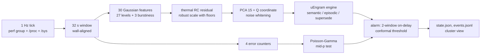

# uEngram for running Linux hosts (the Void cluster)

`src/uengram/host/` turns each node of the cluster (msi, hp, asus, lenovo, gigabyte) into a uEngram stream: a 1 Hz snapshot of the machine, 32-second windows, a whitened 16-d latent, and the unchanged uEngram engine (`engine.py`, `lifecycle.py`) as the node's memory. Research notes: `docs/research-host-state.md` (snapshot accuracy, PMU, RAPL, PSI, thermal, prior art). This page records every modelling decision, including where the proposal in `BuildinguEngramforVoidLinuxCluster.md` was changed and why.

## 1. Pipeline



## 2. The snapshot

| decision | reason |
|---|---|
| 1 Hz tick at wall second + 0.5 | coretemp caches the sensor for 1 s (`coretemp.c`: `last_updated + HZ`); `/proc/stat` CPU time has 10 ms (USER_HZ) granularity, so a 100 ms tick has ±10 % per CPU; RAPL updates every ~1 ms. Windows start at multiples of 32 s of wall time, 0.5 s away from every tick, so chrony offsets never move a tick into another window and nodes share window boundaries. |
| rates use the measured CLOCK_MONOTONIC interval | a late tick has a longer `dt`, not a wrong rate |
| counters are differenced, gauges are read | `/proc/stat`, `vmstat`, `diskstats`, `net/dev`, `snmp`, PSI `total`, RAPL energy, perf counts, throttle counts are counters; `MemAvailable` and temperature are gauges |
| RAPL unwrapped at `max_energy_range_uj`; other negative deltas = reset → null | |
| only `package-*` RAPL domains | core/uncore/dram are nested inside the package; `psys` (hp) covers the platform |
| `/proc/stat` total excludes guest, guest_nice | they are already counted in user, nice |
| only whole devices with a `device` link; only NICs with a `device` link | partitions, loop, zram, dm and lo/bridges would count the same bytes twice |
| `core_throttle_count` deduplicated per physical core, `package_throttle_count` per package | every SMT sibling exposes the same core counter |
| one perf group per CPU: cycles (leader), instructions, ref-cycles, branch-misses, cache-misses | a group is scheduled as a unit, so ratios inside it are co-temporal. Three fixed + three programmable counters fit even where the NMI watchdog holds fixed counter 1 (4 of 5 nodes), so nothing is multiplexed. If the group is still not scheduled (another tool holds fixed counter 2 for ref-cycles), `pmu_running` < 0.5 and the PMU attributes of that window are missing, not wrong. |
| read time and collector CPU time recorded per tick | measured: ~0.5 ms to read all sources, 0.54 ms CPU per tick on msi (0.05 % of one core); see §8 |
| collector is stdlib-only | workers have no numpy; recording needs only `python3` |

Privilege: system-wide counters need `perf_event_paranoid <= 0` or `CAP_PERFMON`, and RAPL `energy_uj` is root-only since CVE-2020-8694. The proposal's `sysctl kernel.perf_event_paranoid=1` is not enough: level 1 still forbids CPU-wide events for unprivileged users (`perf-security.rst`). The service runs as `kk` with exactly `CAP_PERFMON` and `CAP_DAC_READ_SEARCH`, granted by `setpriv` from runit; no sysctl changes.

## 3. Attributes: one owner, one modality, one statistical model

`schema.py` is the single source. Each measured field is *owned* by exactly one attribute; `schema.validate()` rejects a second owner, and `tests/test_host_schema.py` checks numerically that no feature is a function of the others (the Jacobian of the 30 Gaussian features with respect to all 32 x 34 (tick, field) inputs has full rank).

| modality | attribute | window rule | why this math |
|---|---|---|---|
| compute | cpu_busy | asin √(Σbusy/Σtotal) | fraction; angular transform stabilises binomial variance and is defined at 0 and 1 (logit is not) |
| compute | cpu_sys_share | asin √(Σsys/Σbusy) | kernel share of busy time |
| compute | cpu_pressure | asin √(ΣPSI cpu some µs / Σdt) | USE saturation; `total` deltas, not the smoothed `avg10` |
| compute | ctx_switch_rate, fork_rate | log1p(Σcount/Σdt) | non-negative rates that can be 0 |
| compute | ipc, freq_ratio, branch_mpki, llc_mpki | log(Σnum/Σden) | ratio of window sums; a mean of per-tick ratios is biased by near-idle ticks (Jensen) |
| memory | mem_used | asin √(mean gauge) | |
| memory | mem_pressure | asin √(PSI memory some) | |
| memory | page_scan, major_faults, swap_out | log1p(Σcount) | activity counts whose size and dependence on load matter |
| storage | disk_read_bps, disk_write_bps, disk_read_iops, disk_write_iops | log1p rate | |
| storage | disk_queue | log1p(Σweighted ms / Σdt ms) | Little's L, defined at zero I/O (latency is not) |
| storage | disk_busy | asin √(mean of per-tick max io_ticks/dt) | busiest device; saturates early on parallel devices |
| storage | io_pressure | asin √(PSI io some) | includes NFS waits |
| network | net_rx_bps, net_tx_bps, net_rx_pps, net_tx_pps | log1p rate | bytes and packets are independent (mean packet size varies) |
| network | tcp_retrans | log1p(Σcount) | depends on traffic, so it stays in the conditional (Gaussian) model |
| power_thermal | pkg_power | log(ΣJ/Σdt) | |
| power_thermal | thermal_residual | T̄_w − RC prediction | see §4 |
| compute / storage / network | cpu_busy.burst, disk_bytes.burst, net_bytes.burst | log(1.4826·MAD(Δs)/√2) | see §4 |
| memory / storage / network / power_thermal | oom_kills, disk_errors, net_faults, throttle_events | raw count → exact tail test | see §4 |

Not attributes (all are in `schema.EXCLUDED` with the reason): loadavg and PSI averages (pre-smoothed), PSI full lines (≤ some; CPU full is 0 by definition system-wide), `/proc/pressure/irq`, iowait (documented as unreliable), interrupt counts, procs_running/blocked (instantaneous), `scaling_cur_freq` and APERF/MPERF (= freq_ratio), ref-cycles rate (= busy), instructions per second (log ips = log ipc + log freq_ratio + log busy + const), cache-references, top-down slots (do not fit the counters with the NMI watchdog), uncore DRAM bandwidth (≈ llc_mpki·ips·64 B), nested RAPL domains, raw and per-core temperatures (explained by power, §4), fan/battery (on 1–2 nodes only), pswpin (also counted by pgmajfault), pgsteal, MemFree/Cached/SwapFree, disk latency and request size (Little's law and byte identities), TCP In/OutSegs, C-state residency.

## 4. Is the mathematics applicable? Decisions per signal

1. **Error counters are not Gaussian.** OOM kills, SCSI I/O errors, NIC errors/drops and thermal throttles are zero in almost every window. Their robust variance is 0: in a Gaussian latent a single event is either invisible (one noise unit among 30 features) or infinitely surprising (scale 0). They get an exact test instead: Poisson rate with Jeffreys prior Gamma(½, 0), posterior frozen at commissioning, predictive negative binomial r = s + ½, q = n/(n+1), upper-tail mid-p `I_{1-q}(k+1, r) + P(X=k)/2` (`events.py`). After a day without OOM kills (n = 2700 windows) one OOM kill has p ≈ 9e-5.
2. **Periodogram band energies assume a stationary window.** Host activity is step-like; one job start inside a window gives a 1/f² spectrum whatever the process does, so uEngram's DSP band features would describe where the step fell. Each activity series gets one robust burstiness feature instead, the MAD of tick-to-tick differences, which one step barely moves (test: a 50x step changes it by < 0.2, real fluctuation by > 2). In the DSP encoder the log std is also a Parseval function of the band energies, i.e. a duplicate.
3. **Temperature is mostly a function of power.** A one-pole RC model `C dT/dt = P − (T − T_amb)/R` with power constant within a window gives exactly, for window means,
   $$\bar T_w = \rho\,\bar T_{w-1} + (1-g)R\,P_w + (g-\rho)R\,P_{w-1} + (1-\rho)T_{amb},\quad \rho = e^{-K/\tau},\ g = \tfrac{\tau}{K}(1-\rho),$$
   so `T_w = c0 + c1 T_{w-1} + c2 P_w + c3 P_{w-1}` with steady-state gain `(c2+c3)/(1−c1) = R`. It is fitted by trimmed least squares and only the residual enters the state (a hot window whose residual exceeds 5 robust scales is not used as context for the next one). Raw temperature would duplicate pkg_power; the residual is what power does not explain: cooling, dust, ambient. The fit also reports τ, R (°C/W) and T_amb per node. Test: τ, R, T_amb recovered within 5 %, 2 %, 0.3 °C.
4. **A channel that never moved during commissioning is invisible to PCA alone.** Its training variance is 0, so it gets no loading. The latent is 15 PCA coordinates plus one coordinate for the squared prediction error Q = ‖x − x̂‖² of the discarded subspace (Jackson & Mudholkar 1979), made near-Gaussian by its cube root (Wilson–Hilferty) and robustly standardised. Test: page scanning that never happened during commissioning moves the latent by > 5 noise units.
5. **Zero-inflated features break noise whitening.** Their difference-based noise variance is 0, so whitening would amplify them without bound. Each feature has a floor (its smallest meaningful change: 0.1 % of time, 1 % of a ratio, 5 % of a rate, one event, 0.1 °C); the floor is the minimum robust scale and is added to the noise covariance (`stats.robust_noise_cov(..., floor=)`), so σ0 = 1 by construction (kept larger where the empirical value is).
6. **Overlapping windows invalidate the engine's sequential statistics.** The MEWMA step detector and M-of-N promotion assume independent consecutive innovations; 75 % overlap would correlate them. The engine sees non-overlapping 32 s windows. For fitting and calibration the commissioning run is cut at four phase offsets (0, 8, 16, 24 s), giving four non-overlapping sequences; the noise covariance uses lag-1 differences inside each sequence only.
7. **A window that straddles a job start is a mixture of two states.** It is novel on its own, and on the synthetic stream the 99.5 % quantile of single-window scores was 17,229 (transitions) against 37 for persistent novelty. Alarms use an on-delay: the score is `min(D²_w, D²_{w−1})` and the threshold is set conformally on that score (research-ad-eval.md §6). Cost: an anomaly shorter than two windows (64 s) does not raise a latent alarm; error counters still alarm immediately.
8. **α is split** between the latent and the four counters (Bonferroni): 0.5 % latent, 0.125 % per counter, so the per-window false-alarm rate is ≤ 1 % under the calibration assumptions (exchangeable, healthy commissioning). Marginal, not per-stream.
9. **Novelty is not badness.** uEngram promotes a state that persists (5 hits in 8 windows) to normal, so a long fault stops alarming once learned. The memory keeps the time each state first alarmed (`state_alarmed_at`, carried through merges) and the cluster view keeps such nodes at `avoid`.
10. **Commissioning is declared healthy**, as in uEngram v2: any state seen in 20 windows anywhere in the fit part becomes semantic; afterwards the sustained-dwell rule applies.

## 5. Changes to the proposal (`BuildinguEngramforVoidLinuxCluster.md`)

| proposal | here | evidence |
|---|---|---|
| project windows onto the hypersphere S^{d−1} | whitened Euclidean ℝ^16 | the sphere discards magnitude (2x load = 1x load); covariance singular radially (uEngram correction 2) |
| `perf_event_paranoid=1` | CAP_PERFMON via setpriv, paranoid unchanged | level 1 forbids CPU-wide events for unprivileged users |
| 10–100 ms tick | 1 s tick | coretemp 1 s cache; 10 ms jiffies |
| a "12-dimensional" vector (table lost in the copy) | 30 Gaussian features + 4 counters, 16-d latent | §3; the counted attributes are the non-redundant set |
| `ABSORBED_EWMA` / `PINNED_EPISODIC` | uEngram's semantic / episodic slots | |
| spinlock → crashing IPC and LLC misses | not assumed; the memory learns what each node's states look like | PAUSE-based spin loops retire instructions at moderate IPC; no source given |
| reward IPS / (W·(1+PSI_io+PSI_mem)) | not used | instructions per joule compares only the same work (spin loops retire instructions); the (1+PSI) factor has no unit or derivation |
| actuator: EPP, frequency cap, read-ahead, dirty ratio per centroid | not implemented; advisory placement only | under the cluster's `performance` governor (rc.local) intel_pstate writes EPP 0 and returns `EBUSY` for EPP > 0 (`intel_pstate.c`); Ivy Bridge/Haswell nodes have no HWP; "30–60 % wasted cycles" has no source; Le Sueur & Heiser 2010 report diminishing DVFS returns. A per-state controller needs an A/B design and the user's decision to leave `performance`. |

What this gives the cluster today: per node, a bounded memory of its operating states with when they started, how often they recur, their power and energy per instruction (`state_profile`), a calibrated alarm with the modality that drove it, error-counter alarms, and a placement order (`uengram-host cluster`) that skips nodes in alarmed or known-bad states and ranks the rest by headroom = (1 − busy)(1 − max pressure).

## 6. Operation

```bash
# record a commissioning run (as root via runit, or by hand)
setpriv --reuid=kk --regid=kk --init-groups --inh-caps=+perfmon,+dac_read_search \
  --ambient-caps=+perfmon,+dac_read_search -- python3 -m uengram.host record --out ticks-$(hostname).jsonl
# fit, seed and calibrate (numpy)
python -m uengram.host commission --ticks ticks-$(hostname).jsonl --model model-$(hostname).pkl
# replay recorded ticks through a model; run online; read state; cluster view
python -m uengram.host replay --model M --ticks F --events out.jsonl
python -m uengram.host run --model M
python -m uengram.host status
python -m uengram.host cluster --nodes msi-worker hp asus-worker lenovo-worker gigabyte-worker
```

Commission on at least 24 h covering the usual workloads; with less, the conformal threshold has few calibration scores and the episodic budget absorbs states that a longer run would have seen as recurring.
