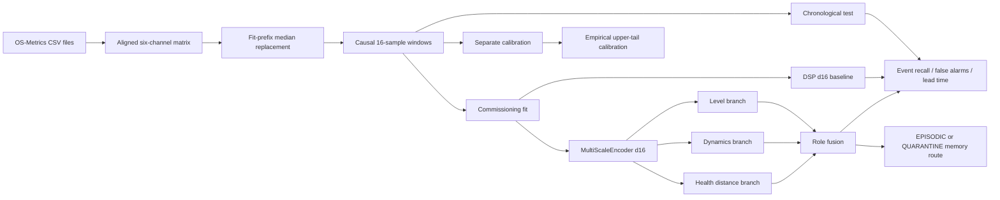

# OS-Metrics exploratory edge-memory gate

## Conclusion first

We downloaded and verified the public **OS-Metrics** dataset and ran the
existing DSP baseline and role-separated uEngram architecture on it.

The dataset is useful for testing the implementation on a new operational
workload, but it **does not satisfy the preregistered independent-field gate**.
It is one published workload rather than a set of independently identified
physical assets. Its labels describe injected or causally annotated
performance disturbances, not operator-adjudicated industrial equipment
faults.

The experiment therefore supports an exploratory engineering conclusion only:

> The current role-based architecture did not improve over DSP on this
> workload. DSP detected more events and produced fewer false alarms than the
> tested role policies. The role design still provides useful memory-routing
> semantics and a clean place to add health, dynamics, and mode-specific logic.

No production or independent-field promotion claim is justified.

## 1. Dataset source and verification

Source records:

- Zenodo record: <https://zenodo.org/records/17981352>
- DOI: <https://doi.org/10.5281/zenodo.17981352>
- Mendeley mirror and description: <https://data.mendeley.com/datasets/gnp6gtn8tb/1>

The archive was downloaded from Zenodo without credentials:

```text
https://zenodo.org/api/records/17981352/files/OSMetrics.zip/content
```

The observed archive MD5 was:

```text
c1c57a31c99b1be3c05316be8fa1c00a
```

The raw archive is intentionally kept outside the Git repository at:

```text
/home/kk/.cache/uengram/osmetrics/
```

This avoids committing raw third-party data while keeping the experiment
reproducible on this machine.

The dataset contains 40,320 samples at 15-second intervals, covering seven
days. It has six metric files and three event-log files:

| Group | Metrics or labels |
|---|---|
| CPU | CPU usage and 13 CPU disturbance intervals |
| Memory | Memory usage, memory used, and 12 memory intervals |
| Network | Two response-time streams, their difference, and 17 network intervals |

There are 42 annotated disturbance intervals in total.

## 2. Repository implementation

New files:

```text
bench/osmetrics.py
bench/osmetrics_role_gate.py
tests/test_osmetrics.py
results/osmetrics_role_gate.json
```

`bench/osmetrics.py` provides:

- aligned CSV loading;
- event interval loading;
- fit-only invalid-value replacement;
- causal windows, where a window ending at time `t` never reads samples after
  `t`;
- event-overlap masks.

`bench/osmetrics_role_gate.py` compares:

1. the existing DSP encoder with dimension 16;
2. the role-separated architecture using `MultiScaleEncoder` with dimensions
   16;
3. four role-fusion policies: `any`, `at_least_2`, `dynamic_health`, and
   `all`.

The split is chronological:

```text
first 24 hours       commissioning fit
next 24 hours        label-filtered calibration
remaining 5 days     test
```

The event labels were used to remove event-overlapping windows from fit and
calibration. This is explicitly recorded in the JSON result because it means
this is not a fully label-free validation.

### Architecture diagram



## 3. Important preprocessing error path

The published file `network_response_time_diff.csv` is a derived difference of
the two response-time streams. Feeding all six channels into the strict
within-state noise-whitening path created a rank-deficient covariance matrix.
In simple language, one input was mathematically repeating information already
present in two other inputs. The covariance matrix then had no unique inverse.

The gate therefore used the five primitive channels:

```text
cpu_usage
memory_usage
memory_used
network_response_time_a
network_response_time_b
```

It recorded the sixth channel as excluded rather than silently dropping it.
The 26 published sentinel values (`-99999`) were replaced with medians computed
only from the first commissioning day. This prevents future test values from
influencing preprocessing.

This failure is important for production edge systems. Derived channels should
be marked in the schema. A model should either:

- remove redundant derived channels before covariance estimation;
- use a pseudoinverse with an explicit conditioning report; or
- use a regularized covariance estimator with a recorded stability threshold.

Silently catching `LinAlgError` and continuing would be unsafe because it could
turn a numerical failure into an apparently valid alarm score.

## 4. Results

The gate used empirical upper-tail calibration, significance level `alpha =
0.01`, and three consecutive alarm windows for persistence. One window is four
minutes because 16 samples are taken every 15 seconds.

| Method | Strict event recall | Recall with 2-hour warning allowance | False alarm episodes/week | AUROC | Median lead hours |
|---|---:|---:|---:|---:|---:|
| DSP d16 | 27/42 = 64.3% | 30/42 = 71.4% | 26.6 | 0.885 | 1.01 |
| Role: any branch | 26/42 = 61.9% | 30/42 = 71.4% | 57.4 | 0.873 | 1.25 |
| Role: at least 2 branches | 25/42 = 59.5% | 30/42 = 71.4% | 46.2 | 0.873 | 1.11 |
| Role: dynamic + health | 24/42 = 57.1% | 30/42 = 71.4% | 42.0 | 0.873 | 0.96 |
| Role: all branches | 23/42 = 54.8% | 28/42 = 66.7% | 26.6 | 0.873 | 0.94 |

### Plain-English interpretation

- **Recall** means the fraction of known disturbances that the system noticed.
  For example, `27/42` means the baseline noticed 27 of 42 annotated events.
- **Strict recall** counts an event only when an alarm starts inside its
  annotated interval.
- **Two-hour recall** also counts an alarm that begins up to two hours before
  the interval. This measures early warning, but it can be more forgiving.
- **False-alarm episodes per week** counts separate alarm starts during
  protected normal time, scaled to one week. It is not the same as the number
  of alarm windows; three consecutive windows are one episode.
- **AUROC** is a ranking score. A value of `0.5` is roughly random ordering;
  `1.0` is perfect ordering. It does not tell an operator how many alarms will
  be produced at the chosen threshold.
- **Lead time** is how early the first accepted alarm appeared before the event.
  A negative value means the alarm began after the event start.

The role policies shared the same underlying role score, so their AUROC was the
same. Their different results came from how strictly branches had to agree
before opening an alarm.

### Main finding

The role architecture did not beat DSP on this dataset. DSP had:

- the highest strict recall;
- the highest AUROC;
- fewer false alarms than three of the four role policies;
- the same false-alarm rate as the strict `all` policy, but with better recall.

This is a useful negative result. Splitting evidence into semantic branches is
not automatically better. Branch separation adds a decision layer, and that
layer can discard weak but useful signals or produce extra alarms when any
branch is too sensitive.

## 5. Memory routing result

For the `dynamic_health` policy, the gate produced:

```text
EPISODIC   3,254 windows
QUARANTINE 25,546 windows
SEMANTIC   0 windows
```

No semantic memories were admitted because this public dataset has no
operator-confirmed-normal labels. That is intentional. The memory policy is:

```text
bad data or unconfirmed normal -> QUARANTINE
alarm or branch exceedance     -> EPISODIC
operator-confirmed normal      -> SEMANTIC
```

This is safer than automatically storing every low-score window as a trusted
long-term baseline. In a real system, the operator-confirmed-normal path would
be supplied by maintenance or control-room confirmation.

The measured role scoring latency was approximately:

```text
6.8 microseconds per test window
```

This is a local Python measurement, not a hardware-certified real-time bound.
It excludes sensor acquisition, serialization, database writes, and scheduler
latency.

## 6. What this dataset can and cannot prove

### It can test

- causal window construction;
- handling of missing or sentinel sensor values;
- multimodal operational telemetry;
- separate calibration and test periods;
- branch fusion behavior;
- event detection and early-warning metrics;
- conservative episodic/quarantine memory routing;
- numerical stability of covariance whitening.

### It cannot prove

- performance on unseen industrial assets;
- physical bearing, motor, pump, vehicle, or compressor faults;
- operator acceptance;
- fleet-level transfer;
- non-inferiority against the frozen baseline under the independent-cohort
  preregistration;
- safe autonomous memory consolidation in production.

The missing property is **asset independence**. The test data are later in the
same published workload, not recordings from assets independently held out by a
custodian. The result therefore does not remove the blocker documented in
`docs/independent-cohort-preregistration.md`.

## 7. Machine and cluster data investigation

The local cluster was also inspected as a possible source. It contains useful
operational evidence, but not enough for the preregistered physical-fault
experiment:

- node health files are mostly current snapshots rather than long sensor
  histories;
- alert logs mainly say whether services were healthy;
- restart logs identify service events but do not provide independently
  adjudicated physical-fault intervals;
- the current cluster state records `msi` with high home-disk and swap usage,
  while `gigabyte` is offline, but these are operational states, not a prepared
  multi-asset benchmark.

The cluster data can become a valuable **system-health** dataset if collection
is extended. It should record CPU, memory, disk latency, temperature, network
latency, service state, scheduler state, and exact incident intervals for each
node. Each incident should have a reason, operator confirmation, start/end
timestamps, and a recovery timestamp. That would support a separate
cluster-reliability experiment, but it should not be called an industrial
physical-fault dataset.

## 8. Recommended next improvements

### 8.1 Improve numerical robustness

Add a pre-fit diagnostic that reports:

```text
rank(covariance)
condition_number(covariance)
number_of_derived_channels
number_of_invalid_samples
```

A safe decision rule is:

```text
if covariance is ill-conditioned:
    identify redundant channels
    prefer schema-declared primitive channels
    otherwise use regularization and record the value
if covariance is singular:
    fail closed with a diagnostic
```

Do not catch the failure and silently produce a score.

### 8.2 Separate detection from memory consolidation

Detection can use a low threshold to be sensitive. Memory admission should use a
stricter rule and context:

```text
if quality_bad:
    quarantine
elif alarm_open:
    store episodic memory
elif normal_is_operator_confirmed:
    update semantic baseline
else:
    quarantine
```

This prevents a false alarm or an unverified operating condition from changing
the long-term baseline.

### 8.3 Add metric-specific experts

The OS-Metrics result suggests that a single fused score may hide which signal
caused the decision. A stronger edge design would have:

- a CPU specialist;
- a memory specialist;
- a network specialist;
- a cross-channel consistency check;
- a final calibrated decision layer.

The final layer should report both the alarm and the evidence source. For
example: “network response-time gradual drift, high confidence; CPU normal.”

### 8.4 Build a real cluster cohort

For each node, collect the same schema at a fixed interval. Hold out entire
nodes or later maintenance periods. Keep labels hidden until the model and
split are frozen. Use service failures and operator-confirmed maintenance
incidents as separate event types.

This would test the memory system in an environment close to its intended
edge-compute use while preserving a clear distinction between service faults
and physical equipment faults.

## 9. Reproduction

After downloading and extracting the archive to the path above:

```bash
PYTHONPATH=src:. .venv/bin/pytest -q tests/test_osmetrics.py
PYTHONPATH=src:. .venv/bin/python bench/osmetrics_role_gate.py \
  --root /home/kk/.cache/uengram/osmetrics/extracted \
  --out results/osmetrics_role_gate.json
```

Observed adapter test result:

```text
4 passed
```

Artifact validation also passed:

```text
python3 -m json.tool results/osmetrics_role_gate.json
python3 -m py_compile bench/osmetrics.py bench/osmetrics_role_gate.py
git diff --check
```

## References

1. Song, Q. *OS-Metrics: Performance Time Series (PTS) Dataset for Anomaly
   Detection and Change Point Detection*. Zenodo, record 17981352,
   <https://doi.org/10.5281/zenodo.17981352>.
2. OS-Metrics Mendeley Data mirror,
   <https://data.mendeley.com/datasets/gnp6gtn8tb/1>.
3. `docs/independent-cohort-preregistration.md` in this repository.
4. `src/uengram/role_architecture.py` in this repository.
