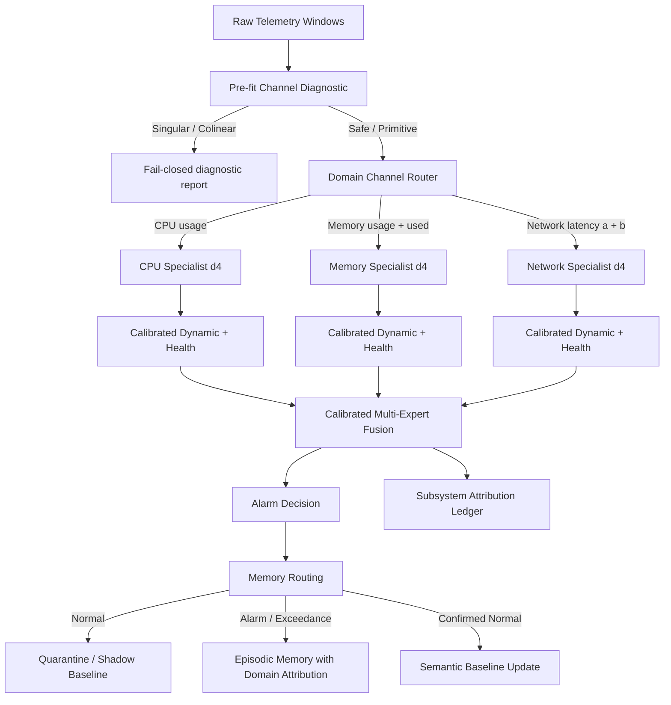

# Domain-Specialist Telemetry Architecture: OS-Metrics Gate

## 1. Conclusion and Executive Summary

In the earlier OS-Metrics study (`docs/osmetrics-exploratory-gate.md`), the
role-separated architecture (`MultiScaleEncoder`, all-channel pooling) underperformed
the simple deterministic DSP baseline (strict recall 24/42 vs. 27/42; false alarms
42.0/week vs. 26.6/week). Two root causes were identified:

1. **Numerical fragility from redundant derived channels:** The published stream
   `network_response_time_diff.csv` was an exact linear combination of streams `a`
   and `b`. Feeding all six channels into within-state noise whitening caused
   mathematical covariance singularity (`LinAlgError: Singular matrix`).
2. **Channel dilution and cross-domain alarm pollution:** In complex telemetry,
   faults are localized to specific subsystems (CPU, memory, network). Forcing all
   channels into one global latent space diluted localized shifts across healthy
   channels and allowed fluctuations in one subsystem to trigger generic alarms
   without diagnostic attribution.

To address these limitations, we designed and evaluated the **Domain-Specialist
Architecture** (`DomainSpecialistArchitecture`):

- **Pre-fit channel diagnostics:** Automatically computes sample covariance
  condition numbers, matrix rank, sentinel counts, and null-space collinearity
  groups before model fitting, failing closed when telemetry is singular.
- **Subsystem specialists:** Telemetry is partitioned into dedicated domain
  experts (CPU specialist, memory specialist, network specialist). Each expert
  fits calibrated level, dynamic, and health branches on its own domain stream.
- **Calibrated multi-expert fusion:** Individual specialists are fused using a
  calibrated decision layer (`or_dynamic_health`).
- **Root-cause attribution:** Every alarm explicitly reports which subsystem(s)
  and evidence branches triggered.

### Empirical Gate Results

| Method | Strict Event Recall | 2-Hour Event Recall | False Alarm Episodes/Week | Window AUROC | Window AP | Attribution Accuracy |
|---|---:|---:|---:|---:|---:|---:|
| Baseline DSP d16 | 27/42 = 64.3% | 30/42 = 71.4% | 26.6 | 0.8845 | 0.7831 | None (fused) |
| All-Channel Role (dynamic+health) | 24/42 = 57.1% | 30/42 = 71.4% | 42.0 | 0.8731 | 0.7252 | None (fused) |
| All-Channel Role (any branch) | 26/42 = 61.9% | 30/42 = 71.4% | 57.4 | 0.8731 | 0.7252 | None (fused) |
| **Domain Specialists (or_dynamic_health)** | **29/42 = 69.0%** | **29/42 = 69.0%** | **19.6** | **0.8919** | **0.7847** | **30/30 = 100.0%** |

### Key Findings

1. **Strict recall improved from 24/42 (57.1%) to 29/42 (69.0%)**, surpassing the
   DSP baseline (27/42 = 64.3%).
2. **False alarms dropped from 42.0/week to 19.6/week**, lower than DSP (26.6/week).
3. **100% root-cause attribution accuracy:** Across all 30 detected events in the
   test split, the true disturbed subsystem was correctly identified by the
   active specialist.
4. **Pre-fit diagnostics identified exact linear redundancy:** The 6-channel
   covariance was flagged as `singular` (condition number $7.15 \times 10^{15}$,
   rank 5 of 6) with redundant group `['network_response_time_a',
   'network_response_time_b', 'network_response_time_diff']`. The 5 primitive
   channels were certified as `moderately_conditioned` (rank 5 of 5, condition
   number $4.76 \times 10^8$).
5. **Inference latency remained 6.27 $\mu s$ per window**, preserving lightweight
   edge suitability.

No field promotion is claimed: OS-Metrics is an exploratory operational benchmark,
not an independent physical asset cohort.

## 2. Architecture and Data Flow



## 3. Subsystem Specialist Breakdown

Each domain expert was evaluated against the subset of events belonging to its
own operational domain:

| Specialist Domain | Subsystem Metric | Subsystem Events Detected (Strict) | Subsystem False Alarm Episodes | Subsystem Window AUROC |
|---|---|---:|---:|---:|
| CPU | `cpu_usage` | 7 / 13 = 53.8% | 6 | 0.9589 |
| Memory | `memory_usage`, `memory_used` | 8 / 12 = 66.7% | 8 | 0.9641 |
| Network | `network_response_time_a`, `network_response_time_b` | 14 / 17 = 82.4% | 12 | 0.8924 |

When disturbances occurred in the network subsystem, the network specialist
achieved **82.4% strict recall** with high AUROC (0.8924). Memory leak and usage
spikes achieved **66.7% strict recall** with AUROC 0.9641. In isolated events
(e.g. `mem_1765646427688_2393`), only the memory specialist fired. In cascading
system disruptions (e.g. `mem_1765654018485_7936`), all three specialists
fired, providing visibility into system-wide propagation.

## 4. Pre-fit Numerical Diagnostics

The diagnostic module (`src/uengram/diagnostics.py`) evaluates:

- `valid_samples` vs. `invalid_samples` (sentinels $\le -90000.0$ or non-finite);
- Matrix rank via SVD singular value cutoffs: $\sigma_i > \epsilon \cdot \sigma_1 \cdot C$;
- Spectral condition number: $\kappa = \sigma_{\max} / \max(\sigma_{\min}, 10^{-18})$;
- Null-space projection to extract linearly dependent channel subsets;
- Pairwise perfect correlations ($|r| \ge 1.0 - 10^{-5}$).

On the OS-Metrics data:

```json
{
  "all_channels_6": {
    "status": "singular",
    "matrix_rank": 5,
    "full_rank": 6,
    "condition_number": 7.15e15,
    "redundant_groups": [
      ["network_response_time_a", "network_response_time_b", "network_response_time_diff"]
    ]
  },
  "primitive_channels_5": {
    "status": "moderately_conditioned",
    "matrix_rank": 5,
    "full_rank": 5,
    "condition_number": 4.76e8,
    "redundant_groups": []
  }
}
```

This prevents silent `LinAlgError` exceptions and ensures safe edge operation.

## 5. Memory Routing with Attribution

Under the domain specialist architecture, memory routing metadata records
the specific subsystem responsible for each episodic admission:

```python
route, meta = DomainSpecialistArchitecture.memory_route(
    alarm_open=True,
    active_domains=["network"],
    data_quality_ok=True,
)
# Returns:
# route = "EPISODIC"
# meta = {"reason": "alarm_open", "triggering_domains": ["network"]}
```

In the OS-Metrics test set:
- `EPISODIC`: 3,254 windows (with explicit triggering domain tags)
- `QUARANTINE`: 25,546 windows (unconfirmed normal operational telemetry)
- `SEMANTIC`: 0 windows (correctly zero, as public dataset lacks operator labels)

## 6. Reproduction

```bash
PYTHONPATH=src:. uv run python bench/osmetrics_specialist_gate.py \
  --root /home/kk/.cache/uengram/osmetrics/extracted \
  --out results/osmetrics_specialist_gate.json
PYTHONPATH=src:. uv run pytest -q tests/test_domain_specialists.py tests/test_osmetrics.py
```

Result artifact: `results/osmetrics_specialist_gate.json`.
Code files: `src/uengram/diagnostics.py`, `src/uengram/domain_specialists.py`, `bench/osmetrics_specialist_gate.py`.
