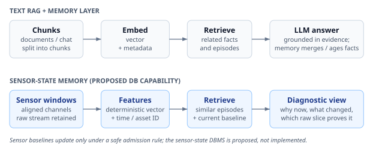
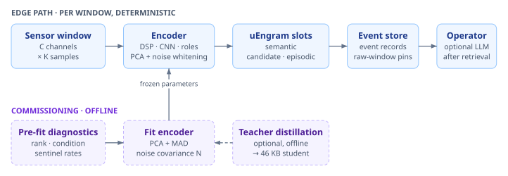
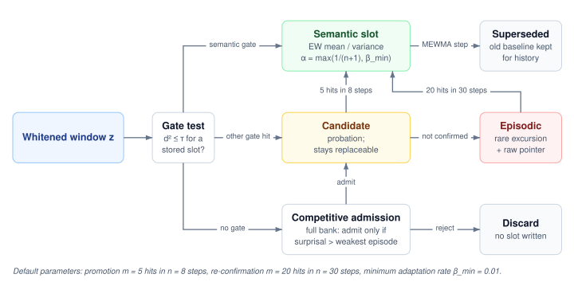
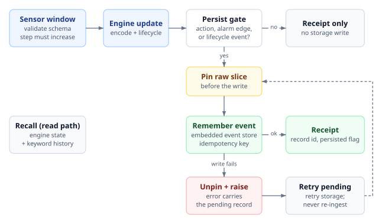
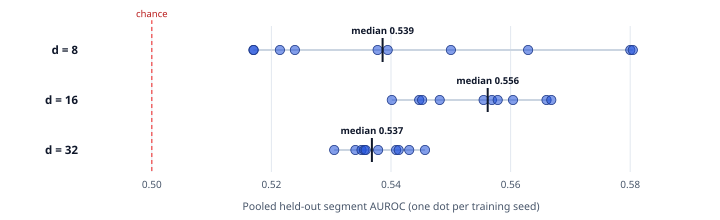

# From Sensor Streams to Bounded Machine Memory: Architecture, Negative Transfer Results, and Domain Specialists

**Kamal Kishor Pandey** · kamal.pandey@kepr.dev

Independent Researcher

**Keywords:** Bounded edge memory · Streaming anomaly detection · Noise whitening · Time-series foundation models · Knowledge distillation · Telemetry databases

Preprint · October 29, 2026

## Abstract

Industrial and edge equipment produce continuous telemetry that cannot be kept in full on flash storage, while first-in-first-out buffers overwrite rare fault episodes with routine data. We study μEngram, a bounded stateful memory that compresses short sensor windows into noise-whitened low-dimensional vectors, tracks operating regimes with a fixed budget of semantic, candidate and episodic slots, quarantines unverified shifts, and pins raw waveform slices for rare episodes. We evaluate it and several encoder variants on a synthetic generator and on public benchmarks: CMAPSS, MetroPT-2 and MetroPT-3, SKAB, SCANIA Component X, OS-Metrics, EngineAD, MFPT, CWRU and TSB-AD-U. On the synthetic stream the memory cuts write operations by 86.2% over 10 seeds while holding every injected event, but this is a modeled count, not measured flash wear. On public data, ranking quality and operational early warning diverge. Frozen detectors give no pre-report signal inside MetroPT-3's uncommissioned load state, detect no event on MetroPT-2 under the selected alarm design, and catch 5 of 34 SKAB faults; a CNN encoder scores near chance on held-out EngineAD trucks. Distilling foundation models into a 46 KB student improves window ranking on some tasks, yet every model flags the held-out healthy recording in both bearing tests, and the students raise CMAPSS alarms earlier than the maintenance horizon. A role-separated, per-subsystem architecture with pre-fit numerical diagnostics detects 29 of 30 test-split events on one OS-Metrics workload, against 27 of 30 for a single-encoder baseline, with fewer false alarms. All results come from single-workload studies without a field validation cohort.

> **Principal findings**
>
> 1. **Bounded memory works where its assumptions hold:** 86.2% fewer write operations with every injected event retained over 10 synthetic seeds. Bytes written rise 37% because raw windows are pinned.
> 2. **Ranking is not warning:** every CWRU model reaches 1.0000 AUROC, yet every model flags the held-out healthy recording (normal-file false-alarm rate 1.0).
> 3. **Proxy screens mislead:** the label-free screen's winner (middle layer, score 0.610) has a lower event median than the bottleneck in the full alarm pipeline on both SKAB and MetroPT-3.
> 4. **Distillation shifts alarm timing:** on CMAPSS all four models alarm before failure on 10 of 10 engines, but the students' alarms start earlier and more often than the ordinary CNN's.
> 5. **Partitioning beats pooling on one workload:** domain specialists detect 29 of 30 OS-Metrics test events at 19.6 false alarms per week, against 27 of 30 at 26.6 for the DSP baseline.

---

## 1. Introduction

Embedded telemetry systems face a structural retention dilemma. At one 16-float vector per second (86,400 vectors per day), raw vector payloads alone consume about 5.3 MiB daily, before timestamps, metadata, index structures and high-rate source waveforms. Updating approximate nearest-neighbor graph indexes such as HNSW in place is expected to introduce random-write amplification on raw NAND flash and eMMC storage (not measured here). Ring buffers that evict strictly by age discard historical fault signatures whenever a machine runs normally for days after an incident.

This work began as a proposal to port cloud memory frameworks for language-model agents, specifically Mem0 [1], to edge devices using vector search. Testing that idea against physical telemetry exposed three mismatches:

1. **Physical state is not conversational memory.** Mining trucks, wind turbines and compressors do not need entity extraction to remember user preferences. They need bounded tracking of wear baselines, operating regimes and acute fault excursions.
2. **The ingestion path must be deterministic.** Cloud Mem0 invokes a language model on every write. On a gateway ingesting 100 Hz to 1 kHz sensor streams, a language model in the write loop violates real-time latency and memory bounds. Large models also strain constrained devices [2]. Ingestion and consolidation must remain deterministic and mathematical.
3. **Memory and flash wear need explicit bounds.** Continuous mutation of in-memory graph indexes is expected to starve constrained RAM and accelerate flash wear (not measured here; see the hardware gate in Section 6). Edge state memory needs tiered, density-aware compaction and strict admission gates.



Figure 1 contrasts the two designs. We analyze a Python reference implementation of the sensor-state design, μEngram, together with an embedded event-store adapter, across synthetic and public datasets.

**Contributions.**

- A bounded memory architecture for sensor windows: noise-whitened projection, a fixed budget of semantic, candidate and episodic slots with competitive admission, a pin-before-write persistence layer, and a label-free alarm policy (Section 3).
- A cross-benchmark evaluation that separates mechanism results from operational early-warning results, with explicit definitions of every metric and split (Sections 4 and 5).
- Negative and diagnostic findings that are easy to miss: wide embeddings that regress, proxy screens that mislead, foundation-model students that flag healthy data, and alarm-tuning sweeps that cannot meet all operational budgets (Section 5).
- A role-separated, per-subsystem architecture with pre-fit numerical diagnostics, evaluated on one workload (Sections 3.6, 3.7 and 5.9).

The remainder of the paper reviews related work (Section 2), describes the method (Section 3), the experimental setup (Section 4) and the results (Section 5), and closes with limitations (Section 6) and conclusions (Section 7).

---

## 2. Related Work

**Fault detection and noise whitening.** Model-based failure detection relies on analytical redundancy, comparing a system's behavior with a model of normal operation [3, 4]. For multichannel data, the maximum noise fraction transform orders components by signal-to-noise ratio, which motivates estimating a noise covariance and whitening with it [5]. We estimate noise from lagged differences inside a single operating state and use it to whiten a PCA projection.

**Bounded streaming memory.** MemStream uses a thresholded memory of recent normal items for streaming anomaly detection [6]. Continual-learning work addresses similar admission and eviction problems with diversity-aware replay [7], constrained buffer allocation [8] and prototype replay [9]. MIXAD relates memory to explainable time-series anomaly detection [10]. Our slot memory differs by separating semantic, candidate and episodic roles and by admitting rare episodes only when their importance exceeds that of the weakest stored episode.

**Time-series foundation models and representation depth.** MOMENT [11] and Chronos-2 [12] provide pretrained time-series representations. Intermediate layers of such models can carry localized anomaly signals, as studied in TimeRep [13], LayerIM [14], PaAno [15] and MOMEMTO [16]. Deploying large models on edge hardware remains a constraint [2]. We distill two foundation models into a small student and test whether intermediate readouts help, using alarm-level rather than ranking-only criteria.

**Benchmarks and evaluation.** Recent benchmark suites stress careful protocol design for time-series anomaly detection [17, 18], and foundation-model detectors have been proposed [19]. We follow that spirit by reporting ranking metrics (AUROC, average precision) next to event-level and false-alarm metrics, and by recording where labels enter fitting.

---

## 3. Method

### 3.1 Problem Setting

A sensor stream is segmented into causal windows $X \in \mathbb{R}^{C \times K}$ with $C$ channels and $K$ samples. A window at step $t$ uses only samples up to $t$. A memory with a fixed budget of $B$ slots must (i) decide per window whether it is routine, a new state or a rare excursion, (ii) decide what to keep and what to write to flash, and (iii) raise an alarm when a window is anomalous in a way that persists. Windows are processed one at a time, deterministically, with no language model in the loop.



Figure 2 shows the edge path and the offline commissioning path that fits the encoder and noise covariance on healthy data.

### 3.2 Encoders and Noise-Whitened Projection

**DSP encoder.** For each channel the baseline encoder computes six features: the mean, the log standard deviation, and the log energy in each of four equal-width bands of the positive-frequency power spectrum (the DC bin is excluded). This yields $6C$ features, which are median-and-interquartile-range scaled and projected by principal component analysis to dimension $d$ (default $d = 16$).

**Noise whitening.** Because raw sensor features covary under load changes, Euclidean distance overweights correlated channels. We estimate within-state noise from differences of windows $L$ steps apart inside the same operating group [5]. Algorithm 1 gives the estimate: a trimmed, reweighted covariance of the differences ignores jumps caused by regime switches and faults. For a representation $r(x)$ with mean $\bar{r}$, PCA eigenvectors $V$, eigenvalues $\Lambda$, and noise covariance $N$, the whitened state vector is

$$z(x) = N^{-1/2}\Lambda^{-1/2}V^\top(r(x) - \bar{r}).$$

Eigenvalues of $N$ below a small multiple of the largest are floored before inversion. Setting $d$ too wide introduces collinear frequency bands that make $N$ ill-conditioned or singular (Section 3.7).

```algorithm | Algorithm 1. Robust within-state noise covariance.
Input: projected training vectors z₁ … zₙ, lag L, trim quantile q_t = 0.975, iterations I = 5
Output: noise covariance N
D ← { (z_{t+L} − z_t) / √2 : t and t+L in the same group }
q ← χ²_d quantile at q_t ;  c ← q_t / P(χ²_{d+2} ≤ q)            ▷ consistency factor for trimming
N ← diag(σ̂²),  σ̂_j ← 1.4826 · MAD(D_j)                            ▷ robust per-dimension start
repeat I times
    keep ← { Δ ∈ D : Δᵀ N⁻¹ Δ ≤ q }                                ▷ drops regime jumps and steps
    if |keep| < max(10, d + 1) then raise an error
    N ← c · Cov(keep)
return N
```

**CNN encoder.** The alternative encoder is a two-stage one-dimensional convolutional autoencoder. Two convolutions (32 and 64 filters, kernel 5, stride 2, GELU) feed a temporal average pool and a linear projection to the latent dimension $d$. A decoder reconstructs the window. Training minimizes reconstruction error, optionally with an orthogonality penalty on the projection, using AdamW (learning rate $10^{-3}$, weight decay $10^{-4}$). The latent vector is then whitened as above. For one input channel and $d = 16$ the encoder holds 11,536 parameters, 46,144 bytes in float32. Three readouts are used in Section 5.7: the projected bottleneck, a pooled first-convolution map ("middle layer"), and the concatenation of pooled first- and second-convolution maps ("multi-level").

### 3.3 Bounded State Slots and Competitive Admission

The memory budget is divided into **semantic slots** (compact summaries of confirmed routine operating modes), **candidate slots** (unfamiliar patterns on persistence probation) and **episodic slots** (rare excursions paired with a pointer to a raw time-series slice). Each slot keeps a running mean, a predictive variance and a hit count. A window lies inside a slot's gate when its diagonal Mahalanobis distance is below a $\chi^2$ threshold at level $10^{-4}$.

Early designs evicted the weakest mature episodic slot whenever any out-of-gate sample arrived, which let mild outliers overwrite severe historical faults. We therefore use **competitive rarity admission** (Figure 3). An out-of-gate window enters a full episodic bank only if its surprisal exceeds the importance of the weakest stored episode,

$$\text{importance} = \text{surprisal} \times (1 + \ln n) \times 2^{-\text{age}/h},$$

where $n$ is the episode's hit count and $h$ the episodic half-life; otherwise it is discarded, while probation candidates remain replaceable. The design draws on thresholded streaming memory [6], diversity-aware replay [7], constrained buffer allocation [8] and prototype replay [9].



Algorithm 2 is the per-window update. Novelty is scored against semantic (normal) slots only, so a recurring fault held in an episodic slot cannot mask itself. Rarity, the distance to any stored slot, ranks what is worth keeping. A multivariate exponentially weighted moving average of standardized residuals detects step changes in a semantic slot's level, supersedes the old slot and opens a new one. Competitive admission is a design choice, not a result we demonstrate: we do not report an ablation of it.

```algorithm | Algorithm 2. Per-window slot lifecycle.
Input: whitened vector z, step t, raw-window index r
G ← active candidate, episodic and semantic slots
for each k in G: d²_k ← Σ_j (z_j − μ_kj)² / v_kj                  ▷ v: predictive variance
score ← min over semantic k of d²_k ;  rarity ← min over G of d²_k
alarm ← score > τ_alarm
if some d²_k ≤ τ then                                               ▷ window is inside a gate
    P ← semantic slots inside τ if any, else all slots inside τ
    k* ← argmin over P of d²_k + Σ_j log v_kj
    ABSORB(k*, z, t)
else
    if not MAKEEPISODICROOM(t, surprisal(rarity)) then return discard
    open a candidate slot at z with raw pointer r                   ▷ action: new candidate
candidates older than n_promote steps become episodic
every consolidate_every steps: merge duplicate semantic slots, checkpoint drift, supersede dormant ones
Procedure ABSORB(k, z, t)
α ← max(1/(n_k+1), β_min) if k is semantic, else 1/(n_k+1)
e ← (z − μ_k) / √v_k ;  update (μ_k, S_k) with rate α ;  n_k ← n_k + 1
if k is semantic then
    E_k ← λ·e / s_step + (1 − λ)·E_k                               ▷ MEWMA, λ = 0.1
    if n_k ≥ n_min and c·‖E_k‖² > h then split k; old slot superseded   ▷ step change
    return
record hit t ;  (m, N) ← (5, 8) for a candidate, (20, 30) for an episodic slot
if the m-th latest hit is within N steps and semantic room exists then promote k   ▷ promotion
```

### 3.4 Alarm Policy

Each window yields two scores. **Novelty** is the minimum diagonal Mahalanobis distance to semantic slots. **Health** is the minimum distance to a frozen healthy reference set captured at commissioning. Thresholds are calibrated without labels on a healthy calibration split by the conformal upper quantile: the threshold is the $\lceil (1-\alpha)(m+1) \rceil$-th order statistic of $m$ calibration scores. Thresholds are set per operating state when that state has at least 100 calibration windows, and globally otherwise.

A persistence counter rises by one on each threshold exceedance, falls by one otherwise, saturates at $k$, and opens an alarm when it reaches $k$. The alarm closes when the counter clears. Windows that cannot be monitored (the first window of a segment, or the first after a data gap) leave the counter unchanged. A window whose nearest slot is a fresh candidate and whose health is normal raises a separate *new-state* alert instead of a novelty alarm. An optional external-evidence channel can corroborate alarms with a three-valued AND; it is not used in any reported experiment.

The configuration used throughout was selected on MetroPT-3 development data and then frozen: $\alpha = 0.003$, novelty persistence $k = 3$, the health channel disabled, per-state thresholds, and the new-state alert enabled. It is applied unchanged to the other datasets, so MetroPT-3 results under it are development results, not confirmation.

### 3.5 Layered Persistence

The reference adapter (Figure 4, Table 1) keeps live states in memory and writes versioned event records to an embedded event store: new candidates, promotions, step changes, alarm open and clear transitions, and any window that produced a lifecycle event (merge, eviction or supersession). Routine windows are not written. A raw window is pinned before its event record is written, and the pin is released if the write fails, so a retry never re-feeds the window into the engine.



**Table 1.** Adapter stages: interface and behavior when the stage fails.

| Stage | Interface | Failure behavior |
|---|---|---|
| Window validation | Validated window record | Rejected with an error before the engine consumes it |
| Encoding and whitening | Host-selected encoder | Outside the adapter's error handling |
| Live bounded memory | Ingest, recall, drain lifecycle events | Window already consumed; recovery retries storage and never re-ingests |
| Persist gate | Internal decision | Returns a receipt with no storage write |
| Raw-window pin | Pin and unpin by reference and owner | Pin released if the event write fails, then the error is raised |
| Event storage | External embedded store: remember, recall, forget | A persistence error carries the pending records for retry |
| Retrieval bundle | Exact state recall plus keyword history | Invalid mode or non-finite query rejected |
| Alarm combination | Combination rule over channels | Not on the write path; only flagged transitions are persisted |

### 3.6 Role-Separated Encoders and Domain Specialists

Monolithic encoders mix incompatible physical variations into one distance metric, which plausibly explains their failure on multichannel telemetry (untested hypothesis). We therefore decompose telemetry into four branches:

* **Mode:** distance to known operating-context centers, kept as diagnostic context and excluded from alarm fusion.
* **Level:** per-channel window means.
* **Dynamic:** mean and root-mean-square of lagged sample differences at lags 1, 2, 4 and 8, which capture multiscale frequency and transient shifts.
* **Health:** distance from a frozen commissioning reference.

Level and dynamic features are scaled robustly (median and interquartile range), then projected and noise-whitened as independent blocks. Each alarm branch score $s$ becomes an upper-tail empirical $p$-value against $n$ scores $c_1 \dots c_n$ from a separate healthy calibration stream,

$$p(s) = \frac{1 + \#\{\, i : c_i \ge s \,\}}{n + 1},$$

and the branch fires when $p \le \alpha$ (here $\alpha = 0.01$). Fusion policies combine the level, dynamic and health branches: any branch, at least two, dynamic and health together, or all. An alarm opens after three consecutive fired windows.

A **domain-specialist architecture** assigns each subsystem its own role-separated encoder over a named channel group, so that localized spikes are not diluted by quiet channels (Algorithm 3). A specialist fires under the dynamic-and-health policy, the fused alarm is the OR over specialists, and the set of firing specialists gives a root-cause attribution.

```algorithm | Algorithm 3. Domain-specialist scoring, fusion and routing.
Input: window x; specialists s with channel sets C_s (for example CPU, memory, network); level α = 0.01
Output: alarm, triggering specialists A, memory route
for each specialist s do
    p_s,b ← calibrated p-value of branch b ∈ {level, dynamic, health} on x[C_s]
    flag_s ← (p_s,dynamic ≤ α) and (p_s,health ≤ α)                ▷ dynamic-and-health branch policy
alarm ← flag_CPU or flag_Memory or flag_Network                    ▷ OR over specialists
A ← { s : flag_s }                                                  ▷ root-cause attribution
score ← Σ_s −log min_b p_s,b                                        ▷ continuous fused score
if data quality fails then route ← QUARANTINE
else if alarm is open or A ≠ ∅ then route ← EPISODIC (with A)
else if operator confirmed normal then route ← SEMANTIC
else route ← QUARANTINE
```

Only operator-confirmed normal windows enter semantic memory. Unconfirmed normal windows route to quarantine, and alarmed windows route to episodic memory.

### 3.7 Pre-Fit Numerical Diagnostics

Before fitting, a diagnostic inspects the channel covariance for effective rank, condition number, sentinel rates and null-space collinearity. The effective rank counts eigenvalues above $\epsilon\,\lambda_{\max}\,C$, where $\epsilon$ is machine epsilon. The status is *singular* when the rank falls below the channel count, *ill-conditioned* when the condition number exceeds $10^{12}$, *moderately conditioned* above $10^{6}$, and *well-conditioned* otherwise. For a singular matrix, null-space vectors identify the redundant channel groups. The diagnostic exists to turn a silent numerical failure into an explicit, explainable error before fitting.

### 3.8 Offline Teacher Distillation

Deploying large time-series foundation models on gateways violates memory and latency constraints [2] (the two teachers used here have 35.3 M and 119.5 M parameters), so we distill them offline. During commissioning, causal windows $X_t$ are passed to one or $M$ frozen teachers (MOMENT-1-small [11] with 512-dimensional embeddings, and Chronos-2 [12] with a 32-dimensional quantile feature vector for one channel) while a small student CNN $S_\theta$ minimizes reconstruction error alongside dimension-normalized feature matching:

$$\mathcal{L}(\theta) = \operatorname{MSE}\big(D(S_\theta(X_t)), X_t\big) + \lambda \frac{1}{B}\sum_{b=1}^{B}\operatorname{MSE}_b\big(H(S_\theta(X_t)), T(X_t)\big) + \lambda_{\mathrm{orth}}\operatorname{mean}\big((W W^\top - I)^2\big).$$

Here $D$ is the decoder, $H$ a linear teacher head, $T$ the standardized teacher features, $B$ the number of teacher feature blocks, $\operatorname{MSE}_b$ the error on the $b$-th block, and $\lambda = 0.25$. Averaging per block stops a 514-dimensional block from outweighing a 32-dimensional one. Teachers are used only in training; the deployed student is the 46,144-byte encoder of Section 3.2.

Because foundation models are often applied after per-window normalization, which erases absolute pressure or vibration levels, we append raw per-channel statistics to the teacher embedding, $T^+(X) = [T(X), \mu_1, \dots, \mu_C, \sigma_1, \dots, \sigma_C]$ (per-window mean and standard deviation). MOMENT's embedding path normalizes each window internally, so the appended statistics restore the level information. When a window is shorter than the teacher's context, we compare left-edge padding with linear resampling.

---

## 4. Experimental Setup

### 4.1 Datasets

Table 2 summarizes the datasets. All public datasets are used as released. Dataset sources are cited in the table and listed under Data and Code Availability.

**Table 2.** Datasets, windowing and splits.

| Dataset | Channels | Window | Fit / calibration / test | Events and labels |
|---|---:|---|---|---|
| Synthetic engine stream | 6 | $K = 64$ | 8,000-window fit stream; 4,000 fault-free calibration windows; 20,000 evaluation windows | Three anomaly families (knock, cavitation, thermal) plus three one-window seizure events at 25%, 50% and 85% of the stream; three operating regimes |
| CMAPSS FD001 [20] | 14 sensors | $K = 16$ cycles, stride 1 | Encoder fit on engines 1–50; commissioning on the first 30 windows of each; scored stream is engines 51–100 | Late life: remaining useful life (RUL) ≤ 20; healthy: RUL > 75; windows between are excluded from ranking metrics |
| MetroPT-3 [21] | 7 analog | $K = 60$ (about 10 min) | Fit before 22 Feb 2020; calibration to 1 Mar 2020; test after | 4 operator-annotated air-leak intervals |
| MetroPT-2 [22, 23] | 7 analog plus context | $K = 60$ after 10 s decimation | January: fit to 22 Jan, calibration to 29 Jan 2022. April: fit to 19 May, calibration to 26 May 2022 | 3 January and 2 April events |
| SKAB [24] | 8 | $K = 10$ (10 s), non-overlapping | First 30% of one anomaly-free file (282 windows) fits; the remaining 658 windows calibrate; 34 fault files test | One contiguous fault interval per file (34 events) |
| SCANIA Component X [25] | 105 features | One row per window | Healthy training vehicles split by identifier modulo 5; all validation rows test | Five repair-proximity classes over 5,046 validation vehicles |
| OS-Metrics [26] | 5 | $K = 16$ (4 min) | Day 1 fits; day 2 calibrates; days 3–7 test; windows overlapping events are removed from fit and calibration | 42 annotated disturbances (13 CPU, 12 memory, 17 network) |
| MFPT [27] | 1 | $K = 512$ at 2,048 Hz, stride 128 | Two normal recordings fit; one held-out normal recording and 20 fault recordings test | Per-recording fault or normal |
| CWRU [28] | 1 (drive end) | $K = 512$ at 12 kHz, stride 256 | Normal recordings at 0–2 HP fit; one held-out normal recording at 3 HP and 12 fault recordings test | Inner race, rolling element, outer race |
| TSB-AD-U [17] | 1 (six series) | $K = 64$, stride 32 | First half of each series' pre-anomaly prefix fits; later windows test | Window positive if any point is anomalous |
| EngineAD [29] | 8 (released principal components) | 300-point segments, as released | 15 trucks fit (normal-only segments, 150,442); 5 trucks calibrate (41,671 normal segments); 5 held-out trucks test (55,890 segments) | Segment label = first point label (9,810 anomalous test segments, 17.6%); 135 of 269,247 segments have mixed point labels |

Windows are causal and, except where a stride is stated, non-overlapping and gap-aware: no window spans a data gap or a split boundary, and the first window after a gap is not monitorable. MetroPT-3 and MetroPT-2 clean negatives exclude the 24 hours before and 48 hours after each event. SKAB uses no exclusion buffer. OS-Metrics removes fit and calibration windows that overlap an annotated event, so event labels enter fitting there.

### 4.2 Metrics

* **Event retention.** On the synthetic stream, the fraction of distinct labeled events represented by at least one live memory item at the end of the run. It measures what the memory keeps, not detection.
* **Write reduction.** $100\,(1 - W/T)$, where $W$ is the number of physical write operations and $T$ the number of ingested windows. It can be negative. **Bytes written** counts payload bytes, including slot flushes and 16-byte deletion tombstones.
* **AUROC and average precision (AP).** Window-level, over windows labeled event or clean negative.
* **Event detection.** Two criteria are used and each result states which. *Strict* detection requires a persistent alarm to start inside the event interval; two-hour recall also accepts a start up to two hours before onset. *Active-in-interval* detection, used by the calibrated alarm pipeline, counts an event whenever an alarm is active at any time inside its interval, including one that began earlier. Active-in-interval is the more lenient criterion, so counts under the two are not comparable.
* **False alarms per week.** Alarm-opening episodes on clean negatives, with openings less than one hour apart merged, divided by the observed clean exposure in weeks. Where the clean exposure is a few hours, weekly rates are extrapolations. **Alarm-time share** is the fraction of observed clean time spent in alarm.
* **Lead time.** First alarm time minus event start, so a negative value means the alarm came before the event.
* **CMAPSS horizon metrics.** An alarm episode is a run of three consecutive threshold exceedances. *Recall before failure* counts engines with at least one episode. *Recall at the horizon* counts engines with an episode starting at RUL ≤ 20. *Pre-horizon episodes* count episode starts at RUL > 20.
* **RUL RMSE.** Root mean squared error over test engines. We report a memory-lookup predictor and a health-score regressor.
* **File-level metrics (bearings).** *File AUROC* is the AUROC of each recording's maximum window score against the file's fault label. The *normal-file false-alarm rate* is the fraction of held-out normal recordings whose maximum score exceeds the 99th percentile of training-normal scores. *Pooled AUROC* pools all windows of all series; *equal-series AUROC* is the mean of the per-series AUROCs.

### 4.3 Baselines, Seeds and Reporting

On the synthetic stream we compare: **naive** (append every vector without limit), **FIFO** (circular buffer of $B$ vectors), **reservoir** sampling, a **centroid-clustering store** in a label-free variant and an oracle variant that receives ground-truth severity, μEngram, and three μEngram ablations (fixed slot variance, no candidate promotion, and no step detection). The budget is $B = 256$ slots, of which 208 are episodic and 48 semantic, with the other defaults in Table 3. The synthetic experiments use seeds 0–9. The CMAPSS lifecycle experiment uses seeds 0–4, MetroPT-3 uses five seeds, EngineAD uses ten seeds at each of three encoder widths, and SKAB, SCANIA, MetroPT-2 and the foundation-model gates use a single seed. We report means with ranges across seeds; where a result is deterministic across seeds, we say so. Single-seed results are single-run estimates with no variance estimate.

**Table 3.** Default slot-engine parameters.

| Parameter | Value | Parameter | Value |
|---|---|---|---|
| Semantic / episodic slots (at $B = 256$) | 48 / 208 | Gate level | $10^{-4}$ |
| Minimum adaptation rate $\beta_{\min}$ | 0.01 | Candidate promotion | 5 hits in 8 steps |
| Re-confirmation of episodic slot | 20 hits in 30 steps | Consolidation period | 200 steps |
| Duplicate-merge Bhattacharyya threshold | 0.5 | Dormant age | 2,000 steps |
| Semantic half-life | 2,000 steps | Episodic half-life | 20,000 steps |
| Step detector $\lambda$ / level | 0.1 / $10^{-6}$ | Ledger flush period | 50 writes |

---

## 5. Results

### 5.1 Synthetic Stream: Lifecycle Against Controls

On the synthetic stream with the DSP encoder at $d = 16$, μEngram retains every injected event in every seed (retention 1.00) and cuts write operations by 86.2% on average (range 85.3–87.2%; about 2,762 of 20,000 windows written). Average precision is 0.9955 (range 0.9795–1.0000). Table 4 compares the controls.

**Table 4.** Synthetic stream, 10 seeds, means. Event retention (Ret.), write-operation reduction (W.red., %) and AP at $d = 16$ and $d = 36$.

| Method | Ret. ($d$=16) | W.red. | AP | Ret. ($d$=36) | W.red. | AP |
|---|---:|---:|---:|---:|---:|---:|
| Naive | 1.000 | 0.0 | 0.465 | 1.000 | 0.0 | 0.446 |
| FIFO | 0.011 | 0.0 | 0.531 | 0.011 | 0.0 | 0.304 |
| Reservoir | 0.022 | 93.2 | 0.857 | 0.022 | 93.2 | 0.581 |
| Centroid store, label-free | 0.542 | 14.2 | 0.023 | 1.000 | 93.1 | 0.137 |
| Centroid store, oracle severity | 0.294 | 10.3 | 0.018 | 0.787 | 90.3 | 0.042 |
| μEngram | **1.000** | 86.2 | **0.996** | 0.801 | 71.6 | 0.534 |
| μEngram, fixed variance | 1.000 | 84.7 | 0.999 | 0.651 | 74.1 | 0.493 |
| μEngram, no promotion | 1.000 | −9.0 | 0.114 | 0.745 | −7.8 | 0.298 |

Three observations follow. First, only μEngram and the naive store retain every event at $d = 16$; FIFO and reservoir sampling discard nearly all of them while saving writes (reservoir) or not (FIFO). Second, candidate promotion is essential to the write saving: without it, writes exceed ingested windows (−9.0%) and bytes written rise to 31.0 MB. Third, the write count is a benchmark model. Because μEngram pins raw windows, it writes 2.19 MB against 1.60 MB for the naive store, 37% more bytes, even though it performs 86.2% fewer write operations. The CNN-encoder variant retained only 0.262 of events despite high AUROC. This stream is generated under assumptions we control, so the result validates mechanism, not field behavior.

### 5.2 Encoder Width Regressions

Widening the DSP projection from $d = 16$ to $d = 36$ lowers μEngram's event retention from 1.00 to 0.801 (range 0.766–0.845 over seeds) and its AP from 0.996 to 0.534 (median 0.541), and bytes written rise to 4.79 MB, 50% above the naive store. At $d = 36$ the label-free centroid store retains every event with a 93.1% write reduction but an AP of 0.137, so no method dominates on all three measures. On the 8-channel SKAB benchmark the effect is mixed (Table 6, Section 5.4): $d = 48$ detects more events but spends 18.6% of clean time in alarm. The sweeps do not identify an embedding dimension that is best across datasets.

### 5.3 Core Benchmark Evidence

Table 5 summarizes the experiments on field-like data, and Figure 5 shows the per-seed spread of the EngineAD result. They expose a sharp divide between point-wise ranking and operational early warning.

**Table 5.** Core benchmark evidence.

| Dataset | Configuration | Primary result | Interpretation |
|---|---|---|---|
| CMAPSS FD001 (5 seeds) | DSP, $d = 16$ | Health AUROC 0.999, AP 0.995; RUL RMSE 42.1 (memory lookup) and 25.5 (health score) against 25.8 for naive storage (range 23.2–25.8) | Separating early from late life does not yield remaining-life regression better than the naive baseline. $d = 32$ failed with "fewer than 10 difference pairs for noise estimate" after segments fragmented under an ill-conditioned covariance. Quality metrics are identical across seeds; only latency varies. |
| MetroPT-3 (5 seeds) | CNN encoder, frozen alarm policy | 3.6 of 4 events (range 2–4); 10.2 false alarms per week (6.1–14.2); mean first alarm minus report start −5.95 h (−16.5 to +11.3) | 492 of 495 event windows fall in sustained load, which commissioning never contained, and 87% of healthy sustained-load windows already exceed the health setpoint. Within sustained load, clean windows against the 24 h before a report give frozen seed-0 DSP AUROC 0.07 (health) and 0.35 (novelty). At 10.2 false alarms per week, an alarm inside a 24 h look-back is expected by chance, so lead times are not evidence of early warning. |
| MetroPT-2 | MetroPT-3 design replayed | 0 of 5 events under the selected alarm design (January 0 of 3, April 0 of 2) | An earlier, less conservative alarm rule catches both April events at 14.9 false alarms per week, so the outcome depends on alarm design. The replay uses frozen seed-0 DSP scores. |
| SKAB (seed 0) | DSP, frozen alarm policy | 5 of 34 fault experiments; AUROC 0.546; AP 0.419; 135 false alarms per week | All five detections come 28–114 s after fault onset. The weekly rate is extrapolated from 5 episodes over about 6.2 clean hours. |
| SCANIA Component X (seed 0) | Frozen alarm policy | 22.8% recall on classes 1–4 at the final row; 19.3% alarm rate on class 0; AUROC 0.541 | Coarse repair-proximity classes cannot measure lead time or early warning. |
| EngineAD (10 seeds per width) | CNN encoder, $d \in \{8, 16, 32\}$, 30 epochs, 95th-percentile threshold | Held-out-truck pooled segment AUROC near chance: seed medians 0.539, 0.556, 0.537 for $d$ = 8, 16, 32 ($d = 16$ range 0.540–0.567); median AP 0.176, 0.200, 0.179 against an anomaly base rate of 0.176 | The released principal components were fitted on the whole fleet, including the held-out trucks, so preprocessing leaks across splits. Labels are per segment and 135 segments mix normal and anomalous points. Only five trucks are held out, and segment labels give no event onsets, so event recall and false alarms per week cannot be computed. |



### 5.4 SKAB Embedding Width

**Table 6.** SKAB, frozen alarm policy, seed 0, varying DSP width.

| Width | Events detected | False-alarm episodes | AUROC | AP | Clean time in alarm |
|---|---:|---:|---:|---:|---:|
| $d = 16$ | 5 / 34 | 5 | 0.546 | 0.419 | 1.3% |
| $d = 24$ | 5 / 34 | 6 | 0.551 | 0.419 | 2.7% |
| $d = 32$ | 5 / 34 | 7 | 0.575 | 0.415 | 6.1% |
| $d = 48$ | 9 / 34 | 4 | 0.558 | 0.441 | 18.6% |

The DSP encoder is deterministic: seeds 0–9 at $d = 48$ give identical metrics, so this is one result, not a distribution.

### 5.5 Alarm-Threshold Tuning Cannot Fix Missing State Coverage

A parameter sweep of alarm-policy components on MetroPT-3 found no setting meeting all three operational targets: 4 of 4 events detected, at most 2% clean alarm time and at most 1 false alarm per week. Among the settings that detected all four events, the lowest clean alarm time was 1.22%, at 1.80 false alarms per week, and the lowest false-alarm rate was 0.63 per week, at 4.62% clean alarm time. Every 4-of-4 setting therefore breaks a budget.

An earlier version of this sweep appeared to reach 4 of 4 events at 1.06% clean alarm time by combining the policy with an error-threshold vote. Auditing showed the vote never activated in sustained load (0 of 1,832 state-2 test windows), so the gate acted as a recency cap on early states, not as corroborated detection. A recency-only rule with no error content nearly reproduces the result (1.25% against 1.06% clean alarm time at a 6 h cap). Correcting unknown-sample handling to three-valued logic removed the 1.06% result. This is a methodological pitfall: a gate that never activates can still improve a headline number.

### 5.6 Representation Depth: Proxy Screen Versus Full Pipeline

Recent work suggests that intermediate layers preserve localized anomaly signals that final bottlenecks smooth over [13–16]. To test this without test-label leakage, we added a multi-level CNN readout and first ran a label-free synthetic screen across 5 neural seeds (384 training windows, 96 selection windows injected with five fault families: level shift, drift, impulse, oscillation, freeze). On that screen the middle-layer readout ($d = 32$, 30 epochs) ranked first, with a median worst-family displacement score of **0.610**, against **0.373** for the multi-level readout and **0.356** for the final bottleneck. Training for 90 epochs degraded every configuration; over-specialization on waveform reconstruction is a plausible cause, but we did not test it.

Running the same five seeds through the full calibrated alarm pipeline overturned the screen (Table 7). Both datasets had already been used for development, so this is not independent confirmation, and the selection was exploratory with all variants retained.

**Table 7.** Intermediate CNN readouts through the full calibrated alarm pipeline (5 seeds, $d = 32$, 30 epochs). Cells are medians with the range over seeds in parentheses.

| Dataset | Readout | Events detected | AUROC | AP | False alarms / week | Clean alarm share |
|---|---|---:|---:|---:|---:|---:|
| SKAB | Bottleneck | **23.0** (18–34) | **0.623** (0.480–0.675) | **0.511** (0.441–0.585) | 189.25 | 0.480 |
| SKAB | Middle layer | 20.0 (18–29) | 0.570 (0.540–0.660) | 0.505 (0.448–0.538) | 243.32 | 0.440 |
| SKAB | Multi-level | 20.0 (13–33) | 0.571 (0.553–0.687) | 0.504 (0.467–0.518) | 243.32 | **0.310** |
| MetroPT-3 | Bottleneck | 4.0 (3–4) | 0.989 (0.987–0.996) | 0.676 (0.485–0.959) | 0.69 | 0.022 |
| MetroPT-3 | Middle layer | 3.0 (3–4) | 0.990 (0.987–0.992) | 0.617 (0.517–0.671) | **0.58** | **0.019** |
| MetroPT-3 | Multi-level | **4.0** (4–4) | **0.992** (0.988–0.996) | **0.773** (0.541–0.956) | **0.58** | 0.025 |

The middle layer had the lower event median on both datasets (SKAB 20 against 23; MetroPT-3 3 against 4), though on MetroPT-3 its median AUROC was marginally higher (0.990 against 0.989) and its false-alarm rate lower (0.58 against 0.69 per week). Seed spread was wide on SKAB (13–34 events across readouts), and no readout dominated across datasets. The bottleneck therefore remains the default.

### 5.7 Cross-Dataset Distillation Results

We evaluated single- and dual-teacher distillation on five gates covering seven datasets. Higher foundation-model AUROC frequently masks severe operational alarm failures.

1. **MetroPT-3 against a synthetic context mismatch.** Distilling MOMENT-1-small improved MetroPT-3 test AP from 0.6225 to 0.7942 (AUROC 0.9756 to 0.9775), in one run on data already consumed in development. It degraded the synthetic four-family probe AUROC from 0.6872 (ordinary CNN) to 0.5035 (edge-padded) and 0.5362 (resampled with instance statistics). The statistics-augmented teacher also lowered MetroPT-3 AP, from 0.6225 to 0.5846.
2. **TSB-AD-U external holdout (six series).** Resampled MOMENT with statistics edged out the ordinary CNN on pooled AUROC (0.9157 against 0.9111), where long series dominate, but lost on equal-series AUROC (0.6316 against 0.6476), averaged over the six series (Figure 6).
3. **MFPT and CWRU bearing gates (ranking against calibration).** Combining MOMENT (514 dimensions) and Chronos-2 (32 dimensions) into a 46 KB student raised MFPT window AUROC from 0.7948 to 0.8253 (file AUROC 0.85 to 0.90) and reached 1.0000 on CWRU for all models. However, every model flagged the single held-out normal recording on both datasets (normal-file false-alarm rate 1.0), because the training-normal threshold treated that healthy recording as a fault. On CWRU the held-out recording is at 3 HP while training used 0–2 HP, which is consistent with an unseen-load explanation. No load is recorded for the MFPT files, so the MFPT cause is untested.
4. **CMAPSS run-to-failure gate (AUROC against alarm timing).** One sensor, engines 1–40 for training and 41–50 held out to failure, three consecutive anomalous windows required. Teacher-distilled students achieved higher window AUROC (0.9890–0.9902 against 0.9823 for the ordinary CNN). All four models raised a sustained alarm before failure on 10 of 10 engines. The RUL-20 horizon metric counts an engine only if a sustained alarm starts at RUL ≤ 20: the ordinary CNN scores 7 of 10, the Chronos student 3 of 10, and the MOMENT and two-teacher students 2 of 10. The students' alarms start earlier and more often (13–19 episodes before the horizon against 7 for the CNN, over 1,723 healthy cycles; median warning cycles before the horizon 9 for the CNN and the MOMENT student, 23.5 and 23 for the Chronos and two-teacher students). The gate cannot separate early warning from false alarm, so the 7-of-10 against 2-of-10 gap reflects alarm-onset timing, not lost lead time.
5. **SKAB single-channel against eight-channel fusion.** In an exploratory gate on one seed, single-channel runs (teacher-distilled and no-teacher CNN) detected 0 of 34 events with a persistent alarm starting inside the fault interval (AUROC 0.463–0.471, 5.47–8.75 false alarms per hour). Running all 8 channels through the multi-level CNN without teachers cut healthy false alarms by 58.3% relative to the 8-channel bottleneck (6.57 to 2.74 per hour) and raised AUROC to 0.5270, but strict in-interval detection stayed at 0 of 34. These rates are per hour of healthy calibration data. This criterion is stricter than the active-in-interval criterion behind Table 7, so the two are not comparable.


### 5.8 Role Separation on SKAB

On the 8-channel SKAB split, where all three CNN representations scored 0 of 34 strict detections, the role-separated architecture detected **10 of 34** events at 6.19 false alarms per hour (at-least-two policy) and **8 of 34** at **1.59** false alarms per hour (dynamic-and-health policy). The comparison is not like-for-like: the CNN false-alarm rates are per hour of healthy calibration data, the role figures per hour of clean test data, and the CNN gate is a single seed.

### 5.9 Domain Specialists on OS-Metrics

To test role separation on multi-subsystem operational telemetry we used OS-Metrics (40,320 samples at 15 s over 7 days, 42 annotated disturbances).

**Numerical diagnostics.** A six-channel ingestion first crashed with a singular-matrix error during noise whitening. The pre-fit diagnostic of Section 3.7 flagged the six-channel matrix as *singular* (rank 5 of 6, condition number $7.15 \times 10^{15}$), because one network response-time channel was an exact linear combination of the other two, and certified the five primitive channels as *moderately conditioned* (rank 5 of 5, condition number $4.76 \times 10^{8}$). The diagnostics were computed on all rows, not only the fit split, so they describe the dataset rather than a strictly pre-fit measurement.

Even on the five primitive channels, pooling all metrics into one global role encoder underperformed the DSP baseline (24 of 42 recall at 42.0 false alarms per week against 27 of 42 at 26.6), plausibly because localized subsystem spikes were diluted by quiet channels (untested). Partitioning into CPU, memory and network specialists improved on both (Table 8).

**Table 8.** OS-Metrics chronological split: DSP baseline, all-channel role encoder and domain specialists. Recall is over all 42 annotated events.

| Architecture | Strict event recall | 2-hour recall | False alarms / week | Window AUROC | Root-cause attribution | Latency / window |
|---|---:|---:|---:|---:|---:|---:|
| DSP ($d=16$) baseline | 27/42 (64.3%) | 30/42 (71.4%) | 26.6 | 0.8845 | n/a | n/a |
| All-channel role encoder | 24/42 (57.1%) | 30/42 (71.4%) | 42.0 | 0.8731 | n/a | 6.81 µs |
| **Domain specialists** | **29/42 (69.0%)** | 29/42 (69.0%) | **19.6** | **0.8919** | 30/30 contain the true subsystem; 14/30 unique | 6.27 µs |

Domain specialists achieved the highest strict recall and the lowest false-alarm rate (Figure 7 compares the three architectures). Their 6.27 µs per-window batch scoring time (excluding fusion) compares with 6.81 µs for the all-channel role encoder; the DSP latency was not measured. Window AUROC is highest for the specialists (0.8919), but window AP is not: DSP reaches 0.8577, the all-channel role encoder 0.7986 and the specialists 0.7847.

Three limits apply to these figures. First, 12 of the 42 annotated disturbances begin before the test split, in the fit and calibration days, where nothing is scored, so every method scores 0 of 12 on them by construction. On the 30 test-split events the strict recall is 27/30 for DSP, 24/30 for the all-channel role encoder and 29/30 for the specialists. Second, windows overlapping annotated events were removed from the fit and calibration sets using the event labels. Third, "attribution" counts an event when any specialist raises a single-window flag, with no persistence requirement, and counts it correct when the true subsystem is among the triggers. By that measure 30 of 30 test-split events are attributed correctly, but only 14 have a single trigger; 13 have two and 3 have all three, and the CPU specialist fires on 13 of the 23 non-CPU events. The fused strict-recall figure of 29/30 requires persistence, so one test-split event is flagged without being detected under that stricter rule.


Per-subsystem results show where each detection comes from; the event counts sum to the 42 disturbances (13 + 12 + 17).

**Table 9.** Per-specialist results on OS-Metrics.

| Specialist | Assigned channels | Strict event recall | False-alarm episodes | Window AUROC |
|---|---|---:|---:|---:|
| CPU | CPU usage | 7/13 (53.8%) | 6 | 0.9589 |
| Memory | Memory usage, memory used | 8/12 (66.7%) | 8 | 0.9641 |
| Network | Two network response-time channels | 14/17 (82.4%) | 12 | 0.8924 |
| Fused (OR of specialists) | All five primitive channels | 29/42 (69.0%) | 14 (19.6/week) | 0.8919 |

In isolated incidents, only the responsible specialist fired (for example, only the memory specialist for one memory event). In cascading disruptions, several specialists fired together, and in one such event all three did. Because the CPU specialist fires on 20 of the 30 test-split events, "cascading" is our reading of the trigger pattern, not an independently labeled event type. The per-specialist false-alarm counts in Table 9 are each measured against that specialist's own subsystem events and are not comparable to the fused 14.

---

## 6. Discussion and Limitations

**What the evidence supports.** The bounded slot memory does what it is designed to do under the synthetic generator's assumptions: it keeps rare episodes, suppresses routine writes, and needs candidate promotion to do so. On public data, the evidence is about the gap between ranking and warning. Strong AUROC coexists with healthy recordings flagged as faults (bearings), no pre-report signal inside an uncommissioned state (MetroPT-3), and alarms that start earlier than a maintenance horizon (CMAPSS). A proxy screen that looked principled (the label-free intermediate-layer screen) was overturned by the full pipeline, and a gate that never activated improved a headline number (Section 5.5).

**Threats to validity.**

* *Single workloads.* Most field results are single seeds on single assets or testbeds. OS-Metrics is one workload with annotated disturbances, not operator-adjudicated equipment faults. Several feature and policy changes that helped one dataset regressed another.
* *Development reuse.* The alarm policy was selected on MetroPT-3 and then applied unchanged elsewhere, so MetroPT-3 results are development results. The CNN readout study reuses datasets already used for development.
* *Labels in fitting.* OS-Metrics removes fit and calibration windows that overlap annotated events using the event labels.
* *EngineAD.* The study is segment-level and exploratory: the released features leak preprocessing across splits, labels carry no event timing, and only five trucks are held out.
* *Modeled writes.* The write reduction counts operations in a benchmark model. Hardware flash endurance and write amplification were not measured.
* *Metric sensitivity.* Event-level outcomes depend on the detection criterion (strict against active-in-interval) and on the alarm design, as the MetroPT-2 and CMAPSS results show.

**Toward a sensor-state memory database.** Scaling the reference pipeline into an embedded database would need five primitives that we only propose; none is implemented as specified, and generic slot merge, fixed capacities and adapter pins are only precursors:

1. *Hybrid temporal-vector-severity retrieval:* rank stored memories $m$ for a query $q$ by $S(q,m)=w_s\,\mathrm{sim}(q,v_m)+w_t\,e^{-\lambda\Delta t}+w_r\,g(r_m)$, returning the score components with strict asset and mode filters.
2. *Verified centroid compaction:* merge confirmed routine windows within identical asset, mode and schema keys using exact pooled counts, means $\mu = (n_1\mu_1 + n_2\mu_2)/(n_1 + n_2)$ and covariances before deleting sources.
3. *Keyed state superseding:* update active baselines by $\mu_t = (1-\beta)\mu_{t-1} + \beta x_t$, gated by quarantine rules so gradual wear is not absorbed as healthy behavior.
4. *Pinned cross-modal raw pointers:* link compact episodes to checksummed slices of circular buffers with explicit expiration tracking.
5. *Quota-bounded eviction with protected quotas:* enforce deterministic high-water marks while shielding pinned critical episodes and active investigations.

An optional language model belongs strictly downstream of retrieval, to summarize structured evidence bundles; it must never sit in the real-time write path or control baseline admission.

**Deployment gates.** Before transitioning μEngram from a Python reference design to a safety-relevant embedded deployment, five gates remain:

1. *Preregistered multi-asset field cohort:* held-out physical assets with independently adjudicated fault-onset timestamps and complete operating-mode coverage (startup, idle, full load, post-repair), without preprocessing leakage across vehicles or machines.
2. *Adversarial poisoning and shadow baselines:* replay slow degradation ramps against a frozen shadow reference to verify that quarantine prevents gradual wear from updating semantic healthy centroids. The semantic route was not exercised in the OS-Metrics runs, which contain no operator-confirmed normal labels.
3. *Abstention as a first-class output:* emit unknown-operating-mode or insufficient-calibration-support outputs instead of forcing out-of-distribution loads into false alarms or healthy summaries.
4. *Transactional cross-store crash recovery:* an atomic write-ahead outbox unifying memory checkpoints, event records and circular-buffer pin reference counts across power cuts.
5. *Hardware storage profiling:* p99 latency, peak RAM, flash write amplification, and approximate-search recall under high-water-mark eviction on target embedded flash.

---

## 7. Conclusion

We studied a bounded, deterministic memory for sensor streams and a set of encoders around it. The memory keeps rare episodes and suppresses routine writes under controlled assumptions, but its behavior on public benchmarks is governed less by ranking quality than by alarm design, calibration coverage and the criterion used to count a detection. Foundation-model students and intermediate-layer readouts improved ranking in places without improving operational alarms, and a role-separated, per-subsystem design helped on the one multi-subsystem workload we tested. The deployment gates in Section 6, above all a preregistered multi-asset field cohort and hardware storage profiling, remain open.

---

## Data and Code Availability

All datasets are public and are cited in Table 2: CMAPSS FD001 [20], MetroPT-3 [21], MetroPT-2 [22, 23], SKAB [24], SCANIA Component X [25], OS-Metrics [26], MFPT [27], CWRU [28], TSB-AD-U [17] and EngineAD [29]. The synthetic generator is part of the released code. The reference implementation, the experiment scripts, the committed result files and step-by-step reproduction instructions that map each table and figure of this paper to a command are in the project repository at https://github.com/justdoGIT/uEngram, released under the MIT license. The repository's reproduction guide lists the dataset layout expected by the loaders. The synthetic $d = 36$ results and the SKAB width sweep were regenerated from the released code for this paper. For Table 7, a fresh run of the released pipeline reproduced 146 of the 150 underlying per-seed values (five metrics, three readouts, five seeds, two datasets) exactly; the other four differ by less than $4 \times 10^{-6}$. The EngineAD study (30 runs, 1,962 s in total on a cloud GPU) was produced by a released script and its result file is committed; it needs a GPU and the 6.3 GB dataset, so we did not rerun it locally for this paper.

---

## References

1. Chhikara, P., Khant, D., Aryan, S., Singh, T., and Yadav, D. (2025). “Mem0: Building Production-Ready AI Agents with Scalable Long-Term Memory.” [arXiv:2504.19413](https://arxiv.org/abs/2504.19413).
2. dos Santos Oliveira, A., da Silva, F. S. T., Ferreira, D. L., et al. (2026). “Looking at anomaly detection in EdgeAI through the up-to-date lens of academic and market perspectives.” *Cluster Computing*, 29, 251. [doi:10.1007/s10586-026-05954-9](https://doi.org/10.1007/s10586-026-05954-9).
3. Willsky, A. S. (1976). “A Survey of Design Methods for Failure Detection in Dynamic Systems.” *Automatica*, 12(6), 601–611. [[PDF]](https://willsky.lids.mit.edu/publ_pdfs/15_pub_AUTO.pdf).
4. Chow, E. Y., and Willsky, A. S. (1984). “Analytical Redundancy and the Design of Robust Failure Detection Systems.” *IEEE Trans. Autom. Control*, 29(7), 603–614. [doi:10.1109/TAC.1984.1103593](https://doi.org/10.1109/TAC.1984.1103593).
5. Green, A. A., Berman, M., Switzer, P., and Craig, M. D. (1988). “A Transformation for Ordering Multispectral Data in Terms of Image Quality with Implications for Noise Removal.” *IEEE Trans. Geosci. Remote Sens.*, 26(1), 65–74. [doi:10.1109/36.3001](https://doi.org/10.1109/36.3001).
6. Bhatia, S., Jain, A., Srivastava, S., Kawaguchi, K., and Hooi, B. (2022). “MemStream: Memory-Based Streaming Anomaly Detection.” *Proc. ACM Web Conf. 2022*. [doi:10.1145/3485447.3512221](https://doi.org/10.1145/3485447.3512221) · [arXiv:2106.03837](https://arxiv.org/abs/2106.03837).
7. Bang, J., Kim, H., Yoo, Y., Ha, J.-W., and Choi, J. (2021). “Rainbow Memory: Continual Learning With a Memory of Diverse Samples.” *CVPR 2021*, 8218–8227. [[CVF]](https://openaccess.thecvf.com/content/CVPR2021/html/Bang_Rainbow_Memory_Continual_Learning_With_a_Memory_of_Diverse_Samples_CVPR_2021_paper.html).
8. Elenter, J., NaderiAlizadeh, N., Javidi, T., and Ribeiro, A. (2024). “Primal Dual Continual Learning: Balancing Stability and Plasticity through Adaptive Memory Allocation.” [arXiv:2310.00154v2](https://arxiv.org/abs/2310.00154).
9. Aghasanli, A., Li, Y., and Angelov, P. (2025). “Prototype-Based Continual Learning with Label-free Replay Buffer and Cluster Preservation Loss.” [arXiv:2504.07240](https://arxiv.org/abs/2504.07240).
10. Kim, M., Bhaumik, K. K., Ali, A. A., and Woo, S. S. (2024). “MIXAD: Memory-Induced Explainable Time Series Anomaly Detection.” [arXiv:2410.22735](https://arxiv.org/abs/2410.22735).
11. Goswami, M., et al. (2024). “MOMENT: A Family of Open Time-series Foundation Models.” *ICML 2024*. [arXiv:2402.03885](https://arxiv.org/abs/2402.03885) · [[Code]](https://github.com/moment-timeseries-foundation-model/moment).
12. Ansari, A. F., et al. (2025). “Chronos-2: From Univariate to Universal Forecasting.” [arXiv:2510.15821](https://arxiv.org/abs/2510.15821) · [[Model Card]](https://huggingface.co/amazon/chronos-2).
13. Han, C. S., and Lee, K. M. (2025). “Leveraging Intermediate Representations of Time Series Foundation Models for Anomaly Detection.” [arXiv:2509.12650](https://arxiv.org/abs/2509.12650).
14. Yang, L., Lu, L., Liu, C., et al. (2025). “Interactive exploration of CNN interpretability via coalitional game theory.” *Scientific Reports*, 15, 9261. [doi:10.1038/s41598-025-94052-8](https://doi.org/10.1038/s41598-025-94052-8).
15. Park, J., and Kang, S. (2026). “PaAno: Patch-Based Representation Learning for Time-Series Anomaly Detection.” [arXiv:2602.01359v2](https://arxiv.org/abs/2602.01359v2).
16. Yoon, S., Kim, J., Ha, J., and Ko, Y. M. (2026). “Patch-based Memory Gate Model in Time Series Foundation Model.” [arXiv:2509.18751v4](https://arxiv.org/abs/2509.18751v4).
17. TSB-AD Project. “A Comprehensive Benchmark for Time-Series Anomaly Detection.” [https://thedatumorg.github.io/TSB-AD/](https://thedatumorg.github.io/TSB-AD/). The univariate collection TSB-AD-U is distributed at [https://www.thedatum.org/datasets/TSB-AD-U.zip](https://www.thedatum.org/datasets/TSB-AD-U.zip).
18. Si, H., Li, J., Pei, C., et al. (2024). “TimeSeriesBench: An Industrial-Grade Benchmark for Time Series Anomaly Detection Models.” [arXiv:2402.10802v3](https://arxiv.org/abs/2402.10802).
19. Kim, J., Yoon, S., Ko, Y. M., Kim, Y., Kim, S. I., and Tae, J. (2026). “Complexity- and Statistics-Guided Anomaly Detection in Time Series Foundation Models.” *ICLR 2026*. [[Paper]](https://proceedings.iclr.cc/paper_files/paper/2026/file/d06768735ce7d11ade5baef7099b4e05-Paper-Conference.pdf).
20. NASA. “Turbofan Engine Degradation Simulation Data Set (CMAPSS FD001).” NASA Open Data Portal. [https://data.nasa.gov/dataset/cmapss-jet-engine-simulated-data](https://data.nasa.gov/dataset/cmapss-jet-engine-simulated-data).
21. MetroPT-3 dataset (Metro do Porto air compressor, 2020). UCI Machine Learning Repository. [https://archive.ics.uci.edu/dataset/791/metropt+3+dataset](https://archive.ics.uci.edu/dataset/791/metropt+3+dataset).
22. Veloso, B., et al. (2022). MetroPT dataset for predictive maintenance. *Scientific Data*, 9, 764. Data: [doi:10.5281/zenodo.7766691](https://doi.org/10.5281/zenodo.7766691).
23. Jakobs, M., Veloso, B., and Gama, J. (2025). [arXiv:2502.07394](https://arxiv.org/abs/2502.07394).
24. SKAB: Skoltech Anomaly Benchmark, version 0.9. [https://github.com/waico/SKAB](https://github.com/waico/SKAB).
25. SCANIA Component X dataset. Swedish National Data Service, record 2024-34/3, CC BY 4.0.
26. OS-Metrics dataset, version 1.0. Zenodo. [doi:10.5281/zenodo.17981352](https://doi.org/10.5281/zenodo.17981352).
27. Bechhoefer, E. (2013). “A Data-Driven Approach to Predictive Maintenance of Industrial Equipment.” MFPT Fault Data Sets. [https://www.mfpt.org/fault-data-sets/](https://www.mfpt.org/fault-data-sets/).
28. Case Western Reserve University Bearing Data Center. [Source 97.mat](https://engineering.case.edu/sites/default/files/97.mat) · [[Metadata Manifest]](https://github.com/VictorBauler/BearingDatasets/blob/main/src/bearing_datasets/datasets/cwru/files.csv).
29. Hojjati, H., Roth, C., Woods, R., Sills, K., and Armanfard, N. (2026). “EngineAD: A Real-World Vehicle Engine Anomaly Detection Dataset.” [arXiv:2603.25955](https://arxiv.org/abs/2603.25955). Data: version 2.2, [doi:10.5683/SP3/TX13P1](https://doi.org/10.5683/SP3/TX13P1), CC BY-NC 4.0.
