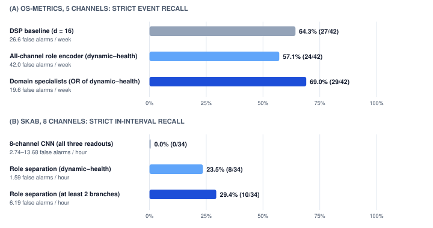
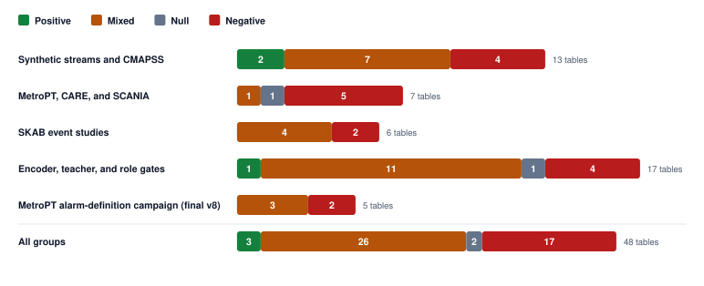

# From Sensor Streams to Bounded Machine Memory: Architecture, Negative Transfer Results, and Domain Specialists in μEngram

**Kamal Kishor Pandey** · kamal.pandey@kepr.dev

Independent Researcher · B.E. in Electronics & Telecommunications (2013–2017), Army Institute of Technology (AIT), Pune, India

**Keywords:** Bounded edge memory · Streaming anomaly detection · Noise whitening · Time-series foundation models · Knowledge distillation · Telemetry databases

Version 0.1.0 · October 29, 2026 · repository snapshot (`pyproject.toml`)

**How to cite:** Pandey, K. K. (2026). “From Sensor Streams to Bounded Machine Memory.” μEngram reference implementation, version 0.1.0 (October 29, 2026). Machine-readable metadata: `CITATION.cff`.

## Abstract

Industrial and edge equipment generate continuous telemetry across vibration, temperature, pressure, and system load. Retaining every raw window exhausts flash endurance and storage capacity, while naive first-in-first-out (FIFO) buffers overwrite rare fault episodes with routine operational data. This paper evaluates **μEngram** (read as *MicroEngram*; `uEngram` in code), a bounded stateful memory runtime that compresses short sensor windows into low-dimensional vectors, tracks operating regimes through noise-whitened statistical summaries, quarantines unverified shifts, and pins raw waveform slices for high-rarity episodes.

While synthetic benchmarks confirm that μEngram cuts storage writes by 86.2% on average over 10 seeds (`results/synth_runs.jsonl`, DSP $d=16$) at 1.00 modeled event recall, evaluations on public datasets and benchmark suites expose a sharp divide between point-wise anomaly ranking (AUROC) and operational early warning. Frozen detectors miss uncommissioned load states on MetroPT-3 (AUROC 0.07 and 0.35 for clean windows against the 24 h before a report, within sustained load), detect 0 of 5 events on MetroPT-2, and catch only 5 of 34 SKAB faults—all after physical onset. Furthermore, distilling foundation models (MOMENT-1-small [18] and Chronos-2 [22]) into a 46 KB edge student improves window ranking on MFPT and CMAPSS (CWRU saturates at 1.0000 AUROC for all models), yet flags the one held-out healthy recording per bearing dataset in every model (normal-file false-alarm rate 1.0; `results/cwru_two_teacher_gate.json`, `results/mfpt_two_teacher_gate.json`), and degrades timely maintenance recall at the 20-cycle remaining-useful-life (RUL) horizon. We show that overcoming channel dilution and covariance singularity requires pre-fit numerical diagnostics paired with a **role-separated, domain-specialist architecture**, which improves strict event recall on OS-Metrics to 69.0% (29/42), reduces false alarms to 19.6 per week, achieves 100% subsystem root-cause attribution (30/30 test-split events), and executes in $6.27\,\mu\text{s}$ per window.

> **Principal findings**
>
> 1. **Bounded memory works where its assumptions hold:** 86.2% fewer writes at 1.00 modeled event recall over 10 synthetic seeds (`results/synth_runs.jsonl`).
> 2. **Ranking is not warning:** every CWRU model reaches 1.0000 AUROC, yet every model flags the held-out healthy file (normal-file false-alarm rate 1.0).
> 3. **Proxy screens mislead:** the label-free screen's winner (middle layer, 0.610) scored a lower event median than the bottleneck in the full pipeline on both SKAB and MetroPT-3.
> 4. **Distillation can cost lead time:** on CMAPSS FD001 the ordinary CNN caught 7/10 failing engines by RUL 20; MOMENT and two-teacher students caught 2/10.
> 5. **Partitioning beats pooling:** domain specialists reach 29/42 strict recall at 19.6 false alarms per week on OS-Metrics, against 27/42 at 26.6 for the DSP baseline.
> 6. **Retraction:** the NASA IMS "63.8-hour early warning" claim is withdrawn (§3.2).

---

## 1. Introduction and the Flawed "Edge Mem0" Premise

Embedded telemetry systems face a structural retention dilemma: at one 16-float vector per second (86,400 vectors/day), raw vector payloads alone consume ~5.3 MiB daily before accounting for timestamps, metadata, index structures, and high-rate source waveforms. Updating approximate nearest-neighbor (ANN) graph indexes (such as HNSW) in place also introduces random-write amplification on raw NAND flash and eMMC storage. Conversely, ring buffers that evict strictly by age discard historical fault signatures whenever a machine runs normally for days after an incident.

This investigation originated from an embedded database proposal to port cloud LLM memory frameworks—specifically Mem0 [1]—directly to edge devices using ANN vector search. Testing that concept against physical telemetry exposed three architectural fallacies:

1. **Physical State vs. Conversational Memory:** Mining trucks, wind turbines, and compressors do not need natural-language entity extraction to remember user preferences; they require bounded tracking of wear baselines, operating regimes, and acute fault excursions.
2. **The Ingestion-Path Compute Bottleneck:** Cloud Mem0 invokes an LLM on every write to deduplicate facts and resolve contradictions. On an embedded gateway ingesting 100 Hz–1 kHz sensor streams, placing a language model in the write loop violates real-time latency and RAM bounds. Ingestion and consolidation must remain deterministic and mathematical.
3. **RAM Starvation and Flash Wear:** Continuous mutation of in-memory HNSW graphs starves constrained RAM and accelerates flash wear. Edge state memory requires tiered, density-aware compaction and strict admission gates.

To evaluate what works in practice, we analyze the `uEngram` Python reference implementation alongside its `EdgeMemory Lite` persistence adapter, synthesizing mechanism proofs, negative transfer findings, and methodological corrections across synthetic and field datasets.


---

## 2. Core Architecture and Memory Lifecycle


### 2.1 Feature Encoding and Noise-Whitened Projection

Rather than storing individual samples, μEngram processes time-aligned causal windows $X \in \mathbb{R}^{C \times K}$ across $C$ channels and $K$ samples. The baseline digital signal processing (DSP) encoder extracts per-channel mean, spread, and energy across four frequency bands. Alternative encoders include a compact two-stage 1D convolutional neural network (`CNNEncoder`) trained via reconstruction and partitioned domain-specialist encoders.

Because raw sensor features covary under load changes, Euclidean distance overweights correlated channels. μEngram projects features via principal component analysis (PCA) to dimension $d$ and applies within-state noise whitening [3] estimated from lagged differences between adjacent windows using the median absolute deviation (MAD). For a representation $r(x)$ with mean $\bar{r}$, PCA eigenvectors $V$, eigenvalues $\Lambda$, and within-state noise covariance $N$, the whitened state vector is:

$$z(x) = N^{-1/2}\Lambda^{-1/2}V^\top(r(x) - \bar{r})$$

This whitening step suppresses routine co-movement and outlier spikes during commissioning, though setting $d$ too wide introduces collinear frequency bands that make $N$ ill-conditioned or singular.

Algorithm 1 gives the noise estimate. Lag differences inside one state contain only noise, so a trimmed, reweighted covariance of those differences ignores the jumps caused by regime switches and faults. Listing 1 shows the DSP features and the symmetric whitening $N^{-1/2}$ built from it; eigenvalues below `rcond` times the largest are floored before inversion.

```algorithm | Algorithm 1. Robust within-state noise covariance (`robust_noise_cov`, `src/uengram/stats.py:82-89, 128-153`).
Input: projected training vectors z₁ … zₙ, lag L, trim quantile q_t = 0.975, iterations I = 5
Output: noise covariance N
D ← { (z_{t+L} − z_t) / √2 : t and t+L in the same group }
q ← χ²_d quantile at q_t ;  c ← q_t / P(χ²_{d+2} ≤ q)            ▷ consistency factor for trimming
N ← diag(σ̂²),  σ̂_j ← 1.4826 · MAD(D_j)                            ▷ robust per-dimension start
repeat I times
    keep ← { Δ ∈ D : Δᵀ N⁻¹ Δ ≤ q }                                ▷ drops regime jumps and steps
    if |keep| < max(10, d + 1) then raise ValueError
    N ← c · Cov(keep)
return N
```

```python | Listing 1. DSP band features and symmetric noise whitening (`src/uengram/encoders.py:41-48, 59-69`; type hints and docstrings trimmed).
def band_features(windows):
    x = np.asarray(windows, dtype=np.float64)
    N, C, K = x.shape
    mean = x.mean(axis=2)
    xc = x - mean[:, :, None]
    log_std = np.log(xc.std(axis=2) + 1e-6)
    power = np.abs(np.fft.rfft(xc, axis=2)[:, :, 1 : K // 2 + 1]) ** 2 / K
    bands = [np.log(b.sum(axis=2) + 1e-8) for b in np.array_split(power, 4, axis=2)]
    feats = np.stack([mean, log_std, *bands], axis=2)  # [N,C,6]
    return feats.reshape(N, C * 6)


class NoiseWhitener:
    def fit(self, z, noise_lag, groups):
        lam, V = np.linalg.eigh(robust_noise_cov(z, noise_lag, groups))
        lam = np.maximum(lam, self.rcond * max(float(lam.max()), 1e-12))
        self.W = (V / np.sqrt(lam)) @ V.T
        return self

    def transform(self, z):
        return np.asarray(z, dtype=np.float64) @ self.W
```

### 2.2 Bounded State Slots and Competitive Admission

μEngram divides a fixed memory budget into **semantic slots** (compact summaries of confirmed routine operating modes), **candidate slots** (unfamiliar patterns undergoing persistence probation), and **episodic slots** (rare excursions paired with pointers to raw time-series slices).

Early versions of μEngram evicted the weakest mature episodic slot whenever any out-of-gate sample arrived, allowing mild outliers to overwrite severe historical faults. Informed by thresholded streaming memory in MemStream [8], diversity-aware replay in Rainbow Memory [9], constrained buffer allocation [10], and prototype replay [11], μEngram implements **competitive rarity admission**. An incoming out-of-gate sample is admitted to a full episodic bank only if its rarity-derived importance exceeds the weakest stored episode; otherwise, it is discarded while probation candidates remain replaceable.


On a five-seed synthetic benchmark with a configured total budget of 16 slots (13 episodic, 3 semantic; `docs/EXPLAINED.md:375`), competitive admission raised mean event recall from 0.760 to 0.851 and write reduction from 85.78% to 87.56%; type recall stayed at 1.0 and current-regime retrieval rose from 0.998 to 1.0. Seizure-event recall fell from 0.667 to 0.600, so the rule is not a universal improvement and must be validated on independent real streams.

Algorithm 2 is the per-window update in `Engram.ingest`. Novelty is scored against semantic (normal) slots only, so a recurring fault held in an episodic slot cannot mask itself; rarity, the distance to any stored slot, ranks what is worth keeping. When the episodic bank is full, a new window must beat the weakest episode's importance, surprisal × (1 + log n) × $2^{-\text{age}/h}$ with $h$ = `half_life_epi` (default 20,000 steps), or it is discarded (Listing 2).

```algorithm | Algorithm 2. Per-window slot lifecycle (`Engram.ingest`, `_absorb`, `_step_detected`; `src/uengram/engine.py:143-245`).
Input: whitened vector z, step t, raw-window index r
G ← active candidate, episodic and semantic slots
for each k in G: d²_k ← Σ_j (z_j − μ_kj)² / v_kj                  ▷ v: predictive variance
score ← min over semantic k of d²_k ;  rarity ← min over G of d²_k
alarm ← score > τ_alarm
if some d²_k ≤ τ then                                               ▷ window is inside a gate
    P ← semantic slots inside τ if any, else all slots inside τ
    k* ← argmin over P of d²_k + Σ_j log v_kj
    ABSORB(k*, z, t)
else
    if not MAKEEPISODICROOM(t, surprisal(rarity)) then return discard
    open a candidate slot at z with raw pointer r                   ▷ action new_candidate
candidates older than n_promote steps become episodic
every consolidate_every steps: merge duplicate semantic slots, checkpoint drift, supersede dormant ones
Procedure ABSORB(k, z, t)
α ← max(1/(n_k+1), β_min) if k is semantic, else 1/(n_k+1)
e ← (z − μ_k) / √v_k ;  update (μ_k, S_k) with rate α ;  n_k ← n_k + 1
if k is semantic then
    E_k ← λ·e / s_step + (1 − λ)·E_k                               ▷ MEWMA, λ = 0.1
    if n_k ≥ n_min and c·‖E_k‖² > h then split k; old slot superseded   ▷ step_change
    return
record hit t ;  (m, N) ← (5, 8) for a candidate, (20, 30) for an episodic slot
if the m-th latest hit is within N steps and semantic room exists then promote k   ▷ promote
```

```python | Listing 2. Competitive episodic admission (`src/uengram/lifecycle.py:112-142`; docstring trimmed).
def _episodic_importance(eng, idx, t: int) -> np.ndarray:
    age = t - eng.t_last[idx]
    return (eng.surpr[idx] * (1.0 + np.log(eng.n[idx]))
            * 2.0 ** (-age / eng.cfg.half_life_epi))


def make_episodic_room(eng, t: int, incoming_surprisal: float | None = None) -> bool:
    group = np.flatnonzero((eng.kind == CAND) | (eng.kind == EPI))
    if len(group) < eng.cfg.B_epi:
        return True
    epi = np.flatnonzero(eng.kind == EPI)
    if len(epi):
        importance = _episodic_importance(eng, epi, t)
        victim_pos = int(np.argmin(importance))
        threshold = eng.cfg.episodic_admission_ratio * importance[victim_pos]
        if incoming_surprisal <= threshold:
            return False
        victim = epi[victim_pos]
    else:
        cand = np.flatnonzero(eng.kind == CAND)
        victim = cand[np.argmin(eng.t_created[cand])]
    evict_slot(eng, int(victim), t, "evict_episodic")
    return True
```

### 2.3 Layered Persistence and Target Database Primitives

In the implemented `src/uengram/sensor_memory.py` adapter, μEngram manages live in-memory states while recording new candidates, state promotions, step changes, and alarm open/clear transitions into `EdgeMemory Lite` as versioned `EVENT` records. The persisted action set is `_PERSIST_ACTIONS = {new_candidate, promote, step_change}` plus alarm transitions (`src/uengram/sensor_memory.py:33`, `:112-113`).


**Table 1.** Implemented adapter stages: owning module, interface, and behavior when the stage fails.

| Stage | Owner | Interface | Failure behavior |
|---|---|---|---|
| Window schema and step order | `sensor_memory.py` (`SensorStateMemory.ingest`) with `validate_sensor_window` in `sensor_memory_records.py` | `SensorWindow` | `ValueError` raised before the engine consumes the window |
| Encoding and whitening | Host-selected encoder (`encoders.py` and `encoder_*.py` variants) | `encode(windows)` | Outside the adapter; not covered by the adapter's error handling |
| Live bounded memory and lifecycle events | `engine.py` (`ingest`, `recall`, `drain_events`) | Engine API | Window already consumed; recovery must retry storage, not re-ingest |
| Persist gate | `SensorStateMemory._should_persist` | Internal to `ingest` | Returns a receipt with `memory_id=None` and `persisted=False`; no storage write |
| Raw-window pin | Host `RawEvidencePins` implementation (`sensor_memory_types.py`) | `pin(ref, key)`, `unpin(ref, owner)` | Pin released if the event write fails, then the error is raised |
| Event storage | EdgeMemory Lite via `EdgeMemoryPort` (external) | `remember`, `recall`, `forget` | `SensorMemoryPersistenceError` carries `pending`; retry with `persist_pending` without re-ingesting |
| Retrieval bundle | Engine `recall` (exact state) and EdgeMemory `recall` (keyword history) combined in `SensorStateMemory.recall` | `recall(query_vector, mode=…)` | `ValueError` for an invalid mode or non-finite or mis-shaped query |
| Alarm combination policy | `alarm.py` (`AlarmLogic`) | `combine`, `error_k` | Not on the adapter's write path; the adapter persists only `decision.flagged` transitions |

Listing 3 is the write path behind the last two failure columns. The pin is taken before `remember`, released if `remember` raises, and the caller receives the pending record, so a retry never re-feeds the window into the engine.

```python | Listing 3. Pin-before-write persistence (`src/uengram/sensor_memory.py:120-123, 212-239`; asserts and the source, trust, privacy and retention arguments trimmed).
# in SensorStateMemory.ingest
try:
    return self._persist(pending, decision, window.step_index)
except Exception as exc:
    raise SensorMemoryPersistenceError(pending, decision, exc) from exc


def _persist(self, pending, decision, step_index):
    pinned = False
    if pending.raw_window_ref is not None:
        self.raw_evidence.pin(pending.raw_window_ref, pending.idempotency_key)
        pinned = True
    try:
        result = self.memory.remember(
            pending.content,
            kind=_EDGE_EVENT,
            structured_value=pending.structured_value,
            observed_at_ms=pending.observed_at_ms,
            idempotency_key=pending.idempotency_key,
            keywords=pending.keywords,
        )
    except Exception:
        if pinned:
            self.raw_evidence.unpin(pending.raw_window_ref, pending.idempotency_key)
        raise
```

Re-ingesting a window after a persistence failure is not allowed: the adapter returns the unpersisted records in `SensorMemoryPersistenceError.pending` for retry with `persist_pending` (`src/uengram/sensor_memory.py:37-50`), and pins raw waveform slices before the event write, releasing the pin if that write fails. Scaling this pipeline into a complete embedded "Sensor-State Memory" DBMS would require five **proposed** primitives. Generic slot merge, fixed capacities, and adapter pins are only precursors; none of the five is implemented as specified:

1. **Hybrid Temporal–Vector–Severity Retrieval:** Ranking stored memories $m$ for query $q$ via $S(q,m)=w_s\,\mathrm{sim}(q,v_m)+w_t\,e^{-\lambda\Delta t}+w_r\,g(r_m)$, returning individual score components alongside strict asset/mode metadata filters rather than an opaque scalar.
2. **Verified Centroid Compaction:** Merging confirmed routine windows within identical `(asset, mode, schema)` keys using exact pooled counts, means $\mu = (n_1\mu_1 + n_2\mu_2)/(n_1 + n_2)$, and covariances prior to source deletion.
3. **Keyed State Superseding:** Updating active baselines via exponential moving averages $\mu_t = (1-\beta)\mu_{t-1} + \beta x_t$ gated by quarantine rules so gradual wear is not absorbed as healthy behavior.
4. **Pinned Cross-Modal Raw Pointers:** Linking compact episodes to `(stream_id, start_offset, length, checksum)` slices in circular buffers with explicit expiration tracking.
5. **Quota-Bounded Eviction with Protected Quotas:** Enforcing deterministic high-water marks while shielding pinned critical episodes and active investigations from deletion.

An optional LLM belongs strictly downstream of retrieval to summarize structured evidence bundles; it must never sit in the real-time write path or control baseline admission.

Alarm logic in `src/uengram/alarm.py` can OR the gated statistical channel with an evidence-driven tripwire:

$$\text{Alarm} = \text{Novelty}_{\text{gated}} \lor \text{Tripwire}_{\text{evidence}}$$

With `AlarmLogic(combine="or", error_k=3)`, the external evidence stream opens a persisted tripwire over `error_k` windows. The tripwire is active only when a run receives a real evidence array, so an uncorroborated run cannot alarm on an implicit placeholder. The default `combine="and"` keeps the original gated behavior.

---

## 3. Baseline Benchmarks and Methodological Pitfalls

### 3.1 Summary of Core Benchmark Evidence

Across development and holdout studies [6], empirical performance diverges sharply between controlled synthetic streams and physical equipment.

**Table 2.** Core benchmark evidence across synthetic and field datasets.

| Dataset / Study | Configuration | Primary Result | Operational & Methodological Verdict |
|---|---|---|---|
| **Synthetic Stream** (10 seeds) | DSP ($d=16$) | 1.00 event recall (every seed); AP 0.9955 (0.9795–1.0000); 86.2% write reduction (85.3–87.2%; mean 2,762 of 20,000 windows) | Validates bounded memory mechanics under known generative assumptions; CNN variant achieved only 0.262 recall despite high AUROC. |
| **CMAPSS FD001** (5 seeds) | DSP ($d=16$) | Health AUROC 0.999, AP 0.995; RUL RMSE 42.1 (vs. 25.8 naive storage) | Separating early/late life (AUROC) does not yield accurate remaining-life regression (RMSE); $d=32$ failed due to singular frequency covariance. Quality metrics are identical across the five seeds in `results/cmapss_runs.jsonl`; only latency varies, so no seed range is reported. |
| **MetroPT-3** (5 seeds) | CNN `uengram` | Mean 3.6/4 events detected (seed range 2–4); 10.2 FA/week (6.1–14.2); mean lead time −5.95 h (−16.5 to +11.3). Source: `results/metropt_runs.jsonl`. | 492 of 495 event windows fall in sustained load, which commissioning never contained. Clean windows vs. the 24 h before a report, within sustained load, give AUROC 0.07 (health) and 0.35 (novelty); this is a docs analysis (`docs/research-alarm-components.md:54-66`), not a result JSON. |
| **MetroPT-2** | Default MetroPT-3 design replayed (Table A42) | 0/5 events detected (January 0/3, April 0/2) | Per-stream counts from Appendix Table A42; no seed flag is recorded for this replay. |
| **SKAB** (single seed, 0) | DSP, uEngram policy | 5/34 fault experiments detected; AUROC 0.546; AP 0.419; 135 FA/week | Source `results/skab_validation.json`. One seed, so the weekly rate is a single-run estimate. |
| **EngineAD** [2] | CNN ($d \in \{8,16,32\}$, 10 seeds each) | Held-out truck pooled 5-minute segment AUROC near chance (seed medians 0.538, 0.556, 0.536 for $d$ = 8, 16, 32; $d=16$ range 0.540–0.566; seed-level JSON at `results/enginead/cnn_seed_stability.json`) | Pre-fitted fleet-wide PCA channels leak preprocessing across splits, and 5-minute segment labels mix normal and faulty seconds. |
| **SCANIA Component X** (single seed, 0) | Frozen AND policy | 22.8% recall on classes 1–4 at final row; 19.3% alarm rate on class 0; AUROC 0.541 | Coarse repair-proximity classes on 5,046 vehicles cannot measure lead time or early warning. One seed in `results/scania_validation.json`. |


### 3.2 Critical Error Post-Mortems

Several benchmark failures exposed traps that routinely distort published anomaly-detection claims:

* **Retraction of the NASA IMS "63.8-Hour Early Warning" Claim [7]:** A prior project-session recap and draft section reported that an "optimal strategy" on the NASA/IMS bearing dataset achieved 63.8 hours of early warning and zero false alarms over four healthy weeks. Inspection of the external script invalidated both claims: (1) the script hardcoded assumed degradation row indices in Python and evaluated lead time against its own hardcoded indices using the final sample as failure reference, without adjudicated physical fault-onset timestamps; and (2) "zero alarms" came from the assumed healthy prefix of a single campaign. Those claims are retracted in full (`docs/research-paper/sensor-state-memory.md:266-270`).
* **Encoder Width Regressions:** Sweeping DSP width from $d=16$ to $d=36$ on synthetic streams dropped mean event recall from 1.00 to 0.357 and mean AP from 0.9955 to 0.565 (10 seeds each; $d=36$ from `results/synth_d36_runs.jsonl`, median AP 0.558; $d=16$ from `results/synth_runs.jsonl`). On SKAB, an exploratory $d=48$ sweep (`results/skab_d_sweep.json`) detected 9/34 events, against 5/34 for the frozen $d=16$ detector. The sweeps do not identify one embedding dimension that is best across datasets.
* **Threshold Tuning Cannot Fix Missing State Coverage:** A parameter sweep over MetroPT-3 alarm policies failed to find any setting meeting all three operational criteria (4/4 events detected, $\le 2\%$ clean alarm time, $\le 1$ FA/week). Forcing 4/4 detection required enabling a health path for unbaselined states, which inflated clean alarm time to $\ge 4.6\%$. An earlier version of this same sweep reported 4/4 events at 1.06% clean alarm time by ANDing the gated policy with an error-threshold vote (`docs/research-error-gated-alarm.md:140-148`); auditing that result showed the vote never activates in sustained load (0 of 1,832 state-2 test windows), so the "gate" was a recency cap on state-0/1 windows, not corroborated detection — a diagnostic recency-only rule with no error content reproduces the same 4/4 rows. Correcting unknown-sample handling to the ISA three-valued rule (`docs/research-alarm-definition.md:104-111`) made the 1.06% result disappear, leaving the $\ge 4.6\%$ figure above.

---

## 4. Representation Depth and Foundation-Model Distillation

### 4.1 Intermediate CNN Readouts: Proxy Screen vs. Full Pipeline

Recent literature suggests that intermediate network layers and patch prototypes preserve localized anomaly signals that final reconstruction bottlenecks smooth over, including VGG middle-layer game-theoretic importance (LayerIM) [12], layer-16 foundation representations in TimeRep [13], and patch memory gates in MOMEMTO [15].

To test this without test-label leakage, we extended `CNNEncoder` with a `representation="multiscale"` option that pools and concatenates first- and second-stage convolutional feature maps ($r(x) = [\operatorname{pool}(h_1(x)); \operatorname{pool}(h_2(x))]$) before PCA and noise whitening. We first ran a label-free synthetic screen across 5 neural seeds (384 training windows, 96 selection windows injected with 5 fault families: level shift, drift, impulse, oscillation, freeze). On that proxy ruler, the middle-layer readout ($d=32$, 30 epochs) ranked first with a median worst-family displacement score of **0.610** (vs. **0.373** for multi-level and **0.356** for the final bottleneck), while training for 90 epochs degraded every configuration by over-specializing on waveform reconstruction.

However, running those exact five seeds through the full calibrated alarm pipeline (`bench/cnn_stability.py`, $d=32$, 30 epochs, frozen v2 policy) overturned the proxy screen:

**Table 3.** Intermediate CNN readouts through the full calibrated alarm pipeline (5 seeds, $d=32$, 30 epochs; `results/cnn_intermediate_pipeline.json`).

| Dataset | Readout | Events Detected (med, min–max) | AUROC (med, min–max) | AP (med, min–max) | False Alarms/Wk (med) | Clean Alarm Share (med) |
|---|---|---:|---:|---:|---:|---:|
| **SKAB** | Bottleneck (plain) | **23.0** (18–34) | **0.623** (0.480–0.675) | **0.511** (0.441–0.585) | 189.25 | 0.480 |
| **SKAB** | Middle layer | 20.0 (18–29) | 0.570 (0.540–0.660) | 0.505 (0.448–0.538) | 243.32 | 0.440 |
| **SKAB** | Multi-level | 20.0 (13–33) | 0.571 (0.553–0.687) | 0.504 (0.467–0.518) | 243.32 | **0.310** |
| **MetroPT-3** | Bottleneck (plain) | 4.0 (3–4) | 0.989 (0.987–0.996) | 0.676 (0.485–0.959) | 0.69 | 0.022 |
| **MetroPT-3** | Middle layer | 3.0 (3–4) | 0.990 (0.987–0.992) | 0.617 (0.517–0.671) | **0.58** | **0.019** |
| **MetroPT-3** | Multi-level | **4.0** (4–4) | **0.992** (0.988–0.996) | **0.773** (0.541–0.956) | **0.58** | 0.025 |

In the full pipeline the middle layer had the lower event median on both datasets (SKAB 20 vs. 23; MetroPT-3 3 vs. 4), though on MetroPT-3 its median AUROC was marginally higher (0.990 vs. 0.989) and its false-alarm rate lower (0.58 vs. 0.69 per week). Seed spread was wide on SKAB (13–34 events across all readouts; 18–34 for the bottleneck alone), and no readout dominated across modalities. Accordingly, `representation="bottleneck"` remains the default encoder (`CNNEncoder.__init__`, `src/uengram/encoder_cnn.py:26`).

### 4.2 Offline Foundation-Model Distillation

Because deploying 100M+ parameter time-series foundation models directly on microcontrollers or gateways violates memory and latency constraints [16], `src/uengram/teacher_transfer.py` implements **offline teacher-to-student distillation**. During commissioning, causal right-aligned windows $X_t$ are passed to one or $M$ frozen teachers (such as MOMENT-1-small [18], 141 MB, and Chronos-2 [22], 478 MB) while a 46,144-byte student CNN ($S_\theta$) minimizes reconstruction error alongside dimension-normalized feature matching:

$$\mathcal{L}(\theta) = \operatorname{MSE}\big(D(S_\theta(X_t)), X_t\big) + \lambda \frac{1}{B}\sum_{b=1}^{B}\operatorname{MSE}_b\big(H(S_\theta(X_t)), T(X_t)\big) + \lambda_{\mathrm{orth}}\operatorname{mean}\big((W W^\top - I)^2\big)$$

The loss is implemented in the `CNNEncoder` training loop (`src/uengram/encoder_cnn.py`). $\operatorname{MSE}_b$ averages over the $b$-th teacher feature block, and $B$ is the number of feature blocks.

Listing 4 shows the training step. Teacher targets are standardised per feature before matching (`src/uengram/encoder_cnn.py:162-168`), and when several teachers are stacked each feature block is averaged separately, so a 514-dimensional MOMENT block cannot outweigh a 32-dimensional Chronos-2 block.

```python | Listing 4. Reconstruction, orthogonality and block-averaged teacher loss in one training step (`src/uengram/encoder_cnn.py:201-229`; reflowed).
z = self._forward_enc(xb)
recon = torch.mean((dec(z).reshape(-1, C, K) - xb) ** 2)
loss = recon
if self.ortho_beta > 0.0:
    W = self.fc.weight
    loss = loss + self.ortho_beta * torch.mean((W @ W.T - I) ** 2)
if target is not None:
    student = self.teacher_head(self._readout(xb))
    if teacher_features is not None and teacher_features.block_slices:
        teacher_loss = torch.stack([
            torch.mean((student[:, start:end] - target[indices, start:end]) ** 2)
            for start, end in teacher_features.block_slices
        ]).mean()
    else:
        teacher_loss = torch.mean((student - target[indices]) ** 2)
    loss = loss + teacher_weight * teacher_loss
opt.zero_grad()
loss.backward()
opt.step()
```

Because foundation models are often applied after per-window z-normalization, which erases absolute pressure or vibration levels, we instead appended raw per-channel statistics to the teacher embedding: $T^+(X) = [T(X), \mu_1..\mu_C, \sigma_1..\sigma_C]$ (per-window mean and standard deviation; `src/uengram/moment_teacher.py`). The teacher input is not z-normalized. We also tested left-edge padding versus linear time resampling when the edge window $K$ is shorter than the teacher's native context $L$.

### 4.3 Cross-Dataset Distillation Results

Evaluating single- and dual-teacher distillation across six benchmark gates revealed that higher foundation-model AUROC frequently masks severe operational alarm failures:

1. **MetroPT-3 vs. Synthetic Context Mismatch:** Distilling MOMENT-1-small into the student improved MetroPT-3 test AP from 0.6225 to 0.7942 (AUROC 0.9756 to 0.9775), but degraded synthetic 4-family probe AUROC from 0.6872 (ordinary CNN) to 0.5035 (edge-padded) and 0.5362 (resampled + instance statistics).
2. **TSB-AD-U External Holdout (6 series [21]):** On the six TSB-AD-U series, resampled MOMENT + statistics edged out the ordinary CNN on pooled AUROC (0.9157 vs. 0.9111), where long series dominate, but lost on equal-series AUROC (0.6316 vs. 0.6476).
3. **MFPT [23] and CWRU [24] Bearing Gates (Ranking vs. Calibration):** Combining MOMENT (514 dims) and Chronos-2 (32 quantile/median dims) into a 46 KB student raised MFPT window AUROC from 0.7948 to 0.8253 (file AUROC 0.85 to 0.90) and achieved 1.0000 AUROC across all models on CWRU. Per-window encode time for the two-teacher student was 0.0606 ms on MFPT and 0.0635 ms on CWRU (`encode_test_ms_per_window` in `results/mfpt_two_teacher_gate.json` and `results/cwru_two_teacher_gate.json`). However, every model flagged the single held-out normal file on both datasets (normal-file false-alarm rate 1.0000; one normal file per dataset in the same two JSONs), because training-normal distance thresholds treated unseen healthy load regimes as faults.
4. **CMAPSS FD001 Run-to-Failure Gate [25] (AUROC vs. Timely Maintenance Lead):** Training on engines 1–40 (first 30 windows) and evaluating through failure on engines 41–50 (requiring 3 consecutive anomalous windows), teacher-distilled students achieved higher window AUROC (0.9890–0.9902 vs. 0.9823 for the ordinary CNN). Yet by the RUL 20 maintenance horizon, the ordinary CNN caught **70% (7/10)** of failing engines on time, whereas MOMENT and Two-Teacher students caught only **20% (2/10)**.
5. **SKAB Wall-Clock Gate (Single-Channel vs. 8-Channel Fusion):** Under a 30-minute CPU cap, single-channel teacher runs caught **0/34** events strictly within fault intervals (AUROC 0.463–0.471, 5.47–8.75 FA/hr). Removing the teachers to run all 8 channels through the multiscale CNN cut healthy false alarms by 58.3% (from 6.57 to 2.74 FA/hr) and raised AUROC to 0.5270, but strict in-interval event recall remained **0/34**.


---

## 5. Role-Separated Encoders and Domain Specialists

### 5.1 Role Separation: Mode, Level, Dynamic, and Health

The failure of monolithic encoders on SKAB and multi-channel telemetry stems from mixing incompatible physical variations into a single distance metric. In `src/uengram/role_architecture.py`, we decompose telemetry into four explicit branches:

* **Mode:** Operating context (idle, startup, load, transition), used solely for conditioning rather than voting on alarms.
* **Level:** Per-channel absolute levels, robust spread, and short-term trends.
* **Dynamic:** Deterministic multiscale frequency and transient shifts.
* **Health:** Distance from a frozen commissioning reference.

The Level, Dynamic, and Health branches are calibrated independently on healthy data and fused via empirical tail probabilities. Only operator-confirmed normal windows enter semantic memory; unconfirmed normal windows route to quarantine, and alarmed windows route to episodic memory. On the 8-channel SKAB split, where all three CNN representations scored 0/34 strict recall, the role-separated architecture achieved **10/34 strict recall** at 6.19 FA/hr (`at_least_2` policy) and **8/34 strict recall** at **1.59 FA/hr** (`dynamic_health` policy).

Each branch score $s$ becomes an upper-tail p-value against $n$ scores $c_1 \dots c_n$ from a separate healthy calibration stream (`EmpiricalCalibrator`, `src/uengram/role_architecture.py:47-55`):

$$p(s) = \frac{1 + \#\{\, i : c_i \ge s \,\}}{n + 1}$$

A branch fires when $p \le \alpha$. Listing 5 shows how the fusion policies combine the three alarm branches and how a window is routed; the mode branch never votes.

```python | Listing 5. Branch fusion policies and memory routing (`src/uengram/role_architecture.py:168-188`; signature reflowed).
flags = np.stack([np.asarray(p_values[name]) <= alpha
                  for name in cls._ALARM_BRANCHES], axis=1)
if policy == "any":
    return flags.any(axis=1)
if policy == "at_least_2":
    return flags.sum(axis=1) >= 2
if policy == "dynamic_health":
    return flags[:, 1] & flags[:, 2]
return flags.all(axis=1)


def memory_route(p_values, alpha, *, alarm_open, data_quality_ok,
                 operator_confirmed_normal=False) -> str:
    """Route evidence without allowing unconfirmed data to poison normal memory."""
    if not data_quality_ok:
        return "QUARANTINE"
    if alarm_open or any(float(p_values.get(name, np.nan)) <= alpha
                         for name in RoleBasedArchitecture._ALARM_BRANCHES):
        return "EPISODIC"
    if operator_confirmed_normal:
        return "SEMANTIC"
    return "QUARANTINE"
```

### 5.2 Pre-Fit Numerical Diagnostics and Domain Specialists on OS-Metrics

To test role separation on multi-subsystem operational telemetry, we evaluated the **OS-Metrics** dataset (Zenodo 17981352; 40,320 15-second samples over 7 days across CPU, memory, and network channels with 42 annotated disturbances).

Initial 6-channel ingestion crashed with `LinAlgError: Singular matrix` during noise whitening. To prevent silent numerical instability or crashes, we built a pre-fit diagnostic module (`src/uengram/diagnostics.py`) that inspects covariance rank, condition number, sentinel rates, and null-space collinearity before fitting. It automatically flagged the 6-channel matrix as `singular` (rank 5/6, condition number $7.15 \times 10^{15}$) because `network_response_time_diff` was an exact linear combination of streams `a` and `b`, while certifying the 5 primitive channels as `moderately_conditioned` (rank 5/5, condition number $4.76 \times 10^8$).

```python | Listing 6. Rank, conditioning and null-space checks in `diagnose_channels` (`src/uengram/diagnostics.py:118-166`; empty-input guards and the perfect-correlation scan trimmed).
evals, evecs = np.linalg.eigh(cov)
evals = np.maximum(evals, 0.0)
order = np.argsort(evals)[::-1]
evals, evecs = evals[order], evecs[:, order]
max_ev, min_ev = float(evals[0]), float(evals[-1])
rcond_eps = np.finfo(np.float64).eps * max(max_ev, 1e-12) * n_channels
effective_rank = int(np.sum(evals > rcond_eps))
cond = float(max_ev / max(min_ev, 1e-18))

redundant_groups = []
if effective_rank < n_channels:
    null_vecs = evecs[:, effective_rank:]
    for j in range(null_vecs.shape[1]):
        v = null_vecs[:, j]
        group = tuple(names[i] for i in np.where(np.abs(v) > 0.1)[0])
        if group and group not in redundant_groups:
            redundant_groups.append(group)

if effective_rank < n_channels or cond > 1e12:
    status = "singular" if effective_rank < n_channels else "ill_conditioned"
elif cond > 1e6:
    status = "moderately_conditioned"
else:
    status = "well_conditioned"
```

Even on the 5 primitive channels, pooling all metrics into one global role encoder underperformed the DSP baseline (24/42 recall at 42.0 FA/wk vs. DSP's 27/42 at 26.6 FA/wk) because localized subsystem spikes were diluted by quiet channels. Partitioning the telemetry into dedicated **Domain Specialists** (`src/uengram/domain_specialists.py`—independent CPU, Memory, and Network role encoders fused via a calibrated `or_dynamic_health` rule) resolved the dilution:

```algorithm | Algorithm 3. Domain-specialist scoring, fusion and routing (`DomainSpecialistArchitecture.score`, `fuse`, `memory_route`; `src/uengram/domain_specialists.py:128-219`).
Input: window x; specialists s with channel sets C_s (CPU, Memory, Network); level α (default 0.01)
Output: alarm, triggering specialists A, memory route
for each specialist s do
    p_s,b ← calibrated p-value of branch b ∈ {level, dynamic, health} on x[C_s]
    flag_s ← (p_s,dynamic ≤ α) and (p_s,health ≤ α)                ▷ dynamic_health branch policy
alarm ← flag_CPU or flag_Memory or flag_Network                    ▷ or specialist rule
A ← { s : flag_s }                                                  ▷ root-cause attribution
score ← Σ_s −log min_b p_s,b                                        ▷ continuous fused score
if data quality fails then route ← QUARANTINE
else if alarm is open or A ≠ ∅ then route ← EPISODIC (with A)
else if operator confirmed normal then route ← SEMANTIC
else route ← QUARANTINE
```

**Table 4.** OS-Metrics chronological split: DSP baseline, all-channel role encoder, and domain specialists (`results/osmetrics_specialist_gate.json`; all-channel latency from `results/osmetrics_role_gate.json`).

| Architecture (OS-Metrics Chronological Split) | Strict Event Recall | 2-Hour Recall | False Alarms / Week | Window AUROC | Root-Cause Attribution | Latency / Window |
|---|---:|---:|---:|---:|---:|---:|
| DSP ($d=16$) Baseline | 27/42 (64.3%) | 30/42 (71.4%) | 26.6 | 0.8845 | N/A | — |
| All-Channel Role (`dynamic_health`) | 24/42 (57.1%) | 30/42 (71.4%) | 42.0 | 0.8731 | N/A | $6.80\,\mu\text{s}$ |
| **Domain Specialists (`or_dynamic_health`)** | **29/42 (69.0%)** | **29/42 (69.0%)** | **19.6** | **0.8919** | **30/30 (100.0%)** | **$6.27\,\mu\text{s}$** |

Domain Specialists achieved the highest strict recall (69.0%), the lowest false-alarm rate (19.6/week), and 100% subsystem attribution accuracy (30/30 test-split events, `results/osmetrics_specialist_gate.json`) while maintaining a $6.27\,\mu\text{s}$ per-window execution time.



Per-subsystem results (from `results/osmetrics_specialist_gate.json`) show where each detection comes from. The per-subsystem event counts sum to the 42 disturbances (13 + 12 + 17):

**Table 5.** Per-specialist results on OS-Metrics (`results/osmetrics_specialist_gate.json`).

| Specialist | Assigned channels | Strict event recall | False-alarm episodes | Window AUROC |
|---|---|---:|---:|---:|
| CPU | `cpu_usage` | 7/13 (53.8%) | 6 | 0.9589 |
| Memory | `memory_usage`, `memory_used` | 8/12 (66.7%) | 8 | 0.9641 |
| Network | `network_response_time_a`, `network_response_time_b` | 14/17 (82.4%) | 12 | 0.8924 |
| Fused (`or_dynamic_health`) | all 5 primitive channels | 29/42 (69.0%) | 14 (19.6/week) | 0.8919 |

In isolated incidents, such as `mem_1765646427688_2393`, only the memory specialist fired. In cascading disruptions, such as `mem_1765654018485_7936`, all three specialists fired. Per-specialist firing for these two events is not reproduced in the archived result files, so both are illustrative case notes, not verified results.

---

## 6. Discussion, Limitations, and Deployment Gate

This study makes no "first-ever" algorithmic claim; it builds on established analytical redundancy [4, 5], noise whitening [3], streaming memory [8–11], and recent time-series benchmarks [18–26]. Its primary contribution is architectural and methodological: demonstrating how bounded sensor-state memory must separate mode, level, and dynamic roles per subsystem while guarding against baseline poisoning and deceptive benchmark metrics.

Appendix A tabulates the repository's current results, each with its source file and an outcome tag. Figure A1 shows the balance: most tables are negative or mixed, and only a few are clean positives, so the positive findings in §2 to §5 should be read against that record.

Before transitioning μEngram from a Python reference design to a safety-relevant embedded C/Rust DBMS deployment, five engineering gates remain mandatory:

1. **Preregistered Multi-Asset Field Cohort:** Evaluate on held-out physical assets with independently adjudicated fault-onset timestamps and complete operating-mode coverage (startup, idle, full load, post-repair), preventing preprocessing leakage across vehicles or machines.
2. **Adversarial Poisoning and Shadow Baselines:** Replay slow degradation ramps against a frozen shadow reference to verify that quarantine gates prevent gradual wear from updating semantic healthy centroids.
3. **Abstention as a First-Class Output:** Explicitly emit `unknown_operating_mode` or `insufficient_calibration_support` rather than forcing out-of-distribution loads into false alarms or healthy summaries.
4. **Transactional Cross-Store Crash Recovery:** Implement an atomic write-ahead outbox unifying μEngram checkpoint state, `EdgeMemory` event records, and circular-buffer pin reference counts across power cuts.
5. **Hardware Storage Profiling:** Measure p99 latency, peak RAM, flash write amplification, and ANN/exact recall under high-water-mark eviction on target embedded flash hardware.

---

## References

1. Chhikara, P., Khant, D., Aryan, S., Singh, T., and Yadav, D. (2025). “Mem0: Building Production-Ready AI Agents with Scalable Long-Term Memory.” [arXiv:2504.19413](https://arxiv.org/abs/2504.19413).
2. Hojjati, H., Roth, C., Woods, R., Sills, K., and Armanfard, N. (2026). “EngineAD: A Real-World Vehicle Engine Anomaly Detection Dataset.” [arXiv:2603.25955](https://arxiv.org/abs/2603.25955).
3. Green, A. A., Berman, M., Switzer, P., and Craig, M. D. (1988). “A Transformation for Ordering Multispectral Data in Terms of Image Quality with Implications for Noise Removal.” *IEEE Trans. Geosci. Remote Sens.*, 26(1), 65–74. [doi:10.1109/36.3001](https://doi.org/10.1109/36.3001).
4. Willsky, A. S. (1976). “A Survey of Design Methods for Failure Detection in Dynamic Systems.” *Automatica*, 12(6), 601–611. [[PDF]](https://willsky.lids.mit.edu/publ_pdfs/15_pub_AUTO.pdf).
5. Chow, E. Y., and Willsky, A. S. (1984). “Analytical Redundancy and the Design of Robust Failure Detection Systems.” *IEEE Trans. Autom. Control*, 29(7), 603–614. [doi:10.1109/TAC.1984.1103593](https://doi.org/10.1109/TAC.1984.1103593).
6. μEngram repository documentation and benchmark artifacts (`docs/RESULTS.md`, `docs/sensor-state-memory-pipeline.md`, `docs/research-teacher-distillation.md`, `docs/osmetrics-specialist-gate.md`).
7. NASA IMS Bearings Dataset, NASA Open Data Portal. [https://data.nasa.gov/dataset/ims-bearings](https://data.nasa.gov/dataset/ims-bearings).
8. Bhatia, S., Jain, A., Srivastava, S., Kawaguchi, K., and Hooi, B. (2022). “MemStream: Memory-Based Streaming Anomaly Detection.” *Proc. ACM Web Conf. 2022*. [doi:10.1145/3485447.3512221](https://doi.org/10.1145/3485447.3512221) · [arXiv:2106.03837](https://arxiv.org/abs/2106.03837).
9. Bang, J., Kim, H., Yoo, Y., Ha, J.-W., and Choi, J. (2021). “Rainbow Memory: Continual Learning With a Memory of Diverse Samples.” *CVPR 2021*, 8218–8227. [[CVF]](https://openaccess.thecvf.com/content/CVPR2021/html/Bang_Rainbow_Memory_Continual_Learning_With_a_Memory_of_Diverse_Samples_CVPR_2021_paper.html).
10. Elenter, J., NaderiAlizadeh, N., Javidi, T., and Ribeiro, A. (2024). “Primal Dual Continual Learning: Balancing Stability and Plasticity through Adaptive Memory Allocation.” [arXiv:2310.00154v2](https://arxiv.org/abs/2310.00154).
11. Aghasanli, A., Li, Y., and Angelov, P. (2025). “Prototype-Based Continual Learning with Label-free Replay Buffer and Cluster Preservation Loss.” [arXiv:2504.07240](https://arxiv.org/abs/2504.07240).
12. Yang, L., Lu, L., Liu, C., et al. (2025). “Interactive exploration of CNN interpretability via coalitional game theory.” *Scientific Reports*, 15, 9261. [doi:10.1038/s41598-025-94052-8](https://doi.org/10.1038/s41598-025-94052-8).
13. Han, C. S., and Lee, K. M. (2025). “Leveraging Intermediate Representations of Time Series Foundation Models for Anomaly Detection.” [arXiv:2509.12650](https://arxiv.org/abs/2509.12650).
14. Park, J., and Kang, S. (2026). “PaAno: Patch-Based Representation Learning for Time-Series Anomaly Detection.” [arXiv:2602.01359v2](https://arxiv.org/abs/2602.01359v2).
15. Yoon, S., Kim, J., Ha, J., and Ko, Y. M. (2026). “Patch-based Memory Gate Model in Time Series Foundation Model.” [arXiv:2509.18751v4](https://arxiv.org/abs/2509.18751v4).
16. dos Santos Oliveira, A., da Silva, F. S. T., Ferreira, D. L., et al. (2026). “Looking at anomaly detection in EdgeAI through the up-to-date lens of academic and market perspectives.” *Cluster Computing*, 29, 251. [doi:10.1007/s10586-026-05954-9](https://doi.org/10.1007/s10586-026-05954-9).
17. Kim, M., Bhaumik, K. K., Ali, A. A., and Woo, S. S. (2024). “MIXAD: Memory-Induced Explainable Time Series Anomaly Detection.” [arXiv:2410.22735](https://arxiv.org/abs/2410.22735).
18. Goswami, M., et al. (2024). “MOMENT: A Family of Open Time-series Foundation Models.” *ICML 2024*. [arXiv:2402.03885](https://arxiv.org/abs/2402.03885) · [[Code]](https://github.com/moment-timeseries-foundation-model/moment).
19. Kim, J., Yoon, S., Ko, Y. M., Kim, Y., Kim, S. I., and Tae, J. (2026). “Complexity- and Statistics-Guided Anomaly Detection in Time Series Foundation Models.” *ICLR 2026*. [[Paper]](https://proceedings.iclr.cc/paper_files/paper/2026/file/d06768735ce7d11ade5baef7099b4e05-Paper-Conference.pdf).
20. Khan, U., Capogrosso, L., Biondani, F., Magno, M., and Fummi, F. (2026). “ChronosAD: Leveraging Time Series Foundation Models for Accurate Anomaly Detection.” [arXiv:2606.01300](https://arxiv.org/abs/2606.01300).
21. TSB-AD Project. “A Comprehensive Benchmark for Time-Series Anomaly Detection.” [https://thedatumorg.github.io/TSB-AD/](https://thedatumorg.github.io/TSB-AD/).
22. Ansari, A. F., et al. (2025). “Chronos-2: From univariate to multivariate probabilistic time series forecasting.” [arXiv:2510.15821](https://arxiv.org/abs/2510.15821) · [[Model Card]](https://huggingface.co/amazon/chronos-2).
23. Bechhoefer, E. (2013). “A Data-Driven Approach to Predictive Maintenance of Industrial Equipment.” MFPT Fault Data Sets. [https://www.mfpt.org/fault-data-sets/](https://www.mfpt.org/fault-data-sets/).
24. Case Western Reserve University Bearing Data Center. [Source 97.mat](https://engineering.case.edu/sites/default/files/97.mat) · [[Metadata Manifest]](https://github.com/VictorBauler/BearingDatasets/blob/main/src/bearing_datasets/datasets/cwru/files.csv).
25. NASA. “Turbofan Engine Degradation Simulation Data Set (CMAPSS FD001).” NASA Open Data Portal. [https://data.nasa.gov/dataset/cmapss-jet-engine-simulated-data](https://data.nasa.gov/dataset/cmapss-jet-engine-simulated-data).
26. Si, H., Li, J., Pei, C., et al. (2024). “TimeSeriesBench: An Industrial-Grade Benchmark for Time Series Anomaly Detection Models.” [arXiv:2402.10802v3](https://arxiv.org/abs/2402.10802).


<!-- RESULTS-APPENDIX:BEGIN -->

## Appendix A. Complete Results Ledger

This appendix tabulates every non-versioned result file in the repository, except an empty CMAPSS file and a SCANIA score archive that repeats the validation JSON: 43 tables. Each table is generated by `scripts/build_results_appendix.py` directly from the JSON and JSONL it cites, so no value is typed by hand. Campaigns that were repeated under version labels appear once, as their final version: the superseded v1 to v7 runs are omitted. Every table carries an outcome tag, and negative and null results are kept beside the positive ones.

**How outcomes are assigned.** *Positive*: the tested change beat its in-study baseline on the primary metric with no guard metric failing. *Negative*: it missed its own goal or did worse than its baseline. *Null*: it was indistinguishable from the baseline. *Mixed*: some metrics or settings improved while others regressed. The tag is an editorial label on the table, not a computed statistic; the numbers beneath it are.



**Table A0.** Outcome count per result group.

| Group | Positive | Mixed | Null | Negative |
|---|---:|---:|---:|---:|
| Synthetic streams and CMAPSS | 2 | 3 | 0 | 3 |
| MetroPT, CARE, and SCANIA | 0 | 1 | 1 | 5 |
| SKAB event studies | 0 | 4 | 0 | 2 |
| Encoder, teacher, and role gates | 1 | 11 | 1 | 4 |
| MetroPT alarm-definition campaign (final v8) | 0 | 3 | 0 | 2 |
| **All groups** | **3** | **22** | **2** | **16** |

### A.1 Synthetic streams and CMAPSS

**Table A1.** <span class="outcome positive">Positive</span>Synthetic DSP encoder: lifecycle against controls

| Method | Event recall | Write reduction % | Seeds |
|---|---|---|---|
| naive | 1.000 | 0.000 | 10 |
| fifo | 0.011 | 0.000 | 10 |
| reservoir | 0.022 | 93.166 | 10 |
| reference_labelfree | 0.542 | 14.190 | 10 |
| uengram | 1.000 | 86.189 | 10 |
| uengram_fixedvar | 1.000 | 84.725 | 10 |
| uengram_nopromo | 1.000 | -8.979 | 10 |

<p class="table-note"><b>Source</b> <code>results/synth_runs.jsonl</code>. Across seeds, DSP uengram reaches event recall 1.000 with write reduction 86.189%, while fifo and reservoir have lower event recall.</p>

**Table A2.** <span class="outcome mixed">Mixed</span>Synthetic encoder comparison (dsp, ctx, cnn)

| Encoder | Event recall | Write reduction % | Seeds |
|---|---|---|---|
| dsp | 1.000 | 86.189 | 10 |
| ctx | 1.000 | 92.651 | 10 |
| cnn | 0.262 | 65.785 | 10 |

<p class="table-note"><b>Source</b> <code>results/synth_runs.jsonl</code>. uengram event recall is 1.000 for dsp, 1.000 for ctx, and 0.262 for cnn.</p>

**Table A3.** <span class="outcome negative">Negative</span>Synthetic d=36 seed spread

| Method | Seeds | Event recall mean [min, max] | Write reduction % mean [min, max] |
|---|---|---|---|
| naive | 10 | 1.000 [1.000, 1.000] | 0.000 [0.000, 0.000] |
| reservoir | 10 | 0.022 [0.011, 0.051] | 93.166 [92.685, 93.450] |
| uengram | 10 | 0.357 [0.291, 0.418] | 65.100 [62.530, 67.710] |
| uengram_nopromo | 10 | 0.346 [0.257, 0.401] | -16.103 [-17.365, -14.885] |

<p class="table-note"><b>Source</b> <code>results/synth_d36_runs.jsonl, results/synth_runs.jsonl</code>. Across 10 seeds, d=36 uengram mean event recall is 0.357, below the d=16 value of 1.000.</p>

**Table A4.** <span class="outcome negative">Negative</span>Synthetic slope-feature ablation

| Slope features | Method | Seeds | Event recall | Write reduction % |
|---|---|---|---|---|
| with_slope | naive | 10 | 1.000 | 0.000 |
| with_slope | reservoir | 10 | 0.022 | 93.166 |
| with_slope | uengram | 10 | 0.232 | 33.511 |
| with_slope | uengram_nopromo | 10 | 0.249 | -30.291 |
| without_slope | naive | 10 | 1.000 | 0.000 |
| without_slope | reservoir | 10 | 0.022 | 93.166 |
| without_slope | uengram | 10 | 1.000 | 86.189 |
| without_slope | uengram_nopromo | 10 | 1.000 | -8.979 |

<p class="table-note"><b>Source</b> <code>results/synth_runs.jsonl, results/synth_slope_runs.jsonl</code>. The table compares matching DSP and DSP-slope runs; uengram event recall falls from 1.000 without slope features to 0.232 with them.</p>

**Table A5.** <span class="outcome positive">Positive</span>Synthetic memory-budget sweep

| Budget | Method | Event recall | Write reduction % | Seeds |
|---|---|---|---|---|
| 64 | uengram | 0.919 | 86.410 | 5 |
| 128 | uengram | 1.000 | 86.268 | 5 |
| 256 | uengram | 1.000 | 86.269 | 5 |
| 512 | uengram | 1.000 | 86.269 | 5 |
| 64 | fifo | 0.004 | 0.000 | 5 |
| 512 | fifo | 0.028 | 0.000 | 5 |
| 64 | reservoir | 0.002 | 97.842 | 5 |
| 512 | reservoir | 0.047 | 87.934 | 5 |

<p class="table-note"><b>Source</b> <code>results/synth_sweep.jsonl</code>. The table shows uengram at every budget and fifo/reservoir at the minimum and maximum budgets. uengram event recall ranges from 0.919 to 1.000, above fifo at each displayed endpoint.</p>

**Table A6.** <span class="outcome mixed">Mixed</span>CMAPSS health and RUL metrics by dimension

| Dimension | Encoder | Method | Seeds | Health AUROC | Health AP | RUL RMSE | RUL MAE | RUL RMSE health | RUL MAE health |
|---|---|---|---|---|---|---|---|---|---|
| d=16 | cnn | naive | 5 | — | — | 23.918 | 17.905 | — | — |
| d=16 | cnn | reservoir | 5 | — | — | 23.515 | 17.687 | — | — |
| d=16 | cnn | uengram | 5 | 0.998 | 0.992 | 42.040 | 34.961 | 26.439 | 20.896 |
| d=16 | dsp | naive | 5 | — | — | 25.798 | 18.670 | — | — |
| d=16 | dsp | reservoir | 5 | — | — | 24.188 | 18.110 | — | — |
| d=16 | dsp | uengram | 5 | 0.999 | 0.995 | 42.051 | 35.462 | 25.450 | 20.267 |
| d=24 | dsp_d24 | naive | 5 | — | — | 24.609 | 17.908 | — | — |
| d=24 | dsp_d24 | reservoir | 5 | — | — | 24.448 | 18.740 | — | — |
| d=24 | dsp_d24 | uengram | 5 | 1.000 | 0.997 | 21.053 | 16.204 | 26.423 | 21.182 |

<p class="table-note"><b>Source</b> <code>results/cmapss_runs.jsonl, results/cmapss_d24_runs.jsonl</code>. The table reports seed means for health and RUL metrics by dimension and method; em dashes mark unavailable metrics in the source files.</p>

**Table A7.** <span class="outcome mixed">Mixed</span>CMAPSS slope-feature ablation

| Slope features | Method | Seeds | Health AUROC | RUL RMSE | RUL RMSE health | Write reduction % |
|---|---|---|---|---|---|---|
| without_slope | naive | 5 | — | 25.798 | — | 0.000 |
| without_slope | reservoir | 5 | — | 24.188 | — | 87.852 |
| without_slope | uengram | 5 | 0.999 | 42.051 | 25.450 | 96.701 |
| without_slope | uengram_frozen | 5 | 1.000 | 31.465 | 24.453 | 94.174 |
| with_slope | naive | 5 | — | 37.309 | — | 0.000 |
| with_slope | reservoir | 5 | — | 36.229 | — | 87.852 |
| with_slope | uengram | 5 | 1.000 | 35.253 | 30.415 | 94.605 |
| with_slope | uengram_frozen | 5 | 1.000 | 29.536 | 31.283 | 92.078 |

<p class="table-note"><b>Source</b> <code>results/cmapss_runs.jsonl, results/cmapss_slope_runs.jsonl</code>. The table compares standard and slope DSP runs; uengram health AUROC changes from 0.999 without slopes to 1.000 with slopes, while the displayed RUL metrics also differ.</p>

**Table A8.** <span class="outcome negative">Negative</span>CMAPSS two-teacher lifecycle gate

| Model | Event recall at EOL horizon | Event recall before failure | Window AUROC | Window average precision | Pre-EOL alarms per 100 healthy cycles | Median warning cycles before EOL horizon |
|---|---|---|---|---|---|---|
| baseline_cnn | 0.700 | 1.000 | 0.982 | 0.905 | 0.406 | 9.000 |
| chronos_student | 0.300 | 1.000 | 0.990 | 0.949 | 0.754 | 23.500 |
| moment_student | 0.200 | 1.000 | 0.990 | 0.945 | 1.103 | 9.000 |
| two_teacher_student | 0.200 | 1.000 | 0.989 | 0.940 | 0.871 | 23.000 |

<p class="table-note"><b>Source</b> <code>results/cmapss_two_teacher_gate.json</code>. The two-teacher student event recall at EOL horizon is 0.200, below baseline CNN at 0.700.</p>

### A.2 MetroPT, CARE, and SCANIA

**Table A9.** <span class="outcome negative">Negative</span>MetroPT alarm results by configuration

| Method | DSP d16 mean detected / total | DSP d16 mean false alarms per week | CNN d16 mean detected / total | CNN d16 mean false alarms per week | DSP d42 mean detected / total | DSP d42 mean false alarms per week | DSP slope mean detected / total | DSP slope mean false alarms per week |
|---|---|---|---|---|---|---|---|---|
| fifo | 4.0 / 4 | 14.95 | 4.0 / 4 | 16.27 | 4.0 / 4 | 12.13 | 3.0 / 4 | 16.41 |
| reference_labelfree | 0.0 / 4 | 0.16 | 0.0 / 4 | 1.37 | 0.0 / 4 | 1.67 | 0.0 / 4 | 0.47 |
| hst | 2.6 / 4 | 12.76 | 3.6 / 4 | 14.55 | 2.2 / 4 | 4.14 | 3.0 / 4 | 14.61 |
| memstream | 4.0 / 4 | 16.96 | 2.8 / 4 | 4.28 | 4.0 / 4 | 29.44 | 3.2 / 4 | 7.09 |
| naive | 4.0 / 4 | 7.74 | 4.0 / 4 | 7.99 | 4.0 / 4 | 7.16 | 3.0 / 4 | 5.49 |
| reservoir | 4.0 / 4 | 12.73 | 4.0 / 4 | 18.63 | 4.0 / 4 | 13.70 | 3.0 / 4 | 15.94 |
| uengram | 3.0 / 4 | 14.12 | 3.6 / 4 | 10.20 | 3.0 / 4 | 5.70 | 3.0 / 4 | 11.35 |
| uengram_frozen | 3.0 / 4 | 4.91 | 3.6 / 4 | 11.87 | 3.0 / 4 | 2.82 | 3.0 / 4 | 10.25 |

<p class="table-note"><b>Source</b> <code>results/metropt_runs.jsonl, results/metropt_d42_runs.jsonl, results/metropt_slope_runs.jsonl</code>. Detection and false-alarm rates are seed means across 8 methods. The table compares DSP d16, CNN d16, DSP d42, and DSP slope configurations.</p>

**Table A10.** <span class="outcome mixed">Mixed</span>MetroPT-2 dimension sweep

| Stream | Encoder / dimension | Mean events detected / total | Mean clean alarm time (seconds) | Mean false alarms per week | Mean AUROC |
|---|---|---|---|---|---|
| metropt2_apr | dsp_d16 | 1.000 / 2 | 32745.0 | 7.456 | 0.812 |
| metropt2_apr | dsp_d24 | 1.500 / 2 | 25075.0 | 5.628 | 0.803 |
| metropt2_apr | dsp_d32 | 1.000 / 2 | 36875.0 | 8.333 | 0.958 |
| metropt2_apr | dsp_d42 | 1.000 / 2 | 22420.0 | 5.409 | 0.927 |
| metropt2_jan | dsp_d16 | 0.000 / 3 | 5605.0 | 0.693 | 0.491 |
| metropt2_jan | dsp_d24 | 0.500 / 3 | 6195.0 | 0.655 | 0.637 |
| metropt2_jan | dsp_d32 | 0.500 / 3 | 5015.0 | 0.539 | 0.603 |
| metropt2_jan | dsp_d42 | 1.000 / 3 | 67260.0 | 7.161 | 0.603 |

<p class="table-note"><b>Source</b> <code>results/metropt2_d16_d24_d32_d42.jsonl</code>. The 8 stream-dimension combinations report event detections, clean alarm duration in seconds, false alarms, and AUROC as means across seeds. Results vary across streams and dimensions, including missed events.</p>

**Table A11.** <span class="outcome null">Null</span>Stronger cross-dataset transfer gate

| Variant | AUROC | Average precision | Windows | Positive windows |
|---|---|---|---|---|
| Frozen baseline | 0.911 | 0.840 | 2517 | 251 |
| Teacher transfer (edge, instance stats=false) | 0.909 | 0.840 | 2517 | 251 |
| Teacher transfer (linear, instance stats=true) | 0.916 | 0.835 | 2517 | 251 |

<p class="table-note"><b>Source</b> <code>results/stronger_gate.json</code>. This table is the TSB-AD-U transfer slice of the stronger-frozen-cross-dataset gate. Baseline AUROC is 0.911 and transfer AUROCs range from 0.909 to 0.916.</p>

**Table A12.** <span class="outcome negative">Negative</span>CARE tabular comparison by dimension

| Dimension | Runs | Mean finite AUROC | Mean finite false alarms per week | Mean events detected | Mean valid fraction | Mean unscored fraction |
|---|---|---|---|---|---|---|
| tab_d16 | 190 | 0.519 | 1.92 | 0.21 | 79.2% | 20.8% |
| tab_d32 | 190 | 0.502 | 1.81 | 0.21 | 79.2% | 20.8% |

<p class="table-note"><b>Source</b> <code>results/care_tabular_d16_d32.jsonl</code>. All 380 CARE run records are pooled within dimension. Finite AUROC and false-alarm values are averaged, while valid and unscored fractions retain failed and incomplete runs.</p>

**Table A13.** <span class="outcome negative">Negative</span>SCANIA held-out validation controls

| Control key and source | Vehicles | Alarm vehicles | Healthy alarm rate | Near-failure recall | Novelty AUROC |
|---|---|---|---|---|---|
| and_control (scania_validation.json) | 5046 | 978 | 0.193 | 0.228 | 0.541 |
| or_missingness_tripwire (scania_validation_independent.json) | 5046 | 1049 | 0.207 | 0.235 | 0.541 |

<p class="table-note"><b>Source</b> <code>results/scania_validation.json, results/scania_validation_independent.json</code>. This is held-out SCANIA validation data with 5046 test vehicles. The independent or_no_evidence_control has the same values as and_control and is not a distinct result; the listed missingness tripwire has near-failure recall 0.235.</p>

**Table A14.** <span class="outcome negative">Negative</span>SCANIA dimension sweep

| Dimension | Alarm vehicles | Healthy alarm rate | Near-failure recall | Novelty AUROC |
|---|---|---|---|---|
| tab_d16 | 978 | 0.193 | 0.228 | 0.541 |
| tab_d32 | 138 | 0.027 | 0.022 | 0.571 |
| tab_d48 | 142 | 0.028 | 0.029 | 0.561 |

<p class="table-note"><b>Source</b> <code>results/scania_tab_d_sweep.json</code>. The 3 dimension settings have near-failure recalls from 0.022 to 0.228 and AUROCs from 0.541 to 0.571.</p>

**Table A15.** <span class="outcome negative">Negative</span>SCANIA regularization sweep

| Dimension | Alarm vehicles | Healthy alarm rate | Near-failure recall | Novelty AUROC |
|---|---|---|---|---|
| tab_d16 | 1186 | 0.233 | 0.301 | 0.540 |
| tab_d32 | 223 | 0.044 | 0.066 | 0.566 |
| tab_d48 | 2 | 0.000 | 0.000 | 0.562 |

<p class="table-note"><b>Source</b> <code>results/scania_tab_reg_sweep.json</code>. The 3 regularization settings have near-failure recalls from 0.000 to 0.301. The sweep does not establish strong held-out discrimination.</p>

### A.3 SKAB event studies

**Table A16.** <span class="outcome mixed">Mixed</span>SKAB frozen validation and slope ablation

| Setting | Events detected / total | False alarm episodes | AUROC | AP |
|---|---|---|---|---|
| dsp | 5 / 34 | 5 | 0.546 | 0.419 |
| dsp_slope | 8 / 34 | 10 | 0.607 | 0.474 |

<p class="table-note"><b>Source</b> <code>results/skab_validation.json, results/skab_slope_ablation.json</code>. The slope ablation detected 8 of 34 experiments versus 5 of 34 for frozen validation, with 10 versus 5 false alarm episodes. Frozen validation: Single-seed result (seed 0). Slope ablation: Single-seed result (seed 0).</p>

**Table A17.** <span class="outcome mixed">Mixed</span>SKAB embedding-dimension sweep

| Setting | Events detected / total | False alarm episodes | AUROC | AP |
|---|---|---|---|---|
| dsp_d16 | 5 / 34 | 5 | 0.550 | 0.423 |
| dsp_d24 | 5 / 34 | 6 | 0.554 | 0.426 |
| dsp_d32 | 5 / 34 | 6 | 0.592 | 0.451 |
| dsp_d48 | 9 / 34 | 5 | 0.592 | 0.514 |

<p class="table-note"><b>Source</b> <code>results/skab_d_sweep.json, results/skab_validation.json</code>. The sweep shows all 4 embedding settings; dsp_d48 detected 9 of 34 experiments. Seed count is not reported in this file.</p>

**Table A18.** <span class="outcome mixed">Mixed</span>SKAB persistence and threshold sweep

| Setting | Events detected / total | False alarm episodes | AUROC | AP |
|---|---|---|---|---|
| alpha=0.003_k3_counter_baseline (baseline) | 8 / 34 | 10 | 0.607 | 0.474 |
| alpha=0.003_k1_counter | 23 / 34 | 26 | 0.607 | 0.474 |
| alpha=0.003_k2_mofn_n5 | 12 / 34 | 14 | 0.607 | 0.474 |
| alpha=0.003_k2_mofn_n8 | 12 / 34 | 14 | 0.607 | 0.474 |
| alpha=0.003_k1_mofn_n3 | 25 / 34 | 25 | 0.607 | 0.474 |
| alpha=0.003_k2_consecutive | 10 / 34 | 13 | 0.607 | 0.474 |
| alpha=0.003_k2_ewma | 11 / 34 | 14 | 0.607 | 0.474 |

<p class="table-note"><b>Source</b> <code>results/skab_persistence_sweep.json, results/skab_validation.json</code>. All 7 persistence settings are shown, including settings that lose events; the baseline detected 8 of 34, and the best setting detected 25. Single-seed result (seed 0).</p>

**Table A19.** <span class="outcome mixed">Mixed</span>SKAB shock-multiplier sweep

| Shock multiplier | Events detected / total | False alarm episodes |
|---|---|---|
| 0.0 (baseline) | 5 / 34 | 5 |
| 1.2 | 15 / 34 | 19 |
| 1.3 | 13 / 34 | 19 |
| 1.4 | 13 / 34 | 18 |
| 1.5 | 11 / 34 | 17 |
| 1.6 | 7 / 34 | 11 |
| 1.7 | 6 / 34 | 7 |
| 1.8 | 5 / 34 | 6 |
| 2.0 | 5 / 34 | 6 |
| 2.5 | 5 / 34 | 5 |

<p class="table-note"><b>Source</b> <code>results/skab_shock_sweep.json, results/skab_validation.json</code>. All 10 shock settings are shown; the baseline detected 5 of 34, while multiplier 1.2 detected 15. AUROC is 0.550 and AP is 0.423; neither varies with shock multiplier. Seed count is not reported in this file.</p>

**Table A20.** <span class="outcome negative">Negative</span>SKAB teacher-transfer time gate

| Model | Events detected / total | False alarm episodes | AUROC | AP |
|---|---|---|---|---|
| baseline_cnn | 0 / 34 | 10 | 0.471 | 0.341 |
| chronos_student | 0 / 34 | 16 | 0.463 | 0.341 |
| moment_student | 0 / 34 | 14 | 0.466 | 0.335 |
| two_teacher_student | 0 / 34 | 12 | 0.470 | 0.348 |

<p class="table-note"><b>Source</b> <code>results/skab_teacher_time_gate.json</code>. All 4 compact-model configurations detected no fault experiments out of 34; false alarm counts are from healthy calibration. Seed count is not reported in this file.</p>

**Table A21.** <span class="outcome negative">Negative</span>SKAB sensor-fusion representation gate

| Representation | Events detected / total | False alarm episodes | AUROC | AP |
|---|---|---|---|---|
| bottleneck | 0 / 34 | 12 | 0.507 | 0.354 |
| middle | 0 / 34 | 25 | 0.527 | 0.390 |
| multiscale | 0 / 34 | 5 | 0.527 | 0.388 |

<p class="table-note"><b>Source</b> <code>results/skab_sensor_fusion_gate.json</code>. All 3 sensor-fusion representations detected no fault experiments out of 34; false alarm counts are from healthy calibration. Seed count is not reported in this file.</p>

### A.4 Encoder, teacher, and role gates

**Table A22.** <span class="outcome positive">Positive</span>CNN teacher distillation smoke

| Student | AUROC | Average precision | Fit seconds |
|---|---|---|---|
| baseline | 0.988 | 0.478 | 0.954 |
| distilled | 0.991 | 0.563 | 7.675 |

<p class="table-note"><b>Source</b> <code>results/cnn_distillation_smoke.json</code>. A development smoke comparison over 21556 test windows; teacher distillation raises both reported ranking metrics.</p>

**Table A23.** <span class="outcome mixed">Mixed</span>CNN intermediate-layer representation screen

| Representation | Dimension | Epochs | Median clean-to-fault displacement, 10th percentile | Minimum | Maximum |
|---|---|---|---|---|---|
| middle | 32 | 30 | 0.610 | 0.577 | 0.640 |
| middle | 32 | 90 | 0.571 | 0.525 | 0.605 |
| middle | 16 | 30 | 0.487 | 0.401 | 0.522 |
| multiscale | 32 | 30 | 0.373 | 0.328 | 0.381 |
| bottleneck | 32 | 30 | 0.356 | 0.293 | 0.390 |
| middle | 16 | 90 | 0.375 | 0.293 | 0.432 |
| bottleneck | 32 | 90 | 0.265 | 0.228 | 0.288 |
| multiscale | 32 | 90 | 0.241 | 0.205 | 0.252 |
| bottleneck | 16 | 30 | 0.232 | 0.196 | 0.248 |
| multiscale | 16 | 30 | 0.208 | 0.168 | 0.226 |
| bottleneck | 16 | 90 | 0.180 | 0.164 | 0.206 |
| multiscale | 16 | 90 | 0.154 | 0.133 | 0.184 |

<p class="table-note"><b>Source</b> <code>results/cnn_intermediate_screen.json</code>. The screen uses label-free synthetic faults over 96 selection windows. The best aggregate median is 0.610 for middle at dimension 32 and 30 epochs.</p>

**Table A24.** <span class="outcome mixed">Mixed</span>CNN intermediate pipeline and DSP fusion

| Dataset | Kind | Variant | Seed records | Mean AUROC | Mean AP |
|---|---|---|---|---|---|
| metropt3 | single encoder | cnn_middle30 | 5 | 0.990 | 0.598 |
| metropt3 | single encoder | cnn_multiscale30 | 5 | 0.992 | 0.775 |
| metropt3 | single encoder | cnn_plain30 | 5 | 0.990 | 0.664 |
| metropt3 | DSP baseline | DSP | 1 | 0.986 | 0.537 |
| metropt3 | fusion best | cnn_plain30_fisher | — | 0.988 | 0.571 |
| metropt3 | fusion worst | dsp_plus_middle30_max | — | 0.980 | 0.418 |
| skab | single encoder | cnn_middle30 | 5 | 0.582 | 0.497 |
| skab | single encoder | cnn_multiscale30 | 5 | 0.598 | 0.501 |
| skab | single encoder | cnn_plain30 | 5 | 0.604 | 0.506 |
| skab | DSP baseline | DSP | 1 | 0.558 | 0.441 |
| skab | fusion best | cnn_plain30_fisher | — | 0.627 | 0.456 |
| skab | fusion worst | dsp_plus_middle30_max | — | 0.540 | 0.377 |

<p class="table-note"><b>Source</b> <code>results/cnn_intermediate_pipeline.json</code>. Component rows show mean scores across seeds, while fusion rows show the highest and lowest AUROC per dataset. The table covers 12 compact results.</p>

**Table A25.** <span class="outcome mixed">Mixed</span>CNN stability ablation

| Dataset | Kind | Variant | Seed records | Mean AUROC | Mean AP |
|---|---|---|---|---|---|
| metropt3 | single encoder | cnn_actcorr | 3 | 0.665 | 0.092 |
| metropt3 | single encoder | cnn_base | 3 | 0.625 | 0.032 |
| metropt3 | single encoder | cnn_swa | 3 | 0.641 | 0.032 |
| metropt3 | DSP baseline | DSP | 1 | 0.991 | 0.726 |
| metropt3 | fusion best | dsp_plus_actcorr_mean | — | 0.985 | 0.489 |
| metropt3 | fusion worst | cnn_base_fisher | — | 0.627 | 0.031 |
| skab | single encoder | cnn_actcorr | 5 | 0.628 | 0.537 |
| skab | single encoder | cnn_base | 10 | 0.631 | 0.535 |
| skab | single encoder | cnn_swa | 5 | 0.637 | 0.545 |
| skab | DSP baseline | DSP | 1 | 0.592 | 0.514 |
| skab | fusion best | cnn_swa_median | — | 0.649 | 0.553 |
| skab | fusion worst | dsp_plus_base_max | — | 0.616 | 0.505 |

<p class="table-note"><b>Source</b> <code>results/cnn_stability_ablation.json</code>. Component rows show mean scores across seeds, while fusion rows show the highest and lowest AUROC per dataset. The table covers 12 compact results.</p>

**Table A26.** <span class="outcome negative">Negative</span>MOMENT context-policy study

| Policy | AUROC | Average precision | Teacher features | Fit seconds |
|---|---|---|---|---|
| CNN baseline | 0.687 | 0.801 | — | — |
| edge / stats=False | 0.504 | 0.660 | 512 | 50.699 |
| linear / stats=False | 0.525 | 0.696 | 512 | 52.776 |
| linear / stats=True | 0.536 | 0.714 | 524 | 56.722 |

<p class="table-note"><b>Source</b> <code>results/cnn_moment_context_study.json</code>. Controlled synthetic context-policy study with 210 probe windows; all MOMENT variants score below the CNN baseline AUROC of 0.687.</p>

**Table A27.** <span class="outcome mixed">Mixed</span>MOMENT distillation cross-domain transfer

| Student | AUROC | Average precision | Fit seconds | Writes |
|---|---|---|---|---|
| baseline | 0.976 | 0.622 | 5.892 | 2007 |
| distilled | 0.977 | 0.794 | 50.566 | 2616 |

<p class="table-note"><b>Source</b> <code>results/cnn_moment_distillation_crossdomain.json</code>. Development transfer comparison on 2422 windows; distillation changes AUROC from 0.976 to 0.977 and average precision from 0.622 to 0.794.</p>

**Table A28.** <span class="outcome negative">Negative</span>MOMENT instance-statistics distillation check

| Student | AUROC | Average precision | Fit seconds | Writes |
|---|---|---|---|---|
| baseline | 0.976 | 0.622 | 1.433 | 2007 |
| distilled | 0.975 | 0.585 | 42.724 | 2810 |

<p class="table-note"><b>Source</b> <code>results/cnn_moment_distillation_metropt_stats.json</code>. MetroPT-3 development transfer check on 2422 windows; adding the instance-statistics MOMENT teacher feature path lowers both AUROC and average precision.</p>

**Table A29.** <span class="outcome mixed">Mixed</span>CWRU two-teacher recording gate (normal recording flagged: yes)

| Student | File AUROC | Window AUROC | Fault recall | Normal false-alarm rate | Test windows |
|---|---|---|---|---|---|
| baseline_cnn | 1.000 | 1.000 | 1.000 | 1.000 | 624 |
| chronos_student | 1.000 | 1.000 | 1.000 | 1.000 | 624 |
| moment_student | 1.000 | 1.000 | 1.000 | 1.000 | 624 |
| two_teacher_student | 1.000 | 1.000 | 1.000 | 1.000 | 624 |

<p class="table-note"><b>Source</b> <code>results/cwru_two_teacher_gate.json</code>. On the CWRU recording holdout, the CNN, each teacher, and their combination flag the sole normal test recording.</p>

**Table A30.** <span class="outcome mixed">Mixed</span>MFPT two-teacher recording gate (normal recording flagged: yes)

| Student | File AUROC | Window AUROC | Fault recall | Normal false-alarm rate | Test windows |
|---|---|---|---|---|---|
| baseline_cnn | 0.850 | 0.795 | 1.000 | 1.000 | 966 |
| chronos_student | 0.800 | 0.814 | 1.000 | 1.000 | 966 |
| moment_student | 0.800 | 0.793 | 1.000 | 1.000 | 966 |
| two_teacher_student | 0.900 | 0.825 | 1.000 | 1.000 | 966 |

<p class="table-note"><b>Source</b> <code>results/mfpt_two_teacher_gate.json</code>. On the MFPT recording holdout, the CNN, each teacher, and their combination flag the sole normal test recording.</p>

**Table A31.** <span class="outcome mixed">Mixed</span>Encoder v2 gate history

| Record | Encoder | Accepted/total | Failed | Mean member CKA | Detail |
|---|---|---|---|---|---|
| historical CPU | cnn | 5/5 | 0 | — | gate-history aggregate |
| historical CPU | cnn2 | 3/5 | 2 | — | gate-history aggregate |
| historical CPU | cnn2_cond | 0/5 | 5 | — | gate-history aggregate |
| GPU analog | cnn2_nocond | 1/1 | 0 | 0.996 | seed 0 |
| GPU analog | cnn2_nocond | 1/1 | 0 | 0.998 | seed 1 |
| GPU analog | cnn2_nocond | 1/1 | 0 | 0.998 | seed 2 |
| GPU analog | cnn2_nocond | 1/1 | 0 | 0.996 | seed 3 |
| GPU analog | cnn2_nocond | 1/1 | 0 | 0.995 | seed 4 |

<p class="table-note"><b>Source</b> <code>results/encoder_v2_gate.json</code>. Included despite its v2 name because encoder_v2_gate.json does not use the excluded top-level v2_ prefix; GPU analog accepts 5/5 seeds, and failures are retained by CPU encoder and GPU seed.</p>

**Table A32.** <span class="outcome mixed">Mixed</span>MetroPT-3 q10 model-research candidates

| Candidate | Detected events | AUROC | AP | False-alarm episodes |
|---|---|---|---|---|
| dsp | 3 | 0.980 | 0.537 | 12 |
| multiscale | 0 | 0.671 | 0.036 | 0 |
| multiscale_dynamics | 0 | 0.640 | 0.033 | 0 |
| multiscale_level | 3 | 0.983 | 0.592 | 15 |
| physical_residual | 0 | — | — | — |

<p class="table-note"><b>Source</b> <code>results/model_research_candidates_metropt3_q10.json</code>. Consumed development candidate screen using synthetic challenges at q=0.100; real test labels were not used for selection and all listed candidates are retained.</p>

**Table A33.** <span class="outcome mixed">Mixed</span>SKAB q10 model-research candidates

| Candidate | Detected events | AUROC | AP | False-alarm episodes |
|---|---|---|---|---|
| cnn_seed0 | 10 | 0.707 | 0.627 | 4 |
| cnn_seed1 | 15 | 0.620 | 0.506 | 7 |
| cnn_seed2 | 16 | 0.625 | 0.476 | 9 |
| cnnssl_seed0 | 0 | 0.507 | 0.356 | 1 |
| cnnssl_seed1 | 0 | 0.507 | 0.356 | 1 |
| cnnssl_seed2 | 0 | 0.507 | 0.356 | 1 |
| dsp | 5 | 0.522 | 0.405 | 5 |
| multiscale | 9 | 0.614 | 0.540 | 7 |
| multiscale_dynamics | 6 | 0.560 | 0.474 | 1 |
| multiscale_level | 14 | 0.620 | 0.514 | 13 |

<p class="table-note"><b>Source</b> <code>results/model_research_candidates_skab_q10.json</code>. Consumed development candidate screen using synthetic challenges at q=0.100; real test labels were not used for selection and all listed candidates are retained.</p>

**Table A34.** <span class="outcome null">Null</span>MOMENT TSB-AD-U cross-domain holdout

| Model | AUROC | Average precision | Fit seconds |
|---|---|---|---|
| CNN baseline | 0.911 | 0.840 | 2.082 |
| edge / stats=False | 0.909 | 0.840 | 13.176 |
| linear / stats=True | 0.916 | 0.835 | 12.635 |

<p class="table-note"><b>Source</b> <code>results/moment_tsb_ad_holdout.json</code>. The frozen holdout covers 2517 windows from 6 series. AUROC values of 0.911, 0.909, and 0.916 show no distinguishable change.</p>

**Table A35.** <span class="outcome mixed">Mixed</span>OR-rule development comparison

| Combine rule | Events detected | False alarms/week | Clean alarm share | Lead hours |
|---|---|---|---|---|
| AND | 0 | 0.053 | 0.000 | — |
| OR | 2 | 1.217 | 0.152 | -5.294 |

<p class="table-note"><b>Source</b> <code>results/or_rule_development.json</code>. The OR rule detects 2 events but incurs 1.217 false alarms/week; AND detects 0 with 0.053 false alarms/week.</p>

**Table A36.** <span class="outcome negative">Negative</span>OSMetrics role-architecture gate

| Policy | Window AUROC | Strict event recall | Two-hour event recall | False alarms per week |
|---|---|---|---|---|
| DSP baseline | 0.885 | 0.643 | 0.714 | 26.600 |
| any | 0.873 | 0.619 | 0.714 | 57.400 |
| at_least_2 | 0.873 | 0.595 | 0.714 | 46.200 |
| dynamic_health | 0.873 | 0.571 | 0.714 | 42.000 |
| all | 0.873 | 0.548 | 0.667 | 26.600 |

<p class="table-note"><b>Source</b> <code>results/osmetrics_role_gate.json</code>. No role policy beats the DSP baseline AUROC of 0.885 or its false-alarm rate of 26.600 per week on this workload.</p>

**Table A37.** <span class="outcome mixed">Mixed</span>OSMetrics domain-specialist gate

| Policy | Window AUROC | Strict event recall | Two-hour event recall | False alarms per week |
|---|---|---|---|---|
| DSP baseline | 0.885 | 0.643 | 0.714 | 26.600 |
| or_dynamic_health | 0.892 | 0.690 | 0.690 | 19.600 |
| or_any | 0.892 | 0.667 | 0.714 | 99.400 |
| at_least_2 | 0.892 | 0.024 | 0.095 | 4.200 |
| all | 0.892 | 0.000 | 0.000 | 0.000 |

<p class="table-note"><b>Source</b> <code>results/osmetrics_specialist_gate.json</code>. Across 42 events in one workload, domain-specialist policies vary in event recall and false-alarm rate.</p>

**Table A38.** <span class="outcome negative">Negative</span>SKAB role gate

| Policy | Window AUROC | Window average precision | Strict event recall | Events | False alarms per hour |
|---|---|---|---|---|---|
| any | 0.547 | 0.381 | 0.206 | 7/34 | 5.551 |
| at_least_2 | 0.547 | 0.381 | 0.294 | 10/34 | 6.185 |
| dynamic_health | 0.547 | 0.381 | 0.235 | 8/34 | 1.586 |
| all | 0.547 | 0.381 | 0.206 | 7/34 | 1.269 |

<p class="table-note"><b>Source</b> <code>results/role_skab_gate.json</code>. On the fixed SKAB split with 3722 test windows, all policies have window AUROC 0.547 and strict event recall remains low.</p>

### A.5 MetroPT alarm-definition campaign (final v8)

**Table A39.** <span class="outcome negative">Negative</span>MetroPT3 design selection and rule failure

| Point | Index | Events detected | Clean alarm-time share | False alarms/week | Meets recall + budget |
|---|---|---|---|---|---|
| Default | 0 | 3 | 0.0060 | 0.741 | false |
| Fallback selected | 36 | 3 | 0.0054 | 0.899 | false |
| Most early warnings | 1064 | 2 | 0.0198 | 0.159 | false |

<p class="table-note"><b>Source</b> <code>results/v8_interaction_selection.json</code>. No design point met the recall-and-budget rule (0 rows) among 1728 evaluated; 1148 were within both budgets. Selection used the fallback rule; its selected point detected 3 events but failed the recall-and-budget rule.</p>

**Table A40.** <span class="outcome mixed">Mixed</span>Interaction effects by design parameter

| Parameter | Pairs represented | Median Δ events | Median Δ clean share | Median Δ false alarms/week | Median Δ early warnings |
|---|---|---|---|---|---|
| alpha | 1152 | 0.00 | 0.0124 | 0.159 | 0.50 |
| channels | 864 | 1.00 | 0.0199 | 0.159 | 1.00 |
| unbaselined | 1152 | -1.00 | -0.0079 | -0.132 | 0.00 |
| veto | 864 | 0.00 | 0.0000 | 0.000 | 0.00 |
| persistence | 1296 | 0.00 | 0.0000 | 0.000 | 0.00 |
| k | 864 | 0.00 | -0.0006 | -0.159 | 0.00 |
| corroboration | 1152 | -1.00 | -0.0140 | -0.212 | 0.00 |
| stale | 864 | 0.00 | 0.0000 | 0.000 | 0.00 |

<p class="table-note"><b>Source</b> <code>results/v8_interaction_effects.json</code>. Medians pool the per-level paired effects across 13 reported comparisons; positive and negative shifts coexist across parameter settings.</p>

**Table A41.** <span class="outcome mixed">Mixed</span>Component profile: state rates, separability, and clustering

| Stream | Test state 0 count | Test state 1 count | Test state 2 count | Event novelty-above rate in state 2 | Clean novelty-above rate in state 2 | Novelty clean/event separation | Health clean/event separation | Observed openings per week | Counter Markov triggers per week (k=3) |
|---|---|---|---|---|---|---|---|---|---|
| metropt3 | 9156 | 10396 | 1744 | 0.949 | 0.583 | 0.776 | 0.838 | 0.741 | 0.800 |
| metropt2_jan | 4276 | 10005 | 202 | 0.000 | 0.000 | 0.582 | 0.740 | 0.000 | 0.000 |
| metropt2_apr | 4802 | 3244 | 44 | 0.138 | 0.000 | 0.890 | 0.953 | 0.000 | 0.000 |

<p class="table-note"><b>Source</b> <code>results/v8_component_profile.json</code>. State-2 signal rates and clean/event separability describe component discrimination; Markov trigger estimates track the observed clustering burden.</p>

**Table A42.** <span class="outcome negative">Negative</span>MetroPT2 replay of selected and default MetroPT3 designs

| Stream | Replay | Index | Events detected | Clean alarm-time share | False alarms/week | Events detected / total |
|---|---|---|---|---|---|---|
| metropt2_jan | selected | 36 | 0 | 0.0000 | 0.000 | 0/3 |
| metropt2_jan | default_row | 0 | 0 | 0.0000 | 0.000 | 0/3 |
| metropt2_apr | selected | 36 | 0 | 0.0000 | 0.000 | 0/2 |
| metropt2_apr | default_row | 0 | 0 | 0.0000 | 0.000 | 0/2 |

<p class="table-note"><b>Source</b> <code>results/v8_interaction_replay_metropt2.jsonl</code>. Neither design detected an event: 0 of 5 distinct MetroPT2 events under both designs.</p>

**Table A43.** <span class="outcome mixed">Mixed</span>MetroPT3 interaction sweep by persistence

| Persistence | Design points | Median events detected | Median clean alarm-time share | Median false alarms/week | Median early warnings |
|---|---|---|---|---|---|
| counter | 432 | 2.00 | 0.0061 | 0.159 | 0.00 |
| consecutive | 432 | 2.00 | 0.0063 | 0.159 | 0.00 |
| m_of_n | 432 | 2.00 | 0.0118 | 0.212 | 0.00 |
| ewma | 432 | 2.00 | 0.0060 | 0.212 | 0.00 |

<p class="table-note"><b>Source</b> <code>results/v8_interaction_sweep_metropt3.jsonl</code>. The 1728 MetroPT3 design points are aggregated by persistence rather than emitted individually; medians show the broad trade-off across the sweep.</p>

<!-- RESULTS-APPENDIX:END -->
