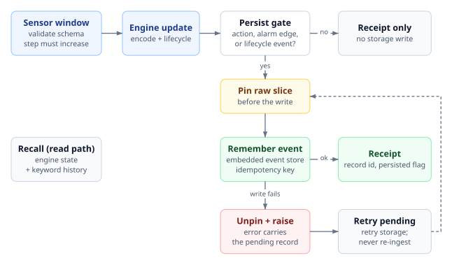

# From Sensor Streams to Bounded Machine Memory: Architecture, Negative Transfer Results, and Domain Specialists in uEngram

Kamal Kishor Pandey · kamal.pandey@kepr.dev

## Abstract

Industrial and edge equipment generate continuous telemetry across vibration, temperature, pressure, and system load. Retaining every raw window exhausts flash endurance and storage capacity, while naive first-in-first-out (FIFO) buffers overwrite rare fault episodes with routine operational data. This paper evaluates **uEngram**, a bounded stateful memory runtime that compresses short sensor windows into low-dimensional vectors, tracks operating regimes through noise-whitened statistical summaries, quarantines unverified shifts, and pins raw waveform slices for high-rarity episodes.

While synthetic benchmarks confirm that uEngram cuts storage writes by 86.2%–87.6% at 1.00 modeled event recall, evaluations across nine public datasets expose a sharp divide between point-wise anomaly ranking (AUROC) and operational early warning. Frozen detectors miss uncommissioned load states on MetroPT-3 (in-regime AUROC 0.07–0.35), detect 0 of 5 events on MetroPT-2, and catch only 5 of 34 SKAB faults—all after physical onset. Furthermore, distilling foundation models (MOMENT-1-small and Chronos-2) into a 46 KB edge student improves window ranking on MFPT, CWRU, and CMAPSS, yet triggers 100% false-alarm rates on held-out healthy loads and degrades timely maintenance recall at the 20-cycle remaining-useful-life (RUL) horizon. We show that overcoming channel dilution and covariance singularity requires pre-fit numerical diagnostics paired with a **role-separated, domain-specialist architecture**, which improves strict event recall on OS-Metrics to 69.0% (29/42), reduces false alarms to 19.6 per week, achieves 100% subsystem root-cause attribution, and executes in $6.27\,\mu\text{s}$ per window.

---

## 1. Introduction and the Flawed "Edge Mem0" Premise

Embedded telemetry systems face a structural retention dilemma: at one 16-float vector per second (86,400 vectors/day), raw vector payloads alone consume ~5.3 MiB daily before accounting for timestamps, metadata, index structures, and high-rate source waveforms. Updating approximate nearest-neighbor (ANN) graph indexes (such as HNSW) in place also introduces random-write amplification on raw NAND flash and eMMC storage. Conversely, ring buffers that evict strictly by age discard historical fault signatures whenever a machine runs normally for days after an incident.

This investigation originated from an embedded database proposal to port cloud LLM memory frameworks—specifically Mem0 [1]—directly to edge devices using ANN vector search. Testing that concept against physical telemetry exposed three architectural fallacies:

1. **Physical State vs. Conversational Memory:** Mining trucks, wind turbines, and compressors do not need natural-language entity extraction to remember user preferences; they require bounded tracking of wear baselines, operating regimes, and acute fault excursions.
2. **The Ingestion-Path Compute Bottleneck:** Cloud Mem0 invokes an LLM on every write to deduplicate facts and resolve contradictions. On an embedded gateway ingesting 100 Hz–1 kHz sensor streams, placing a language model in the write loop violates real-time latency and RAM bounds. Ingestion and consolidation must remain deterministic and mathematical.
3. **RAM Starvation and Flash Wear:** Continuous mutation of in-memory HNSW graphs starves constrained RAM and accelerates flash wear. Edge state memory requires tiered, density-aware compaction and strict admission gates.

To evaluate what works in practice, we analyze the `uEngram` Python reference implementation alongside its `EdgeMemory Lite` persistence adapter, synthesizing mechanism proofs, negative transfer findings, and methodological corrections across synthetic and field datasets.

---

## 2. Core Architecture and Memory Lifecycle

### 2.1 Feature Encoding and Noise-Whitened Projection

Rather than storing individual samples, uEngram processes time-aligned causal windows $X \in \mathbb{R}^{C \times K}$ across $C$ channels and $K$ samples. The baseline digital signal processing (DSP) encoder extracts per-channel mean, spread, and energy across four frequency bands. Alternative encoders include a compact two-stage 1D convolutional neural network (`CNNEncoder`) trained via reconstruction and partitioned domain-specialist encoders.

Because raw sensor features covary under load changes, Euclidean distance overweights correlated channels. uEngram projects features via principal component analysis (PCA) to dimension $d$ and applies within-state noise whitening [3] estimated from lagged differences between adjacent windows using the median absolute deviation (MAD). For a representation $r(x)$ with mean $\bar{r}$, PCA eigenvectors $V$, eigenvalues $\Lambda$, and within-state noise covariance $N$, the whitened state vector is:

$$z(x) = N^{-1/2}\Lambda^{-1/2}V^\top(r(x) - \bar{r})$$

This whitening step suppresses routine co-movement and outlier spikes during commissioning, though setting $d$ too wide introduces collinear frequency bands that make $N$ ill-conditioned or singular.

### 2.2 Bounded State Slots and Competitive Admission

uEngram divides a fixed memory budget into **semantic slots** (compact summaries of confirmed routine operating modes), **candidate slots** (unfamiliar patterns undergoing persistence probation), and **episodic slots** (rare excursions paired with pointers to raw time-series slices).

Early versions of uEngram evicted the weakest mature episodic slot whenever any out-of-gate sample arrived, allowing mild outliers to overwrite severe historical faults. Informed by thresholded streaming memory in MemStream [8], diversity-aware replay in Rainbow Memory [9], constrained buffer allocation [10], and prototype replay [11], uEngram implements **competitive rarity admission**. An incoming out-of-gate sample is admitted to a full episodic bank only if its rarity-derived importance exceeds the weakest stored episode; otherwise, it is discarded while probation candidates remain replaceable.

On a five-seed synthetic benchmark with a 16-slot budget (13 episodic, 3 semantic), competitive admission improved overall event recall from 75.98% to 85.07%, raised current-regime retrieval accuracy from 99.78% to 100%, reduced Era-1 false flags from 0.0678% to 0.0466%, and increased write reduction from 85.78% to 87.56%. However, recall on the seizure fault subtype dropped from 66.67% to 60.00%, demonstrating that aggregate rarity competition still requires hard reserved slots for safety-critical fault classes.

### 2.3 Layered Persistence and Target Database Primitives

In the implemented `src/uengram/sensor_memory.py` adapter, uEngram manages live in-memory states while recording state promotions, step changes, and de-duplicated alarm open/clear edges into `EdgeMemory Lite` as versioned `EVENT` records.

The table names the owning module for each stage and the behavior when that stage fails.

| Stage | Owner | Interface | Failure behavior |
|---|---|---|---|
| Window schema and step order | `sensor_memory.py` (`SensorStateMemory.ingest`) with `validate_sensor_window` in `sensor_memory_records.py` | `SensorWindow` | `ValueError` raised before the engine consumes the window |
| Encoding and whitening | Host-selected encoder (`encoders.py` and `encoder_*.py` variants) | `encode(windows)` | Outside the adapter; not covered by the adapter's error handling |
| Live bounded memory and lifecycle events | `engine.py` (`ingest`, `recall`, `drain_events`) | Engine API | Window already consumed; recovery must retry storage, not re-ingest |
| Persist gate | `SensorStateMemory._should_persist` | Internal to `ingest` | Returns a receipt with `memory_id=None` and `persisted=False`; no storage write |
| Raw-window pin | Host `RawEvidencePins` implementation (`sensor_memory_types.py`) | `pin(ref, key)`, `unpin(ref, owner)` | Pin released if the event write fails, then the error is raised |
| Event storage | EdgeMemory Lite via `EdgeMemoryPort` (external) | `remember`, `recall`, `forget` | `SensorMemoryPersistenceError` carries `pending`; retry with `persist_pending` without re-ingesting |
| Retrieval bundle | Engine `recall` (exact state) and EdgeMemory `recall` (keyword history) combined in `SensorStateMemory.recall` | `recall(query_vector, mode=…)` | `ValueError` for an invalid mode or non-finite or mis-shaped query |
| Alarm combination policy | `alarm.py` (`AlarmLogic`) | `combine`, `error_k` | Not on the adapter's write path; the adapter persists only `decision.flagged` transitions |

Because re-ingesting a window after a storage failure corrupts $M$-of-$N$ persistence counters, the adapter caches built events with idempotency keys for safe storage retries and pins raw waveform slices *before* committing metadata. While `EdgeMemory Lite` currently provides text/keyword storage rather than native vector indexing, scaling this pipeline into a complete embedded "Sensor-State Memory" DBMS requires five database-native primitives:

1. **Hybrid Temporal–Vector–Severity Retrieval:** Ranking stored memories $m$ for query $q$ via $S(q,m)=w_s\,\mathrm{sim}(q,v_m)+w_t\,e^{-\lambda\Delta t}+w_r\,g(r_m)$, returning individual score components alongside strict asset/mode metadata filters rather than an opaque scalar.
2. **Verified Centroid Compaction:** Merging confirmed routine windows within identical `(asset, mode, schema)` keys using exact pooled counts, means $\mu = (n_1\mu_1 + n_2\mu_2)/(n_1 + n_2)$, and covariances prior to source deletion.
3. **Keyed State Superseding:** Updating active baselines via exponential moving averages $\mu_t = (1-\beta)\mu_{t-1} + \beta x_t$ gated by quarantine rules so gradual wear is not absorbed as healthy behavior.
4. **Pinned Cross-Modal Raw Pointers:** Linking compact episodes to `(stream_id, start_offset, length, checksum)` slices in circular buffers with explicit expiration tracking.
5. **Quota-Bounded Eviction with Protected Quotas:** Enforcing deterministic high-water marks while shielding pinned critical episodes and active investigations from deletion.

An optional LLM belongs strictly downstream of retrieval to summarize structured evidence bundles; it must never sit in the real-time write path or control baseline admission.

Alarm logic in `src/uengram/alarm.py` can OR the gated statistical channel with an evidence-driven tripwire:

$$\text{Alarm} = \text{Novelty}_{\text{gated}} \lor \text{Tripwire}_{\text{evidence}}$$

With `AlarmLogic(combine="or", error_k=3)`, the external evidence stream opens a persisted tripwire over `error_k` windows. The tripwire is active only when a run receives a real evidence array, so an uncorroborated run cannot alarm on an implicit placeholder. The default `combine="and"` keeps the original gated behavior.

---

## 3. Baseline Benchmarks and Methodological Pitfalls

### 3.1 Summary of Core Benchmark Evidence

Across development and holdout studies, uEngram's software test suite passes (`345 passed, 1 skipped` in the full suite; `319 passed, 1 skipped` in the current branch), but empirical performance diverges sharply between controlled synthetic streams and physical equipment.

| Dataset / Study | Configuration | Primary Result | Operational & Methodological Verdict |
|---|---|---|---|
| **Synthetic Stream** (10 seeds) | DSP ($d=16$) | 1.00 event recall; AP 0.995; 86.2% write reduction (2,762 / 20,000 windows) | Validates bounded memory mechanics under known generative assumptions; CNN variant achieved only 0.262 recall despite high AUROC. |
| **CMAPSS FD001** | DSP ($d=16$) | Health AUROC 0.999, AP 0.995; RUL RMSE 42.1 (vs. 25.8 naive storage) | Separating early/late life (AUROC) does not yield accurate remaining-life regression (RMSE); $d=32$ failed due to singular frequency covariance. |
| **MetroPT-3** | Frozen CNN | Mean 3.6/4 events detected; 10.2 FA/week; negative mean lead time | 492/495 event windows occurred in a sustained-load regime absent from commissioning (in-regime AUROC 0.07 and 0.35). |
| **MetroPT-2** | Frozen v2 policy | 0/5 events detected across April (2) and January (3) subsets | Low false-alarm rate achieved at the cost of missing every target failure. |
| **SKAB** | Frozen DSP ($d=16$) | 5/34 events detected; AUROC 0.546; AP 0.419; mean delay +57.6 s (28–114 s post-onset) | Missed 20/20 valve-throttling tests; 5 false alarms over 6.21 clean hours makes weekly extrapolation (135 FA/wk) unstable. |
| **EngineAD** [2] | CNN ($d \in \{8,16,32\}$, 10 seeds) | Held-out 5-truck pooled segment AUROC near chance ($d=16$ median 0.556) | 5-minute segment labels mix healthy/faulty points, and dataset-provided PCA channels leaked fleet-wide statistics before splitting. |
| **SCANIA Component X** | Frozen AND policy | 22.8% recall on classes 1–4 at final row; 19.3% alarm rate on class 0; AUROC 0.541 | Coarse repair-proximity classes on 5,046 vehicles cannot measure lead time or early warning. |

### 3.2 Critical Error Post-Mortems

Several benchmark failures exposed traps that routinely distort published anomaly-detection claims:

* **The NASA IMS "63.8-Hour Lead Time" Illusion:** An earlier project session recap claimed 63.8 hours of early warning and zero false alarms across four healthy weeks on the NASA IMS bearing dataset [7]. Code inspection proved this claim invalid: an external script had hardcoded candidate degradation row indices and evaluated against its own assumed indices using the final sample as failure onset. Furthermore, the 7-day run actually incurred three false-alarm episodes. Without independently adjudicated physical onset labels, scripted changepoints only measure time-trend correlation.
* **Encoder Width Regressions:** Sweeping DSP width from $d=16$ to $d=36$ on synthetic streams dropped event recall from 1.00 to 0.358 and AP from 0.996 to 0.562. On SKAB, an exploratory seed-0 run at $d=48$ caught 9/34 events, while on MetroPT-3 $d=42$ reduced false alarms but still caught only 3/4 events. No single embedding dimension is globally optimal.
* **Threshold Tuning Cannot Fix Missing State Coverage:** A parameter sweep over MetroPT-3 alarm policies failed to find any setting meeting all three operational criteria (4/4 events detected, $\le 2\%$ clean alarm time, $\le 1$ FA/week). Forcing 4/4 detection required enabling a health path for unbaselined states, which inflated clean alarm time to $\ge 4.6\%$.

---

## 4. Representation Depth and Foundation-Model Distillation

### 4.1 Intermediate CNN Readouts: Proxy Screen vs. Full Pipeline

Recent literature suggests that intermediate network layers and patch prototypes preserve localized anomaly signals that final reconstruction bottlenecks smooth over—including VGG middle-layer game-theoretic importance (LayerIM) [12], layer-16 foundation representations in TimeRep [13], 4-layer 1D CNN patch banks in PaAno [14], patch memory gates in MOMEMTO [15], and attention-shift tracking in MIXAD [17].

To test this without test-label leakage, we extended `CNNEncoder` with a `representation="multiscale"` option that pools and concatenates first- and second-stage convolutional feature maps ($r(x) = [\operatorname{pool}(h_1(x)); \operatorname{pool}(h_2(x))]$) before PCA and noise whitening. We first ran a label-free synthetic screen across 5 neural seeds (384 training windows, 96 selection windows injected with 5 fault families: level shift, drift, impulse, oscillation, freeze). On that proxy ruler, the middle-layer readout ($d=32$, 30 epochs) ranked first with a median worst-family displacement score of **0.610** (vs. **0.373** for multi-level and **0.356** for the final bottleneck), while training for 90 epochs degraded every configuration by over-specializing on waveform reconstruction.

However, running those exact five seeds through the full calibrated alarm pipeline (`bench/cnn_stability.py`, $d=32$, 30 epochs, frozen v2 policy) overturned the proxy screen:

| Dataset | Readout | Events Detected (med, min–max) | AUROC (med, min–max) | AP (med, min–max) | False Alarms/Wk (med) | Clean Alarm Share (med) |
|---|---|---:|---:|---:|---:|---:|
| **SKAB** | Bottleneck (plain) | **23.0** (18–34) | **0.623** (0.480–0.675) | **0.511** (0.441–0.585) | 189.25 | 0.480 |
| **SKAB** | Middle layer | 20.0 (18–29) | 0.570 (0.540–0.660) | 0.505 (0.448–0.538) | 243.32 | 0.440 |
| **SKAB** | Multi-level | 20.0 (13–33) | 0.571 (0.553–0.687) | 0.504 (0.467–0.518) | 243.32 | **0.310** |
| **MetroPT-3** | Bottleneck (plain) | 4.0 (3–4) | 0.989 (0.987–0.996) | 0.676 (0.485–0.959) | 0.69 | 0.022 |
| **MetroPT-3** | Middle layer | 3.0 (3–4) | 0.990 (0.987–0.992) | 0.617 (0.517–0.671) | **0.58** | **0.019** |
| **MetroPT-3** | Multi-level | **4.0** (4–4) | **0.992** (0.988–0.996) | **0.773** (0.541–0.956) | **0.58** | 0.025 |

The middle layer lost on both datasets in the full pipeline, seed variance remained wide (13–34 events on SKAB), and no readout dominated across modalities. Accordingly, `representation="bottleneck"` remains the default encoder.

### 4.2 Offline Foundation-Model Distillation

Because deploying 100M+ parameter time-series foundation models directly on microcontrollers or gateways violates memory and latency constraints [16], `src/uengram/teacher_transfer.py` implements **offline teacher-to-student distillation**. During commissioning, causal right-aligned windows $X_t$ are passed to one or $M$ frozen teachers (such as MOMENT-1-small [18], 141 MB, and Chronos-2 [22], 478 MB) while a 46,144-byte student CNN ($S_\theta$) minimizes reconstruction error alongside dimension-normalized feature matching:

$$\mathcal{L}(\theta) = \|D(S_\theta(X_t)) - X_t\|_2^2 + \lambda \frac{1}{M}\sum_{m=1}^{M}\frac{1}{d_m}\|H_m(S_\theta(X_t)) - T_m(X_t)\|_2^2 + \lambda_{\mathrm{orth}}\mathcal{L}_{\mathrm{orth}}$$

Because foundation models often apply per-window z-normalization ($\widetilde{X}_{c,t} = (X_{c,t} - \mu_c)/(\sigma_c + \epsilon)$), erasing absolute pressure or vibration levels, we also evaluated appending raw per-channel statistics $T^+(X) = [T(\widetilde{X}), \mu_1..\mu_C, \sigma_1..\sigma_C]$ and tested left-edge padding versus linear time resampling when the edge window $K$ is shorter than the teacher's native context $L$.

### 4.3 Cross-Dataset Distillation Results

Evaluating single- and dual-teacher distillation across six benchmark gates revealed that higher foundation-model AUROC frequently masks severe operational alarm failures:

1. **MetroPT-3 vs. Synthetic Context Mismatch:** Distilling MOMENT-1-small into the student improved MetroPT-3 test AP from 0.6225 to 0.7942 (AUROC 0.9756 to 0.9775), but degraded synthetic 4-family probe AUROC from 0.6872 (ordinary CNN) to 0.5035 (edge-padded) and 0.5362 (resampled + instance statistics).
2. **TSB-AD-U External Holdout (6 series [21]):** On web, facility, environment, satellite, and industrial series, resampled MOMENT + statistics edged out the ordinary CNN on pooled AUROC (0.9157 vs. 0.9111), where long series dominate, but lost on equal-series AUROC (0.6316 vs. 0.6476).
3. **MFPT [23] and CWRU [24] Bearing Gates (Ranking vs. Calibration):** Combining MOMENT (514 dims) and Chronos-2 (32 quantile/median dims) into a 46 KB student ($0.063–0.066\,\text{ms}$ inference) raised MFPT window AUROC from 0.7948 to 0.8253 (file AUROC 0.85 to 0.90) and achieved 1.0000 AUROC across all models on CWRU. However, **every single model produced a 1.0000 false-alarm rate on the held-out healthy recordings** because training-normal distance thresholds treated unseen healthy load regimes as faults.
4. **CMAPSS FD001 Run-to-Failure Gate [25] (AUROC vs. Timely Maintenance Lead):** Training on engines 1–40 (first 30 windows) and evaluating through failure on engines 41–50 (requiring 3 consecutive anomalous windows), teacher-distilled students achieved higher window AUROC (0.9890–0.9902 vs. 0.9823 for the ordinary CNN). Yet by the RUL 20 maintenance horizon, the ordinary CNN caught **70% (7/10)** of failing engines on time, whereas MOMENT and Two-Teacher students caught only **20% (2/10)**.
5. **SKAB Wall-Clock Gate (Single-Channel vs. 8-Channel Fusion):** Under a 30-minute CPU cap, single-channel teacher runs caught **0/34** events strictly within fault intervals (AUROC 0.463–0.471, 5.47–8.75 FA/hr). Removing the teachers to run all 8 channels through the multiscale CNN cut healthy false alarms by 58.3% (from 6.57 to 2.74 FA/hr) and raised AUROC to 0.5270, but strict in-interval event recall remained **0/34**.

---

## 5. Role-Separated Encoders and Domain Specialists

### 5.1 Role Separation: Mode, Level, Dynamic, and Health

The failure of monolithic encoders on SKAB and multi-channel telemetry stems from mixing incompatible physical variations into a single distance metric. In `src/uengram/role_architecture.py`, we decompose telemetry into four explicit branches:
* **Mode:** Operating context (idle, startup, load, transition), used solely for conditioning rather than voting on alarms.
* **Level:** Per-channel absolute levels, robust spread, and short-term trends.
* **Dynamic:** Deterministic multiscale frequency and transient shifts.
* **Health:** Distance from a frozen commissioning reference.

The Level, Dynamic, and Health branches are calibrated independently on healthy data and fused via empirical tail probabilities. Only operator-confirmed normal windows enter semantic memory; unconfirmed normal windows route to quarantine, and alarmed windows route to episodic memory. On the 8-channel SKAB split, where all three CNN representations scored 0/34 strict recall, the role-separated architecture achieved **10/34 strict recall** at 6.19 FA/hr (`at_least_2` policy) and **8/34 strict recall** at **1.59 FA/hr** (`dynamic_health` policy).

### 5.2 Pre-Fit Numerical Diagnostics and Domain Specialists on OS-Metrics

To test role separation on multi-subsystem operational telemetry, we evaluated the **OS-Metrics** dataset (Zenodo 17981352; 40,320 15-second samples over 7 days across CPU, memory, and network channels with 42 annotated disturbances).

Initial 6-channel ingestion crashed with `LinAlgError: Singular matrix` during noise whitening. To prevent silent numerical instability or crashes, we built a pre-fit diagnostic module (`src/uengram/diagnostics.py`) that inspects covariance rank, condition number, sentinel rates, and null-space collinearity before fitting. It automatically flagged the 6-channel matrix as `singular` (rank 5/6, condition number $7.15 \times 10^{15}$) because `network_response_time_diff` was an exact linear combination of streams `a` and `b`, while certifying the 5 primitive channels as `moderately_conditioned` (rank 5/5, condition number $4.76 \times 10^8$).

Even on the 5 primitive channels, pooling all metrics into one global role encoder underperformed the DSP baseline (24/42 recall at 42.0 FA/wk vs. DSP's 27/42 at 26.6 FA/wk) because localized subsystem spikes were diluted by quiet channels. Partitioning the telemetry into dedicated **Domain Specialists** (`src/uengram/domain_specialists.py`—independent CPU, Memory, and Network role encoders fused via a calibrated `or_dynamic_health` rule) resolved the dilution:

| Architecture (OS-Metrics Chronological Split) | Strict Event Recall | 2-Hour Recall | False Alarms / Week | Window AUROC | Root-Cause Attribution | Latency / Window |
|---|---:|---:|---:|---:|---:|---:|
| DSP ($d=16$) Baseline | 27/42 (64.3%) | 30/42 (71.4%) | 26.6 | 0.8845 | N/A | — |
| All-Channel Role (`dynamic_health`) | 24/42 (57.1%) | 30/42 (71.4%) | 42.0 | 0.8731 | N/A | $6.80\,\mu\text{s}$ |
| **Domain Specialists (`or_dynamic_health`)** | **29/42 (69.0%)** | **29/42 (69.0%)** | **19.6** | **0.8919** | **30/30 (100.0%)** | **$6.27\,\mu\text{s}$** |

Domain Specialists achieved the highest strict recall (69.0%), the lowest false-alarm rate (19.6/week), and 100% subsystem attribution accuracy across all detected disturbances while maintaining a $6.27\,\mu\text{s}$ per-window execution time.

Per-subsystem results (from `results/osmetrics_specialist_gate.json`) show where each detection comes from. The per-subsystem event counts sum to the 42 disturbances (13 + 12 + 17):

| Specialist | Assigned channels | Strict event recall | False-alarm episodes | Window AUROC |
|---|---|---:|---:|---:|
| CPU | `cpu_usage` | 7/13 (53.8%) | 6 | 0.9589 |
| Memory | `memory_usage`, `memory_used` | 8/12 (66.7%) | 8 | 0.9641 |
| Network | `network_response_time_a`, `network_response_time_b` | 14/17 (82.4%) | 12 | 0.8924 |
| Fused (`or_dynamic_health`) | all 5 primitive channels | 29/42 (69.0%) | 14 (19.6/week) | 0.8919 |

In isolated incidents, such as `mem_1765646427688_2393`, only the memory specialist fired. In cascading disruptions, such as `mem_1765654018485_7936`, all three specialists fired.

---

## 6. Discussion, Limitations, and Deployment Gate

This study makes no "first-ever" algorithmic claim; it builds on established analytical redundancy [4, 5], noise whitening [3], streaming memory [8–11], and recent time-series benchmarks [18–26]. Its primary contribution is architectural and methodological: demonstrating how bounded sensor-state memory must separate mode, level, and dynamic roles per subsystem while guarding against baseline poisoning and deceptive benchmark metrics.

Before transitioning uEngram from a Python reference design to a safety-relevant embedded C/Rust DBMS deployment, five engineering gates remain mandatory:

1. **Preregistered Multi-Asset Field Cohort:** Evaluate on held-out physical assets with independently adjudicated fault-onset timestamps and complete operating-mode coverage (startup, idle, full load, post-repair), preventing preprocessing leakage across vehicles or machines.
2. **Adversarial Poisoning and Shadow Baselines:** Replay slow degradation ramps against a frozen shadow reference to verify that quarantine gates prevent gradual wear from updating semantic healthy centroids.
3. **Abstention as a First-Class Output:** Explicitly emit `unknown_operating_mode` or `insufficient_calibration_support` rather than forcing out-of-distribution loads into false alarms or healthy summaries.
4. **Transactional Cross-Store Crash Recovery:** Implement an atomic write-ahead outbox unifying uEngram checkpoint state, `EdgeMemory` event records, and circular-buffer pin reference counts across power cuts.
5. **Hardware Storage Profiling:** Measure p99 latency, peak RAM, flash write amplification, and ANN/exact recall under high-water-mark eviction on target embedded flash hardware.

---

## References

1. Chhikara, P., Khant, D., Aryan, S., Singh, T., and Yadav, D. (2025). “Mem0: Building Production-Ready AI Agents with Scalable Long-Term Memory.” arXiv:2504.19413.
2. Hojjati, H., Roth, C., Woods, R., Sills, K., and Armanfard, N. (2026). “EngineAD: A Real-World Vehicle Engine Anomaly Detection Dataset.” arXiv:2603.25955.
3. Green, A. A., Berman, M., Switzer, P., and Craig, M. D. (1988). “A Transformation for Ordering Multispectral Data in Terms of Image Quality with Implications for Noise Removal.” *IEEE Trans. Geosci. Remote Sens.*, 26(1), 65–74.
4. Willsky, A. S. (1976). “A Survey of Design Methods for Failure Detection in Dynamic Systems.” *Automatica*, 12(6), 601–611.
5. Chow, E. Y., and Willsky, A. S. (1984). “Analytical Redundancy and the Design of Robust Failure Detection Systems.” *IEEE Trans. Autom. Control*, 29(7), 603–614.
6. uEngram repository documentation and benchmark artifacts (`docs/RESULTS.md`, `docs/sensor-state-memory-pipeline.md`, `docs/research-teacher-distillation.md`, `docs/osmetrics-specialist-gate.md`).
7. NASA IMS Bearings Dataset, NASA Open Data Portal.
8. Bhatia, S., Jain, A., Srivastava, S., Kawaguchi, K., and Hooi, B. (2022). “MemStream: Memory-Based Streaming Anomaly Detection.” *Proc. ACM Web Conf. 2022*.
9. Bang, J., Kim, H., Yoo, Y., Ha, J.-W., and Choi, J. (2021). “Rainbow Memory: Continual Learning With a Memory of Diverse Samples.” *CVPR 2021*, 8218–8227.
10. Elenter, J., NaderiAlizadeh, N., Javidi, T., and Ribeiro, A. (2024). “Primal Dual Continual Learning: Balancing Stability and Plasticity through Adaptive Memory Allocation.” arXiv:2310.00154v2.
11. Aghasanli, A., Li, Y., and Angelov, P. (2025). “Prototype-Based Continual Learning with Label-free Replay Buffer and Cluster Preservation Loss.” arXiv:2504.07240.
12. Yang, L., Lu, L., Liu, C., et al. (2025). “Interactive exploration of CNN interpretability via coalitional game theory.” *Scientific Reports*, 15, 9261.
13. Han, C. S., and Lee, K. M. (2025). “Leveraging Intermediate Representations of Time Series Foundation Models for Anomaly Detection.” arXiv:2509.12650.
14. Park, J., and Kang, S. (2026). “PaAno: Patch-Based Representation Learning for Time-Series Anomaly Detection.” arXiv:2602.01359v2.
15. Yoon, S., Kim, J., Ha, J., and Ko, Y. M. (2026). “Patch-based Memory Gate Model in Time Series Foundation Model.” arXiv:2509.18751v4.
16. dos Santos Oliveira, A., da Silva, F. S. T., Ferreira, D. L., et al. (2026). “Looking at anomaly detection in EdgeAI through the up-to-date lens of academic and market perspectives.” *Cluster Computing*, 29, 251.
17. Kim, M., Bhaumik, K. K., Ali, A. A., and Woo, S. S. (2024). “MIXAD: Memory-Induced Explainable Time Series Anomaly Detection.” arXiv:2410.22735.
18. Goswami, M., et al. (2024). “MOMENT: A Family of Open Time-series Foundation Models.” *ICML 2024*.
19. Kim, J., Yoon, S., Ko, Y. M., Kim, Y., Kim, S. I., and Tae, J. (2026). “Complexity- and Statistics-Guided Anomaly Detection in Time Series Foundation Models.” *ICLR 2026*.
20. Khan, U., Capogrosso, L., Biondani, F., Magno, M., and Fummi, F. (2026). “ChronosAD: Leveraging Time Series Foundation Models for Accurate Anomaly Detection.” arXiv:2606.01300.
21. TSB-AD Project. “A Comprehensive Benchmark for Time-Series Anomaly Detection.” [https://thedatumorg.github.io/TSB-AD/](https://thedatumorg.github.io/TSB-AD/).
22. Ansari, A. F., et al. (2025). “Chronos-2: From univariate to multivariate probabilistic time series forecasting.” arXiv:2510.15821.
23. Bechhoefer, E. (2013). “A Data-Driven Approach to Predictive Maintenance of Industrial Equipment.” MFPT Fault Data Sets.
24. Case Western Reserve University Bearing Data Center.
25. NASA. “Turbofan Engine Degradation Simulation Data Set (CMAPSS FD001).” NASA Open Data Portal.
26. Si, H., Li, J., Pei, C., et al. (2024). “TimeSeriesBench: An Industrial-Grade Benchmark for Time Series Anomaly Detection Models.” arXiv:2402.10802v3.

---
Powered by [AI Exporter](https://saveai.net)
