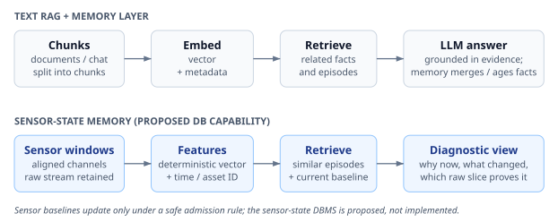
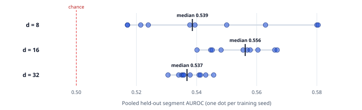

# From Sensor Streams to Machine Memory: What uEngram Shows—and What It Does Not

**A repository-based research report in plain English**  
**Status:** Exploratory research synthesis; not a deployment or safety certification  
**Project:** uEngram  
**Evidence reviewed:** repository implementation, committed experiment reports and result files, available project-session recaps, and selected public research  
**Audience:** engineers, students, and readers new to statistics and machine-learning terminology

## Abstract

Machines produce streams of measurements: vibration, temperature, pressure, speed, and fault codes. Keeping every measurement forever is costly; keeping only the latest measurements can erase rare but important failures. This paper examines uEngram, a research implementation that tries to maintain a small, bounded memory of sensor behavior. It describes each short sensor window with a compact feature vector, compares it with learned operating states, updates familiar states, places unusual repeated patterns on probation, and retains selected unusual episodes.

The repository supports a useful engineering finding: on synthetic streams, bounded stateful memory can reduce writes relative to storing every window and can retain more modeled events than simple first-in-first-out or reservoir baselines. The reservoir baseline itself uses fewer writes in that benchmark, so this is a trade-off—not a claim that uEngram minimizes writes against every method. Results on real datasets are mixed and often poor for the use that matters most—reliable, early, low-false-alarm fault warning. The frozen detector caught 5 of 34 labeled SKAB events, always after onset; it missed every valve-throttling test. The compressor and fleet results reveal operating-state coverage, calibration, label, and transfer problems. These are not side notes: they are the central findings.

We also examine an analogy between text retrieval-augmented generation (RAG) and a proposed industrial “Sensor-State Memory” database. The analogy is useful, but the proposed database features—including a native temporal/vector score, centroid compaction, keyed state superseding, raw-signal pointers, and bounded eviction—are design ideas, not capabilities demonstrated by this repository. A Mem0-like lifecycle could help organize machine episodes and evolving baselines, but adapting a language-model memory idea to safety-relevant sensor data requires deterministic rules, provenance, uncertainty tracking, and strong safeguards against learning a fault as normal.

**Novelty conclusion:** this repository does not establish a new general anomaly-detection algorithm or prove the first edge-memory system. Its defensible contribution is a measured, unusually explicit set of failure analyses and a candidate combination of bounded memory, feature encoding, and lifecycle rules. A complete literature search and independent field evaluation remain outstanding.

## 1. Plain-language summary

Imagine a mechanic who has to remember how a machine behaves over years, but has only a small notebook. Writing down every second of normal humming fills the notebook. Throwing away the oldest page each time the notebook fills can erase the one page describing a serious breakdown. The engineering problem is to keep a compact description of normal behavior, retain unusual episodes that may matter, update the current description as the machine changes, and still be able to inspect the original sensor recording.

uEngram is a Python reference implementation of part of that idea. It reduces each short sensor window to numbers such as average level, variability, and frequency-band energy. It uses a bounded collection of state slots: familiar patterns can be represented by compact summaries; a new pattern can be tested for persistence; and rare patterns can be retained as episodes with evidence. In the current implementation this is not a general-purpose industrial database, not an embedded C++/RTOS engine, not a complete RAG system, and not a natural-language Mem0 clone.

The strongest positive results are on controlled, generated data. They show that the design can behave as intended under conditions constructed for the benchmark. The real-data studies show why that is not enough. A system can have a high AUROC and still miss most events, alarm too often, detect only after a fault has started, or fail when a machine enters an operating condition absent from commissioning. **A high score is not the same as useful warning.**

### Key results at a glance

| Evidence | Observed result | What it means—and does not mean |
|---|---|---|
| Synthetic DSP stream, ten seeds | 1.00 modeled event recall; about 86.2% fewer writes than storing every window; AP 0.995 | Strong controlled demonstration, not a real-world reliability claim. The benchmark’s generated event patterns and labels are known to the experiment. |
| CMAPSS FD001, DSP | uEngram health AUROC 0.999 and health AP 0.995; the separate RUL RMSE was 42.1 for uEngram versus 25.8 for naive storage | Health ranking and remaining-life error are different tasks. Better on one metric does not mean better overall. |
| MetroPT-3, frozen CNN uEngram | Mean 3.6/4 reported events detected; about 10.2 false-alarm episodes per week; mean lead relative to report start was negative | Not a practical low-alarm early-warning result. The evaluation’s event times are report associations, not adjudicated physical failure onsets. |
| MetroPT-2, frozen v2 policy | No published events detected in either the two-event April subset or the three-event January subset | Low false alarms alone is not success when all target events are missed. |
| SKAB, frozen DSP detector | 5/34 events detected; AUROC 0.550; mean detection 40.4 s after onset; 20/20 valve-throttling tests missed | Partial, confirmation-only transfer on one water-loop testbed; no demonstrated early warning or fleet generalization. |
| EngineAD CNN study | Across 30 seed runs and five held-out trucks, pooled segment AUROC stayed near chance; d=16 median 0.556 | Exploratory segment-level study. The representation used fleet-wide fitted PCA; segment labels are not precise fault intervals. Not independent event-level validation. |
| Full repository test suite | 302 passed, 2 skipped | Software tests passed in the recorded run; this does not validate field performance or the proposed database design. |

The data above are not a single contest with one winner. Datasets, labels, metrics, and experiment stages differ. The detailed qualification is in Section 6.

## 2. Research questions and scope

This report asks:

1. Can a bounded sensor-memory engine retain useful state and event information while reducing repeated writes?
2. What happens when this kind of engine meets real sensor data and operational labels?
3. How can a Mem0-like text-memory lifecycle be translated into a temporal, vector-enabled edge database?
4. Which claims are supported by this repository, which are proposals, and what would count as new research?

The scope is the uEngram repository and session history for this project folder, plus selected public sources listed in Section 11. The archive exposed project-session recaps, not every full transcript. A request to retrieve the full session by its available identifier failed, so this paper does not claim to have read a complete transcript. Recaps and the accessible conversation content were used as context; unrelated project sessions were excluded.

## 3. System and basic ideas

### 3.1 From raw readings to a “fingerprint”

A **time series** is a sequence of measurements arranged by time, like temperature readings every second. A **window** is a short consecutive slice of that sequence. The implementation treats a window as one observation rather than saving every raw sample as a separate memory.

A **feature** is a number that describes something about the window. The project’s deterministic DSP (digital signal processing) encoder describes sensor channels with their average, their spread, and the energy in four frequency bands. For example, a motor’s average vibration may remain stable while a new high-frequency rattle appears. The band features can capture that change without storing every waveform sample in the state representation.

The resulting list of numbers is a **vector**—an ordered list, like a row of coordinates. Comparing vectors is a way to ask “does this window resemble a state I already know?” The project also tests learned CNN (convolutional neural network) encoders, which are small neural networks trained to compress and reconstruct windows. A compact vector is useful, but compression discards information; a stored vector cannot replace retaining raw evidence for later inspection.

### 3.2 Distance, noise, and whitening

A distance score measures how different a new vector is from a remembered state. Ordinary Euclidean distance treats every direction and feature scale alike. Sensor features often move together: for example, two temperatures may rise together because the machine is under greater load. **Covariance** describes how measurements vary together. **Whitening** rotates and rescales features to reduce that dependence, so one physical change is not counted several times just because it appears in correlated sensors.

The code estimates within-state noise from differences between nearby windows. The **median absolute deviation (MAD)** is a robust measure of typical spread: take the median, measure each value’s distance from it, then take the median of those distances. Unlike the ordinary standard deviation, a few extreme values do not dominate it. This is useful when the commissioning data may contain occasional spikes.

**PCA (principal component analysis)** is a compression method that keeps directions with the most variation. The output dimension `d` is the number of directions retained. This is a trade-off: too few directions may erase weak faults; too many can retain redundant or nearly duplicate signals and make covariance calculations unstable. In this repository the best dimension depends on the dataset. A larger vector is not automatically better.

### 3.3 The memory lifecycle

The engine has a bounded number of slots rather than an unbounded list of all windows. In broad terms:

- A familiar window updates a known state’s summary.
- A new pattern can enter a candidate period. Repeated evidence can promote it to a stable state; a one-off unusual pattern may remain an episode.
- An old state can be marked superseded so it is not confused with the current state, while its history can remain available.
- Storage limits force explicit choices about which summaries or episodes survive.

The exact policies and thresholds vary by experiment and version. This description is the implemented research direction, not a guarantee that every slot has correct physical meaning. In particular, a statistical outlier is not necessarily a mechanical fault: it could be a new load, a sensor glitch, a repair, or a fault.

### 3.4 Why not just keep everything?

With one new vector per second, a day produces 86,400 vectors. If each vector has 16 float32 values, that is about 5.3 MiB for the raw vector values alone, before timestamps, metadata, index structure, alignment, copies, and the original waveform. At higher sample rates the increase is much faster. A vector search index also consumes storage and must be updated. In flash memory, small random updates can trigger larger physical writes, called **write amplification**. The exact impact depends on the database and storage hardware; it is a risk to measure, not proof that every ANN index will “wear out” a device.

A simple FIFO (first-in, first-out) buffer always deletes the oldest item. It is predictable, but it may delete an old severe fault and keep thousands of recent routine windows. The purpose of a memory lifecycle is to make this selection more meaningful while preserving hard limits and evidence lineage.

## 4. The RAG analogy and Sensor-State Memory

### 4.1 RAG in simple terms

**RAG** means retrieval-augmented generation. Before a large language model answers, a system searches a collection of text passages and gives relevant passages to the model. Think of an open-book exam: the model is the student, the search index is the librarian, and the retrieved passages are the pages placed on the desk. A vector embedding is a compact numerical fingerprint that helps find passages about similar meanings even when wording differs.

A plain vector RAG store can become an untidy filing cabinet. It may contain duplicate passages, facts that have since changed, and contradictory versions. **Mem0** is a published AI memory approach intended to manage longer-lived agent memory, including extraction, updates, and memory lifecycle. That is a useful inspiration, not a ready-made embedded sensor database.

### 4.2 Translate the analogy carefully

For machine telemetry, a “document chunk” becomes a time-aligned sensor window. Instead of embedding sentences, the system can compute a deterministic feature vector or a trained compact representation from vibration, temperature, load, and fault codes. A retrieval query can ask: “Have we seen this pattern on this asset and operating mode?” or “What was the current healthy baseline before this alarm?” The answer should include timestamps, the operating mode, and a link to the exact raw slice that supports the summary.

A vector similarity score by itself does not establish that two windows have the same cause. Two physically different faults can look similar in a compressed space. Likewise, old and new vectors from different operating modes should not be merged just because their distance is small. The system needs asset identity, sensor schema, operating state, units, calibration version, event status, and time as first-class metadata.

See [Figure 1](figures/rag-sensor-memory.svg). It is an architecture analogy; the lower pipeline is proposed behavior, not an implemented uEngram product feature.


### 4.3 Five database-native capabilities proposed for a “Sensor-State Memory” engine

The following are concrete design proposals inspired by the project discussion. They are **not claims that the current repository implements these database primitives**.

#### 1. Hybrid temporal–vector retrieval with severity

An ordinary nearest-neighbor search asks for the most similar vector. An operational query may also care whether the event was recent and whether it was severe. A candidate score could be:

$$S(q,m)=w_s\,\mathrm{sim}(q,v_m)+w_t\,e^{-\lambda\Delta t}+w_r\,g(r_m)$$

Here, `q` is the query window, `v_m` the stored vector, `sim` a similarity score, `Δt` the time since the stored memory, `r_m` an independently assigned severity level, and `w_s`, `w_t`, and `w_r` weights. The exponential term is a smooth “fade with age” curve. `λ` controls how quickly age reduces relevance. This resembles remembering a recent event more easily while still retaining severe old events.

**Important caution:** similarity, time, and severity have different units and meanings. They must be normalized and policy-reviewed; a weighted sum can rank a dangerous old event below a harmless recent one if weights are careless. Severity must not be invented by the similarity model. For safety, retrieval should support filters and return the separate components and source evidence, not only a single opaque score.

#### 2. Centroid compaction (“consolidate”)

A **centroid** is the average point of a group of vectors—the center of a cloud of similar observations. If many windows are confirmed routine, an engine could summarize them with a count, mean vector, variance, time range, operating mode, and provenance rather than keep a separate vector for every window.

For two groups with counts `n₁`, `n₂` and means `μ₁`, `μ₂`, the combined mean is:

$$\mu=\frac{n_1\mu_1+n_2\mu_2}{n_1+n_2}.$$

Variance must also be combined; storing only a mean hides how much the underlying windows differed. Do not merge across assets, operating regimes, sensor-calibration changes, or unresolved event status. Do not delete source windows until the compacted record has been durably written and verified. This is similar to combining many repeated notebook entries into a summary while keeping the count and a reference to the original pages.

#### 3. Keyed state superseding (“mutate state”)

An active state might be keyed by `(asset, subsystem, operating mode, sensor-schema version)`. A new verified healthy pattern can update the current baseline; a repair or major phase change can create a new baseline version and mark the earlier one superseded. An exponential moving average (EMA) updates a value gradually:

$$\mu_t=(1-\beta)\mu_{t-1}+\beta x_t.$$

`β` is a learning rate: a small value changes slowly; a large value follows new observations quickly. This arithmetic is simple. The hard part is deciding which samples are safe to learn from. If a developing fault is admitted as “normal,” the baseline can drift toward the fault and hide it. Use explicit promotion rules, quarantines, operator confirmation or trusted health evidence, and immutable version history.

#### 4. Cross-modal pointers to original signals

A compact episode should point to the exact time-series slice that created it, for example `(stream_id, start_offset, length, timestamp_range, schema_version, checksum)`. This is better than copying a large waveform into every memory record. It is not automatically a “zero-copy” guarantee: the underlying ring buffer may overwrite or move the data. The database needs pinning/retention rules, pointer validity checks, crash-safe updates, and an honest “evidence expired” response.

#### 5. Resource-bounded eviction (“forget”)

When RAM or flash reaches a configured limit, the system must choose what to remove. A simple candidate policy could consider redundancy, age, and severity. However, never use an unconstrained score as the only protection for critical episodes. Enforce hard rules such as “retain at least the newest N confirmed critical events per asset,” “do not evict evidence under active investigation,” and “keep an audit record of every eviction.” Test behavior at the high-water mark and after power loss. Memory bounds should be deterministic and directly testable.

### 4.4 Retrieval and an LLM

A large language model can turn retrieved records into a readable explanation, such as “the pump is operating hotter than its prior loaded baseline; similar episodes occurred after filter blockage.” It should not be the authoritative sensor scorer, sole memory writer, or safety controller. The system should provide the model with structured records and raw-evidence pointers, require it to cite retrieved records, and separately preserve the measured signals and confidence. A bounded edge write path should be deterministic; a cloud model or idle-time worker may suggest summaries for human review.

## 5. Repository evidence and experiments

### 5.1 Synthetic data: useful proof of mechanism, not proof of field performance

The committed v3 synthetic DSP run uses ten random seeds. In the table in `docs/RESULTS.md`, uEngram records about 2,762 writes against 20,000 windows—an 86.2% reduction—and reports event recall 1.00 and average precision (AP) 0.995. In everyday words, **recall** asks “of the modeled events, how many did we catch?” **AP** summarizes precision and recall across score thresholds; it is more informative than raw accuracy when normal windows greatly outnumber events.

The result shows that the lifecycle can work under the generated stream’s assumptions. The same report shows substantial differences among encoders and variants. For example, the synthetic CNN uEngram row has only 0.262 event recall despite high AUROC and AP. This is a useful warning against reading any one score in isolation. Synthetic labels and transitions are built into the benchmark, so these results do not estimate a real plant’s failure rate.

### 5.2 CMAPSS: two different questions give two different answers

On CMAPSS FD001, DSP uEngram’s reported health-ranking AUROC/AP are 0.999/0.995, while its remaining-useful-life RMSE is 42.1; the naive baseline’s RUL RMSE is 25.8. **RMSE** is the typical size of prediction errors, with large misses penalized more heavily. Here a smaller value is better. The repository’s own table therefore does not show that uEngram wins every task. “Is this engine near end-of-life?” and “how many cycles remain?” are different questions with different scores. A health score that separates late-life from early-life windows may still give a poor numeric estimate of the exact remaining life.

A dimension sweep found real numerical limits. On CMAPSS, dimension 32 failed because near-duplicate frequency features made the estimated noise covariance unstable and fragmented per-engine windows. Dimension 24 improved the RUL RMSE in a separate result but lowered novelty AUROC. The project appropriately kept dimension 16 as its default rather than treating width as a free improvement.

### 5.3 MetroPT compressor data: state coverage and warning limits

In the MetroPT-3 evaluation, many reported failure windows were in sustained compressor-load operation that was absent from commissioning: the remediation report counts 492 of 495 event windows in that condition, with zero commissioning examples and one calibration example. A detector cannot reliably learn the normal distribution of a condition it has never observed. More importantly, within that loaded state, the studied health/novelty scores did not distinguish healthy loaded windows from pre-report windows (reported AUROC 0.07 and 0.35). This is evidence against claiming an early-warning signal for that failure mode using those sensors and that split.

The frozen CNN benchmark reports a mean 3.6 of four report-associated events detected and roughly 10.2 false-alarm episodes per week. Mean lead relative to the report time is negative, meaning alarms tended to come after the report start under that evaluation convention. A report association is not the same as an independently adjudicated physical fault timestamp. The project’s later strict evaluation of the frozen v2 confirmation policy found **zero of five** published MetroPT-2 events detected across the January and April subsets; false alarms were low, but the primary “catch the event” condition failed. Do not combine the earlier development benchmark with this confirmation result as if they were one study.

### 5.4 SKAB: precise labels expose low recall and late detections

SKAB is one water-circulation testbed, not a multi-asset industrial fleet. The frozen detector caught 5 of 34 point-labeled fault experiments. Its row-level AUROC was 0.550 and AP 0.423. All five alarms occurred 28–114 seconds **after** the annotated onset. The detector missed every one of the 20 valve-throttling experiments. It did better on several vibration-changing faults, which fits the DSP features’ sensitivity to frequency content; that is a plausible explanation, not a proven causal mechanism.

A short clean exposure produced five false-alarm episodes over only 6.21 hours. Extrapolating that to 135 alarms per week is mathematically possible but operationally misleading: a few events in a short observation period produce an unstable weekly rate. The duration-weighted alarm share is also only a small-sample description. This report is valuable because it names the denominator and labels the weakness instead of presenting a flattering extrapolation.

### 5.5 EngineAD: held-out trucks, weak segment-level transfer

The EngineAD study trained CNN encoders across ten random seeds for each of three latent dimensions and tested segments from five held-out trucks. The 30 pooled held-out segment AUROC values are shown in Figure 2. The `d=16` values are somewhat higher overall, but all groups remain near the 0.50 chance-ranking reference. Here **seed** means a different random initialization/training run; it does not mean a new independent dataset. The five held-out vehicles are also a small test group.


The dataset provides five-minute segments with fleet-fitted PCA channels rather than raw high-rate sensor waveforms, and labels are segment-level. The projection was fit across fleet data, so the vehicle-held-out model split does not eliminate all information leakage: the feature transformation already saw fleet-wide data. Some segments contain mixed point labels, so segment classification cannot supply exact physical onset or warning time. The study is exploratory evidence of weak transfer under this setup—not a final test of the frozen sensor-memory engine and not event-level validation.

### 5.6 NASA IMS: an important error correction

A project-session recap and a draft result section described an “optimal strategy” on the NASA/IMS bearing data as providing 63.8 hours of early warning and zero alarms over four healthy weeks. **Those claims are not supported as physical early-warning or false-alarm validation and should not be repeated as verified results.** The inspected benchmark is a separate exploratory script outside the repository. It defines candidate degradation indices in code, then evaluates against those assumed indices; the script uses the final sample as the failure reference and the archive does not provide the independently adjudicated fault-onset times required for the claimed lead-time interpretation. The short 7-day run also had three counted false-alarm episodes, not zero. The zero episodes came from the longer campaign’s assumed healthy portion, not four weeks of independently verified healthy operation.

The scripts can still be used to explore features and thresholds. Their AUROC/AP values mostly show that the score changes over the campaign’s time trend; they do not establish detection before a known physical failure. This correction is a major research finding because a plausible-looking table can turn an assumed changepoint into a seemingly precise, but unsupported, “hours of warning” claim. Section 9 gives the general lesson for avoiding this error.

### 5.7 Other validation and encoder experiments

The repository also contains results that are important even when they do not improve the frozen candidate:

| Study | Result | Interpretation |
|---|---|---|
| Encoder-capacity sweep, synthetic | Increasing DSP width from 16 to 36 reduced modeled event recall from 1.00 to 0.358 and AP from 0.996 to 0.562 | A larger vector can make a real regression; the synthetic test caught it. |
| Encoder-capacity sweep, MetroPT-3 | DSP width 42 improved ranking metrics and lowered false alarms compared with width 16, but detection remained 3/4 and false alarms remained above the stated goal | A local improvement is not a successful operational result. |
| Encoder-capacity sweep, SKAB | A seed-0 exploratory width-48 run detected 9/34 with five false-alarm episodes, versus 5/34 and five episodes for the frozen width-16 run | Promising diagnostic result, not multi-seed or independently confirmed; it did not change the frozen model. |
| MetroPT-3 alarm-policy sweep | No tested parameter combination met all three goals: detect 4/4 reports, clean alarm time at most 2%, and at most one false alarm per week | The miss is not fixed by simple threshold tuning. Forcing all four detections raised clean alarm time to at least about 4.6% in the tested combinations. |
| SCANIA Component X | On 5,046 vehicles, the frozen AND policy alarmed on 19.287% of class-0 vehicles and recalled 22.794% of classes 1–4 at the final row; AUROC 0.541, AP 0.0321 | This is held-out data not used to select the configuration, but labels are coarse repair-proximity classes—not exact failure times. No early-warning claim is possible. |
| CARE to Compare | Full-cohort score and confidence interval are unavailable because some attempted event datasets had no valid evaluation; no subset aggregate was substituted | Missing valid coverage is not a pass. Report the evaluation failure, not a cherry-picked subset score. |
| Independent field-cohort preregistration | No screened source currently meets every requirement for untouched assets, precise physical-fault timing, independent adjudication, and power planning | The decisive field validation is still outstanding. |

The capacity sweep illustrates why results are split across dimensions and datasets rather than flattened into one “best model” ranking. A configuration can improve an AUROC or rescue several test cases while failing a different acceptance criterion. The MetroPT-3 alarm sweep also found a mechanism-level trap: enabling a health path for an unbaselined state recovered a missed report only at the cost of much longer clean-time alarms. This is a real trade-off, not a free parameter win.

### 5.8 Software tests

The recorded full Python test run was:

```text
PYTHONPATH=src .venv/bin/pytest tests/
302 passed, 2 skipped
```

This shows that the tested code contracts and regression checks passed in that run. It does **not** show the model detects industrial faults, prove statistical claims, validate power-failure durability, exercise the proposed five database primitives, or certify safety. A good software test suite and a good field-validation study answer different questions.

## 6. Key findings, with appropriate weight

1. **Bounded memory has a credible mechanism.** On synthetic workloads, lifecycle decisions reduce writes while retaining modeled episodes. The result supports further work on bounded sensor memory, not automatic deployment.
2. **Operating-state coverage is essential.** If commissioning misses a legitimate load or mode, a detector may label that mode novel. “Normal” must be defined conditionally on asset, subsystem, and operating state.
3. **Fault warning is harder than anomaly scoring.** An anomaly score may rank data usefully while producing weak event recall, many false alarms, or alarms only after onset. Report event recall, false-alarm exposure, and timing, not only AUROC.
4. **Labels determine what the experiment can prove.** A report timestamp, segment label, or assumed degradation index is not automatically a fault onset. The metric must match the label’s true meaning.
5. **One embedding dimension does not fit every dataset.** Higher dimension can rescue weak patterns in one dataset and destabilize covariance estimation or reduce event recall in another.
6. **Memory lifecycle creates a fault-assimilation hazard.** If abnormal windows are allowed to update the healthy baseline, slow faults may become the new “normal.” The software must separate “observed often” from “verified healthy.”
7. **The product idea is promising but the prototype gap is real.** The five native DB primitives are plausible engineering targets. They require transactional behavior, deterministic bounds, flash/RAM benchmarks, and raw-evidence retention semantics that this Python research code does not establish.

## 7. Statistics and unfamiliar terms, in simple English

| Term | Simple meaning | Everyday comparison | Common misuse to avoid |
|---|---|---|---|
| AUROC | How often a randomly chosen positive example gets a higher score than a random negative one | A ranking contest: did the faulty example usually rank above the healthy one? | It does not say how many alarms occur at the chosen threshold or how early they happen. |
| Average precision (AP) | A summary of precision/recall trade-offs across score thresholds | How useful the “top suspicious items” list remains as you expand it | It depends on how common positives are; compare only with that context. |
| Precision | Of the alarms raised, what share corresponded to a labeled event? | Of the smoke alarms, how many were real fires? | A system can have high precision by raising almost no alarms and miss most faults. |
| Recall | Of the labeled events, what share were detected? | Of all fires, how many did the alarms catch? | High recall can be bought with excessive alarms. |
| False alarm per week | Number of false alarm episodes divided by observed eligible operating weeks | Count false calls per week, but only while the system was actually watched | A tiny observation period makes the weekly rate unstable. State exposure and gaps. |
| Lead time | Time between alarm and a trusted event onset | How long before the confirmed fire did the alarm ring? | A report date or assumed index is not necessarily the physical onset. Negative lead is after onset. |
| RMSE | Square-root of average squared prediction error | Typical distance between predicted and actual remaining cycles, with big misses weighted more | It is not comparable across different units or target definitions without care. |
| Confidence interval | A range reflecting uncertainty under a stated sampling model | A plausible range from repeated samples, not a guarantee about every future machine | Seed resampling is not the same as sampling new assets or sites. |
| Conformal threshold | A threshold selected from calibration scores to target a specified tail rate under assumptions | Use a clean reference pile to decide what counts as unusually high | Dependence, drift, and non-representative calibration can break the guarantee. |
| Data leakage | Test information influencing fitting or evaluation | Studying from the answer sheet before the exam | A vehicle-held-out split can still leak if shared preprocessing used all vehicles. |
| Covariance | How two measurements tend to move together | Two dancers whose steps often change in sync | Correlation does not prove one sensor causes the other. |
| Whitening | Rescale/rotate features to reduce correlations and equalize noise | Adjusting a sound mixer so one loud channel is not counted twice | It can become unstable when features are duplicates or data are scarce. |
| Drift / non-stationarity | The data’s usual pattern changes over time | A familiar machine gradually changes as it wears or the weather changes | Adapting too quickly can absorb a fault into the baseline. |
| ANN | Approximate nearest-neighbor search | An express-lane map that finds very similar records quickly, sometimes not the exact closest | “Approximate” means the index may miss the true closest item; measure recall/latency. |
| Semantic memory | A compact general fact or current state | A mechanic’s note: “this pump usually vibrates at this level under load” | A summary should not erase dates, uncertainty, or its source episodes. |
| Episodic memory | A record of one particular event | A dated service-log entry about a specific breakdown | Rare does not always mean important; preserve context and evidence. |
| Centroid | Average location of a group of vectors | The center of a cluster of dots on paper | Mean alone loses spread, multimodality, and individual examples. |
| EMA | A running average that gives new observations more weight | A rolling average that forgets old readings gradually | It does not know whether new observations are healthy. |
| High-water mark | A configured point at which storage pressure triggers action | A fuel gauge line that says “start conserving now” | Must be tested at the actual hardware and under power loss. |

**Histogram reading tip:** Figure 2’s bars show how many separate training seeds landed in each score range. A bar is not one fault and not one truck. The chart is about variation across model starts, not independent field evidence.

## 8. Pseudocode for the critical paths

The following pseudocode describes safe design patterns. It is explanatory; it is not a copy of a production embedded engine or a claim that all steps exist in the current code.

### 8.1 Ingest, classify, and retain evidence

```text
function ingest(asset, raw_window, time, operating_mode, schema_version):
    validate_timestamps_and_sensor_schema(raw_window)
    vector = deterministic_encode(raw_window)
    candidates = nearest_states(
        asset=asset,
        mode=operating_mode,
        schema=schema_version,
        vector=vector
    )

    if candidates.has_confirmed_healthy_match(vector):
        update_summary_only_if_admission_policy_allows(candidates.best, vector)
        record_summary_update_and_source_time()
        return "routine-state update"

    score = novelty_score(vector, candidates)
    raw_ref = pin_raw_slice_before_memory_commit(raw_window, time)

    if score is severe_or_unprecedented:
        write_episode_transactionally(vector, raw_ref, score, time, provenance)
        return "episode retained"

    candidate = update_probation_state(vector, raw_ref, time)
    if candidate.meets_persistence_rule:
        promote_only_after_health_or_event_classification(candidate)
    enforce_hard_memory_budget_without_evicting_protected_evidence()
```

**Why the order matters:** pin the raw slice before writing the record that points to it; otherwise the memory can contain a broken pointer. Do not promote a repeated pattern to “healthy” just because it repeats: a repeated ongoing fault also repeats.

### 8.2 Safe centroid consolidation

```text
function consolidate(group):
    require same_asset(group)
    require same_operating_mode_and_schema(group)
    require every_member_is_confirmed_routine(group)
    summary = merge(count, mean, covariance, time_range, provenance)
    commit(summary)                 # durable write first
    verify(summary.checksum)
    mark_source_records_compacted() # only after verification
    retain_source_pointers_as_policy_requires()
```

A centroid is useful only if the summary keeps enough context to answer “how many observations?”, “how variable were they?”, “when did they occur?”, and “which raw windows support this?”

### 8.3 Retrieval with transparent scoring

```text
function retrieve(query, asset, mode, now, limit):
    pool = ANN_candidates(query.vector, filters=(asset, mode))
    for memory in pool:
        memory.similarity = similarity(query.vector, memory.vector)
        memory.age_factor = exp(-lambda * (now - memory.time))
        memory.severity = independently_recorded_severity(memory)
        memory.rank_score = calibrated_weighted_score(
            memory.similarity, memory.age_factor, memory.severity
        )
    return top(limit, pool,
               include_score_parts=true,
               include_raw_evidence_refs=true,
               include_state_version=true)
```

The severity field must come from an identified source (such as an operator or validated fault code). Do not allow the model’s own generated explanation to silently become severity ground truth.

## 9. Failure modes and unorthodox strategies worth keeping

### 9.1 Avoid the evidence errors

- **Do not turn assumed indices into ground truth.** If a benchmark script declares “degradation starts at row 600,” report performance relative to that scripted convention, not physical fault onset, unless an independent source validates that timestamp.
- **Do not equate a high AUROC with a useful alarm.** Publish event-level recall, false alarms per eligible operating time, detection delay, and missed-event categories at the frozen threshold.
- **Do not use a short clean interval to imply a stable weekly rate.** Show the raw exposure and episodes; widen uncertainty or state that a rate is not estimable.
- **Do not call a segment label an event timeline.** Segments can contain both normal and faulty seconds. Evaluate exactly what the labels support.
- **Do not call vehicle-held-out processing leakage-free if preprocessing saw all vehicles.** Fit scalers, PCA, and other learned transforms on training assets only; freeze and hash them before test evaluation.
- **Do not conflate development, selection, and confirmation.** Reusing MetroPT or SKAB after inspecting its results makes the next run development evidence, not a fresh confirmation.
- **Do not let a baseline learn unverified data.** Faults that persist can look like repeated normality. Quarantine new states until health is supported.
- **Do not delete the original just because a summary exists.** Verify the summary and maintain a recoverable evidence path first.
- **Do not quote synthetic results as an industrial success rate.** Synthetic data test mechanism and code paths; field data test transfer and operational assumptions.

### 9.2 Unorthodox strategies that help research

These strategies are unconventional only because they resist the temptation to optimize one headline score:

1. **Make “we cannot know” an output.** The engine should be able to say “unknown operating mode,” “raw evidence expired,” “calibration lacks support,” or “no onset label available.” Abstention is safer than a precise-looking unsupported answer.
2. **Use a two-speed memory.** Keep a tiny fast in-RAM state for real-time operation and a slower durable evidence ledger for episodes, compaction lineage, and event review. Separate deadlines from enrichment.
3. **Reserve anomaly slots before using the budget.** Protect a fixed capacity for rare/high-severity events so ordinary updates cannot crowd them all out. Measure the trade-off rather than claiming “density eviction” automatically protects faults.
4. **Replay adversarial lifecycle cases.** Feed an increasingly abnormal signal, sensor replacement, intermittent outage, gradual wear, and repair. Test that the model neither forgets severe old events nor absorbs a fault into normality.
5. **Use negative controls and “nothing changed” tests.** Verify that shuffled labels, unrelated sensors, and a time-reversed signal do not produce a persuasive pre-failure result. If they do, the score may be tracking time or leakage rather than a physical signal.
6. **Treat traces as evidence, not just training material.** Store source hashes, data split definitions, feature-transform versions, threshold origin, and every eviction/update in an auditable manifest.
7. **Keep an independent “shadow” baseline.** Compare the adapting baseline with a frozen reference. If they diverge, flag possible wear, repair, or poisoning instead of silently replacing the reference.

## 10. Industry and everyday uses—with boundaries

- **Industrial equipment:** find similar vibration/thermal episodes and preserve the waveform around a fault. Potential value: faster maintenance diagnosis and less raw-data upload. Not yet shown: reliable universal prediction across sites.
- **Fleet vehicles:** summarize recurring conditions by vehicle and subsystem, then sync rare events when connectivity returns. Potential value: lower bandwidth and more useful service histories. EngineAD results warn that fleet transfer and segment labels remain difficult.
- **Robots and drones:** retain recent incidents and mode changes under memory/power limits. Use only with a safe local fallback; a nearest match is not proof the robot can safely repeat a maneuver.
- **Remote energy or utility sensors:** keep event summaries and raw slices around outages while routine data is compressed. Must preserve regulatory and operator audit requirements.
- **Everyday analogy:** a smart thermostat could remember “the room warms slowly when the sun is low” and keep a dated record of a failed heater sensor. A human-readable assistant could retrieve those records, but it should distinguish observed temperature from its own guess about the cause.

These are plausible use cases, not completed deployments or measured commercial results. Healthcare, aviation, road-vehicle control, and other safety-critical settings would require domain-specific hazard analysis, independent validation, fail-safe design, and approval beyond this paper.

## 11. Prior publication and novelty boundary

Relevant ideas are not new in isolation: digital signal processing, condition monitoring, anomaly detection, change detection, streaming summaries, bounded buffers, vector search, and retrieval-augmented generation all have existing research and products. Mem0 has a published paper describing a long-term memory system for AI agents [1]. The public EngineAD dataset paper reports real vehicle engine anomaly segments [2]. The uEngram repository cites and builds on standard robust signal/statistical techniques, including noise-fraction transforms and analytical redundancy [3, 4].

A repository-and-session review plus selected source checks cannot establish that no similar system has ever been published. That would require a systematic literature review across embedded databases, predictive maintenance, online clustering, event storage, and agent memory. Accordingly, this paper makes **no “first-ever” claim**.

The potentially distinctive research question is the combination and evaluation: can an embedded database natively maintain small, auditable, evolving sensor-state summaries while preserving rare episodic evidence and bounded resource use? The present repository supplies a Python reference design and useful failure analyses; it does not answer that question for a production DBMS. The most honest contribution today is methodological: transparent evidence about which datasets, splits, labels, and metrics do—and do not—support claims.

## 12. Limitations and future work

### Current limitations

- No untouched, independently adjudicated, multi-asset field cohort currently satisfies the project’s preregistered criteria. The preregistration lists exact onset, asset custody, chronological holdout, power planning, and operator limits that are still missing.
- Existing public datasets have different machines, label resolution, asset counts, and operating conditions; their scores are not directly interchangeable.
- Some numbers are from exploratory, single-seed, or per-dimension studies. Between-seed intervals do not represent uncertainty across unseen plants.
- Feature and threshold choices have been explored on previously consumed datasets; those results cannot be reframed as new confirmation.
- The Python code and tests do not establish deterministic real-time deadlines, RAM/flash budgets on target hardware, power-loss consistency, NAND endurance, or ANN-index update cost.
- Several Sensor-State Memory features in this paper are proposals, not code in the current engine.

### Recommended research sequence

1. **Collect the right cohort.** Obtain timestamped raw measurements, independently verified physical onset/offset, asset and operating-mode identifiers, maintenance records, and enough healthy exposure. Keep test labels with an independent custodian until the protocol and code are frozen.
2. **Pre-register the outcome.** Select event recall, false alarms per monitored operating week, warning lead, and operational limits before the final test. Calculate the number of assets/events needed; do not stop when results look favorable.
3. **Fix leakage and split by asset and time.** Fit all learned preprocessing on training assets; hold out independent assets and later time periods. Save checksums and a frozen model/threshold manifest.
4. **Test operating-state coverage.** Report performance separately for load, idle, startup, environment, repair, and sensor replacement. Add a deliberate unknown-state outcome.
5. **Build the five DB primitives incrementally.** Start with durable event pointers and deterministic eviction; then add transparent retrieval scoring and state versioning; only then test centroid compaction. Compare RAM, flash writes, latency, power-cut recovery, and auditability on target hardware.
6. **Prove lifecycle safety.** Inject persistent faults and drift into controlled replay. Measure how often a fault can be absorbed into normal state, how quickly a repair creates a new baseline, and whether severe event evidence survives budget pressure.
7. **Validate LLM use separately.** Measure whether generated explanations cite the correct raw windows and distinguish facts from hypotheses. Keep model output outside hard real-time control and state-update paths until independently justified.
8. **Replicate independently.** Have another team reproduce preprocessing and metrics from the data manifest and frozen code, then evaluate on a new site or asset cohort.

## 13. Conclusion

The repository demonstrates a credible research direction: replace an endless pile of sensor vectors with a bounded memory that treats routine states and rare episodes differently. On generated streams, the mechanism can reduce writes substantially while preserving modeled events. The real-world and transfer evidence is more sobering: low event recall, late detections, false alarms, absent operating-state coverage, weak cross-vehicle results, and uncertain event labels prevent a claim of reliable industrial early warning.

A Mem0-like layer in front of sensor vectors is a useful analogy if it is interpreted as **lifecycle management**, not as “put an LLM in the database write path.” The strongest design is a two-part memory: compact, versioned summaries for routine behavior, plus dated episodes with a verified pointer to raw evidence. Safe admission rules, transparent scoring, bounded storage, and an explicit ability to abstain matter more than a clever vector index alone.

The most important lesson is procedural: ground every claim in the label, denominator, split, and source record that actually support it. In this field, avoiding a false claim of 63.8 hours’ warning is more valuable than reporting a precise number that the data cannot justify.

## References

1. Chhikara, P., Khant, D., Aryan, S., Singh, T., and Yadav, D. (2025). “Mem0: Building Production-Ready AI Agents with Scalable Long-Term Memory.” arXiv:2504.19413. [arXiv](https://arxiv.org/abs/2504.19413)
2. Hojjati, H., Roth, C., Woods, R., Sills, K., and Armanfard, N. (2026). “EngineAD: A Real-World Vehicle Engine Anomaly Detection Dataset.” arXiv:2603.25955. [arXiv](https://arxiv.org/abs/2603.25955)
3. Green, A. A., Berman, M., Switzer, P., and Craig, M. D. (1988). “A Transformation for Ordering Multispectral Data in Terms of Image Quality with Implications for Noise Removal.” IEEE Transactions on Geoscience and Remote Sensing, 26(1), 65–74. [doi](https://doi.org/10.1109/36.3001)
4. Willsky, A. S. (1976). “A Survey of Design Methods for Failure Detection in Dynamic Systems.” Automatica, 12(6), 601–611. [PDF](https://willsky.lids.mit.edu/publ_pdfs/15_pub_AUTO.pdf)
5. Chow, E. Y., and Willsky, A. S. (1984). “Analytical Redundancy and the Design of Robust Failure Detection Systems.” IEEE Transactions on Automatic Control, 29(7), 603–614. [doi](https://doi.org/10.1109/TAC.1984.1103593)
6. uEngram repository, `docs/RESULTS.md`, `docs/EXPLAINED.md`, `docs/research-encoder-capacity.md`, `docs/research-skab-validation.md`, `docs/research-remediation-plan.md`, `docs/independent-cohort-preregistration.md`, `docs/research-pending-model-improvements.md`, and `docs/EdgeAIMemoryArchitecture.md` (accessed for this report).
7. NASA IMS Bearings dataset, NASA Open Data Portal. [Dataset page](https://data.nasa.gov/dataset/ims-bearings). The page describes the experimental data; this paper does not treat assumed row indices in an exploratory script as verified physical event labels.

## Figure captions

**Figure 1.** Text RAG and proposed Sensor-State Memory side by side. Both retrieve compact representations, but sensor memory must also track operating state and point back to the original time-series evidence. The sensor design is proposed, not implemented as a production database in this repository.

**Figure 2.** Histogram of 30 EngineAD pooled held-out segment AUROC values: ten training seeds for each latent width. Each bin counts training seeds. The five held-out trucks and segment-level labels limit what this distribution can establish. Values are extracted from the local result artifact `~/.local/state/uengram/enginead/cnn_seed_stability.json`; the artifact is not committed to the repository.
