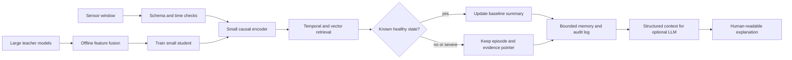
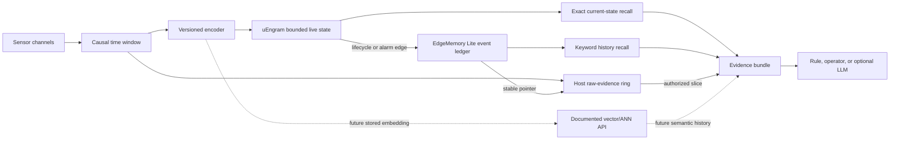
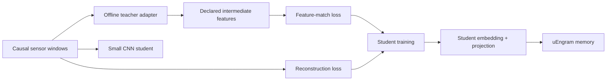
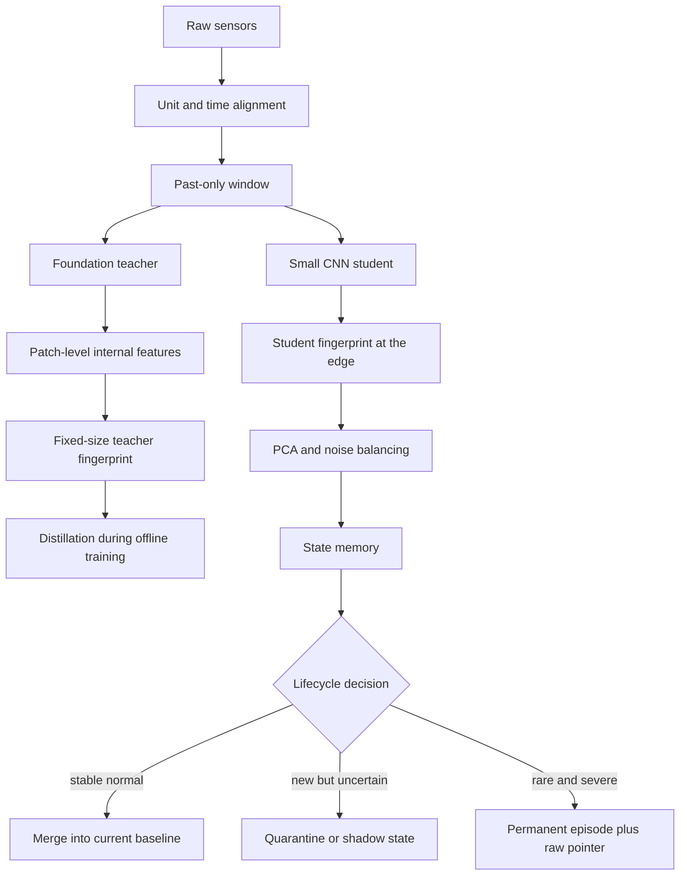
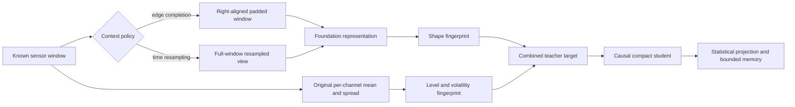
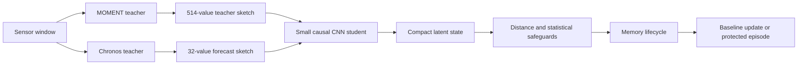
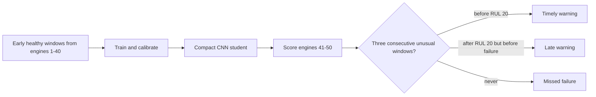

# From Sensor Streams to Machine Memory: What uEngram Shows—and What It Does Not

**A repository-based research report in plain English**  
**Status:** Exploratory research synthesis; not a deployment or safety certification  
**Project:** uEngram  
**Evidence reviewed:** repository implementation, committed experiment reports and result files, available project-session recaps, and selected public research  
**Audience:** engineers, students, and readers new to statistics and machine-learning terminology

## Abstract

Machines produce streams of measurements: vibration, temperature, pressure, speed, and fault codes. Keeping every measurement forever is costly; keeping only the latest measurements can erase rare but important failures. This paper examines uEngram, a research implementation that tries to maintain a small, bounded memory of sensor behavior. It describes each short sensor window with a compact feature vector, compares it with learned operating states, updates familiar states, places unusual repeated patterns on probation, and retains selected unusual episodes.

The repository supports a useful engineering finding: on synthetic streams, bounded stateful memory can reduce writes relative to storing every window and can retain more modeled events than simple first-in-first-out or reservoir baselines. The reservoir baseline itself uses fewer writes in that benchmark, so this is a trade-off—not a claim that uEngram minimizes writes against every method. Results on real datasets are mixed and often poor for the use that matters most—reliable, early, low-false-alarm fault warning. The frozen detector caught 5 of 34 labeled SKAB events, always after onset; it missed every valve-throttling test. The compressor and fleet results reveal operating-state coverage, calibration, label, and transfer problems. These are not side notes: they are the central findings.

We also examine an analogy between text retrieval-augmented generation (RAG) and a proposed industrial “Sensor-State Memory” database. The analogy is useful, but the proposed database features—including a native temporal/vector score, centroid compaction, keyed state superseding, raw-signal pointers, and bounded eviction—are design ideas, not capabilities demonstrated by this repository. A Mem0-like lifecycle could help organize machine episodes and evolving baselines, but adapting a language-model memory idea to safety-relevant sensor data requires deterministic rules, provenance, uncertainty tracking, and strong safeguards against learning a fault as normal.

**Novelty conclusion:** this repository does not establish a new general anomaly-detection algorithm or prove the first edge-memory system. Its defensible contribution is a measured, unusually explicit set of failure analyses and a candidate combination of bounded memory, feature encoding, and lifecycle rules. A complete literature search and independent field evaluation remain outstanding.

## 1. Plain-language summary

Imagine a mechanic who has to remember how a machine behaves over years, but has only a small notebook. Writing down every second of normal humming fills the notebook. Throwing away the oldest page each time the notebook fills can erase the one page describing a serious breakdown. The engineering problem is to keep a compact description of normal behavior, retain unusual episodes that may matter, update the current description as the machine changes, and still be able to inspect the original sensor recording.

uEngram is a Python reference implementation of part of that idea. It reduces each short sensor window to numbers such as average level, variability, and frequency-band energy. It uses a bounded collection of state slots: familiar patterns can be represented by compact summaries; a new pattern can be tested for persistence; and rare patterns can be retained as episodes with evidence. In the current implementation this is not a general-purpose industrial database, not an embedded C++/RTOS engine, not a complete RAG system, and not a natural-language Mem0 clone.

The strongest positive results are on controlled, generated data. They show that the design can behave as intended under conditions constructed for the benchmark. The real-data studies show why that is not enough. A system can have a high AUROC and still miss most events, alarm too often, detect only after a fault has started, or fail when a machine enters an operating condition absent from commissioning. **A high score is not the same as useful warning.**

### Key results at a glance

| Evidence | Observed result | What it means—and does not mean |
|---|---|---|
| Synthetic DSP stream, ten seeds | 1.00 modeled event recall; about 86.2% fewer writes than storing every window; AP 0.995 | Strong controlled demonstration, not a real-world reliability claim. The benchmark’s generated event patterns and labels are known to the experiment. |
| CMAPSS FD001, DSP | uEngram health AUROC 0.999 and health AP 0.995; the separate RUL RMSE was 42.1 for uEngram versus 25.8 for naive storage | Health ranking and remaining-life error are different tasks. Better on one metric does not mean better overall. |
| MetroPT-3, frozen CNN uEngram | Mean 3.6/4 reported events detected; about 10.2 false-alarm episodes per week; mean lead relative to report start was negative | Not a practical low-alarm early-warning result. The evaluation’s event times are report associations, not adjudicated physical failure onsets. |
| MetroPT-2, frozen v2 policy | No published events detected in either the two-event April subset or the three-event January subset | Low false alarms alone is not success when all target events are missed. |
| SKAB, frozen DSP detector | 5/34 events detected; AUROC 0.546; AP 0.419; mean detection 57.6 s after onset; 20/20 valve-throttling tests missed | Partial, confirmation-only transfer on one water-loop testbed; no demonstrated early warning or fleet generalization. |
| EngineAD CNN study | Across 30 seed runs and five held-out trucks, pooled segment AUROC stayed near chance; d=16 median 0.556 | Exploratory segment-level study. The representation used fleet-wide fitted PCA; segment labels are not precise fault intervals. Not independent event-level validation. |
| OS-Metrics operational study | Domain specialists 29/42 strict recall (69.0%), 19.6 false alarms/week, 100% root-cause attribution | Exploratory operational workload comparison; domain partitioning beat DSP (27/42, 26.6 FA/wk) and all-channel role pooling (24/42, 42.0 FA/wk). Not a physical fleet confirmation. |
| Full repository test suite | 345 passed, 1 skipped | Software tests passed in the current branch; this does not validate field performance or the proposed database design. |

The data above are not a single contest with one winner. Datasets, labels, metrics, and experiment stages differ. The detailed qualification is in Section 6.

## 2. Research questions and scope

This report asks:

1. Can a bounded sensor-memory engine retain useful state and event information while reducing repeated writes?
2. What happens when this kind of engine meets real sensor data and operational labels?
3. How can a Mem0-like text-memory lifecycle be translated into a temporal, vector-enabled edge database?
4. Which claims are supported by this repository, which are proposals, and what would count as new research?

The scope is the uEngram repository and session history for this project folder, plus selected public sources listed in Section 11. The archive exposed project-session recaps, not every full transcript. A request to retrieve the full session by its available identifier failed, so this paper does not claim to have read a complete transcript. Recaps and the accessible conversation content were used as context; unrelated project sessions were excluded.

## 3. System and basic ideas

### 3.1 From raw readings to a “fingerprint”

A **time series** is a sequence of measurements arranged by time, like temperature readings every second. A **window** is a short consecutive slice of that sequence. The implementation treats a window as one observation rather than saving every raw sample as a separate memory.

A **feature** is a number that describes something about the window. The project’s deterministic DSP (digital signal processing) encoder describes sensor channels with their average, their spread, and the energy in four frequency bands. For example, a motor’s average vibration may remain stable while a new high-frequency rattle appears. The band features can capture that change without storing every waveform sample in the state representation.

The resulting list of numbers is a **vector**—an ordered list, like a row of coordinates. Comparing vectors is a way to ask “does this window resemble a state I already know?” The project also tests learned CNN (convolutional neural network) encoders, which are small neural networks trained to compress and reconstruct windows. A compact vector is useful, but compression discards information; a stored vector cannot replace retaining raw evidence for later inspection.

### 3.2 Distance, noise, and whitening

A distance score measures how different a new vector is from a remembered state. Ordinary Euclidean distance treats every direction and feature scale alike. Sensor features often move together: for example, two temperatures may rise together because the machine is under greater load. **Covariance** describes how measurements vary together. **Whitening** rotates and rescales features to reduce that dependence, so one physical change is not counted several times just because it appears in correlated sensors.

The code estimates within-state noise from differences between nearby windows. The **median absolute deviation (MAD)** is a robust measure of typical spread: take the median, measure each value’s distance from it, then take the median of those distances. Unlike the ordinary standard deviation, a few extreme values do not dominate it. This is useful when the commissioning data may contain occasional spikes.

**PCA (principal component analysis)** is a compression method that keeps directions with the most variation. The output dimension `d` is the number of directions retained. This is a trade-off: too few directions may erase weak faults; too many can retain redundant or nearly duplicate signals and make covariance calculations unstable. In this repository the best dimension depends on the dataset. A larger vector is not automatically better.

### 3.3 The memory lifecycle

The engine has a bounded number of slots rather than an unbounded list of all windows. In broad terms:

- A familiar window updates a known state’s summary.
- A new pattern can enter a candidate period. Repeated evidence can promote it to a stable state; a one-off unusual pattern may remain an episode.
- An old state can be marked superseded so it is not confused with the current state, while its history can remain available.
- Storage limits force explicit choices about which summaries or episodes survive.

The exact policies and thresholds vary by experiment and version. This description is the implemented research direction, not a guarantee that every slot has correct physical meaning. In particular, a statistical outlier is not necessarily a mechanical fault: it could be a new load, a sensor glitch, a repair, or a fault.

### 3.4 Why not just keep everything?

With one new vector per second, a day produces 86,400 vectors. If each vector has 16 float32 values, that is about 5.3 MiB for the raw vector values alone, before timestamps, metadata, index structure, alignment, copies, and the original waveform. At higher sample rates the increase is much faster. A vector search index also consumes storage and must be updated. In flash memory, small random updates can trigger larger physical writes, called **write amplification**. The exact impact depends on the database and storage hardware; it is a risk to measure, not proof that every ANN index will “wear out” a device.

A simple FIFO (first-in, first-out) buffer always deletes the oldest item. It is predictable, but it may delete an old severe fault and keep thousands of recent routine windows. The purpose of a memory lifecycle is to make this selection more meaningful while preserving hard limits and evidence lineage.

## 4. The RAG analogy and Sensor-State Memory

### 4.1 RAG in simple terms

**RAG** means retrieval-augmented generation. Before a large language model answers, a system searches a collection of text passages and gives relevant passages to the model. Think of an open-book exam: the model is the student, the search index is the librarian, and the retrieved passages are the pages placed on the desk. A vector embedding is a compact numerical fingerprint that helps find passages about similar meanings even when wording differs.

A plain vector RAG store can become an untidy filing cabinet. It may contain duplicate passages, facts that have since changed, and contradictory versions. **Mem0** is a published AI memory approach intended to manage longer-lived agent memory, including extraction, updates, and memory lifecycle. That is a useful inspiration, not a ready-made embedded sensor database.

### 4.2 Translate the analogy carefully

For machine telemetry, a “document chunk” becomes a time-aligned sensor window. Instead of embedding sentences, the system can compute a deterministic feature vector or a trained compact representation from vibration, temperature, load, and fault codes. A retrieval query can ask: “Have we seen this pattern on this asset and operating mode?” or “What was the current healthy baseline before this alarm?” The answer should include timestamps, the operating mode, and a link to the exact raw slice that supports the summary.

A vector similarity score by itself does not establish that two windows have the same cause. Two physically different faults can look similar in a compressed space. Likewise, old and new vectors from different operating modes should not be merged just because their distance is small. The system needs asset identity, sensor schema, operating state, units, calibration version, event status, and time as first-class metadata.

### 4.2.1 Three fallacies in the original "Edge Mem0" pitch

The project began from an inquiry by an embedded database vendor seeking to bring cloud
AI memory architectures (specifically Mem0) into an embedded database with ANN vector search.
Analyzing this proposal against real physical sensor streams revealed three core fallacies:

1. **The "Chatbots on Microcontrollers" fallacy:** Embedded systems on mining trucks, wind
   turbines, and industrial compressors do not need conversational memory to remember
   natural-language user preferences. The true commercial need is **physical state and
   anomaly lifecycle memory**—remembering wear baselines, acute fault excursions, and
   operating regimes under strict memory bounds.
2. **The ingestion-path write bottleneck:** Cloud Mem0 invokes a large language model on
   every write to extract entities, deduplicate facts, and resolve contradictions. On an
   embedded gateway or MCU ingesting 100 Hz–1 kHz physical telemetry, invoking an LLM or
   small language model (SLM) in the ingestion loop destroys real-time guarantees ($4\text{GB}$
   RAM and several seconds of compute per tick). Ingestion and consolidation **must be
   deterministic and mathematical** (centroids, distances, running variance), never
   LLM-dependent.
3. **Flash wear and RAM starvation:** Standard ANN vector indexes (such as in-memory HNSW
   graphs) require substantial RAM overhead and generate severe random-write amplification
   when mutated frequently. On embedded hardware running raw NAND flash or eMMC, frequent
   graph mutations will rapidly exhaust flash endurance. The memory engine must use
   tiered, density-aware page compaction rather than continuous graph rebuilding.


See [Figure 1](figures/rag-sensor-memory.svg). It is an architecture analogy; the lower pipeline is proposed behavior, not an implemented uEngram product feature.


### 4.3 Five database-native capabilities proposed for a “Sensor-State Memory” engine

The following are concrete design proposals inspired by the project discussion. They are **not claims that the current repository implements these database primitives**.

#### 1. Hybrid temporal–vector retrieval with severity

An ordinary nearest-neighbor search asks for the most similar vector. An operational query may also care whether the event was recent and whether it was severe. A candidate score could be:

$$S(q,m)=w_s\,\mathrm{sim}(q,v_m)+w_t\,e^{-\lambda\Delta t}+w_r\,g(r_m)$$

Here, `q` is the query window, `v_m` the stored vector, `sim` a similarity score, `Δt` the time since the stored memory, `r_m` an independently assigned severity level, and `w_s`, `w_t`, and `w_r` weights. The exponential term is a smooth “fade with age” curve. `λ` controls how quickly age reduces relevance. This resembles remembering a recent event more easily while still retaining severe old events.

**Important caution:** similarity, time, and severity have different units and meanings. They must be normalized and policy-reviewed; a weighted sum can rank a dangerous old event below a harmless recent one if weights are careless. Severity must not be invented by the similarity model. For safety, retrieval should support filters and return the separate components and source evidence, not only a single opaque score.

#### 2. Centroid compaction (“consolidate”)

A **centroid** is the average point of a group of vectors—the center of a cloud of similar observations. If many windows are confirmed routine, an engine could summarize them with a count, mean vector, variance, time range, operating mode, and provenance rather than keep a separate vector for every window.

For two groups with counts `n₁`, `n₂` and means `μ₁`, `μ₂`, the combined mean is:

$$\mu=\frac{n_1\mu_1+n_2\mu_2}{n_1+n_2}.$$

Variance must also be combined; storing only a mean hides how much the underlying windows differed. Do not merge across assets, operating regimes, sensor-calibration changes, or unresolved event status. Do not delete source windows until the compacted record has been durably written and verified. This is similar to combining many repeated notebook entries into a summary while keeping the count and a reference to the original pages.

#### 3. Keyed state superseding (“mutate state”)

An active state might be keyed by `(asset, subsystem, operating mode, sensor-schema version)`. A new verified healthy pattern can update the current baseline; a repair or major phase change can create a new baseline version and mark the earlier one superseded. An exponential moving average (EMA) updates a value gradually:

$$\mu_t=(1-\beta)\mu_{t-1}+\beta x_t.$$

`β` is a learning rate: a small value changes slowly; a large value follows new observations quickly. This arithmetic is simple. The hard part is deciding which samples are safe to learn from. If a developing fault is admitted as “normal,” the baseline can drift toward the fault and hide it. Use explicit promotion rules, quarantines, operator confirmation or trusted health evidence, and immutable version history.

#### 4. Cross-modal pointers to original signals

A compact episode should point to the exact time-series slice that created it, for example `(stream_id, start_offset, length, timestamp_range, schema_version, checksum)`. This is better than copying a large waveform into every memory record. It is not automatically a “zero-copy” guarantee: the underlying ring buffer may overwrite or move the data. The database needs pinning/retention rules, pointer validity checks, crash-safe updates, and an honest “evidence expired” response.

#### 5. Resource-bounded eviction (“forget”)

When RAM or flash reaches a configured limit, the system must choose what to remove. A simple candidate policy could consider redundancy, age, and severity. However, never use an unconstrained score as the only protection for critical episodes. Enforce hard rules such as “retain at least the newest N confirmed critical events per asset,” “do not evict evidence under active investigation,” and “keep an audit record of every eviction.” Test behavior at the high-water mark and after power loss. Memory bounds should be deterministic and directly testable.

### 4.4 Retrieval and an LLM

A large language model can turn retrieved records into a readable explanation, such as “the pump is operating hotter than its prior loaded baseline; similar episodes occurred after filter blockage.” It should not be the authoritative sensor scorer, sole memory writer, or safety controller. The system should provide the model with structured records and raw-evidence pointers, require it to cite retrieved records, and separately preserve the measured signals and confidence. A bounded edge write path should be deterministic; a cloud model or idle-time worker may suggest summaries for human review.

### 4.5 A generic Sensor-State Memory architecture

The proposed architecture has two paths. The **fast edge path** receives
sensor windows, checks the schema and timestamp, creates a compact
representation, searches the bounded memory, and applies deterministic
retention rules. It keeps the raw slice or a protected pointer when an
episode needs later inspection. The **slow learning path** runs during
commissioning or offline maintenance. It can use one or more large teacher
models to train a small student encoder, but the teachers do not need to run
inside the deployed edge process.



The multi-teacher idea is similar to asking several specialists to describe
the same machine window. Their feature descriptions can be joined during
training, and a smaller student learns to imitate the useful parts. This is
different from placing every large network inside the machine: that would
increase memory, computation, power use, and software failure surface. It is
also different from blindly copying weights. Two networks may have
incompatible internal shapes even when both process time series.

If teacher $m$ produces a feature vector $h_m(X)$ and the student produces
$\hat h_m(X)$ for the same window $X$, a simple training objective is

$$
\mathcal{L}=\mathcal{L}_{\mathrm{reconstruction}}+
\lambda\frac{1}{M}\sum_{m=1}^{M}
\frac{1}{d_m}\left\|h_m(X)-\hat h_m(X)\right\|_2^2.
$$

The first term asks the student not to forget the sensor window. The second
term asks it to preserve the teachers' descriptions. $M$ is the number of
teachers and $d_m$ is the number of values in teacher $m$'s description.
Dividing by $d_m$ stops a teacher with more output numbers from winning merely
because it is wider. This is only a starting point: correlated teachers may
repeat the same blind spot, and a teacher trained on a different sensor
schema may teach an invalid relationship.

The LLM belongs after retrieval, not in the safety-critical scoring loop. It
may explain a structured result and cite evidence, while the edge rules keep
the measured score, timestamp, uncertainty, baseline version, and raw-data
pointer authoritative. This separation is the main architectural safeguard
against a fluent explanation being mistaken for a verified diagnosis.

## 5. Repository evidence and experiments

### 5.1 Synthetic data: useful proof of mechanism, not proof of field performance

The committed v3 synthetic DSP run uses ten random seeds. In the table in `docs/RESULTS.md`, uEngram records about 2,762 writes against 20,000 windows—an 86.2% reduction—and reports event recall 1.00 and average precision (AP) 0.995. In everyday words, **recall** asks “of the modeled events, how many did we catch?” **AP** summarizes precision and recall across score thresholds; it is more informative than raw accuracy when normal windows greatly outnumber events.

The result shows that the lifecycle can work under the generated stream’s assumptions. The same report shows substantial differences among encoders and variants. For example, the synthetic CNN uEngram row has only 0.262 event recall despite high AUROC and AP. This is a useful warning against reading any one score in isolation. Synthetic labels and transitions are built into the benchmark, so these results do not estimate a real plant’s failure rate.

### 5.2 CMAPSS: two different questions give two different answers

On CMAPSS FD001, DSP uEngram’s reported health-ranking AUROC/AP are 0.999/0.995, while its remaining-useful-life RMSE is 42.1; the naive baseline’s RUL RMSE is 25.8. **RMSE** is the typical size of prediction errors, with large misses penalized more heavily. Here a smaller value is better. The repository’s own table therefore does not show that uEngram wins every task. “Is this engine near end-of-life?” and “how many cycles remain?” are different questions with different scores. A health score that separates late-life from early-life windows may still give a poor numeric estimate of the exact remaining life.

A dimension sweep found real numerical limits. On CMAPSS, dimension 32 failed because near-duplicate frequency features made the estimated noise covariance unstable and fragmented per-engine windows. Dimension 24 improved the RUL RMSE in a separate result but lowered novelty AUROC. The project appropriately kept dimension 16 as its default rather than treating width as a free improvement.

### 5.3 MetroPT compressor data: state coverage and warning limits

In the MetroPT-3 evaluation, many reported failure windows were in sustained compressor-load operation that was absent from commissioning: the remediation report counts 492 of 495 event windows in that condition, with zero commissioning examples and one calibration example. A detector cannot reliably learn the normal distribution of a condition it has never observed. More importantly, within that loaded state, the studied health/novelty scores did not distinguish healthy loaded windows from pre-report windows (reported AUROC 0.07 and 0.35). This is evidence against claiming an early-warning signal for that failure mode using those sensors and that split.

The frozen CNN benchmark reports a mean 3.6 of four report-associated events detected and roughly 10.2 false-alarm episodes per week. Mean lead relative to the report time is negative, meaning alarms tended to come after the report start under that evaluation convention. A report association is not the same as an independently adjudicated physical fault timestamp. The project’s later strict evaluation of the frozen v2 confirmation policy found **zero of five** published MetroPT-2 events detected across the January and April subsets; false alarms were low, but the primary “catch the event” condition failed. Do not combine the earlier development benchmark with this confirmation result as if they were one study.

### 5.4 SKAB: precise labels expose low recall and late detections

SKAB is one water-circulation testbed, not a multi-asset industrial fleet. The frozen detector caught 5 of 34 point-labeled fault experiments. Its row-level AUROC was 0.550 and AP 0.423. All five alarms occurred 28–114 seconds **after** the annotated onset. The detector missed every one of the 20 valve-throttling experiments. It did better on several vibration-changing faults, which fits the DSP features’ sensitivity to frequency content; that is a plausible explanation, not a proven causal mechanism.

A short clean exposure produced five false-alarm episodes over only 6.21 hours. Extrapolating that to 135 alarms per week is mathematically possible but operationally misleading: a few events in a short observation period produce an unstable weekly rate. The duration-weighted alarm share is also only a small-sample description. This report is valuable because it names the denominator and labels the weakness instead of presenting a flattering extrapolation.

### 5.5 EngineAD: held-out trucks, weak segment-level transfer

The EngineAD study trained CNN encoders across ten random seeds for each of three latent dimensions and tested segments from five held-out trucks. The 30 pooled held-out segment AUROC values are shown in Figure 2. The `d=16` values are somewhat higher overall, but all groups remain near the 0.50 chance-ranking reference. Here **seed** means a different random initialization/training run; it does not mean a new independent dataset. The five held-out vehicles are also a small test group.


The dataset provides five-minute segments with fleet-fitted PCA channels rather than raw high-rate sensor waveforms, and labels are segment-level. The projection was fit across fleet data, so the vehicle-held-out model split does not eliminate all information leakage: the feature transformation already saw fleet-wide data. Some segments contain mixed point labels, so segment classification cannot supply exact physical onset or warning time. The study is exploratory evidence of weak transfer under this setup—not a final test of the frozen sensor-memory engine and not event-level validation.

### 5.6 NASA IMS: an important error correction

A project-session recap and a draft result section described an “optimal strategy” on the NASA/IMS bearing data as providing 63.8 hours of early warning and zero alarms over four healthy weeks. **Those claims are not supported as physical early-warning or false-alarm validation and should not be repeated as verified results.** The inspected benchmark is a separate exploratory script outside the repository. It defines candidate degradation indices in code, then evaluates against those assumed indices; the script uses the final sample as the failure reference and the archive does not provide the independently adjudicated fault-onset times required for the claimed lead-time interpretation. The short 7-day run also had three counted false-alarm episodes, not zero. The zero episodes came from the longer campaign’s assumed healthy portion, not four weeks of independently verified healthy operation.

The scripts can still be used to explore features and thresholds. Their AUROC/AP values mostly show that the score changes over the campaign’s time trend; they do not establish detection before a known physical failure. This correction is a major research finding because a plausible-looking table can turn an assumed changepoint into a seemingly precise, but unsupported, “hours of warning” claim. Section 9 gives the general lesson for avoiding this error.

### 5.7 Other validation and encoder experiments

The repository also contains results that are important even when they do not improve the frozen candidate:

| Study | Result | Interpretation |
|---|---|---|
| Encoder-capacity sweep, synthetic | Increasing DSP width from 16 to 36 reduced modeled event recall from 1.00 to 0.801 and AP from 0.996 to 0.534 (10-seed mean; median 0.541) | A larger vector can make a real regression; the synthetic test caught it. |
| Encoder-capacity sweep, MetroPT-3 | DSP width 42 improved ranking metrics and lowered false alarms compared with width 16, but detection remained 3/4 and false alarms remained above the stated goal | A local improvement is not a successful operational result. |
| Encoder-capacity sweep, SKAB | A seed-0 exploratory width-48 run detected 9/34 with five false-alarm episodes, versus 5/34 and five episodes for the frozen width-16 run | Promising diagnostic result, not multi-seed or independently confirmed; it did not change the frozen model. |
| MetroPT-3 alarm-policy sweep | No tested parameter combination met all three goals: detect 4/4 reports, clean alarm time at most 2%, and at most one false alarm per week | The miss is not fixed by simple threshold tuning. Forcing all four detections raised clean alarm time to at least about 4.6% in the tested combinations. |
| SCANIA Component X | On 5,046 vehicles, the frozen AND policy alarmed on 19.287% of class-0 vehicles and recalled 22.794% of classes 1–4 at the final row; AUROC 0.541, AP 0.0321 | This is held-out data not used to select the configuration, but labels are coarse repair-proximity classes—not exact failure times. No early-warning claim is possible. |
| CARE to Compare | Full-cohort score and confidence interval are unavailable because some attempted event datasets had no valid evaluation; no subset aggregate was substituted | Missing valid coverage is not a pass. Report the evaluation failure, not a cherry-picked subset score. |
| Independent field-cohort preregistration | No screened source currently meets every requirement for untouched assets, precise physical-fault timing, independent adjudication, and power planning | The decisive field validation is still outstanding. |

The capacity sweep illustrates why results are split across dimensions and datasets rather than flattened into one “best model” ranking. A configuration can improve an AUROC or rescue several test cases while failing a different acceptance criterion. The MetroPT-3 alarm sweep also found a mechanism-level trap: enabling a health path for an unbaselined state recovered a missed report only at the cost of much longer clean-time alarms. This is a real trade-off, not a free parameter win.

### 5.8 Software tests

The current full Python test run was:

```text
PYTHONPATH=src:. .venv/bin/pytest tests/
319 passed, 1 skipped
```

This shows that the tested code contracts and regression checks passed in that run. It does **not** show the model detects industrial faults, prove statistical claims, validate power-failure durability, exercise the proposed five database primitives, or certify safety. A good software test suite and a good field-validation study answer different questions.

### 5.9 Stronger cross-dataset gate

The repository now records a stronger gate in `results/stronger_gate.json`.
It keeps three kinds of evidence separate instead of mixing their scores:

1. the new public TSB-AD-U holdout for MOMENT teacher transfer;
2. the five-seed CMAPSS FD001 lifecycle and health/RUL results; and
3. a fresh replay of the frozen SKAB event protocol.

The fresh SKAB replay detected 5 of 34 events, with AUROC 0.5458 and AP
0.4192. The detections were post-onset, and the short clean exposure makes a
weekly false-alarm extrapolation unstable. CMAPSS continues to show the
important split between a strong health-ranking result and a separate RUL
error. The gate therefore confirms reproducibility and exposes missing
coverage; it does not prove that MOMENT transfer improves CMAPSS or SKAB.
Those two teacher-transfer experiments remain future work because the current
public transfer holdout used one teacher and different window contracts.

## 6. Key findings, with appropriate weight

1. **Bounded memory has a credible mechanism.** On synthetic workloads, lifecycle decisions reduce writes while retaining modeled episodes. The result supports further work on bounded sensor memory, not automatic deployment.
2. **Operating-state coverage is essential.** If commissioning misses a legitimate load or mode, a detector may label that mode novel. “Normal” must be defined conditionally on asset, subsystem, and operating state.
3. **Fault warning is harder than anomaly scoring.** An anomaly score may rank data usefully while producing weak event recall, many false alarms, or alarms only after onset. Report event recall, false-alarm exposure, and timing, not only AUROC.
4. **Labels determine what the experiment can prove.** A report timestamp, segment label, or assumed degradation index is not automatically a fault onset. The metric must match the label’s true meaning.
5. **One embedding dimension does not fit every dataset.** Higher dimension can rescue weak patterns in one dataset and destabilize covariance estimation or reduce event recall in another.
6. **Memory lifecycle creates a fault-assimilation hazard.** If abnormal windows are allowed to update the healthy baseline, slow faults may become the new “normal.” The software must separate “observed often” from “verified healthy.”
7. **The product idea is promising but the prototype gap is real.** The five native DB primitives are plausible engineering targets. They require transactional behavior, deterministic bounds, flash/RAM benchmarks, and raw-evidence retention semantics that this Python research code does not establish.

## 7. Statistics and unfamiliar terms, in simple English

| Term | Simple meaning | Everyday comparison | Common misuse to avoid |
|---|---|---|---|
| AUROC | How often a randomly chosen positive example gets a higher score than a random negative one | A ranking contest: did the faulty example usually rank above the healthy one? | It does not say how many alarms occur at the chosen threshold or how early they happen. |
| Average precision (AP) | A summary of precision/recall trade-offs across score thresholds | How useful the “top suspicious items” list remains as you expand it | It depends on how common positives are; compare only with that context. |
| Precision | Of the alarms raised, what share corresponded to a labeled event? | Of the smoke alarms, how many were real fires? | A system can have high precision by raising almost no alarms and miss most faults. |
| Recall | Of the labeled events, what share were detected? | Of all fires, how many did the alarms catch? | High recall can be bought with excessive alarms. |
| False alarm per week | Number of false alarm episodes divided by observed eligible operating weeks | Count false calls per week, but only while the system was actually watched | A tiny observation period makes the weekly rate unstable. State exposure and gaps. |
| Lead time | Time between alarm and a trusted event onset | How long before the confirmed fire did the alarm ring? | A report date or assumed index is not necessarily the physical onset. Negative lead is after onset. |
| RMSE | Square-root of average squared prediction error | Typical distance between predicted and actual remaining cycles, with big misses weighted more | It is not comparable across different units or target definitions without care. |
| Confidence interval | A range reflecting uncertainty under a stated sampling model | A plausible range from repeated samples, not a guarantee about every future machine | Seed resampling is not the same as sampling new assets or sites. |
| Conformal threshold | A threshold selected from calibration scores to target a specified tail rate under assumptions | Use a clean reference pile to decide what counts as unusually high | Dependence, drift, and non-representative calibration can break the guarantee. |
| Data leakage | Test information influencing fitting or evaluation | Studying from the answer sheet before the exam | A vehicle-held-out split can still leak if shared preprocessing used all vehicles. |
| Covariance | How two measurements tend to move together | Two dancers whose steps often change in sync | Correlation does not prove one sensor causes the other. |
| Whitening | Rescale/rotate features to reduce correlations and equalize noise | Adjusting a sound mixer so one loud channel is not counted twice | It can become unstable when features are duplicates or data are scarce. |
| Drift / non-stationarity | The data’s usual pattern changes over time | A familiar machine gradually changes as it wears or the weather changes | Adapting too quickly can absorb a fault into the baseline. |
| ANN | Approximate nearest-neighbor search | An express-lane map that finds very similar records quickly, sometimes not the exact closest | “Approximate” means the index may miss the true closest item; measure recall/latency. |
| Semantic memory | A compact general fact or current state | A mechanic’s note: “this pump usually vibrates at this level under load” | A summary should not erase dates, uncertainty, or its source episodes. |
| Episodic memory | A record of one particular event | A dated service-log entry about a specific breakdown | Rare does not always mean important; preserve context and evidence. |
| Centroid | Average location of a group of vectors | The center of a cluster of dots on paper | Mean alone loses spread, multimodality, and individual examples. |
| EMA | A running average that gives new observations more weight | A rolling average that forgets old readings gradually | It does not know whether new observations are healthy. |
| High-water mark | A configured point at which storage pressure triggers action | A fuel gauge line that says “start conserving now” | Must be tested at the actual hardware and under power loss. |

**Seed-plot reading tip:** each dot in Figure 2 is one training seed's pooled AUROC, and the vertical tick marks the median. A dot is not one fault and not one truck. The chart is about variation across model starts, not independent field evidence.

## 8. Pseudocode for the critical paths

The following pseudocode describes safe design patterns. It is explanatory; it is not a copy of a production embedded engine or a claim that all steps exist in the current code.

### 8.1 Ingest, classify, and retain evidence

```text
function ingest(asset, raw_window, time, operating_mode, schema_version):
    validate_timestamps_and_sensor_schema(raw_window)
    vector = deterministic_encode(raw_window)
    candidates = nearest_states(
        asset=asset,
        mode=operating_mode,
        schema=schema_version,
        vector=vector
    )

    if candidates.has_confirmed_healthy_match(vector):
        update_summary_only_if_admission_policy_allows(candidates.best, vector)
        record_summary_update_and_source_time()
        return "routine-state update"

    score = novelty_score(vector, candidates)
    raw_ref = pin_raw_slice_before_memory_commit(raw_window, time)

    if score is severe_or_unprecedented:
        write_episode_transactionally(vector, raw_ref, score, time, provenance)
        return "episode retained"

    candidate = update_probation_state(vector, raw_ref, time)
    if candidate.meets_persistence_rule:
        promote_only_after_health_or_event_classification(candidate)
    enforce_hard_memory_budget_without_evicting_protected_evidence()
```

**Why the order matters:** pin the raw slice before writing the record that points to it; otherwise the memory can contain a broken pointer. Do not promote a repeated pattern to “healthy” just because it repeats: a repeated ongoing fault also repeats.

### 8.2 Safe centroid consolidation

```text
function consolidate(group):
    require same_asset(group)
    require same_operating_mode_and_schema(group)
    require every_member_is_confirmed_routine(group)
    summary = merge(count, mean, covariance, time_range, provenance)
    commit(summary)                 # durable write first
    verify(summary.checksum)
    mark_source_records_compacted() # only after verification
    retain_source_pointers_as_policy_requires()
```

A centroid is useful only if the summary keeps enough context to answer “how many observations?”, “how variable were they?”, “when did they occur?”, and “which raw windows support this?”

### 8.3 Retrieval with transparent scoring

```text
function retrieve(query, asset, mode, now, limit):
    pool = ANN_candidates(query.vector, filters=(asset, mode))
    for memory in pool:
        memory.similarity = similarity(query.vector, memory.vector)
        memory.age_factor = exp(-lambda * (now - memory.time))
        memory.severity = independently_recorded_severity(memory)
        memory.rank_score = calibrated_weighted_score(
            memory.similarity, memory.age_factor, memory.severity
        )
    return top(limit, pool,
               include_score_parts=true,
               include_raw_evidence_refs=true,
               include_state_version=true)
```

The severity field must come from an identified source (such as an operator or validated fault code). Do not allow the model’s own generated explanation to silently become severity ground truth.

## 9. Failure modes and unorthodox strategies worth keeping

### 9.1 Avoid the evidence errors

- **Do not turn assumed indices into ground truth.** If a benchmark script declares “degradation starts at row 600,” report performance relative to that scripted convention, not physical fault onset, unless an independent source validates that timestamp.
- **Do not equate a high AUROC with a useful alarm.** Publish event-level recall, false alarms per eligible operating time, detection delay, and missed-event categories at the frozen threshold.
- **Do not use a short clean interval to imply a stable weekly rate.** Show the raw exposure and episodes; widen uncertainty or state that a rate is not estimable.
- **Do not call a segment label an event timeline.** Segments can contain both normal and faulty seconds. Evaluate exactly what the labels support.
- **Do not call vehicle-held-out processing leakage-free if preprocessing saw all vehicles.** Fit scalers, PCA, and other learned transforms on training assets only; freeze and hash them before test evaluation.
- **Do not conflate development, selection, and confirmation.** Reusing MetroPT or SKAB after inspecting its results makes the next run development evidence, not a fresh confirmation.
- **Do not let a baseline learn unverified data.** Faults that persist can look like repeated normality. Quarantine new states until health is supported.
- **Do not delete the original just because a summary exists.** Verify the summary and maintain a recoverable evidence path first.
- **Do not quote synthetic results as an industrial success rate.** Synthetic data test mechanism and code paths; field data test transfer and operational assumptions.

### 9.2 Unorthodox strategies that help research

These strategies are unconventional only because they resist the temptation to optimize one headline score:

1. **Make “we cannot know” an output.** The engine should be able to say “unknown operating mode,” “raw evidence expired,” “calibration lacks support,” or “no onset label available.” Abstention is safer than a precise-looking unsupported answer.
2. **Use a two-speed memory.** Keep a tiny fast in-RAM state for real-time operation and a slower durable evidence ledger for episodes, compaction lineage, and event review. Separate deadlines from enrichment.
3. **Reserve anomaly slots before using the budget.** Protect a fixed capacity for rare/high-severity events so ordinary updates cannot crowd them all out. Measure the trade-off rather than claiming “density eviction” automatically protects faults.
4. **Replay adversarial lifecycle cases.** Feed an increasingly abnormal signal, sensor replacement, intermittent outage, gradual wear, and repair. Test that the model neither forgets severe old events nor absorbs a fault into normality.
5. **Use negative controls and “nothing changed” tests.** Verify that shuffled labels, unrelated sensors, and a time-reversed signal do not produce a persuasive pre-failure result. If they do, the score may be tracking time or leakage rather than a physical signal.
6. **Treat traces as evidence, not just training material.** Store source hashes, data split definitions, feature-transform versions, threshold origin, and every eviction/update in an auditable manifest.
7. **Keep an independent “shadow” baseline.** Compare the adapting baseline with a frozen reference. If they diverge, flag possible wear, repair, or poisoning instead of silently replacing the reference.

## 10. Industry and everyday uses—with boundaries

- **Industrial equipment:** find similar vibration/thermal episodes and preserve the waveform around a fault. Potential value: faster maintenance diagnosis and less raw-data upload. Not yet shown: reliable universal prediction across sites.
- **Fleet vehicles:** summarize recurring conditions by vehicle and subsystem, then sync rare events when connectivity returns. Potential value: lower bandwidth and more useful service histories. EngineAD results warn that fleet transfer and segment labels remain difficult.
- **Robots and drones:** retain recent incidents and mode changes under memory/power limits. Use only with a safe local fallback; a nearest match is not proof the robot can safely repeat a maneuver.
- **Remote energy or utility sensors:** keep event summaries and raw slices around outages while routine data is compressed. Must preserve regulatory and operator audit requirements.
- **Everyday analogy:** a smart thermostat could remember “the room warms slowly when the sun is low” and keep a dated record of a failed heater sensor. A human-readable assistant could retrieve those records, but it should distinguish observed temperature from its own guess about the cause.

These are plausible use cases, not completed deployments or measured commercial results. Healthcare, aviation, road-vehicle control, and other safety-critical settings would require domain-specific hazard analysis, independent validation, fail-safe design, and approval beyond this paper.

## 11. Prior publication and novelty boundary

Relevant ideas are not new in isolation: digital signal processing, condition monitoring, anomaly detection, change detection, streaming summaries, bounded buffers, vector search, and retrieval-augmented generation all have existing research and products. Mem0 has a published paper describing a long-term memory system for AI agents [1]. The public EngineAD dataset paper reports real vehicle engine anomaly segments [2]. The uEngram repository cites and builds on standard robust signal/statistical techniques, including noise-fraction transforms and analytical redundancy [3, 4].

A repository-and-session review plus selected source checks cannot establish that no similar system has ever been published. That would require a systematic literature review across embedded databases, predictive maintenance, online clustering, event storage, and agent memory. Accordingly, this paper makes **no “first-ever” claim**.

The potentially distinctive research question is the combination and evaluation: can an embedded database natively maintain small, auditable, evolving sensor-state summaries while preserving rare episodic evidence and bounded resource use? The present repository supplies a Python reference design and useful failure analyses; it does not answer that question for a production DBMS. The most honest contribution today is methodological: transparent evidence about which datasets, splits, labels, and metrics do—and do not—support claims.

## 12. Limitations and future work

### Current limitations

- No untouched, independently adjudicated, multi-asset field cohort currently satisfies the project’s preregistered criteria. The preregistration lists exact onset, asset custody, chronological holdout, power planning, and operator limits that are still missing.
- Existing public datasets have different machines, label resolution, asset counts, and operating conditions; their scores are not directly interchangeable.
- Some numbers are from exploratory, single-seed, or per-dimension studies. Between-seed intervals do not represent uncertainty across unseen plants.
- Feature and threshold choices have been explored on previously consumed datasets; those results cannot be reframed as new confirmation.
- The Python code and tests do not establish deterministic real-time deadlines, RAM/flash budgets on target hardware, power-loss consistency, NAND endurance, or ANN-index update cost.
- A new Python reference adapter now joins uEngram's bounded state memory with the inspected EdgeMemory Lite API: it writes lifecycle/alarm-edge events, supports keyword history recall, retries persisted events without re-ingesting windows, and manages externally pinned raw-window references. This does not provide DB-backed vectors, binary storage, ANN, relationships, atomic detector checkpoints, or field validation; see `docs/sensor-state-memory-pipeline.md`.

### Recommended research sequence

1. **Collect the right cohort.** Obtain timestamped raw measurements, independently verified physical onset/offset, asset and operating-mode identifiers, maintenance records, and enough healthy exposure. Keep test labels with an independent custodian until the protocol and code are frozen.
2. **Pre-register the outcome.** Select event recall, false alarms per monitored operating week, warning lead, and operational limits before the final test. Calculate the number of assets/events needed; do not stop when results look favorable.
3. **Fix leakage and split by asset and time.** Fit all learned preprocessing on training assets; hold out independent assets and later time periods. Save checksums and a frozen model/threshold manifest.
4. **Test operating-state coverage.** Report performance separately for load, idle, startup, environment, repair, and sensor replacement. Add a deliberate unknown-state outcome.
5. **Build the five DB primitives incrementally.** Start with durable event pointers and deterministic eviction; then add transparent retrieval scoring and state versioning; only then test centroid compaction. Compare RAM, flash writes, latency, power-cut recovery, and auditability on target hardware.
6. **Prove lifecycle safety.** Inject persistent faults and drift into controlled replay. Measure how often a fault can be absorbed into normal state, how quickly a repair creates a new baseline, and whether severe event evidence survives budget pressure.
7. **Validate LLM use separately.** Measure whether generated explanations cite the correct raw windows and distinguish facts from hypotheses. Keep model output outside hard real-time control and state-update paths until independently justified.
8. **Replicate independently.** Have another team reproduce preprocessing and metrics from the data manifest and frozen code, then evaluate on a new site or asset cohort.

## 13. Conclusion

The repository demonstrates a credible research direction: replace an endless pile of sensor vectors with a bounded memory that treats routine states and rare episodes differently. On generated streams, the mechanism can reduce writes substantially while preserving modeled events. The real-world and transfer evidence is more sobering: low event recall, late detections, false alarms, absent operating-state coverage, weak cross-vehicle results, and uncertain event labels prevent a claim of reliable industrial early warning.

A Mem0-like layer in front of sensor vectors is a useful analogy if it is interpreted as **lifecycle management**, not as “put an LLM in the database write path.” The strongest design is a two-part memory: compact, versioned summaries for routine behavior, plus dated episodes with a verified pointer to raw evidence. Safe admission rules, transparent scoring, bounded storage, and an explicit ability to abstain matter more than a clever vector index alone.

The most important lesson is procedural: ground every claim in the label, denominator, split, and source record that actually support it. In this field, avoiding a false claim of 63.8 hours’ warning is more valuable than reporting a precise number that the data cannot justify.

## 14. Implementation update: the Lite integration boundary

The repository now includes an executable Python adapter in `src/uengram/sensor_memory.py`. Each validated sensor window is fed once to uEngram using a monotonically increasing sample counter. Candidate creation, promotion, step changes, engine lineage events, and alarm open/clear edges are recorded as small, versioned EdgeMemory Lite `EVENT` records. Repeated alarm-positive windows do not create repeated records. Records include source, trust, privacy, retention, timestamp, idempotency, feature-schema, and optional raw-evidence-pointer metadata.

Retrieval deliberately returns two result types rather than pretending they are one index: exact uEngram matches for the current in-memory state, and EdgeMemory keyword matches for historical events. If a raw-window pointer is supplied, the host must provide durable pin/unpin behavior; the adapter marks such events critical and releases the pin after explicit forgetting. On a database write error, it exposes the already-built pending event so the caller can retry without feeding the same sensor sample into uEngram again.

This advances the earlier proposed architecture but does not cross the present EdgeMemory Lite contract. Lite is text/keyword storage; the vendor API inspected here does not offer vector or ANN retrieval, arbitrary binary/time-series payloads, relationships, model plugins, or persistent uEngram checkpoints. The adapter therefore is a reference event-and-state pipeline, not a finished embedded sensor DBMS. Its process-local detector state, external raw-evidence store, clock correctness, crash recovery, quotas, feature-schema migration, and detector safety all remain host/deployment responsibilities. The archived EdgeMemory Python binding's tests also need a working CFFI dependency and matching native library; its optional AutoGen demonstration is not needed by this adapter.

The implementation's behavioral tests cover lifecycle writes, alarm-edge de-duplication, asset/subsystem historical filtering, critical raw-window pin and release, storage retry without duplicate detector ingestion, and rejection of invalid/replayed windows. These tests establish adapter behavior only. They do not establish sensor-detection accuracy or safety on unseen equipment.

Verification for the earlier Lite integration reported `306 passed, 2 skipped`; the current teacher-transfer branch reports `313 passed, 1 skipped`. The patched EdgeMemory Python binding reported three tests passed and one optional AutoGen module skipped; a real x64 CFFI smoke test stored/recalled `new_candidate` and `promote` events and returned one live pattern. These checks confirm tested software paths and binding interoperability, not anomaly-detection accuracy, production reliability, or an ANN/vector feature.

See [`docs/sensor-state-memory-pipeline.md`](../sensor-state-memory-pipeline.md) for the end-to-end diagram, RAG analogy, plain-language glossary, schema, failure priorities, and pseudocode.

## 15. Targeted literature update and competitive admission experiment

A targeted literature review suggests three useful but distinct lessons. MemStream updates its normal-memory bank only when the incoming anomaly score is below an admission threshold; the purpose is to resist memory poisoning while still following concept drift [8]. Rainbow Memory reports that feature-space diversity improves bounded replay memory under blurry task boundaries [9]. Primal-Dual Continual Learning treats retention as a constrained stability-versus-plasticity problem and allocates more buffer capacity to harder tasks [10]. Label-free prototype replay further supports storing compact prototypes and samples that describe cluster spread rather than keeping arbitrary recent items [11]. These works do not directly validate uEngram's sensor lifecycle, but they agree that a bounded memory needs an admission objective; unconditional replacement is avoidable.

uEngram previously evicted its weakest mature episodic slot whenever any out-of-gate sample arrived. This allowed a weaker new sample to destroy stronger retained evidence. The revised rule compares the incoming rarity-derived importance with the weakest mature episode. It admits and writes the arrival only when the new value is greater; otherwise it returns `discard`. Candidate states remain replaceable so that a genuinely new normal mode can still complete probation. In simple terms, a full display cabinet no longer throws away a valuable item merely because a new package reached the door.

At a fixed total budget of 16 slots, with 13 episodic slots and 3 semantic slots, the five-seed synthetic benchmark changed as follows:

| Metric | Before competitive admission | After competitive admission |
|---|---:|---:|
| Event recall | 75.98% | 85.07% |
| Event-type recall | 100% | 100% |
| Seizure-event recall | 66.67% | 60.00% |
| Current-regime retrieval accuracy | 99.78% | 100% |
| Era-1 false-flag rate | 0.0678% | 0.0466% |
| Write reduction | 85.78% | 87.56% |

The selected run was repeated and reproduced every non-timing metric exactly on the same seeds. The approximately 9.1 percentage-point gain in overall event recall is encouraging, but the 6.7-point decrease in seizure-event recall is an explicit warning: optimizing aggregate coverage can still discard a critical subtype. A production system should therefore add a separately validated hard protection rule for safety-critical episodes, or a constraint-aware allocation mechanism, rather than hiding the regression inside an average. The experiment remains synthetic development evidence; it does not establish benefit on an unseen machine, renderer, XR workload, or LLM.

## 16. Edge memory as a layered system

“Edge memory” is not one database table or one neural network. It is a set of
responsibilities that run close to the machine producing the data. “Edge”
means that the first decision happens on the device, vehicle, robot, or local
gateway rather than waiting for a distant cloud service.

The architecture below separates the fast path from the slower evidence and
explanation paths. Solid arrows describe code that exists in this repository.
Dashed arrows describe a possible future Standard/Advanced database contract;
they are not features of the inspected Lite API.



### 16.1 Clear ownership prevents a confused system

| Layer | Owns | Must not silently decide |
|---|---|---|
| Application | Sensor selection, operating-mode context, externally supported severity, and what action is allowed | That frequent automatically means healthy |
| Encoder | A repeatable numerical fingerprint and its version | Fault diagnosis or maintenance priority |
| uEngram | Bounded live states, candidates, episodes, novelty, and lifecycle events | The validity of a physical label |
| EdgeMemory Lite | Durable text/event metadata, keywords, retention class, and idempotent event identity | Vector similarity, ANN, or raw-waveform persistence |
| Raw evidence store | Exact time-series slices and pin lifetime | Whether a slice represents a fault |
| Optional LLM | Plain-language synthesis from retrieved records | Alarm authority, baseline mutation, or evidence creation |

This separation is the main difference between a safe evidence pipeline and
“put an LLM in front of a vector database.” An LLM is useful after retrieval,
like a technical writer given the correct log pages. It is not a reliable
transaction manager or hard real-time controller.

### 16.2 Three product levels, stated as contracts rather than promises

The colleague-provided direction describes Lite, Standard, and Advanced
levels. Only Lite was available for inspection. A defensible progression is:

1. **Lite:** text/event records, keywords, retention, and lifecycle metadata.
   This is useful even with no neural model. The present adapter reaches this
   level.
2. **Standard:** stored embeddings plus exact vector search. “Exact” means
   every eligible vector can be checked, like comparing a query with every
   card in a small box. This needs a documented API, persistence semantics,
   schema/version filters, and measured latency.
3. **Advanced:** an ANN index for a larger collection. ANN is an express lane:
   it is faster because it may inspect only promising neighborhoods. Its
   recall—the fraction of true nearest neighbors it actually returns—must be
   measured under insertions, deletions, power loss, and storage pressure.

Binary payloads, time-series objects, relationships, and preprocessing/model
plug-ins would be valuable because a memory record could keep the embedding,
the fault code, the asset relationship, and the source waveform under one
transactional database boundary. The current repository must not compile
against guessed versions of those APIs. A versioned adapter should be written
only after the vendor publishes the real contract and ownership terms permit
its use.

A 2026 EdgeAI anomaly-detection review examined 4,075 papers and 10 market
players and emphasized that algorithms, hardware, communication, energy, and
cost must be evaluated together [16]. This supports the layered architecture:
an accurate model that exceeds the device’s energy, latency, RAM, or network
budget is not an edge solution.

### 16.3 Crash consistency is as important as similarity

The hardest database problem is not `save()` or `remember()`. It is preserving
one honest story after a crash. Suppose uEngram consumes window 900, opens an
alarm, and then the database write fails. Re-ingesting window 900 changes
M-of-N counters and can create a different decision. The implemented adapter
therefore returns the already-built event for storage retry with the same
idempotency key.

A production design still needs an atomic checkpoint or transactional outbox:

```text
begin durable transaction
    append source-window identity and checksum
    append uEngram decision and next checkpoint version
    append EdgeMemory event with one idempotency key
    increment raw-evidence pin reference
commit

on restart:
    restore last committed checkpoint
    replay only source windows after its committed source identity
    reconcile event records with raw-evidence pin counts
```

“Atomic” means all related changes become durable together or none of them do,
similar to a bank transfer that must not debit one account without crediting
the other. The present two-component Python pipeline does not yet provide this
cross-store transaction.

## 17. What recent CNN and memory research changes

### 17.1 The “understandable middle layer” claim

Yang and colleagues proposed NeuronIM and LayerIM for an image-classification
CNN [12]. NeuronIM compares two pictures: a guided-backpropagation picture of
what activates one neuron and a SHAP contribution picture. A high cosine
similarity means their highlighted directions are alike. LayerIM averages this
value across a layer. In their VGG-16/CIFAR-10 study, middle convolution layers
3–6 had high LayerIM values, and pruning neurons selected by this measure
damaged accuracy more than pruning low-scoring neurons.

This does **not** prove that every CNN middle layer has a human-readable
physical meaning. The method was tested on images and class labels, uses
expensive after-training explanations, and its cosine score can miss spatial
structure. uEngram has multichannel signals and no image-classification SHAP
target. Copying LayerIM directly would therefore create a complicated metric
without a matching scientific question.

The useful lesson is narrower: do not assume the final bottleneck is the only
representation worth testing. Early convolution layers notice short local
shapes; later layers combine them into broader patterns; the final bottleneck
is optimized for reconstruction. A reconstruction model can learn to reproduce
an anomaly and thereby hide it. An internal feature can remain sensitive to the
unusual local shape.

### 17.2 Stronger direct evidence from time-series research

TimeRep uses intermediate representations from a 24-layer, 385-million
parameter time-series foundation model [13]. Its best reported UCR result used
layer 16, not the final layer. It stores normal intermediate vectors, selects a
greedy k-center coreset, scores distance to the nearest memory, and admits
non-redundant test representations. The paper reports 77.6% Top-1 accuracy for
its center-aligned version and more than 75% after reducing the memory to 1,000
items. These are the authors’ UCR results, not uEngram results. Center alignment
also uses future samples and therefore is not suitable for a strictly online
alarm; uEngram must keep last-aligned causal windows.

PaAno supplies a second important result [14]. It uses a small four-layer 1D
CNN, local time patches, triplet learning, a temporary “are these patches
consecutive?” task, and a reduced normal memory bank. The paper reports a
0.3-million-parameter model and state-of-the-art results on its TSB-AD protocol.
Its careful warning is equally useful: large Transformers can look impressive
under weak point-adjusted evaluation yet lose to simpler methods under
threshold-free, non-adjusted metrics.

MOMEMTO puts patch-shaped normal prototypes inside a time-series foundation
model [15]. It is intended to stop a powerful decoder from reconstructing
abnormal inputs too well. Its reported multi-domain model improves AUC-PR from
29.58 for its MOMENT backbone to 36.35. It is promising evidence for prototype
memory, but it is a large univariate model whose memory changes during
training and freezes during inference. It is not an embedded replacement for
uEngram’s bounded online lifecycle.

MIXAD suggests a different route to explanation [17]. Instead of treating
reconstruction error as the whole answer, it watches how attention moves among
learned normal-memory slots. It measures change with Jensen–Shannon divergence,
a symmetric number describing how different two probability distributions are.
An everyday analogy is a worker who normally chooses tools from drawer A but
suddenly chooses mostly from drawer D; the change in drawer preference is
evidence even if the finished object looks normal. The authors report strong
feature-attribution gains, but their detection evaluation uses point adjustment
and threshold tuning, which can inflate apparent success. For uEngram, a
lightweight version—logging per-state or per-channel activation shifts—deserves
study as an explanation aid, not as an automatic root-cause claim.

Together, these papers support four testable ideas:

1. inspect internal representations instead of trusting only the final output;
2. preserve local patches or multiple temporal scales;
3. keep a diverse, bounded normal reference rather than every vector;
4. guard online admission so anomalies do not poison “normal” memory.

### 17.3 The uEngram application: a multi-level readout

The new experimental `CNNEncoder` option implements the smallest direct test of
the first two ideas. Training is unchanged: two convolution stages feed a
reconstruction bottleneck. At inference, `representation="multiscale"` pools
both stages and concatenates them before the existing PCA and noise-whitening
steps:

$$
r(x)=\left[\operatorname{pool}(h_1(x));
           \operatorname{pool}(h_2(x))\right],\qquad
z(x)=N^{-1/2}\Lambda^{-1/2}V^\top(r(x)-\bar r).
$$

`h₁` and `h₂` are first- and second-stage activation maps. `pool` averages
across time by default; max-plus-average pooling remains separately available.
`V` and `Λ` are PCA directions and variances. `N` is the estimated
within-state noise covariance. In simpler words: keep clues from both the
close-up and wider views, then compress and balance them using the same
statistical machinery as the other encoders.

```text
train reconstruction CNN on commissioning windows
freeze convolution weights

for each window:
    local_features = temporal_pool(first_convolution(window))
    broad_features = temporal_pool(second_convolution(window))
    joined = concatenate(local_features, broad_features)
    vector = fitted_PCA_and_noise_whitening(joined)
    decision = bounded_memory.ingest(vector)
```

This avoids selecting one hidden layer from test labels. It is not an
interpretability certificate: the resulting coordinates are still learned
numbers, not names such as “bearing looseness.” Channel occlusion, local
perturbations, and expert-labelled fault studies would be needed to attach
physical meaning.

### 17.4 Controlled label-free screen: `d`, epochs, and readout depth

The first experiment used 384 generated normal training windows and 96 separate
normal selection windows. Five fixed synthetic fault families—level shift,
drift, impulse, oscillation, and freeze—were injected only into copies of the
selection windows. No MetroPT or SKAB labels selected the model. Each cell
contains five neural seeds.

The score is the weakest fault family’s 10th-percentile displacement divided by
the median displacement between neighboring clean windows. A larger number is
better: even the less-responsive corrupted windows moved farther than ordinary
clean variation. The number is a development ruler, not a fault probability or
field accuracy.

| Readout | `d` | Epochs | Median worst-family score | Minimum seed | Seed spread |
|---|---:|---:|---:|---:|---:|
| Middle layer | 32 | 30 | **0.610** | **0.577** | 0.063 |
| Middle layer | 32 | 90 | 0.571 | 0.525 | 0.081 |
| Middle layer | 16 | 30 | 0.487 | 0.401 | 0.121 |
| Multi-level | 32 | 30 | 0.373 | 0.328 | **0.053** |
| Final bottleneck | 32 | 30 | 0.356 | 0.293 | 0.097 |
| Middle layer | 16 | 90 | 0.375 | 0.293 | 0.140 |
| Final bottleneck | 32 | 90 | 0.265 | 0.228 | 0.060 |
| Multi-level | 32 | 90 | 0.241 | 0.205 | **0.047** |
| Final bottleneck | 16 | 30 | 0.232 | 0.196 | **0.051** |
| Multi-level | 16 | 30 | 0.208 | 0.168 | 0.058 |
| Final bottleneck | 16 | 90 | 0.180 | 0.164 | **0.043** |
| Multi-level | 16 | 90 | 0.154 | 0.133 | 0.050 |

The result supports testing the middle representation, but it also corrects two
tempting stories. First, concatenating every available level was not best; the
later reconstruction-oriented features weakened the early-layer signal.
Second, more training was not automatically better. Ninety epochs lowered the
median score in every matched readout/dimension pair. The likely explanation is
that longer reconstruction training specializes features toward reproducing
the normal waveform rather than separating the injected local changes. That is
a mechanism hypothesis, not yet a causal proof.

The top `middle, d=32, 30 epochs` configuration scored 0.577–0.640 across
seeds. Freeze and impulse were its limiting families; level shifts were much
easier. This screen is reproducible through
`bench/cnn_representation_screen.py`; complete per-seed and per-family values
are in `results/cnn_intermediate_screen.json`. The next required gate is the
actual bounded-memory and alarm pipeline. A screen winner is not promoted from
this table alone.

### 17.5 The full alarm pipeline overturns the screen's own winner

The label-free screen in §17.4 is a development filter, not a verdict. Running
the same five seeds through the actual bounded-memory encoder → PCA/noise-
whitening → calibrated alarm-policy pipeline (`bench/cnn_stability.py`,
`epochs=30`, `d=32`, frozen v2 policy, SKAB and MetroPT-3) gives a different,
dataset-dependent picture. `events_detected`, AUROC, and AP use the ground-truth
fault windows for *evaluation only*, exactly as the rest of this repository's
benchmarks do; no readout was chosen by looking at these numbers before fitting.

| Dataset | Readout | Events detected (med, min–max) | AUROC (med, min–max) | AP (med, min–max) | False alarms/week (med, min–max) | Clean alarm-time share (med, min–max) |
|---|---|---:|---:|---:|---:|---:|
| SKAB | DSP baseline | 9 | 0.558 | 0.441 | 108.14 | 0.186 |
| SKAB | Bottleneck (plain) | **23.0** (18.0–34.0) | **0.623** (0.480–0.675) | **0.511** (0.441–0.585) | **189.25** (54.07–351.46) | 0.480 (0.239–0.895) |
| SKAB | Middle layer | 20.0 (18.0–29.0) | 0.570 (0.540–0.660) | 0.505 (0.448–0.538) | 243.32 (135.18–351.46) | 0.440 (0.225–0.627) |
| SKAB | Multi-level | 20.0 (13.0–33.0) | 0.571 (0.553–0.687) | 0.504 (0.467–0.518) | 243.32 (135.18–378.49) | **0.310** (0.175–0.508) |
| MetroPT-3 | DSP baseline | 1 | 0.986 | 0.537 | 0.16 | 0.001 |
| MetroPT-3 | Bottleneck (plain) | 4.0 (3.0–4.0) | 0.989 (0.987–0.996) | 0.676 (0.485–0.959) | 0.69 (0.53–1.06) | 0.022 (0.019–0.023) |
| MetroPT-3 | Middle layer | 3.0 (3.0–4.0) | 0.990 (0.987–0.992) | 0.617 (0.517–0.671) | **0.58** (0.53–0.74) | 0.019 (0.016–0.020) |
| MetroPT-3 | Multi-level | **4.0** (4.0–4.0) | **0.992** (0.988–0.996) | **0.773** (0.541–0.956) | 0.58 (0.42–0.90) | 0.025 (0.016–0.025) |

Three things contradict the screen's own ranking:

1. **The middle-layer readout, the screen's top candidate, was not the best
   readout on either dataset in the real pipeline.** On SKAB the plain
   bottleneck detects more median events (23 vs. 20) with better median AUROC
   and AP, at the cost of more false alarms. On MetroPT-3 the middle layer is
   the *worst* of the three on events detected and AP; multi-level is best.
2. **No readout dominates both datasets.** Plain wins SKAB's detection/AUROC
   columns; multi-level wins MetroPT-3's detection/AUROC/AP columns and SKAB's
   clean-time column. This is evidence against a single "better layer"
   discovery and for asset- and modality-specific validation, consistent with
   this document's existing stance on `d`, pooling, and other encoder choices
   (§“Encoder capacity” findings referenced in `docs/research-encoder-capacity.md`).
3. **Seed spread remains wide relative to the gaps between readouts** (e.g.
   SKAB events detected ranges 13–34 across seeds within a single readout).
   Five seeds is enough to see this instability; it is not enough to certify
   a ranking. A deployment decision needs more seeds, more assets, and the
   held-out-asset protocol in §19, not a five-seed, two-dataset table.

The corrected reading of §17.2's literature is therefore narrower than "use
the middle layer": internal representations are *worth measuring*, but which
one helps is dataset-dependent and must be checked against the full pipeline,
not assumed from a cheaper label-free proxy. The proxy caught a real, reproducible
effect (epoch count hurting the screen's own metric) but did not transfer to
operational ranking. `representation="multiscale"` is retained as a documented,
tested option precisely because it was the full-pipeline MetroPT-3 winner, not
because the screen favored it. It is not installed as the new default encoder
configuration; the existing default (`representation="bottleneck"`) is
unchanged, and switching it on any real asset needs the asset's own
held-out validation.

## 18. Where the combined design could matter

| Area | Memory that is worth retaining | Potential benefit | Critical boundary |
|---|---|---|---|
| Rotating machinery | Vibration/temperature/load signatures plus waveform pointers | Diagnose recurring wear patterns without uploading all high-rate data | Validate on unseen assets and verified physical onsets |
| Fleet vehicles and mining trucks | Per-vehicle operating baselines, fault codes, rare episodes | Offline retention and selective synchronization over weak links | Do not merge different vehicle, firmware, or duty-cycle states |
| Robots | Joint current, torque, contact, pose, and recovery episodes | Retrieve a prior safe recovery for a similar state | Retrieval proposes; a verified safety controller decides |
| AR/VR | Motion-to-photon timing, tracking confidence, thermal and dropped-frame states | Recognize recurring performance failures and tune quality conservatively | Never retain sensitive surroundings or biometrics without explicit policy |
| 3D rendering farms | Scene complexity, shader/VRAM/thermal/PMU signatures, failure records | Route jobs by observed hardware state and retain rare crash evidence | Correlation is not proof that a tuning action caused improvement |
| Digital twins and simulation | Compact boundary-condition states and divergent runs | Reuse comparable runs and preserve unusual trajectories | Store solver/version/mesh provenance; similar vectors can have different physics |
| Remote grids and renewables | Weather/load/inverter state and outage episodes | Local detection with selective upload during poor connectivity | Regulatory audit and deterministic fail-safe behavior remain mandatory |
| Personal devices | Battery, thermal, storage, and application workload state | Explain recurring slowdowns and reduce unnecessary telemetry | Local privacy, opt-in, and deletion guarantees |

The most distinctive opportunity is not “an LLM remembers sensor data.” It is
an **auditable, resource-bounded operational black box**: the device knows its
current state, retains a few exceptional episodes, can point to exact evidence,
and can explain what it does not know. A full LLM may summarize retrieved
episodes or propose a diagnostic checklist. It should run outside the bounded
admission and safety-control loop.

## 19. Highest-priority research and error paths

1. **Prove admission safety before faster ANN.** A fast search index only finds
   poisoned memories faster. Replay slow faults, repairs, sensor replacement,
   and unknown healthy modes against a frozen shadow baseline.
2. **Measure layer usefulness without label leakage.** Use normal commissioning
   data plus preregistered synthetic challenge families for development; then
   freeze the layer/readout and test on untouched assets.
3. **Report seed and asset variation.** Ten neural seeds on one testbed measure
   optimizer variation, not fleet generalization. Both axes are needed.
4. **Use causal evaluation.** Centered windows can improve a paper score by
   looking into the future. A real-time claim must use only samples available
   at the decision time and report end-to-end delay.
5. **Separate novelty, degradation, and severity.** “Different from memory,”
   “getting worse,” and “dangerous” are three questions. They need separate
   evidence and policies.
6. **Benchmark the complete storage lifecycle.** Measure exact/ANN recall,
   p50/p99 latency, peak RAM, bytes written, energy, power-cut recovery, quota
   exhaustion, and raw-pointer integrity on target hardware.
7. **Prefer abstention to forced assimilation.** Unknown operating modes should
   remain unknown until verified; repetition alone must not convert them into
   healthy semantics.

## 20. Transfer learning: using a large teacher without copying incompatible weights

Transfer learning can help a small edge model, but “copy the weights from a
large dense model” is usually the wrong operation. Neural-network weights are
shaped for a particular architecture. A Transformer block does not fit directly
into this repository’s two-stage 1D CNN, just as a truck engine does not fit
into a bicycle.

The implemented route is **offline teacher-to-student distillation**:



The teacher may be a large time-series foundation model, an audio/signal model,
or a permitted model checkpoint. A text LLM is normally a poor direct teacher
for vibration and pressure waveforms; it is better used for maintenance text,
manuals, fault-code descriptions, or explanations after retrieval. The edge
device deploys the student, not the large teacher.

### 20.1 What the repository now implements

`src/uengram/teacher_transfer.py` defines a versioned `WindowSchema` and
`TeacherSpec`. The schema records channel order, sample rate, window length,
and version. The teacher specification records model identity, the exact
intermediate layer, feature dimension, causal flag, alignment, and contract
version. `extract_teacher_features()` runs the adapter in batches and rejects
wrong row counts, wrong feature dimensions, non-finite values, and schema
mismatches.

`CNNEncoder.fit_distilled()` keeps the existing reconstruction objective and
adds a linear head that maps the selected student readout to standardized
teacher features:

$$
L = L_{\mathrm{reconstruction}}+
    \lambda_{\mathrm{teacher}}L_{\mathrm{feature\ match}}+
    \lambda_{\mathrm{orthogonal}}L_{\mathrm{orthogonal}}.
$$

The teacher target mean and spread are computed from commissioning windows
only. The existing `fit()` path and default `representation="bottleneck"`
remain unchanged. The teacher contract must be causal and right-aligned; a
centered teacher that uses future samples is rejected before training.

```text
spec = declare_teacher(model, version, layer, causal=True,
                       alignment="right", input_schema, feature_dim)
teacher_features = run_teacher_in_batches(teacher, commissioning_windows)
validate_order_shape_finiteness_and_schema(teacher_features, spec)

student.fit_distilled(
    commissioning_windows, teacher, spec,
    noise_lag=1, groups=segments, teacher_weight=0.25
)
freeze(student)
deploy(student, projection_statistics, bounded_uengram_memory)
```

This is feature transfer, not direct weight copying. A model-specific adapter
still has to load the permitted checkpoint and select the declared layer. The
core package deliberately does not guess a vendor’s tensor layout or licensing
terms.

### 20.2 Real-data smoke result and its limits

The first smoke harness uses MetroPT-3 commissioning data and a local small CNN
with a multiscale readout as a **teacher stand-in**. It compares an ordinary
student and a distilled student with the same `d=16`, five training epochs, and
a teacher weight of 0.25. Test labels are used only for evaluation; MetroPT-3
is already a consumed development dataset.

A second engineering check used the public MIT-licensed MOMENT-1-small
time-series foundation model. On 2,422 MetroPT-3 test windows, the ordinary
student reached AUROC 0.9756 and average precision 0.6225; the distilled
student reached AUROC 0.9775 and average precision 0.7942, with all four
reported events retained. On the four-family synthetic challenge, however,
distillation reduced AUROC from 0.6872 to 0.5035. This opposing result is
important: a broad teacher is a useful experiment, not proof of a universal
best encoder. Full provenance and limitations are in
[`docs/research-teacher-distillation.md`](../research-teacher-distillation.md).

| Student | AUROC | Average precision | Test windows | Positive windows |
|---|---:|---:|---:|---:|
| Ordinary CNN | 0.9879 | 0.4781 | 21,556 | 499 |
| Distilled CNN | **0.9909** | **0.5633** | 21,556 | 499 |

The distilled smoke run improved the ranking metrics in this one development
execution. It does **not** establish that a large teacher improves industrial
accuracy: the teacher was another local CNN, the data split was previously
consumed, and the score was a norm rather than the complete bounded alarm
pipeline. The raw output is `results/cnn_distillation_smoke.json`, and the
reproducible command is:

```text
PYTHONPATH=src:. .venv/bin/python -m bench.cnn_distillation_smoke \
  --epochs 5 --out results/cnn_distillation_smoke.json
```

### 20.3 Error paths and acceptance gate

Distillation can transfer teacher bias, data leakage, and future context. It
does not solve baseline poisoning: a persistent fault can still be absorbed as
healthy unless uEngram’s quarantine, candidate, episodic, and shadow-baseline
rules remain active. Weight files also have separate use, modification, and
redistribution licenses; a downloadable checkpoint is not automatically
commercially deployable.

Before changing the default encoder, a new asset cohort must show no schema or
causal violations, no protected-event recall regression, no false-alarm-budget
regression, and acceptable warning time, seed spread, RAM, flash, latency,
energy, power-loss recovery, and evidence-pointer integrity. The exact API,
failure paths, and checklist are in
[`docs/research-teacher-distillation.md`](../research-teacher-distillation.md).

### 20.4 Generic architecture for a foundation-model teacher

The practical architecture is a **two-stage memory system** rather than one
giant model running forever on the device. During preparation, a broad
time-series foundation model studies permitted historical windows. During
operation, a small student model produces a similar fingerprint quickly and
the bounded memory decides what is normal, novel, changing, or worth retaining.



The teacher is like a specialist who has read many machine histories. The
student is like a short checklist trained to imitate the specialist's useful
judgement. The memory is not just a filing cabinet: it decides whether a new
observation should update the current baseline, remain an unknown candidate, or
be protected as an exceptional episode.

Let a sensor window be $X_t$ and let the teacher produce a vector
$T(X_t)$. The student produces $S_\theta(X_t)$, where $\theta$ represents
its learned numbers. Training balances two goals:

$$
\mathcal{L}(\theta)
= \underbrace{\|D(S_\theta(X_t))-X_t\|_2^2}_{\text{rebuild the signal}}
+ \lambda\underbrace{\|H(S_\theta(X_t))-T(X_t)\|_2^2}_{\text{match the teacher}}.
$$

Here $\|\cdot\|_2^2$ is the sum of squared differences, the same idea as
measuring how far two points are on a map. $D$ is a decoder that rebuilds the
window, $H$ is a small translator from the student's fingerprint to the
teacher's size, and $\lambda$ controls how strongly imitation matters. A low
$\lambda$ keeps the student focused on reconstructing its own sensor family; a
high $\lambda$ risks copying teacher mistakes.

MOMENT is a useful teacher candidate because it turns a time series into
patch-level representations before its Transformer encoder processes them
[18]. A patch is simply a short consecutive slice, like reading a long
paragraph one group of words at a time. The student need not copy the
Transformer's weights. It learns a compact approximation of the teacher's
window-level fingerprint, after which uEngram's statistical whitening and
memory lifecycle remain responsible for state drift, anomaly quarantine, and
retention.

This design makes the division of responsibility explicit:

| Layer | Main question | Failure to avoid |
|---|---|---|
| Sensor/window preparation | What was available at decision time? | Future leakage, unit mismatch, bad timestamps |
| Foundation teacher | What broad patterns are present? | Training-data contamination and teacher bias |
| Small student | Can the pattern be computed cheaply? | Over-compression and unstable latent geometry |
| Statistical projection | Which differences are ordinary noise? | Singular covariance and inflated thresholds |
| Memory lifecycle | What should be retained or forgotten? | Poisoning the normal baseline with a fault |
| Retrieval/explanation | What evidence supports the decision? | A plausible text explanation without raw evidence |

The architecture is therefore a candidate general pattern for industrial
monitoring, robotics, vehicle fleets, rendering farms, augmented reality,
virtual reality, and simulation. It is not a claim that one teacher or one
embedding works for every field. The correct teacher, window length, latent
dimension, and retention policy still require held-out assets and a measured
false-alarm budget.

The design is based on the MOMENT model and its published time-series
foundation-model study [18]. The repository's implementation notes and
engineering evidence remain in
[`docs/research-teacher-distillation.md`](../research-teacher-distillation.md);
this section intentionally gives the architecture rather than a vendor API or
an application-specific data interface.

### 20.5 Context compatibility, statistics, and a safer research extension

The teacher architecture has one more important design choice: the teacher's
native window may be longer than the edge window. If the edge window contains
$K$ samples and the teacher expects $L$ samples, two causal transformations are
possible:

1. **Edge completion:** repeat the first known sample on the left until the
   window has length $L$. The newest sample remains at the right edge, but the
   teacher sees an artificial flat history.
2. **Time resampling:** place the $K$ known samples on a normalized time axis
   and interpolate them onto $L$ positions. This uses the whole known window
   without looking beyond its right edge, but it changes the time spacing.

Neither operation is automatically correct. The first can create a false
stationary history; the second can smooth a short impulse. The policy must
therefore be versioned and selected before held-out evaluation.

Foundation models may also normalize every window internally:

$$
\widetilde{X}_{c,t} =
\frac{X_{c,t}-\mu_c}{\sigma_c+\epsilon},
\qquad
\mu_c=\frac{1}{K}\sum_t X_{c,t},
\qquad
\sigma_c=\sqrt{\frac{1}{K}\sum_t(X_{c,t}-\mu_c)^2}.
$$

This is helpful for comparing shapes, but it can hide the fact that a pump is
running at an unusually high pressure or that vibration has become much more
variable. A generic safeguard is to retain both the learned shape vector and
the original statistics:

$$
T^+(X)=\big[T(\widetilde{X}),\ \mu_1,\ldots,\mu_C,\
\sigma_1,\ldots,\sigma_C\big].
$$

In plain language, the memory keeps the specialist's sketch and the ruler
used to measure the sketch. This is the theoretical form of the instance
statistics branch; it is not a guarantee that the extra numbers improve every
asset.



The repository's controlled study gives a useful warning rather than a
universal improvement. On the fixed four-family synthetic probe, the ordinary
CNN scored AUROC/AP `0.6872/0.8007`; edge-completed MOMENT scored
`0.5035/0.6602`; time-resampled MOMENT scored `0.5250/0.6956`; and
time-resampled MOMENT with original mean/spread scored `0.5362/0.7136`.
The last variant was the best teacher branch but still lost to the
domain-specific baseline. On the already-consumed MetroPT-3 development
split, native-context mean/spread augmentation scored `0.9751/0.5846`,
below the ordinary CNN's `0.9756/0.6225` and below the earlier
no-statistics transfer result `0.9775/0.7942`.

These results support three conclusions:

1. context compatibility is a real failure boundary, not a preprocessing
   detail;
2. recovering statistics can help one family while hurting another;
3. a teacher target must be compared with an unchanged local baseline and
   judged by event recall, false alarms, storage writes, and latency—not only
   AUROC.

Recent work points to a broader architecture. ChronosAD [20] adds a temporal
refinement block after foundation-model representations, while Kim et al. [19]
(ICLR 2026) combine a foundation-model score with a statistical score when
signal complexity suggests that reconstruction is overgeneralizing. A
resource-bounded uEngram design can apply the same idea conceptually: use a
small causal refinement and a robust statistical fallback, then let the
memory lifecycle decide whether the result is baseline drift, an uncertain
candidate, or a protected episode. This keeps the LLM or large teacher out of
the safety-critical admission loop.

The research contribution here is an auditable integration pattern and a
measured negative result, not a claim of a new universal detector. The
combination should be considered novel to this repository only after
independent reproduction, a held-out-asset study, and comparison with TSB-AD
[21], CMAPSS, SKAB, and other licensed datasets under a fixed protocol.

### 20.6 What the first new public holdout shows

The first external holdout used six series from TSB-AD-U: web-service
telemetry, facility telemetry, an environment signal, a satellite-sensor
signal, a synthetic series, and an industrial facility series. A healthy
prefix was split before scoring, each series was normalized using only that
prefix, and the student used 64-sample windows. The large teacher and the
small student were never allowed to choose a policy from the evaluation labels.

| Model | Pooled AUROC | Pooled AP | Equal-series AUROC | Equal-series AP |
|---|---:|---:|---:|---:|
| Ordinary compact CNN | 0.9111 | 0.8397 | **0.6476** | **0.4290** |
| Teacher, edge completion | 0.9091 | **0.8397** | 0.6336 | **0.4397** |
| Teacher, resampling plus statistics | **0.9157** | 0.8351 | 0.6316 | 0.4249 |

The two aggregation methods disagree. Pooled metrics weight long series more
heavily; equal-series metrics give each series one vote. This is a simple
mathematical reminder that an average can answer different questions depending
on its weights. The result supports cross-domain evaluation but does not prove
industrial generalization: two selected series had only two and four positive
windows, and TSB-AD combines data with different physical meanings and source
licenses.

The holdout therefore strengthens the paper's main conclusion. A foundation
teacher can be competitive, but its value depends on context compatibility,
operating domain, anomaly prevalence, and the metric used. The safest
architecture keeps a local statistical fallback, reports both pooled and
equal-series results, and prevents a model from promoting an unfamiliar
pattern into the normal baseline solely because the teacher produced a
confident vector.

### 20.7 Two independent teachers: a stronger but still failing gate

The next experiment asked a careful question: if two large models look at the
same sensor window in different ways, can a small uEngram remember the useful
parts without carrying the large models to the edge?

Imagine two doctors examining the same patient. One doctor is good at spotting
the shape of the heartbeat; the other is good at predicting what the heartbeat
will look like a moment later. A small trainee writes down both opinions. At
deployment time, only the trainee travels with the ambulance. This is
**distillation**: a large teacher gives training targets to a smaller student.
It is different from placing the two large models inside the deployed
application.

The teachers were MOMENT-1-small (MIT license) and Chronos-2 (Apache-2.0
license), each pinned to a recorded model revision. MOMENT supplied 514
representation values per sensor window. Chronos supplied 32 values made from
forecast quantiles and the median forecast. A quantile is a boundary that says
“the future is likely to be below this value with this probability.” The
student learned each teacher block with equal average error, preventing a
teacher with more output values from automatically receiving more influence.



The untouched MFPT evaluation used two baseline recordings for training.
Baseline recording 3, the test-rig fault recordings, and the three field
recordings were held out. The signal was changed to a common 2,048-Hz sample
rate, divided into overlapping 512-sample windows, normalized with training
data only, and scored with a threshold set from training-normal distances.
The archive hash was
`cd46b9d95545c095899b2b9f6462ce60cdbfeae87a743625dd312e6a4df6e6fa`.
The exact report is in `results/mfpt_two_teacher_gate.json`.

| Model | Window AUROC | File AUROC | Positive-file recall | Normal-file false-alarm rate |
|---|---:|---:|---:|---:|
| Ordinary compact CNN | 0.7948 | 0.8500 | 1.0000 | 1.0000 |
| MOMENT student | 0.7926 | 0.8000 | 1.0000 | 1.0000 |
| Chronos student | 0.8143 | 0.8000 | 1.0000 | 1.0000 |
| **Two-teacher student** | **0.8253** | **0.9000** | 1.0000 | **1.0000** |

The result has two sides. The two-teacher student ranked faulty windows better:
its window AUROC improved by 0.0305 and its file AUROC improved by 0.0500 over
the ordinary CNN. But every model flagged the only held-out normal recording.
In plain English, the models learned “fault-like versus the training
baseline,” not “fault versus every healthy condition.” A factory alarm that
does this would create alarm fatigue, so this false-alarm result outweighs the
ranking improvement. This gate is therefore a research result, not evidence
that the model is ready for safety-critical use.

AUROC means that a randomly chosen faulty window is usually ranked above a
randomly chosen normal window. It does **not** choose a safe alarm threshold.
The normal-file false-alarm rate asks a more practical question: how many
healthy recordings receive at least one alarm under the selected threshold?
When there is only one held-out normal recording, the estimate is unstable,
but a 1.000 result still exposes a concrete failure that must not be hidden by
the higher AUROC.

No warning time is reported. MFPT provides static fault experiments rather
than independently labelled moments when a fault begins. Claiming early
warning from these files would confuse a fault class with a fault timeline.
Future run-to-failure evaluation must report warning time, missed events,
false alarms per operating hour, and the delay between a real onset and the
first sustained alarm.

The first small run failed because the covariance estimator had too few
difference pairs. More overlapping windows fixed the sample-size problem.
The correct lesson is not to remove covariance or silently weaken the
statistical safeguard. The pipeline should stop and explain when the
calibration set is too small. This error path is especially important in
edge memory: a confident vector made from inadequate calibration can poison
the evolving baseline.

The two large teachers were used offline. Their parameter storage in the
experiment was approximately 141 MB for MOMENT and 478 MB for Chronos, and
the process peak was approximately 1.21 GB. The compact student remained
46,144 bytes and encoded a test window in approximately 0.066 ms in the
benchmark environment. This separation is the practical value of transfer:
the expensive models can teach during commissioning, while the small model
and its bounded memory lifecycle operate on the device.

The MFPT holdout is recording- and domain-disjoint, but its metadata does not
fully identify the physical bearing behind every test-rig recording. Its
license is also marked unspecified for commercial use. Thus the experiment is
stronger than a random-window split but weaker than a verified
physical-asset-disjoint industrial trial. A decisive next study needs
explicit asset identifiers, several healthy loads, onset labels, repeated
seeds, and a license suitable for the intended product.

### 20.8 CWRU asset-group holdout: perfect ranking is not safe calibration

The same two-teacher pipeline was tried on a small, untouched subset of the
Case Western Reserve University bearing data. Healthy recordings 97, 98, and
99 trained the model. Healthy recording 100 was held out as a new operating
load. Three damaged-bearing groups—inner-race `IR007`, rolling-element
`B007`, and outer-race `OR007_6`—were held out by asset group. In other words,
the student did not see those damaged bearing groups during training.

| Model | Window AUROC | File AUROC | Positive-file recall | Normal-file false-alarm rate |
|---|---:|---:|---:|---:|
| Ordinary compact CNN | 1.0000 | 1.0000 | 1.0000 | **1.0000** |
| MOMENT student | 1.0000 | 1.0000 | 1.0000 | **1.0000** |
| Chronos student | 1.0000 | 1.0000 | 1.0000 | **1.0000** |
| Two-teacher student | 1.0000 | 1.0000 | 1.0000 | **1.0000** |

This perfect-looking table is a failure for an alarm system. Every model
flagged the only held-out healthy recording. The files make faulty and
training-healthy signals easy to separate, but the threshold does not know
that a healthy machine at another load can look different. This is why a
research paper must show false alarms, not only AUROC. The result is not
evidence that the two teachers improved the detector; it is evidence that the
gate exposed a calibration problem.

The subset used 624 test windows, 512 samples per window, a 12-kHz common
sample rate, and a threshold from the 99th percentile of training-normal
latent distances. The compact student was 46,144 bytes and encoded a window
in about 0.063 ms in the benchmark environment. The two large teachers were
used only offline. Exact per-file hashes, the split, model revisions, and
resource measurements are in `results/cwru_two_teacher_gate.json`.

The CWRU result also has limits. The source metadata identifies damaged
groups, but the healthy files do not expose physical bearing identifiers.
Only one fault size and one drive-end channel were used, the recordings are
static rather than onset-labelled, and the source manifest does not state a
commercial license. Thus this is a useful error-finding experiment, not a
product validation study. A real deployment study needs many healthy assets
and loads, an independent calibration fleet, repeated seeds, onset labels,
and false alarms per operating hour.

### 20.9 Complete run-to-failure lifecycle gate

The next experiment used NASA CMAPSS FD001, a simulated turbofan dataset
where each engine runs until failure. Engines 1--40 supplied 30 early
commissioning windows each. Engines 41--50 were kept completely separate and
were evaluated through their full failures. The alarm needed three
consecutive unusual windows. “By the maintenance horizon” means the model
had raised a sustained alarm by the time the remaining useful life (RUL) was
20 cycles or less.



The two large teachers were used offline. For this bounded run, one retained
sensor channel was used because the full 14-channel teacher experiment did
not finish within the host's 15-minute execution limit. This is recorded as a
limitation rather than hidden as a preprocessing choice.

| Model | Window AUROC | Window AP | Detection before failure | Detection by RUL 20 | Early-warning episodes |
|---|---:|---:|---:|---:|---:|
| Ordinary compact CNN | 0.9823 | 0.9052 | 1.0000 | **0.7000** | 7 |
| MOMENT student | **0.9902** | 0.9453 | 1.0000 | 0.2000 | 19 |
| Chronos student | 0.9896 | **0.9491** | 1.0000 | 0.3000 | 13 |
| Two-teacher student | 0.9890 | 0.9397 | 1.0000 | 0.2000 | 15 |

This result is more informative than the earlier static fault tables. The
teachers slightly improve window ranking, but the ordinary CNN gives the best
timely recall by the maintenance horizon. The two-teacher student eventually
raises an alarm for all ten failing engines, yet only two of ten receive that
alarm by RUL 20. A high AUROC therefore does not guarantee a useful
maintenance lead time.

The word “early-warning episode” is used instead of “false alarm.” Every
held-out CMAPSS engine eventually fails, so an alarm before RUL 20 may be a
valid early warning. Calling it false would be like calling a fire alarm
false merely because it rang before the flames became visible. The
calibration portion is the only healthy-only check in this gate: all four
models produced zero sustained alarms over 1,200 commissioning windows.
That is not enough to estimate false alarms per operating hour because CMAPSS
has cycles, not wall-clock time, and every test engine is a failing engine.

During implementation, the first persistence metric contained two important
mistakes. It accepted a two-window suffix as a three-window alarm, and it
classified every alarm before RUL 20 as a false alarm. The corrected pipeline
requires the complete persistence window and reports four separate quantities:

1. detection before eventual failure;
2. detection by the chosen RUL horizon;
3. early-warning episodes before that horizon; and
4. false alarms on healthy calibration windows.

The compact student remained 46,144 bytes and encoded a test window in about
0.0031 ms. The two-teacher process used about 1.35 GB at peak. Exact
revisions, splits, sensor choice, thresholds, and measurements are in
`results/cmapss_two_teacher_gate.json`. CMAPSS is simulated, has one
operating condition and one fault mode, and is not industrial field evidence.
The decisive next study needs complete wall-clock run-to-failure data with
healthy assets that do not all fail, so false alarms per operating hour can be
measured honestly.

### 20.10 Wall-clock SKAB gate: a deliberately negative transfer result

CMAPSS measures engine cycles, not ordinary clock time. To test the timing
question directly, the next gate used the Skoltech Anomaly Benchmark (SKAB).
SKAB records a real water-circulation testbed once per second. It contains a
healthy stream for calibration and 34 separate fault experiments with labelled
start and end times. The experiment therefore measures warning time in
seconds and false-alarm episodes per healthy hour.

This is not a fleet result. All files come from one physical testbed. The
bounded teacher run used only the first accelerometer channel because an
eight-channel attempt exceeded the 30-minute CPU limit and was stopped before
producing a result.

| Model | Window AUROC | Window AP | Strict event recall | False alarms/hour |
|---|---:|---:|---:|---:|
| Compact CNN | 0.4709 | 0.3412 | 0/34 | 5.47 |
| MOMENT student | 0.4657 | 0.3347 | 0/34 | 7.66 |
| Chronos student | 0.4632 | 0.3412 | 0/34 | 8.75 |
| Two-teacher student | 0.4700 | 0.3480 | 0/34 | 6.57 |

None of the one-channel models produced a strict alarm during a labelled
fault interval. The corrected values are lower than the first report because
long continuous alarm runs were previously counted as several overlapping
persistent episodes. The teachers did not repair the single-channel failure.

### 20.11 All-channel CNN fusion: lower false alarms, but no strict detection

The compact CNN was then run with all eight SKAB channels and no large
teacher. This kept the experiment within the CPU budget and tested whether
sensor fusion and intermediate CNN representations helped.

| Representation | Window AUROC | Window AP | Strict event recall | Alarms before event end | Median warning seconds | False alarms/hour |
|---|---:|---:|---:|---:|---:|---:|
| Bottleneck | 0.5068 | 0.3542 | 0/34 | 34/34 | 600 | 6.57 |
| Middle layer | 0.5268 | **0.3905** | 0/34 | 34/34 | 600 | 13.68 |
| Multiscale | **0.5270** | 0.3880 | 0/34 | 34/34 | 600 | **2.74** |

“Alarms before event end” is not the same as event recall. These alarms began
before the labelled onset and did not persist inside the labelled interval,
so strict event recall remains zero. The multiscale representation reduced
healthy false alarms from 6.57 to 2.74 per hour relative to the all-channel
bottleneck, a 58.3% reduction, while slightly improving AUROC. It is the best
bounded choice in this ablation, but it is not deployment-ready because it
still fails strict fault-interval detection.

The episode-counting error and the distinction between warning and detection
are important safety controls. A model must not receive credit for repeated
overlapping windows from one alarm run, and a warning before an event must not
be presented as a confirmed fault detection when it also occurs during
healthy calibration.

The result supports recent industrial benchmark research: ranking abnormal
windows is different from operating a useful alarm system. A real deployment
gate must report event recall, warning time, false alarms, and resource cost
together. The full rows and resource measurements are in
`results/skab_teacher_time_gate.json` and
`results/skab_sensor_fusion_gate.json`.

## 20.12 Validating a role-separated sensor architecture

The experiments do not support one universal encoder. They support a
role-separated design with four blocks:

- **Mode:** operating context such as idle, startup, load, or transition. It
  provides context and is not itself an alarm vote.
- **Level:** absolute channel levels, robust spread, and short trends.
- **Dynamic:** deterministic multiscale changes, including vibration and
  transient behaviour.
- **Health:** distance from a frozen healthy commissioning reference.

The implementation calibrates the level, dynamic, and health branches
independently on healthy data. It combines their empirical tail probabilities
only after calibration. This avoids treating incompatible vector dimensions as
if they had the same meaning. Mode remains a context branch.

The memory rule is deliberately conservative. Bad data and unconfirmed normal
data go to quarantine. Alarmed data is retained as episodic evidence, not
allowed to redefine semantic normal memory. Only operator-confirmed normal
data may enter semantic memory.

The synthetic development gate used separate fit, healthy calibration, and
test streams:

| Policy | Strict event recall | Normal alarm starts per 1,000 windows |
|---|---:|---:|
| DSP `d=16` baseline | 2/19 | 0.34 |
| Role `any` | 3/19 | 2.36 |
| Role `at_least_2` | 2/19 | 0.00 |
| Role `dynamic_health` | 2/19 | 0.00 |
| Role `all` | 1/19 | 0.00 |

This is a trade-off screen, not a proof of improvement. The permissive
`any` policy caught one more event but raised false alarms. The stricter
policies reduced normal alarm starts without improving event recall.

The same-split SKAB role screen used all eight channels:

| Policy | Strict event recall | Healthy false alarms/hour |
|---|---:|---:|
| Role `any` | 7/34 | 5.55 |
| Role `at_least_2` | 10/34 | 6.19 |
| Role `dynamic_health` | 8/34 | 1.59 |
| Role `all` | 7/34 | 1.27 |

This result is better than the latest all-channel CNN screen on strict
detection, whose three representations all scored 0/34. It is not yet a
deployment result: the role screen is a separate calibrated gate on the same
SKAB split, SKAB contains one water-loop testbed, and no fresh asset-held-out
cohort has tested the architecture. The strict result should therefore be
read as evidence that separating physical roles is promising, not as proof
of general industrial superiority.

The implementation and exact artifacts are
[`src/uengram/role_architecture.py`](../../src/uengram/role_architecture.py),
[`bench/role_architecture_gate.py`](../../bench/role_architecture_gate.py),
[`bench/role_skab_gate.py`](../../bench/role_skab_gate.py),
[`results/role_architecture_gate.json`](../../results/role_architecture_gate.json),
and [`results/role_skab_gate.json`](../../results/role_skab_gate.json).

## 20.13 OS-Metrics exploratory operational gate

The public **OS-Metrics** dataset (Zenodo record 17981352, DOI 10.5281/zenodo.17981352)
was verified and evaluated to test the role-based architecture on an operational
telemetry workload. The dataset contains 40,320 15-second samples (seven days) across
CPU, memory, and network metrics with 42 annotated disturbance intervals.

Feeding all six channels into within-state noise whitening initially triggered
`numpy.linalg.LinAlgError: Singular matrix`. Mathematical analysis confirmed that the
published stream `network_response_time_diff.csv` was an exact linear combination of
streams `a` and `b`. The gate excluded the derived channel and evaluated the five
primitive channels under a chronological split (one day commissioning, one day
calibration, five days test):

| Method | Strict event recall | False alarms/week | Window AUROC | Median lead hours |
|---|---:|---:|---:|---:|
| DSP d16 baseline | 27/42 = 64.3% | 26.6 | 0.8845 | 1.01 |
| All-channel Role `any` | 26/42 = 61.9% | 57.4 | 0.8731 | 1.25 |
| All-channel Role `at_least_2` | 25/42 = 59.5% | 46.2 | 0.8731 | 1.11 |
| All-channel Role `dynamic_health` | 24/42 = 57.1% | 42.0 | 0.8731 | 0.96 |
| All-channel Role `all` | 23/42 = 54.8% | 26.6 | 0.8731 | 0.94 |

The role architecture underperformed DSP on this workload. Forcing all channels into
one global latent space diluted localized subsystem shifts and increased false
alarms across unrelated metrics. Memory routing safely admitted 3,254 EPISODIC windows
and quarantined 25,546 unconfirmed normal windows (latency: 6.8 $\mu s$/window).
The full report is in [`docs/osmetrics-exploratory-gate.md`](../osmetrics-exploratory-gate.md).

## 20.14 Domain specialists and pre-fit numerical diagnostics

To resolve the covariance singularity and channel dilution identified in Section 20.13,
two structural enhancements were developed and benchmarked:

1. **Pre-fit channel diagnostics (`src/uengram/diagnostics.py`):** Automatically
   evaluates sample covariance matrix rank, condition number, sentinel rates, and
   null-space collinearity groups before fitting. On OS-Metrics, it automatically
   diagnosed the six-channel covariance as `singular` (rank 5/6, condition number
   $7.15 \times 10^{15}$) with redundant group `['network_response_time_a',
   'network_response_time_b', 'network_response_time_diff']`, while certifying the
   five primitive channels as `moderately_conditioned` (rank 5/5, condition number
   $4.76 \times 10^8$).
2. **Domain-Specialist Architecture (`src/uengram/domain_specialists.py`):** Telemetry
   is partitioned into dedicated subsystem specialists (CPU, memory, network). Each
   specialist fits independent, calibrated level and dynamic branches on its own domain
   stream. Multi-expert fusion combines specialists via a calibrated decision rule
   (`or_dynamic_health`) and outputs exact root-cause attribution.

Evaluated on the same chronological OS-Metrics test split:

| Architecture | Strict Event Recall | 2-Hour Recall | False Alarms/Week | Window AUROC | Attribution Accuracy |
|---|---:|---:|---:|---:|---:|
| DSP d16 baseline | 27/42 = 64.3% | 30/42 = 71.4% | 26.6 | 0.8845 | N/A |
| All-channel Role `dynamic_health` | 24/42 = 57.1% | 30/42 = 71.4% | 42.0 | 0.8731 | N/A |
| **Domain Specialists (`or_dynamic_health`)** | **29/42 = 69.0%** | **29/42 = 69.0%** | **19.6** | **0.8919** | **30/30 = 100.0%** |

Strict recall improved to **29/42 (69.0%)**, exceeding the DSP baseline (27/42) and
all-channel role pooling (24/42), while false alarms dropped to **19.6 episodes/week**
(lower than DSP at 26.6 and all-channel role at 42.0). Every detected test event (30/30)
correctly identified the true disturbed subsystem in its triggered specialists.
Per-window inference latency remained **6.27 $\mu s$**.

The evaluation artifact is [`results/osmetrics_specialist_gate.json`](../../results/osmetrics_specialist_gate.json);
full documentation is in [`docs/osmetrics-specialist-gate.md`](../osmetrics-specialist-gate.md).

## References

1. Chhikara, P., Khant, D., Aryan, S., Singh, T., and Yadav, D. (2025). “Mem0: Building Production-Ready AI Agents with Scalable Long-Term Memory.” arXiv:2504.19413. [arXiv](https://arxiv.org/abs/2504.19413)
2. Hojjati, H., Roth, C., Woods, R., Sills, K., and Armanfard, N. (2026). “EngineAD: A Real-World Vehicle Engine Anomaly Detection Dataset.” arXiv:2603.25955. [arXiv](https://arxiv.org/abs/2603.25955)
3. Green, A. A., Berman, M., Switzer, P., and Craig, M. D. (1988). “A Transformation for Ordering Multispectral Data in Terms of Image Quality with Implications for Noise Removal.” IEEE Transactions on Geoscience and Remote Sensing, 26(1), 65–74. [doi](https://doi.org/10.1109/36.3001)
4. Willsky, A. S. (1976). “A Survey of Design Methods for Failure Detection in Dynamic Systems.” Automatica, 12(6), 601–611. [PDF](https://willsky.lids.mit.edu/publ_pdfs/15_pub_AUTO.pdf)
5. Chow, E. Y., and Willsky, A. S. (1984). “Analytical Redundancy and the Design of Robust Failure Detection Systems.” IEEE Transactions on Automatic Control, 29(7), 603–614. [doi](https://doi.org/10.1109/TAC.1984.1103593)
6. uEngram repository, `docs/RESULTS.md`, `docs/EXPLAINED.md`, `docs/research-encoder-capacity.md`, `docs/research-skab-validation.md`, `docs/research-remediation-plan.md`, `docs/independent-cohort-preregistration.md`, `docs/research-pending-model-improvements.md`, and `docs/EdgeAIMemoryArchitecture.md` (accessed for this report).
7. NASA IMS Bearings dataset, NASA Open Data Portal. [Dataset page](https://data.nasa.gov/dataset/ims-bearings). The page describes the experimental data; this paper does not treat assumed row indices in an exploratory script as verified physical event labels.
8. Bhatia, S., Jain, A., Srivastava, S., Kawaguchi, K., and Hooi, B. (2022). “MemStream: Memory-Based Streaming Anomaly Detection.” *Proceedings of the ACM Web Conference 2022*. [doi](https://doi.org/10.1145/3485447.3512221) · [arXiv](https://arxiv.org/abs/2106.03837)
9. Bang, J., Kim, H., Yoo, Y., Ha, J.-W., and Choi, J. (2021). “Rainbow Memory: Continual Learning With a Memory of Diverse Samples.” *CVPR 2021*, 8218–8227. [CVF](https://openaccess.thecvf.com/content/CVPR2021/html/Bang_Rainbow_Memory_Continual_Learning_With_a_Memory_of_Diverse_Samples_CVPR_2021_paper.html)
10. Elenter, J., NaderiAlizadeh, N., Javidi, T., and Ribeiro, A. (2024). “Primal Dual Continual Learning: Balancing Stability and Plasticity through Adaptive Memory Allocation.” arXiv:2310.00154v2. [arXiv](https://arxiv.org/abs/2310.00154)
11. Aghasanli, A., Li, Y., and Angelov, P. (2025). “Prototype-Based Continual Learning with Label-free Replay Buffer and Cluster Preservation Loss.” arXiv:2504.07240. [arXiv](https://arxiv.org/abs/2504.07240)
12. Yang, L., Lu, L., Liu, C., et al. (2025). “Interactive exploration of CNN interpretability via coalitional game theory.” *Scientific Reports*, 15, 9261. [doi](https://doi.org/10.1038/s41598-025-94052-8)
13. Han, C. S., and Lee, K. M. (2025). “Leveraging Intermediate Representations of Time Series Foundation Models for Anomaly Detection.” arXiv:2509.12650. [arXiv](https://arxiv.org/abs/2509.12650)
14. Park, J., and Kang, S. (2026). “PaAno: Patch-Based Representation Learning for Time-Series Anomaly Detection.” arXiv:2602.01359v2. [arXiv](https://arxiv.org/abs/2602.01359v2)
15. Yoon, S., Kim, J., Ha, J., and Ko, Y. M. (2026). “Patch-based Memory Gate Model in Time Series Foundation Model.” arXiv:2509.18751v4. [arXiv](https://arxiv.org/abs/2509.18751v4)
16. dos Santos Oliveira, A., da Silva, F. S. T., Ferreira, D. L., et al. (2026). “Looking at anomaly detection in EdgeAI through the up-to-date lens of academic and market perspectives.” *Cluster Computing*, 29, 251. [doi](https://doi.org/10.1007/s10586-026-05954-9)
17. Kim, M., Bhaumik, K. K., Ali, A. A., and Woo, S. S. (2024). “MIXAD: Memory-Induced Explainable Time Series Anomaly Detection.” arXiv:2410.22735. [arXiv](https://arxiv.org/abs/2410.22735)
18. Goswami, M., et al. (2024). “MOMENT: A Family of Open Time-series Foundation Models.” *Proceedings of ICML 2024*. [arXiv](https://arxiv.org/abs/2402.03885) · [official model](https://huggingface.co/AutonLab/MOMENT-1-large) · [code](https://github.com/moment-timeseries-foundation-model/moment)
19. Kim, J., Yoon, S., Ko, Y. M., Kim, Y., Kim, S. I., and Tae, J. (2026).
“Complexity- and Statistics-Guided Anomaly Detection in Time Series
Foundation Models.” *International Conference on Learning Representations
(ICLR) 2026*. [paper](https://proceedings.iclr.cc/paper_files/paper/2026/file/d06768735ce7d11ade5baef7099b4e05-Paper-Conference.pdf)
20. Khan, U., Capogrosso, L., Biondani, F., Magno, M., and Fummi, F. (2026).
“ChronosAD: Leveraging Time Series Foundation Models for Accurate Anomaly
Detection.” arXiv:2606.01300. [arXiv](https://arxiv.org/abs/2606.01300)
21. TSB-AD project. “A Comprehensive Benchmark for Time-Series Anomaly
Detection.” [project page](https://thedatumorg.github.io/TSB-AD/)
22. Ansari, A. F., et al. (2025). “Chronos-2: From univariate to
multivariate probabilistic time series forecasting.” arXiv:2510.15821.
[arXiv](https://arxiv.org/abs/2510.15821) · [model card](https://huggingface.co/amazon/chronos-2)
23. Bechhoefer, E. (2013). “A Data-Driven Approach to Predictive
Maintenance of Industrial Equipment.” MFPT fault-data source and archive:
[MFPT](https://www.mfpt.org/fault-data-sets/).
24. Case Western Reserve University Bearing Data Center. “Bearing Data
Center.” [source file](https://engineering.case.edu/sites/default/files/97.mat)
and [metadata manifest](https://github.com/VictorBauler/BearingDatasets/blob/main/src/bearing_datasets/datasets/cwru/files.csv).
25. NASA. “Turbofan Engine Degradation Simulation Data Set (CMAPSS FD001).”
[Open Data](https://data.nasa.gov/dataset/cmapss-jet-engine-simulated-data) ·
[dataset archive](https://phm-datasets.s3.amazonaws.com/NASA/6.+Turbofan+Engine+Degradation+Simulation+Data+Set.zip).
26. Si, H., Li, J., Pei, C., et al. (2024). “TimeSeriesBench: An
Industrial-Grade Benchmark for Time Series Anomaly Detection Models.”
arXiv:2402.10802v3. [paper](https://arxiv.org/abs/2402.10802).

## Figure captions

**Figure 1.** Text RAG and the implemented Lite Sensor-State adapter side by side. The adapter retrieves bounded uEngram state summaries and keyword-indexed event records, with optional pointers to raw time-series evidence. Vector/ANN storage and a production embedded sensor DB are not implemented.

**Figure 2.** Histogram of 30 EngineAD pooled held-out segment AUROC values: ten training seeds for each latent width. Each bin counts training seeds. The five held-out trucks and segment-level labels limit what this distribution can establish. Values are extracted from the local result artifact `~/.local/state/uengram/enginead/cnn_seed_stability.json`; the artifact is not committed to the repository.

**Figure 3.** Pooled and equal-series metrics for the six-series TSB-AD-U
holdout. The separation between the two aggregation methods shows why a long
series must not dominate a cross-domain claim. The source artifact is
`results/moment_tsb_ad_holdout.json`.
