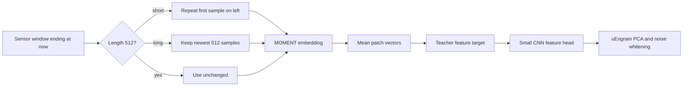
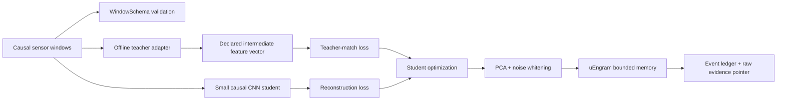

# Teacher-to-Student Transfer for uEngram

## Status and scope

This document describes and tests a safe transfer-learning path for the sensor
memory prototype. It does **not** claim that an arbitrary large language model
can be copied into the small uEngram CNN, or that a large teacher automatically
improves fault detection.

The implementation is in:

- `src/uengram/teacher_transfer.py`: versioned input/teacher contracts and
  batched feature extraction;
- `src/uengram/encoder_cnn.py`: `CNNEncoder.fit_distilled()`;
- `src/uengram/moment_teacher.py`: optional MOMENT checkpoint adapter with
  right-aligned 512-sample context handling;
- `bench/cnn_moment_distillation.py`: real-checkpoint transfer benchmark;
  its default large model can be replaced by a smaller checkpoint when local
  storage is constrained;
- `tests/test_teacher_transfer.py`: schema, causal, shape, deterministic,
  adapter, and bad-input tests.

MetroPT-3 is already a consumed development dataset in this repository. Its
smoke result is not independent confirmation.

## What can transfer

A model's weights are numerical parameters shaped for a particular architecture.
A Transformer block's weights do not fit directly into a two-layer 1D CNN. The
transfer mechanism must therefore be chosen deliberately:

| Method | What moves | Compatible architecture | uEngram use |
|---|---|---|---|
| Fine-tuning | Existing weights plus new updates | Same base model | Adapt a time-series model to one sensor family |
| Frozen features | Teacher hidden vectors | Any student with a matching loss head | Train the edge CNN from a large offline teacher |
| Adapters/LoRA | A small update around a base model | Same compatible model | Cheap text or telemetry adaptation |
| Distillation | Teacher outputs or hidden vectors | Student may be different | Recommended path for edge deployment |
| Prototype transfer | Verified normal/episode vectors | Shared feature contract | Seed a bounded memory, only with provenance |

A text LLM is usually a poor direct teacher for vibration or pressure waveforms.
It has learned language. A time-series, audio, or signal model is a better
teacher for raw telemetry. An LLM can still help with maintenance notes, manuals,
fault-code descriptions, and post-retrieval explanations. For multimodal work,
keep the sensor and language teachers separate and join their outputs through
versioned metadata.

## Selected public teacher: MOMENT

The first real foundation-model adapter targets **MOMENT-1-large**, a
time-series model released by AutonLab under the MIT license. MOMENT is not a
language model. It was trained on many kinds of time-series data and can
produce an embedding, which means a compact numerical fingerprint of a
window. Its official model card documents an embedding task, a native
512-sample context, patch-based processing, and an embedding width of 1024 for
the large checkpoint. The official loading path is
`MOMENTPipeline.from_pretrained(..., model_kwargs={"task_name": "embedding"})`
followed by `init()`.

The repository contains an optional adapter in
`src/uengram/moment_teacher.py`. It keeps the large model out of the edge
runtime: the model is used offline to label windows with feature vectors, and
the small CNN learns to approximate those vectors. The adapter also supports
smaller MOMENT checkpoints. A smaller checkpoint is the practical test choice
on this workstation because the large safetensors file is about 1.39 GB while
the host currently has about 1.5 GB free. That storage limit is a deployment
constraint, not evidence that the small checkpoint is better.

The published `momentfm==0.1.4` package pins NumPy 1.25.2, while this
repository's core package requires NumPy 2.x. Installing it into the main
uEngram environment would silently replace a core dependency. The tested
solution is an isolated teacher environment that reuses the already installed
PyTorch runtime; the edge package itself remains dependency-light. This
separation is intentional and avoids “fixing” one model by breaking the
default Python package.

### MOMENT window alignment

MOMENT expects 512 samples. If an application window is shorter, the adapter
repeats its first sample on the **left** until the context is full. If it is
longer, it keeps the newest 512 samples. This is like filling the empty left
side of a photograph with a copy of its first border pixel; it preserves the
right edge, which is the current time. The adapter never supplies samples after
the window's right edge. Its attention is not internally causal, so the precise
claim is “online-causal window alignment,” not “causal Transformer.”



The model's intermediate patch vectors are averaged to obtain one fixed-size
vector per window. Averaging is deliberately boring and reproducible: it
avoids selecting a test-tuned patch or a future-looking center position. A
later study can compare patch selection, attention pooling, and multiple
temporal scales, but each choice must be frozen before held-out evaluation.

## Implemented architecture



The teacher runs during offline training. Only the small student, its projection
statistics, and uEngram are intended for the edge runtime.

### The contract

`WindowSchema` records:

- ordered channel names;
- sample rate;
- window length;
- schema version.

`TeacherSpec` records:

- model name and model version;
- the exact intermediate layer or output name;
- feature dimension;
- input schema;
- causal flag;
- right-aligned/online alignment;
- teacher contract version.

A teacher is rejected unless it is declared `causal=True` and
`alignment="right"`. This prevents a centered representation that uses future
samples from silently entering an online alarm experiment. The adapter also
rejects channel-count/window-size mismatches, non-finite features, wrong batch
lengths, and empty version/name/layer identifiers.

## Training objective

The student still learns to reconstruct a standardized sensor window. A second
linear head maps its selected readout (`bottleneck`, `middle`, or `multiscale`)
to the teacher's feature dimension. The total loss is:

$$
L = L_{reconstruction} +
    \lambda_{teacher} L_{feature-match} +
    \lambda_{orthogonal}L_{orthogonal}.
$$

The feature-match target is standardized using **training windows only**. This
means the teacher's scale does not dominate simply because one output coordinate
has larger numerical values. `teacher_weight` controls the influence of the
teacher; the default is `0.25` and the ordinary `fit()` path remains unchanged.

In simple terms: the student learns to rebuild the signal and to arrange its
internal fingerprints similarly to the teacher. It does not copy incompatible
teacher layers. The final edge embedding still goes through the existing PCA and
within-state noise-whitening process.

### Pseudocode

```text
teacher_spec = declare(name, version, layer, schema,
                       feature_dim, causal=True, alignment="right")

teacher_features = run_teacher_in_batches(teacher, train_windows)
validate_shape_finiteness_order_and_schema(teacher_features, teacher_spec)

student = CNNEncoder(d=16, epochs=30, representation="bottleneck")
student.fit_distilled(
    train_windows,
    teacher,
    teacher_spec,
    noise_lag=1,
    groups=training_segments,
    teacher_weight=0.25,
)

freeze(student)
fit_or_load_projection_statistics(verified_commissioning_windows)
deploy(student, projection_statistics, uengram)
```

The implementation does not load an unknown vendor checkpoint by filename. A
model owner supplies an adapter with `encode(windows)` that loads the permitted
weights, selects the declared layer, and returns one row per input window. This
keeps model-specific tensor layouts and licensing outside the core sensor-memory
package.

## How to adapt an actual large model

1. Obtain weights and license terms that permit the intended training and
   deployment use.
2. Build a small adapter around the model's documented API.
3. Select an intermediate representation before inspecting the final test set.
4. Make the adapter use causal, right-aligned windows only.
5. Declare the exact sensor order, units, rate, window length, model version, and
   layer name in `TeacherSpec`.
6. Fit the student and all normalization/projection statistics on commissioning
   data only.
7. Compare the student with an unchanged CNN/DSP baseline and, where possible,
   the teacher itself.
8. Freeze the choice before evaluating untouched assets or future time periods.

A teacher can transfer its errors and biases. If its training data contained the
test vehicles, future windows, or labels used to choose the layer, the student
inherits that leakage. A stronger teacher is not automatically a safer teacher.

## Measured smoke path

The smoke harness uses a local `CNNEncoder` with a multiscale readout as a
stand-in teacher because this repository has no permitted high-capacity
foundation-model checkpoint. It trains the teacher on MetroPT-3 commissioning
windows, then compares an ordinary student and a distilled student on the
MetroPT-3 test split. The test split labels are used only to calculate the
reported AUROC/AP; they are not used for training or teacher selection.

The exact output is committed in `results/cnn_distillation_smoke.json` after the
smoke run. Interpret it as an API/integration check, not evidence that transfer
improves industrial accuracy. A local CNN teacher is not equivalent to a large
pretrained time-series or language model.

## Real checkpoint transfer result

The repository now has a real public teacher run, not only the local-CNN
stand-in. The teacher was **MOMENT-1-small**, model card revision
`411e288267f82cce86296dbe4d6c8bc533cc162f`, released under MIT terms. The
large sibling remains the intended high-capacity option, but its approximately
1.39 GB weight file did not fit safely in the roughly 1.5 GB free storage
available on this host. The small run is therefore a feasibility result, not a
claim that small is optimal.

The experiment used a 512-sample MetroPT-3 window so the teacher operated at
its native context length. The student stayed at 16 dimensions and five
training epochs. The complete bounded-memory scoring path was used on the
previously consumed MetroPT-3 development split:

| Student | AUROC | Average precision | Test windows | Positive windows | All four events retained |
|---|---:|---:|---:|---:|---|
| Ordinary CNN | 0.9756 | 0.6225 | 2,422 | 60 | yes |
| MOMENT-distilled CNN | **0.9775** | **0.7942** | 2,422 | 60 | yes |

The result is encouraging but not a deployment claim. It is one seed, one
previously consumed asset, one teacher weight, and one teacher-loss setting.
Distillation also increased test writes from 2,007 to 2,616 in this run. A
better ranking score can therefore coexist with a more expensive or noisier
memory lifecycle.

The same teacher was checked on the included synthetic challenge containing
four named fault families: knock, cavitation, thermal, and seizure. Here the
ordinary CNN scored AUROC 0.6872 and AP 0.8007, while the distilled CNN scored
AUROC 0.5035 and AP 0.6602. The ordinary model detected seizure perfectly in
this small probe; the distilled model did not. This is a valuable negative
finding: copying a broad teacher representation can hurt a small domain when
the teacher's 512-sample context is filled by repeated samples for a 64-sample
window. It is exactly the kind of error that a universal-best claim would hide.

The reproducible artifact is
`results/cnn_moment_distillation_crossdomain.json`. The run used:

```text
PYTHONPATH=src:. HF_HOME=~/.cache/huggingface \
  /home/kk/.local/state/uengram/moment-teacher-venv/bin/python \
  bench/cnn_moment_distillation.py \
  --model-id AutonLab/MOMENT-1-small \
  --revision 411e288267f82cce86296dbe4d6c8bc533cc162f \
  --local-files-only --include-synthetic --epochs 5 \
  --teacher-weight 0.25 \
  --out results/cnn_moment_distillation_crossdomain.json
```

The official model page and paper are the provenance sources:
[MOMENT model card](https://huggingface.co/AutonLab/MOMENT-1-small),
[MOMENT paper](https://arxiv.org/abs/2402.03885), and
[official source](https://github.com/moment-timeseries-foundation-model/moment).
Before commercial release, verify the checkpoint's license, revision, source
data terms, and whether the derived student may be redistributed.

## Why “all faults” is not a valid teacher claim

MOMENT is broad, but it is not a catalogue containing every machine error.
Faults depend on the asset, sensor placement, operating regime, maintenance
history, and definition of failure. A foundation model can provide reusable
shape and trend features; it cannot guarantee recognition of a fault it never
saw or a sensor signal that was never measured.

The safer research question is whether transfer remains useful across several
families and untouched assets. TSB-AD is a useful public benchmark source
because it gathers many anomaly-detection datasets and distinguishes
univariate from multivariate series, but its datasets still have different
licenses, labels, and physical meanings. A good evaluation matrix should
include synthetic local faults, run-to-failure degradation such as CMAPSS,
real machinery such as MetroPT-3/SKAB, and a held-out asset family. The
teacher, student, projection, and memory policy must be frozen before each
held-out test.

[TSB-AD benchmark](https://thedatumorg.github.io/TSB-AD/) is therefore a
dataset source and comparison framework, not proof that one model is
universal.

## Error paths and safeguards

- **Architecture mismatch:** use feature matching, not layer-by-layer weight
  copying.
- **Future leakage:** reject `causal=False` or non-right-aligned teacher specs.
- **Schema mismatch:** reject reordered/missing channels and changed window size.
- **Teacher contamination:** keep teacher fitting and layer selection outside
  held-out test data.
- **Fault assimilation:** distillation does not permit abnormal windows to update
  a healthy uEngram state; retain candidate/quarantine/shadow-baseline rules.
- **Teacher scale:** standardize targets from training data, record the transform,
  and version it with the student.
- **Non-finite output:** fail closed before optimization or projection fitting.
- **Licensing:** downloaded weights and derived student artifacts need separate
  license review; availability is not permission to redistribute.
- **False confidence:** evaluate event recall, false alarms per eligible time,
  lead time, seed spread, held-out assets, RAM, latency, power, and storage —
  not only AUROC.

## Recommended acceptance gate

A distilled model should not replace the default until all of these are met on a
new asset cohort:

1. no schema or causal-contract violations;
2. no increase in false alarms beyond the pre-registered operating budget;
3. no reduction in recall for protected event classes;
4. improvement or non-inferiority in event-level detection and warning time;
5. bounded RAM/flash, inference latency, energy, and model-update cost;
6. successful sensor dropout, repair, drift, and power-loss replay;
7. reproducible results across seeds and held-out assets;
8. verified evidence pointers and model/projection provenance.

Until this gate is passed, the distilled path is an experimental training option,
not a new default.
