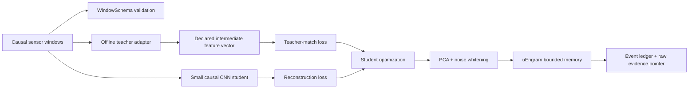

# Teacher-to-Student Transfer for uEngram

## Status and scope

This document describes and tests a safe transfer-learning path for the sensor
memory prototype. It does **not** claim that an arbitrary large language model
can be copied into the small uEngram CNN, or that a large teacher automatically
improves fault detection.

The implementation is in:

- `src/uengram/teacher_transfer.py`: versioned input/teacher contracts and
  batched feature extraction;
- `src/uengram/encoder_cnn.py`: `CNNEncoder.fit_distilled()`;
- `bench/cnn_distillation_smoke.py`: a MetroPT-3 development smoke path;
- `tests/test_teacher_transfer.py`: schema, causal, shape, deterministic, and
  bad-input tests.

MetroPT-3 is already a consumed development dataset in this repository. Its
smoke result is not independent confirmation.

## What can transfer

A model's weights are numerical parameters shaped for a particular architecture.
A Transformer block's weights do not fit directly into a two-layer 1D CNN. The
transfer mechanism must therefore be chosen deliberately:

| Method | What moves | Compatible architecture | uEngram use |
|---|---|---|---|
| Fine-tuning | Existing weights plus new updates | Same base model | Adapt a time-series model to one sensor family |
| Frozen features | Teacher hidden vectors | Any student with a matching loss head | Train the edge CNN from a large offline teacher |
| Adapters/LoRA | A small update around a base model | Same compatible model | Cheap text or telemetry adaptation |
| Distillation | Teacher outputs or hidden vectors | Student may be different | Recommended path for edge deployment |
| Prototype transfer | Verified normal/episode vectors | Shared feature contract | Seed a bounded memory, only with provenance |

A text LLM is usually a poor direct teacher for vibration or pressure waveforms.
It has learned language. A time-series, audio, or signal model is a better
teacher for raw telemetry. An LLM can still help with maintenance notes, manuals,
fault-code descriptions, and post-retrieval explanations. For multimodal work,
keep the sensor and language teachers separate and join their outputs through
versioned metadata.

## Implemented architecture



The teacher runs during offline training. Only the small student, its projection
statistics, and uEngram are intended for the edge runtime.

### The contract

`WindowSchema` records:

- ordered channel names;
- sample rate;
- window length;
- schema version.

`TeacherSpec` records:

- model name and model version;
- the exact intermediate layer or output name;
- feature dimension;
- input schema;
- causal flag;
- right-aligned/online alignment;
- teacher contract version.

A teacher is rejected unless it is declared `causal=True` and
`alignment="right"`. This prevents a centered representation that uses future
samples from silently entering an online alarm experiment. The adapter also
rejects channel-count/window-size mismatches, non-finite features, wrong batch
lengths, and empty version/name/layer identifiers.

## Training objective

The student still learns to reconstruct a standardized sensor window. A second
linear head maps its selected readout (`bottleneck`, `middle`, or `multiscale`)
to the teacher's feature dimension. The total loss is:

$$
L = L_{reconstruction} +
    \lambda_{teacher} L_{feature-match} +
    \lambda_{orthogonal}L_{orthogonal}.
$$

The feature-match target is standardized using **training windows only**. This
means the teacher's scale does not dominate simply because one output coordinate
has larger numerical values. `teacher_weight` controls the influence of the
teacher; the default is `0.25` and the ordinary `fit()` path remains unchanged.

In simple terms: the student learns to rebuild the signal and to arrange its
internal fingerprints similarly to the teacher. It does not copy incompatible
teacher layers. The final edge embedding still goes through the existing PCA and
within-state noise-whitening process.

### Pseudocode

```text
teacher_spec = declare(name, version, layer, schema,
                       feature_dim, causal=True, alignment="right")

teacher_features = run_teacher_in_batches(teacher, train_windows)
validate_shape_finiteness_order_and_schema(teacher_features, teacher_spec)

student = CNNEncoder(d=16, epochs=30, representation="bottleneck")
student.fit_distilled(
    train_windows,
    teacher,
    teacher_spec,
    noise_lag=1,
    groups=training_segments,
    teacher_weight=0.25,
)

freeze(student)
fit_or_load_projection_statistics(verified_commissioning_windows)
deploy(student, projection_statistics, uengram)
```

The implementation does not load an unknown vendor checkpoint by filename. A
model owner supplies an adapter with `encode(windows)` that loads the permitted
weights, selects the declared layer, and returns one row per input window. This
keeps model-specific tensor layouts and licensing outside the core sensor-memory
package.

## How to adapt an actual large model

1. Obtain weights and license terms that permit the intended training and
   deployment use.
2. Build a small adapter around the model's documented API.
3. Select an intermediate representation before inspecting the final test set.
4. Make the adapter use causal, right-aligned windows only.
5. Declare the exact sensor order, units, rate, window length, model version, and
   layer name in `TeacherSpec`.
6. Fit the student and all normalization/projection statistics on commissioning
   data only.
7. Compare the student with an unchanged CNN/DSP baseline and, where possible,
   the teacher itself.
8. Freeze the choice before evaluating untouched assets or future time periods.

A teacher can transfer its errors and biases. If its training data contained the
test vehicles, future windows, or labels used to choose the layer, the student
inherits that leakage. A stronger teacher is not automatically a safer teacher.

## Measured smoke path

The smoke harness uses a local `CNNEncoder` with a multiscale readout as a
stand-in teacher because this repository has no permitted high-capacity
foundation-model checkpoint. It trains the teacher on MetroPT-3 commissioning
windows, then compares an ordinary student and a distilled student on the
MetroPT-3 test split. The test split labels are used only to calculate the
reported AUROC/AP; they are not used for training or teacher selection.

The exact output is committed in `results/cnn_distillation_smoke.json` after the
smoke run. Interpret it as an API/integration check, not evidence that transfer
improves industrial accuracy. A local CNN teacher is not equivalent to a large
pretrained time-series or language model.

## Error paths and safeguards

- **Architecture mismatch:** use feature matching, not layer-by-layer weight
  copying.
- **Future leakage:** reject `causal=False` or non-right-aligned teacher specs.
- **Schema mismatch:** reject reordered/missing channels and changed window size.
- **Teacher contamination:** keep teacher fitting and layer selection outside
  held-out test data.
- **Fault assimilation:** distillation does not permit abnormal windows to update
  a healthy uEngram state; retain candidate/quarantine/shadow-baseline rules.
- **Teacher scale:** standardize targets from training data, record the transform,
  and version it with the student.
- **Non-finite output:** fail closed before optimization or projection fitting.
- **Licensing:** downloaded weights and derived student artifacts need separate
  license review; availability is not permission to redistribute.
- **False confidence:** evaluate event recall, false alarms per eligible time,
  lead time, seed spread, held-out assets, RAM, latency, power, and storage —
  not only AUROC.

## Recommended acceptance gate

A distilled model should not replace the default until all of these are met on a
new asset cohort:

1. no schema or causal-contract violations;
2. no increase in false alarms beyond the pre-registered operating budget;
3. no reduction in recall for protected event classes;
4. improvement or non-inferiority in event-level detection and warning time;
5. bounded RAM/flash, inference latency, energy, and model-update cost;
6. successful sensor dropout, repair, drift, and power-loss replay;
7. reproducible results across seeds and held-out assets;
8. verified evidence pointers and model/projection provenance.

Until this gate is passed, the distilled path is an experimental training option,
not a new default.
