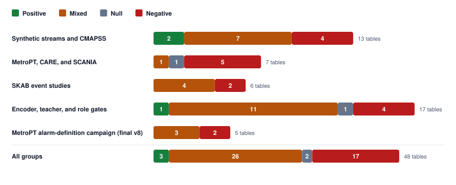

# Supplementary Results Ledger

## Complete Results Ledger

These supplementary tables are generated from files in `results/` (45 tables), excluding an empty CMAPSS file and a SCANIA score archive that repeats the validation JSON. Each table is generated by `scripts/build_results_appendix.py` directly from the JSON and JSONL it cites, so no value is typed by hand. Campaigns that were repeated under version labels appear once, as their final version; superseded runs are omitted. Every table carries an outcome tag, and negative and null results are kept beside the positive ones.

**How outcomes are assigned.** *Positive*: the tested change beat its in-study baseline on the primary metric with no guard metric failing. *Negative*: it missed its own goal or did worse than its baseline. *Null*: it was indistinguishable from the baseline. *Mixed*: some metrics or settings improved while others regressed. The tag is an editorial label on the table, not a computed statistic; the numbers beneath it are.

**Table A0.** Outcome count per result group.

| Group | Positive | Mixed | Null | Negative |
|---|---:|---:|---:|---:|
| Synthetic streams and CMAPSS | 2 | 5 | 0 | 3 |
| MetroPT, CARE, and SCANIA | 0 | 1 | 1 | 5 |
| SKAB event studies | 0 | 4 | 0 | 2 |
| Encoder, teacher, and role gates | 1 | 11 | 1 | 4 |
| MetroPT alarm-definition campaign (final v8) | 0 | 3 | 0 | 2 |
| **All groups** | **3** | **24** | **2** | **16** |

### A.1 Synthetic streams and CMAPSS

**Table A1.** PositiveSynthetic DSP encoder: lifecycle against controls

| Method | Event recall | Write reduction % | Seeds |
|---|---|---|---|
| naive | 1.000 | 0.000 | 10 |
| fifo | 0.011 | 0.000 | 10 |
| reservoir | 0.022 | 93.166 | 10 |
| reference_labelfree | 0.542 | 14.190 | 10 |
| uengram | 1.000 | 86.189 | 10 |
| uengram_fixedvar | 1.000 | 84.725 | 10 |
| uengram_nopromo | 1.000 | -8.979 | 10 |

<b>Source</b> <code>results/synth_runs.jsonl</code>. Across seeds, DSP uengram reaches event recall 1.000 with write reduction 86.189%, while fifo and reservoir have lower event recall.

**Table A2.** MixedSynthetic encoder comparison (dsp, ctx, cnn)

| Encoder | Event recall | Write reduction % | Seeds |
|---|---|---|---|
| dsp | 1.000 | 86.189 | 10 |
| ctx | 1.000 | 92.651 | 10 |
| cnn | 0.262 | 65.785 | 10 |

<b>Source</b> <code>results/synth_runs.jsonl</code>. uengram event recall is 1.000 for dsp, 1.000 for ctx, and 0.262 for cnn.

**Table A3.** NegativeSynthetic d=36 seed spread

| Method | Seeds | Event recall mean [min, max] | Write reduction % mean [min, max] |
|---|---|---|---|
| naive | 10 | 1.0000 [1.0000, 1.0000] | 0.000 [0.000, 0.000] |
| reservoir | 10 | 0.0224 [0.0114, 0.0510] | 93.166 [92.685, 93.450] |
| uengram | 10 | 0.8012 [0.7662, 0.8451] | 71.607 [70.545, 73.650] |
| uengram_nopromo | 10 | 0.7453 [0.6872, 0.7953] | -7.818 [-9.305, -5.585] |

<b>Source</b> <code>results/synth_d36_runs.jsonl, results/synth_runs.jsonl</code>. Across 10 seeds, d=36 uengram mean event recall is 0.8012, below the d=16 value of 1.0000.

**Table A4.** NegativeSynthetic slope-feature ablation

| Slope features | Method | Seeds | Event recall | Write reduction % |
|---|---|---|---|---|
| with_slope | naive | 10 | 1.000 | 0.000 |
| with_slope | reservoir | 10 | 0.022 | 93.166 |
| with_slope | uengram | 10 | 0.232 | 33.511 |
| with_slope | uengram_nopromo | 10 | 0.249 | -30.291 |
| without_slope | naive | 10 | 1.000 | 0.000 |
| without_slope | reservoir | 10 | 0.022 | 93.166 |
| without_slope | uengram | 10 | 1.000 | 86.189 |
| without_slope | uengram_nopromo | 10 | 1.000 | -8.979 |

<b>Source</b> <code>results/synth_runs.jsonl, results/synth_slope_runs.jsonl</code>. The table compares matching DSP and DSP-slope runs; uengram event recall falls from 1.000 without slope features to 0.232 with them.

**Table A5.** PositiveSynthetic memory-budget sweep

| Budget | Method | Event recall | Write reduction % | Seeds |
|---|---|---|---|---|
| 64 | uengram | 0.919 | 86.410 | 5 |
| 128 | uengram | 1.000 | 86.268 | 5 |
| 256 | uengram | 1.000 | 86.269 | 5 |
| 512 | uengram | 1.000 | 86.269 | 5 |
| 64 | fifo | 0.004 | 0.000 | 5 |
| 512 | fifo | 0.028 | 0.000 | 5 |
| 64 | reservoir | 0.002 | 97.842 | 5 |
| 512 | reservoir | 0.047 | 87.934 | 5 |

<b>Source</b> <code>results/synth_sweep.jsonl</code>. The table shows uengram at every budget and fifo/reservoir at the minimum and maximum budgets. uengram event recall ranges from 0.919 to 1.000, above fifo at each displayed endpoint.

**Table A6.** MixedCMAPSS health and RUL metrics by dimension

| Dimension | Encoder | Method | Seeds | Health AUROC | Health AP | RUL RMSE | RUL MAE | RUL RMSE health | RUL MAE health |
|---|---|---|---|---|---|---|---|---|---|
| d=16 | cnn | naive | 5 | — | — | 23.918 | 17.905 | — | — |
| d=16 | cnn | reservoir | 5 | — | — | 23.515 | 17.687 | — | — |
| d=16 | cnn | uengram | 5 | 0.998 | 0.992 | 42.040 | 34.961 | 26.439 | 20.896 |
| d=16 | dsp | naive | 5 | — | — | 25.798 | 18.670 | — | — |
| d=16 | dsp | reservoir | 5 | — | — | 24.188 | 18.110 | — | — |
| d=16 | dsp | uengram | 5 | 0.999 | 0.995 | 42.051 | 35.462 | 25.450 | 20.267 |
| d=24 | dsp_d24 | naive | 5 | — | — | 24.609 | 17.908 | — | — |
| d=24 | dsp_d24 | reservoir | 5 | — | — | 24.448 | 18.740 | — | — |
| d=24 | dsp_d24 | uengram | 5 | 1.000 | 0.997 | 21.053 | 16.204 | 26.423 | 21.182 |

<b>Source</b> <code>results/cmapss_runs.jsonl, results/cmapss_d24_runs.jsonl</code>. The table reports seed means for health and RUL metrics by dimension and method; em dashes mark unavailable metrics in the source files.

**Table A7.** MixedCMAPSS subsets: end-of-life retention and health score

| Subset | Method | Seeds | EOL retention | Health AUROC | RUL RMSE | Write reduction % |
|---|---|---|---|---|---|---|
| FD001 | naive | 5 | 1.000 | — | 25.798 | 0.000 |
| FD001 | reservoir | 5 | 0.432 | — | 24.188 | 87.852 |
| FD001 | uengram | 5 | 1.000 | 0.999 | 42.051 | 96.701 |
| FD002 (per-condition norm) | naive | 5 | 1.000 | — | 32.127 | 0.000 |
| FD002 (per-condition norm) | reservoir | 5 | 0.195 | — | 31.325 | 94.217 |
| FD002 (per-condition norm) | uengram | 5 | 0.062 | 0.986 | 38.552 | 78.522 |
| FD003 | naive | 5 | 1.000 | — | 22.327 | 0.000 |
| FD003 | reservoir | 5 | 0.416 | — | 22.531 | 88.658 |
| FD003 | uengram | 5 | 0.120 | 0.982 | 24.104 | 80.007 |

<b>Source</b> <code>results/cmapss_runs.jsonl, results/cmapss_fd002_norm_runs.jsonl, results/cmapss_fd003_runs.jsonl</code>. The DSP encoder is deterministic, so seeds vary only the reservoir baseline. FD004 is not reported: the encoder&#x27;s EWMA-inflation estimate fails on its operating-condition switching. uengram end-of-life retention falls from 1.000 on FD001 to 0.062 on FD002 and 0.120 on FD003 while the health score stays above 0.98 AUROC.

**Table A8.** MixedDSP feature-group ablation

| Features | Synthetic recall / AP | SKAB events | FD001 health AUROC / EOL retention | FD003 health AUROC / EOL retention |
|---|---|---|---|---|
| all | 1.000 / 0.995 | 5 / 34 | 0.999 / 1.000 | 0.982 / 0.120 |
| no_band_energy | fit fails | 9 / 34 | fit fails | 0.998 / 0.160 |
| no_log_std | 1.000 / 0.991 | 5 / 34 | 1.000 / 1.000 | 0.984 / 0.660 |
| no_mean | 1.000 / 0.995 | 0 / 34 | 0.721 / 0.220 | fit fails |

<b>Source</b> <code>results/feature_group_ablation.json</code>. One group (mean, log standard deviation or the four band energies) is dropped at a time. Synthetic is a 10-seed mean; SKAB is seed 0; CMAPSS is one deterministic run. Dropping the band energies leaves 2 features per channel, which cannot support d=16 on the synthetic stream or FD001.

**Table A9.** MixedCMAPSS slope-feature ablation

| Slope features | Method | Seeds | Health AUROC | RUL RMSE | RUL RMSE health | Write reduction % |
|---|---|---|---|---|---|---|
| without_slope | naive | 5 | — | 25.798 | — | 0.000 |
| without_slope | reservoir | 5 | — | 24.188 | — | 87.852 |
| without_slope | uengram | 5 | 0.999 | 42.051 | 25.450 | 96.701 |
| without_slope | uengram_frozen | 5 | 1.000 | 31.465 | 24.453 | 94.174 |
| with_slope | naive | 5 | — | 37.309 | — | 0.000 |
| with_slope | reservoir | 5 | — | 36.229 | — | 87.852 |
| with_slope | uengram | 5 | 1.000 | 35.253 | 30.415 | 94.605 |
| with_slope | uengram_frozen | 5 | 1.000 | 29.536 | 31.283 | 92.078 |

<b>Source</b> <code>results/cmapss_runs.jsonl, results/cmapss_slope_runs.jsonl</code>. The table compares standard and slope DSP runs; uengram health AUROC changes from 0.999 without slopes to 1.000 with slopes, while the displayed RUL metrics also differ.

**Table A10.** NegativeCMAPSS two-teacher lifecycle gate

| Model | Event recall at EOL horizon | Event recall before failure | Window AUROC | Window average precision | Pre-EOL alarms per 100 healthy cycles | Median warning cycles before EOL horizon |
|---|---|---|---|---|---|---|
| baseline_cnn | 0.700 | 1.000 | 0.982 | 0.905 | 0.406 | 9.000 |
| chronos_student | 0.300 | 1.000 | 0.990 | 0.949 | 0.754 | 23.500 |
| moment_student | 0.200 | 1.000 | 0.990 | 0.945 | 1.103 | 9.000 |
| two_teacher_student | 0.200 | 1.000 | 0.989 | 0.940 | 0.871 | 23.000 |

<b>Source</b> <code>results/cmapss_two_teacher_gate.json</code>. The two-teacher student event recall at EOL horizon is 0.200, below baseline CNN at 0.700.

### A.2 MetroPT, CARE, and SCANIA

**Table A11.** NegativeMetroPT alarm results by configuration

| Method | DSP d16 mean detected / total | DSP d16 mean false alarms per week | CNN d16 mean detected / total | CNN d16 mean false alarms per week | DSP d42 mean detected / total | DSP d42 mean false alarms per week | DSP slope mean detected / total | DSP slope mean false alarms per week |
|---|---|---|---|---|---|---|---|---|
| fifo | 4.0 / 4 | 14.95 | 4.0 / 4 | 16.27 | 4.0 / 4 | 12.13 | 3.0 / 4 | 16.41 |
| reference_labelfree | 0.0 / 4 | 0.16 | 0.0 / 4 | 1.37 | 0.0 / 4 | 1.67 | 0.0 / 4 | 0.47 |
| hst | 2.6 / 4 | 12.76 | 3.6 / 4 | 14.55 | 2.2 / 4 | 4.14 | 3.0 / 4 | 14.61 |
| memstream | 4.0 / 4 | 16.96 | 2.8 / 4 | 4.20 | 4.0 / 4 | 29.44 | 3.2 / 4 | 7.09 |
| naive | 4.0 / 4 | 7.74 | 4.0 / 4 | 7.99 | 4.0 / 4 | 7.16 | 3.0 / 4 | 5.49 |
| reservoir | 4.0 / 4 | 12.73 | 4.0 / 4 | 18.63 | 4.0 / 4 | 13.70 | 3.0 / 4 | 15.94 |
| uengram | 3.0 / 4 | 14.95 | 4.0 / 4 | 12.61 | 3.0 / 4 | 5.70 | 3.0 / 4 | 11.35 |
| uengram_frozen | 3.0 / 4 | 6.12 | 4.0 / 4 | 13.69 | 3.0 / 4 | 2.82 | 3.0 / 4 | 10.25 |

<b>Source</b> <code>results/metropt_runs.jsonl, results/metropt_d42_runs.jsonl, results/metropt_slope_runs.jsonl</code>. Detection and false-alarm rates are seed means across 8 methods. The table compares DSP d16, CNN d16, DSP d42, and DSP slope configurations.

**Table A12.** MixedMetroPT-2 dimension sweep

| Stream | Encoder / dimension | Alarm policy | Events detected / total | Clean alarm time (seconds) | False alarms per week | AUROC |
|---|---|---|---|---|---|---|
| metropt2_apr | dsp_d16 | v1_rule | 2 / 2 | 65490.0 | 14.911 | 0.812 |
| metropt2_apr | dsp_d16 | v2 | 0 / 2 | 0.0 | 0.000 | 0.812 |
| metropt2_apr | dsp_d24 | v1_rule | 2 / 2 | 50150.0 | 11.257 | 0.803 |
| metropt2_apr | dsp_d24 | v2 | 1 / 2 | 0.0 | 0.000 | 0.803 |
| metropt2_apr | dsp_d32 | v1_rule | 2 / 2 | 73750.0 | 16.666 | 0.958 |
| metropt2_apr | dsp_d32 | v2 | 0 / 2 | 0.0 | 0.000 | 0.958 |
| metropt2_apr | dsp_d42 | v1_rule | 2 / 2 | 44840.0 | 10.818 | 0.927 |
| metropt2_apr | dsp_d42 | v2 | 0 / 2 | 0.0 | 0.000 | 0.927 |
| metropt2_jan | dsp_d16 | v1_rule | 0 / 3 | 11210.0 | 1.386 | 0.491 |
| metropt2_jan | dsp_d16 | v2 | 0 / 3 | 0.0 | 0.000 | 0.491 |
| metropt2_jan | dsp_d24 | v1_rule | 1 / 3 | 12390.0 | 1.309 | 0.637 |
| metropt2_jan | dsp_d24 | v2 | 0 / 3 | 0.0 | 0.000 | 0.637 |
| metropt2_jan | dsp_d32 | v1_rule | 1 / 3 | 10030.0 | 1.078 | 0.603 |
| metropt2_jan | dsp_d32 | v2 | 0 / 3 | 0.0 | 0.000 | 0.603 |
| metropt2_jan | dsp_d42 | v1_rule | 2 / 3 | 134520.0 | 14.323 | 0.603 |
| metropt2_jan | dsp_d42 | v2 | 0 / 3 | 0.0 | 0.000 | 0.603 |

<b>Source</b> <code>results/metropt2_d16_d24_d32_d42.jsonl</code>. The 16 rows are one run each (seed 0) for every stream, dimension and alarm policy; the policies are not averaged. Results vary across streams, dimensions and policies, including missed events.

**Table A13.** NullStronger cross-dataset transfer gate

| Variant | AUROC | Average precision | Windows | Positive windows |
|---|---|---|---|---|
| Frozen baseline | 0.911 | 0.840 | 2517 | 251 |
| Teacher transfer (edge, instance stats=false) | 0.909 | 0.840 | 2517 | 251 |
| Teacher transfer (linear, instance stats=true) | 0.916 | 0.835 | 2517 | 251 |

<b>Source</b> <code>results/stronger_gate.json</code>. This table is the TSB-AD-U transfer slice of the stronger-frozen-cross-dataset gate. Baseline AUROC is 0.911 and transfer AUROCs range from 0.909 to 0.916.

**Table A14.** NegativeCARE tabular comparison by dimension

| Dimension | Runs | Mean finite AUROC | Mean finite false alarms per week | Mean events detected | Mean valid fraction | Mean unscored fraction |
|---|---|---|---|---|---|---|
| tab_d16 | 190 | 0.519 | 1.92 | 0.21 | 79.2% | 20.8% |
| tab_d32 | 190 | 0.502 | 1.81 | 0.21 | 79.2% | 20.8% |

<b>Source</b> <code>results/care_tabular_d16_d32.jsonl</code>. All 380 CARE run records are pooled within dimension. Finite AUROC and false-alarm values are averaged, while valid and unscored fractions retain failed and incomplete runs.

**Table A15.** NegativeSCANIA held-out validation controls

| Control key and source | Vehicles | Alarm vehicles | Healthy alarm rate | Near-failure recall | Novelty AUROC |
|---|---|---|---|---|---|
| and_control (scania_validation.json) | 5046 | 978 | 0.193 | 0.228 | 0.541 |
| or_missingness_tripwire (scania_validation_independent.json) | 5046 | 1049 | 0.207 | 0.235 | 0.541 |

<b>Source</b> <code>results/scania_validation.json, results/scania_validation_independent.json</code>. This is held-out SCANIA validation data with 5046 test vehicles. The independent or_no_evidence_control has the same values as and_control and is not a distinct result; the listed missingness tripwire has near-failure recall 0.235.

**Table A16.** NegativeSCANIA dimension sweep

| Dimension | Alarm vehicles | Healthy alarm rate | Near-failure recall | Novelty AUROC |
|---|---|---|---|---|
| tab_d16 | 978 | 0.193 | 0.228 | 0.541 |
| tab_d32 | 138 | 0.027 | 0.022 | 0.571 |
| tab_d48 | 142 | 0.028 | 0.029 | 0.561 |

<b>Source</b> <code>results/scania_tab_d_sweep.json</code>. The 3 dimension settings have near-failure recalls from 0.022 to 0.228 and AUROCs from 0.541 to 0.571.

**Table A17.** NegativeSCANIA regularization sweep

| Dimension | Alarm vehicles | Healthy alarm rate | Near-failure recall | Novelty AUROC |
|---|---|---|---|---|
| tab_d16 | 1186 | 0.233 | 0.301 | 0.540 |
| tab_d32 | 223 | 0.044 | 0.066 | 0.566 |
| tab_d48 | 2 | 0.000 | 0.000 | 0.562 |

<b>Source</b> <code>results/scania_tab_reg_sweep.json</code>. The 3 regularization settings have near-failure recalls from 0.000 to 0.301. The sweep does not establish strong held-out discrimination.

### A.3 SKAB event studies

**Table A18.** MixedSKAB frozen validation and slope ablation

| Setting | Events detected / total | False alarm episodes | AUROC | AP |
|---|---|---|---|---|
| dsp | 5 / 34 | 5 | 0.546 | 0.419 |
| dsp_slope | 8 / 34 | 10 | 0.607 | 0.474 |

<b>Source</b> <code>results/skab_validation.json, results/skab_slope_ablation.json</code>. The slope ablation detected 8 of 34 experiments versus 5 of 34 for frozen validation, with 10 versus 5 false alarm episodes. Frozen validation: Single-seed result (seed 0). Slope ablation: Single-seed result (seed 0).

**Table A19.** MixedSKAB embedding-dimension sweep

| Setting | Events detected / total | False alarm episodes | AUROC | AP |
|---|---|---|---|---|
| dsp_d16 | 5 / 34 | 5 | 0.546 | 0.419 |
| dsp_d24 | 5 / 34 | 6 | 0.551 | 0.419 |
| dsp_d32 | 5 / 34 | 7 | 0.575 | 0.415 |
| dsp_d48 | 9 / 34 | 4 | 0.558 | 0.441 |

<b>Source</b> <code>results/skab_d_sweep.json, results/skab_d48_seeds.json, results/skab_validation.json</code>. The sweep shows all 4 embedding settings; dsp_d48 detected 9 of 34 experiments. Single-seed result (seed 0). A separate check of dsp_d48 over 10 seeds (results/skab_d48_seeds.json) gave identical metrics in every run.

**Table A20.** MixedSKAB persistence and threshold sweep

| Setting | Events detected / total | False alarm episodes | AUROC | AP |
|---|---|---|---|---|
| alpha=0.003_k3_counter_baseline (baseline) | 8 / 34 | 10 | 0.607 | 0.474 |
| alpha=0.003_k1_counter | 23 / 34 | 26 | 0.607 | 0.474 |
| alpha=0.003_k2_mofn_n5 | 12 / 34 | 14 | 0.607 | 0.474 |
| alpha=0.003_k2_mofn_n8 | 12 / 34 | 14 | 0.607 | 0.474 |
| alpha=0.003_k1_mofn_n3 | 25 / 34 | 25 | 0.607 | 0.474 |
| alpha=0.003_k2_consecutive | 10 / 34 | 13 | 0.607 | 0.474 |
| alpha=0.003_k2_ewma | 11 / 34 | 14 | 0.607 | 0.474 |

<b>Source</b> <code>results/skab_persistence_sweep.json, results/skab_validation.json</code>. All 7 persistence settings are shown, including settings that lose events; the baseline detected 8 of 34, and the best setting detected 25. Single-seed result (seed 0).

**Table A21.** MixedSKAB shock-multiplier sweep

| Shock multiplier | Events detected / total | False alarm episodes |
|---|---|---|
| 0.0 (baseline) | 5 / 34 | 5 |
| 1.2 | 15 / 34 | 19 |
| 1.3 | 13 / 34 | 19 |
| 1.4 | 13 / 34 | 18 |
| 1.5 | 11 / 34 | 17 |
| 1.6 | 7 / 34 | 11 |
| 1.7 | 6 / 34 | 7 |
| 1.8 | 5 / 34 | 6 |
| 2.0 | 5 / 34 | 6 |
| 2.5 | 5 / 34 | 5 |

<b>Source</b> <code>results/skab_shock_sweep.json, results/skab_validation.json</code>. All 10 shock settings are shown; the baseline detected 5 of 34, while multiplier 1.2 detected 15. AUROC is 0.550 and AP is 0.423; neither varies with shock multiplier. Seed count is not reported in this file.

**Table A22.** NegativeSKAB teacher-transfer time gate

| Model | Events detected / total | False alarm episodes | AUROC | AP |
|---|---|---|---|---|
| baseline_cnn | 0 / 34 | 10 | 0.471 | 0.341 |
| chronos_student | 0 / 34 | 16 | 0.463 | 0.341 |
| moment_student | 0 / 34 | 14 | 0.466 | 0.335 |
| two_teacher_student | 0 / 34 | 12 | 0.470 | 0.348 |

<b>Source</b> <code>results/skab_teacher_time_gate.json</code>. All 4 compact-model configurations detected no fault experiments out of 34; false alarm counts are from healthy calibration. Seed count is not reported in this file.

**Table A23.** NegativeSKAB sensor-fusion representation gate

| Representation | Events detected / total | False alarm episodes | AUROC | AP |
|---|---|---|---|---|
| bottleneck | 0 / 34 | 12 | 0.507 | 0.354 |
| middle | 0 / 34 | 25 | 0.527 | 0.390 |
| multiscale | 0 / 34 | 5 | 0.527 | 0.388 |

<b>Source</b> <code>results/skab_sensor_fusion_gate.json</code>. All 3 sensor-fusion representations detected no fault experiments out of 34; false alarm counts are from healthy calibration. Seed count is not reported in this file.

### A.4 Encoder, teacher, and role gates

**Table A24.** PositiveCNN teacher distillation smoke

| Student | AUROC | Average precision | Fit seconds |
|---|---|---|---|
| baseline | 0.988 | 0.478 | 0.954 |
| distilled | 0.991 | 0.563 | 7.675 |

<b>Source</b> <code>results/cnn_distillation_smoke.json</code>. A development smoke comparison over 21556 test windows; teacher distillation raises both reported ranking metrics.

**Table A25.** MixedCNN intermediate-layer representation screen

| Representation | Dimension | Epochs | Median clean-to-fault displacement, 10th percentile | Minimum | Maximum |
|---|---|---|---|---|---|
| middle | 32 | 30 | 0.610 | 0.577 | 0.640 |
| middle | 32 | 90 | 0.571 | 0.525 | 0.605 |
| middle | 16 | 30 | 0.487 | 0.401 | 0.522 |
| multiscale | 32 | 30 | 0.373 | 0.328 | 0.381 |
| bottleneck | 32 | 30 | 0.356 | 0.293 | 0.390 |
| middle | 16 | 90 | 0.375 | 0.293 | 0.432 |
| bottleneck | 32 | 90 | 0.265 | 0.228 | 0.288 |
| multiscale | 32 | 90 | 0.241 | 0.205 | 0.252 |
| bottleneck | 16 | 30 | 0.232 | 0.196 | 0.248 |
| multiscale | 16 | 30 | 0.208 | 0.168 | 0.226 |
| bottleneck | 16 | 90 | 0.180 | 0.164 | 0.206 |
| multiscale | 16 | 90 | 0.154 | 0.133 | 0.184 |

<b>Source</b> <code>results/cnn_intermediate_screen.json</code>. The screen uses label-free synthetic faults over 96 selection windows. The best aggregate median is 0.610 for middle at dimension 32 and 30 epochs.

**Table A26.** MixedCNN intermediate pipeline and DSP fusion

| Dataset | Kind | Variant | Seed records | Mean AUROC | Mean AP |
|---|---|---|---|---|---|
| metropt3 | single encoder | cnn_middle30 | 5 | 0.990 | 0.598 |
| metropt3 | single encoder | cnn_multiscale30 | 5 | 0.992 | 0.775 |
| metropt3 | single encoder | cnn_plain30 | 5 | 0.990 | 0.664 |
| metropt3 | DSP baseline | DSP | 1 | 0.986 | 0.537 |
| metropt3 | fusion best | cnn_plain30_fisher | — | 0.988 | 0.571 |
| metropt3 | fusion worst | dsp_plus_middle30_max | — | 0.980 | 0.418 |
| skab | single encoder | cnn_middle30 | 5 | 0.582 | 0.497 |
| skab | single encoder | cnn_multiscale30 | 5 | 0.598 | 0.501 |
| skab | single encoder | cnn_plain30 | 5 | 0.604 | 0.506 |
| skab | DSP baseline | DSP | 1 | 0.558 | 0.441 |
| skab | fusion best | cnn_plain30_fisher | — | 0.627 | 0.456 |
| skab | fusion worst | dsp_plus_middle30_max | — | 0.540 | 0.377 |

<b>Source</b> <code>results/cnn_intermediate_pipeline.json</code>. Component rows show mean scores across seeds, while fusion rows show the highest and lowest AUROC per dataset. The table covers 12 compact results.

**Table A27.** MixedCNN stability ablation

| Dataset | Kind | Variant | Seed records | Mean AUROC | Mean AP |
|---|---|---|---|---|---|
| metropt3 | single encoder | cnn_actcorr | 3 | 0.665 | 0.092 |
| metropt3 | single encoder | cnn_base | 3 | 0.625 | 0.032 |
| metropt3 | single encoder | cnn_swa | 3 | 0.641 | 0.032 |
| metropt3 | DSP baseline | DSP | 1 | 0.991 | 0.726 |
| metropt3 | fusion best | dsp_plus_actcorr_mean | — | 0.985 | 0.489 |
| metropt3 | fusion worst | cnn_base_fisher | — | 0.627 | 0.031 |
| skab | single encoder | cnn_actcorr | 5 | 0.628 | 0.537 |
| skab | single encoder | cnn_base | 10 | 0.631 | 0.535 |
| skab | single encoder | cnn_swa | 5 | 0.637 | 0.545 |
| skab | DSP baseline | DSP | 1 | 0.592 | 0.514 |
| skab | fusion best | cnn_swa_median | — | 0.649 | 0.553 |
| skab | fusion worst | dsp_plus_base_max | — | 0.616 | 0.505 |

<b>Source</b> <code>results/cnn_stability_ablation.json</code>. Component rows show mean scores across seeds, while fusion rows show the highest and lowest AUROC per dataset. The table covers 12 compact results.

**Table A28.** NegativeMOMENT context-policy study

| Policy | AUROC | Average precision | Teacher features | Fit seconds |
|---|---|---|---|---|
| CNN baseline | 0.687 | 0.801 | — | — |
| edge / stats=False | 0.504 | 0.660 | 512 | 50.699 |
| linear / stats=False | 0.525 | 0.696 | 512 | 52.776 |
| linear / stats=True | 0.536 | 0.714 | 524 | 56.722 |

<b>Source</b> <code>results/cnn_moment_context_study.json</code>. Controlled synthetic context-policy study with 210 probe windows; all MOMENT variants score below the CNN baseline AUROC of 0.687.

**Table A29.** MixedMOMENT distillation cross-domain transfer

| Student | AUROC | Average precision | Fit seconds | Writes |
|---|---|---|---|---|
| baseline | 0.976 | 0.622 | 5.892 | 2007 |
| distilled | 0.977 | 0.794 | 50.566 | 2616 |

<b>Source</b> <code>results/cnn_moment_distillation_crossdomain.json</code>. Development transfer comparison on 2422 windows; distillation changes AUROC from 0.976 to 0.977 and average precision from 0.622 to 0.794.

**Table A30.** NegativeMOMENT instance-statistics distillation check

| Student | AUROC | Average precision | Fit seconds | Writes |
|---|---|---|---|---|
| baseline | 0.976 | 0.622 | 1.433 | 2007 |
| distilled | 0.975 | 0.585 | 42.724 | 2810 |

<b>Source</b> <code>results/cnn_moment_distillation_metropt_stats.json</code>. MetroPT-3 development transfer check on 2422 windows; adding the instance-statistics MOMENT teacher feature path lowers both AUROC and average precision.

**Table A31.** MixedCWRU two-teacher recording gate (normal recording flagged: yes)

| Student | File AUROC | Window AUROC | Fault recall | Normal false-alarm rate | Test windows |
|---|---|---|---|---|---|
| baseline_cnn | 1.000 | 1.000 | 1.000 | 1.000 | 624 |
| chronos_student | 1.000 | 1.000 | 1.000 | 1.000 | 624 |
| moment_student | 1.000 | 1.000 | 1.000 | 1.000 | 624 |
| two_teacher_student | 1.000 | 1.000 | 1.000 | 1.000 | 624 |

<b>Source</b> <code>results/cwru_two_teacher_gate.json</code>. On the CWRU recording holdout, the CNN, each teacher, and their combination flag the sole normal test recording.

**Table A32.** MixedMFPT two-teacher recording gate (normal recording flagged: yes)

| Student | File AUROC | Window AUROC | Fault recall | Normal false-alarm rate | Test windows |
|---|---|---|---|---|---|
| baseline_cnn | 0.850 | 0.795 | 1.000 | 1.000 | 966 |
| chronos_student | 0.800 | 0.814 | 1.000 | 1.000 | 966 |
| moment_student | 0.800 | 0.793 | 1.000 | 1.000 | 966 |
| two_teacher_student | 0.900 | 0.825 | 1.000 | 1.000 | 966 |

<b>Source</b> <code>results/mfpt_two_teacher_gate.json</code>. On the MFPT recording holdout, the CNN, each teacher, and their combination flag the sole normal test recording.

**Table A33.** MixedEncoder v2 gate history

| Record | Encoder | Accepted/total | Failed | Mean member CKA | Detail |
|---|---|---|---|---|---|
| historical CPU | cnn | 5/5 | 0 | — | gate-history aggregate |
| historical CPU | cnn2 | 3/5 | 2 | — | gate-history aggregate |
| historical CPU | cnn2_cond | 0/5 | 5 | — | gate-history aggregate |
| GPU analog | cnn2_nocond | 1/1 | 0 | 0.996 | seed 0 |
| GPU analog | cnn2_nocond | 1/1 | 0 | 0.998 | seed 1 |
| GPU analog | cnn2_nocond | 1/1 | 0 | 0.998 | seed 2 |
| GPU analog | cnn2_nocond | 1/1 | 0 | 0.996 | seed 3 |
| GPU analog | cnn2_nocond | 1/1 | 0 | 0.995 | seed 4 |

<b>Source</b> <code>results/encoder_v2_gate.json</code>. Included despite its v2 name because encoder_v2_gate.json does not use the excluded top-level v2_ prefix; GPU analog accepts 5/5 seeds, and failures are retained by CPU encoder and GPU seed.

**Table A34.** MixedMetroPT-3 q10 model-research candidates

| Candidate | Detected events | AUROC | AP | False-alarm episodes |
|---|---|---|---|---|
| dsp | 3 | 0.980 | 0.537 | 12 |
| multiscale | 0 | 0.671 | 0.036 | 0 |
| multiscale_dynamics | 0 | 0.640 | 0.033 | 0 |
| multiscale_level | 3 | 0.983 | 0.592 | 15 |
| physical_residual | 0 | — | — | — |

<b>Source</b> <code>results/model_research_candidates_metropt3_q10.json</code>. Consumed development candidate screen using synthetic challenges at q=0.100; real test labels were not used for selection and all listed candidates are retained.

**Table A35.** MixedSKAB q10 model-research candidates

| Candidate | Detected events | AUROC | AP | False-alarm episodes |
|---|---|---|---|---|
| cnn_seed0 | 10 | 0.707 | 0.627 | 4 |
| cnn_seed1 | 15 | 0.620 | 0.506 | 7 |
| cnn_seed2 | 16 | 0.625 | 0.476 | 9 |
| cnnssl_seed0 | 0 | 0.507 | 0.356 | 1 |
| cnnssl_seed1 | 0 | 0.507 | 0.356 | 1 |
| cnnssl_seed2 | 0 | 0.507 | 0.356 | 1 |
| dsp | 5 | 0.522 | 0.405 | 5 |
| multiscale | 9 | 0.614 | 0.540 | 7 |
| multiscale_dynamics | 6 | 0.560 | 0.474 | 1 |
| multiscale_level | 14 | 0.620 | 0.514 | 13 |

<b>Source</b> <code>results/model_research_candidates_skab_q10.json</code>. Consumed development candidate screen using synthetic challenges at q=0.100; real test labels were not used for selection and all listed candidates are retained.

**Table A36.** NullMOMENT TSB-AD-U cross-domain holdout

| Model | AUROC | Average precision | Fit seconds |
|---|---|---|---|
| CNN baseline | 0.911 | 0.840 | 2.082 |
| edge / stats=False | 0.909 | 0.840 | 13.176 |
| linear / stats=True | 0.916 | 0.835 | 12.635 |

<b>Source</b> <code>results/moment_tsb_ad_holdout.json</code>. The frozen holdout covers 2517 windows from 6 series. AUROC values of 0.911, 0.909, and 0.916 show no distinguishable change.

**Table A37.** MixedOR-rule development comparison

| Combine rule | Events detected | False alarms/week | Clean alarm share | Lead hours |
|---|---|---|---|---|
| AND | 0 | 0.053 | 0.000 | — |
| OR | 2 | 1.217 | 0.152 | -5.294 |

<b>Source</b> <code>results/or_rule_development.json</code>. The OR rule detects 2 events but incurs 1.217 false alarms/week; AND detects 0 with 0.053 false alarms/week.

**Table A38.** NegativeOSMetrics role-architecture gate

| Policy | Window AUROC | Strict event recall | Two-hour event recall | False alarms per week |
|---|---|---|---|---|
| DSP baseline | 0.885 | 0.643 | 0.714 | 26.600 |
| any | 0.873 | 0.619 | 0.714 | 57.400 |
| at_least_2 | 0.873 | 0.595 | 0.714 | 46.200 |
| dynamic_health | 0.873 | 0.571 | 0.714 | 42.000 |
| all | 0.873 | 0.548 | 0.667 | 26.600 |

<b>Source</b> <code>results/osmetrics_role_gate.json</code>. No role policy beats the DSP baseline AUROC of 0.885 or its false-alarm rate of 26.600 per week on this workload.

**Table A39.** MixedOSMetrics domain-specialist gate

| Policy | Window AUROC | Strict event recall | Two-hour event recall | False alarms per week |
|---|---|---|---|---|
| DSP baseline | 0.885 | 0.643 | 0.714 | 26.600 |
| or_dynamic_health | 0.892 | 0.690 | 0.690 | 19.600 |
| or_any | 0.892 | 0.667 | 0.714 | 99.400 |
| at_least_2 | 0.892 | 0.024 | 0.095 | 4.200 |
| all | 0.892 | 0.000 | 0.000 | 0.000 |

<b>Source</b> <code>results/osmetrics_specialist_gate.json</code>. Across 42 events in one workload, domain-specialist policies vary in event recall and false-alarm rate.

**Table A40.** NegativeSKAB role gate

| Policy | Window AUROC | Window average precision | Strict event recall | Events | False alarms per hour |
|---|---|---|---|---|---|
| any | 0.547 | 0.381 | 0.206 | 7/34 | 5.551 |
| at_least_2 | 0.547 | 0.381 | 0.294 | 10/34 | 6.185 |
| dynamic_health | 0.547 | 0.381 | 0.235 | 8/34 | 1.586 |
| all | 0.547 | 0.381 | 0.206 | 7/34 | 1.269 |

<b>Source</b> <code>results/role_skab_gate.json</code>. On the fixed SKAB split with 3722 test windows, all policies have window AUROC 0.547 and strict event recall remains low.

### A.5 MetroPT alarm-definition campaign (final v8)

**Table A41.** NegativeMetroPT3 design selection and rule failure

| Point | Index | Events detected | Clean alarm-time share | False alarms/week | Meets recall + budget |
|---|---|---|---|---|---|
| Default | 0 | 3 | 0.0060 | 0.741 | false |
| Fallback selected | 36 | 3 | 0.0054 | 0.899 | false |
| Most early warnings | 1064 | 2 | 0.0198 | 0.159 | false |

<b>Source</b> <code>results/v8_interaction_selection.json</code>. No design point met the recall-and-budget rule (0 rows) among 1728 evaluated; 1148 were within both budgets. Selection used the fallback rule; its selected point detected 3 events but failed the recall-and-budget rule.

**Table A42.** MixedInteraction effects by design parameter

| Parameter | Pairs represented | Median Δ events | Median Δ clean share | Median Δ false alarms/week | Median Δ early warnings |
|---|---|---|---|---|---|
| alpha | 1152 | 0.00 | 0.0124 | 0.159 | 0.50 |
| channels | 864 | 1.00 | 0.0199 | 0.159 | 1.00 |
| unbaselined | 1152 | -1.00 | -0.0079 | -0.132 | 0.00 |
| veto | 864 | 0.00 | 0.0000 | 0.000 | 0.00 |
| persistence | 1296 | 0.00 | 0.0000 | 0.000 | 0.00 |
| k | 864 | 0.00 | -0.0006 | -0.159 | 0.00 |
| corroboration | 1152 | -1.00 | -0.0140 | -0.212 | 0.00 |
| stale | 864 | 0.00 | 0.0000 | 0.000 | 0.00 |

<b>Source</b> <code>results/v8_interaction_effects.json</code>. Medians pool the per-level paired effects across 13 reported comparisons; positive and negative shifts coexist across parameter settings.

**Table A43.** MixedComponent profile: state rates, separability, and clustering

| Stream | Test state 0 count | Test state 1 count | Test state 2 count | Event novelty-above rate in state 2 | Clean novelty-above rate in state 2 | Novelty clean/event separation | Health clean/event separation | Observed openings per week | Counter Markov triggers per week (k=3) |
|---|---|---|---|---|---|---|---|---|---|
| metropt3 | 9156 | 10396 | 1744 | 0.949 | 0.583 | 0.801 | 0.838 | 0.582 | 4.239 |
| metropt2_jan | 4276 | 10005 | 202 | 0.000 | 0.000 | 0.582 | 0.740 | 0.000 | 0.000 |
| metropt2_apr | 4802 | 3244 | 44 | 0.138 | 0.000 | 0.890 | 0.953 | 0.000 | 0.000 |

<b>Source</b> <code>results/v8_component_profile.json</code>. State-2 signal rates and clean/event separability describe component discrimination; Markov trigger estimates track the observed clustering burden.

**Table A44.** NegativeMetroPT2 replay of selected and default MetroPT3 designs

| Stream | Replay | Index | Events detected | Clean alarm-time share | False alarms/week | Events detected / total |
|---|---|---|---|---|---|---|
| metropt2_jan | selected | 36 | 0 | 0.0000 | 0.000 | 0/3 |
| metropt2_jan | default_row | 0 | 0 | 0.0000 | 0.000 | 0/3 |
| metropt2_apr | selected | 36 | 0 | 0.0000 | 0.000 | 0/2 |
| metropt2_apr | default_row | 0 | 0 | 0.0000 | 0.000 | 0/2 |

<b>Source</b> <code>results/v8_interaction_replay_metropt2.jsonl</code>. Neither design detected an event: 0 of 5 distinct MetroPT2 events under both designs.

**Table A45.** MixedMetroPT3 interaction sweep by persistence

| Persistence | Design points | Median events detected | Median clean alarm-time share | Median false alarms/week | Median early warnings |
|---|---|---|---|---|---|
| counter | 432 | 2.00 | 0.0061 | 0.159 | 0.00 |
| consecutive | 432 | 2.00 | 0.0063 | 0.159 | 0.00 |
| m_of_n | 432 | 2.00 | 0.0118 | 0.212 | 0.00 |
| ewma | 432 | 2.00 | 0.0060 | 0.212 | 0.00 |

<b>Source</b> <code>results/v8_interaction_sweep_metropt3.jsonl</code>. The 1728 MetroPT3 design points are aggregated by persistence rather than emitted individually; medians show the broad trade-off across the sweep.

