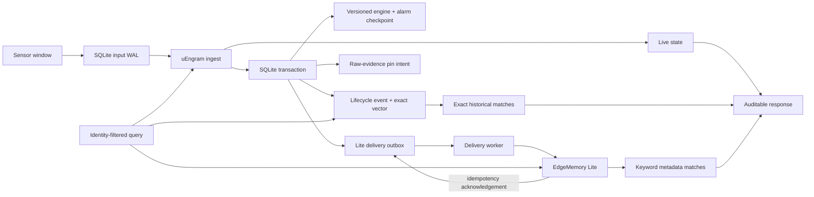

# Sensor Memory Capsule

## Decision

The Sensor Memory Capsule is the host-owned system of record for a uEngram deployment. It keeps detector recovery, lifecycle events, raw-evidence pin intent, exact historical vectors, and EdgeMemory Lite delivery state together. EdgeMemory Lite is an asynchronous, idempotent metadata projection, never the sole source of sensor state.

## Block diagram



## Invariants

1. A window is written to the input WAL before uEngram consumes it.
2. Each committed checkpoint records the resulting engine state, adapter state, last accepted step, and alarm state.
3. A lifecycle event has one stable idempotency key across local recovery and Lite delivery retries.
4. Raw-evidence operations are durable intents. Pin/unpin implementations must be idempotent because they run outside SQLite.
5. Exact historical ranking filters by identity before scoring. Lite keyword recall is supplementary and remains visibly distinct.
6. Recovery restores the latest validated checkpoint, then exposes WAL windows after that checkpoint for deterministic replay.

## Storage model

The capsule uses SQLite in WAL mode with `synchronous=FULL` for its local transaction log. Its schema contains input windows, checkpoints, lifecycle events, compact event vectors, raw pin intents, and Lite outbox rows. Arrays are stored in an explicit NumPy archive with no pickle payload; checkpoints refuse a mismatched engine configuration or latent dimension.

## Integration

```python
capsule = SensorMemoryCapsule("/var/lib/pump-17/capsule.db")
pipeline = CapsuleSensorStateMemory(capsule, engine, edge_memory)

pipeline.recover()  # restores the checkpoint, then replays a WAL suffix
receipt = pipeline.ingest(window)
```

`CapsuleSensorStateMemory` records each input before uEngram consumes it, uses the
capsule for Lite delivery and exact-vector indexing, then checkpoints the resulting
engine state. Lite writes remain idempotent projections. A raw-evidence adapter must
reconcile the capsule's pin intents with idempotent `pin` and `unpin` operations.

## Research protocol and result

The deterministic A/B/C recovery experiment, crash boundaries, fixed endpoints, and
claim limits are in [the resilience experiment protocol](resilience-experiment.md).

Measured result: on a 64-window SMD replay with a midpoint restart, repeated on four fleet
hosts (60 runs per arm), the capsule reproduced the uninterrupted engine state and lifecycle
records in every run. The Lite-only and file-sidecar arms never did: after losing detector
state they emitted two spurious lifecycle records and never raised the alarm-open record the
uninterrupted run raised. The capsule's price was roughly five to six times the
restart-to-completion time of the memory-only arms. The restart is a reopen inside one
process, so power loss and torn writes remain untested.

## Deliberate limits

This is an exact host index, not ANN. It improves candidate completeness when Lite keyword recall is truncated, but does not prove detector accuracy, target-hardware latency, flash endurance, or field diagnostic value. Native vectors, binary payloads, graph relationships, and cross-store transactions still require a versioned vendor ABI and backend implementation.
