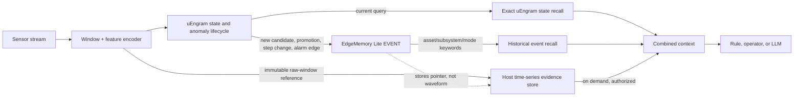

# Sensor-State Memory Pipeline: uEngram + EdgeMemory Lite

## Abstract

This document describes the working Python integration between uEngram and the EdgeMemory Lite API supplied in the companion proof of concept. A feature window from a sensor stream is evaluated by uEngram. Meaningful memory transitions and alarm edges are written as dated, typed EdgeMemory events. The event contains a small JSON record and a pointer to raw evidence when one is supplied. Retrieval combines uEngram's exact search over its live state slots with EdgeMemory's bounded keyword search over historical events.

This is a reference pipeline, not a production embedded database or a validated fault predictor. EdgeMemory Lite currently accepts text records and keywords; it does not accept vectors, binary payloads, time-series slices, relationships, or ANN indexes. Raw sensor data and feature vectors therefore remain in a host-owned evidence store and uEngram's live state remains in process memory.

## 1. Design at a glance



The application still decides which sensor windows and severity labels are trustworthy. `SensorStateMemory` manages the hand-off, event format, recall and raw-evidence pin lifecycle. It does not invent fault severity or make a maintenance decision.

### The RAG analogy, in plain language

A normal RAG system is like a librarian: a document is split into pieces, each piece receives a searchable vector, and a retrieval layer chooses useful pieces before a language model answers. A Mem0-like layer sits in front of that shelf and decides which facts to keep, update, combine, or remove.

For sensor-state memory, the “books” are not only text chunks:

- **uEngram is the compact state index.** It stores evolving statistical descriptions of sensor patterns and can find the closest states by exact distance within its bounded slots.
- **EdgeMemory is the dated event notebook.** It records lifecycle events, provenance, timestamps, retention class, and keywords. Lite can retrieve these by keywords, not semantic vectors.
- **The time-series store is the evidence archive.** An event may point to an immutable waveform window. The pointer is not the waveform, and pinning is done by the host evidence-store adapter.
- **An optional LLM is a reader, not the memory manager.** It can explain retrieved evidence, but its text must remain a hypothesis unless backed by the sensor record. The hard real-time decision path does not require an LLM.

So the analogy is “memory policy in front of searchable evidence,” not “EdgeMemory Lite is already a vector database” and not “an LLM is continuously rewriting the machine’s normal state.” A later Standard/Advanced database could add stored embeddings and ANN search, but that is outside the current Lite API.

## 2. Terms in simpler words

| Term | Simple meaning | Similar everyday idea |
|---|---|---|
| Feature vector | A fixed list of numbers summarizing one sensor window | A short scorecard for the last five seconds |
| Latent feature | A number learned or constructed to describe a pattern | A compact clue such as “strong vibration at this frequency” |
| Candidate | A new pattern that has not been seen enough to trust as normal | A new face not yet recognized as a regular visitor |
| Episodic memory | A dated record of a particular event or uncommon pattern | A diary entry: “this happened at 10:03” |
| Semantic state | A compact summary of a recurring, supported operating pattern | A learned description of what normal cruising looks like |
| Novelty score | How unlike the learned normal patterns a window is | How surprising a new event is, not how dangerous it is |
| Severity | A separate estimate of harm or urgency, provided by a named source | The difference between “unusual noise” and “unsafe noise” |
| ANN | Approximate nearest-neighbor search; faster at large scale but may miss the exact closest item | Looking through a carefully chosen shelf rather than every book |
| Idempotency | Repeating the same request does not create a second record | A receipt number that prevents paying the same bill twice |
| EMA | Exponential moving average; newer observations count more, older ones fade gradually | Updating a running average while giving recent measurements more weight |
| Centroid | The average location of a group of vectors | The center of a cloud of similar points |
| Retention class | A priority label used when memory is scarce | A “keep if possible” label on a record |
| Raw-evidence pin | A promise not to delete the referenced waveform yet | Putting a file on hold until its case review is complete |
| RAG | Retrieval-augmented generation: retrieve evidence, then give it to a text generator | Open the relevant manual pages before writing an answer |

A novelty score is not a probability, a severity score, a diagnosis, or a calibrated false-alarm rate. A semantic slot is not proof that a physical state is healthy. Those meanings require independent calibration and evidence.

## 3. What the current code does

### Input

`SensorWindow` contains:

- asset, subsystem, operating mode, and feature-schema identifiers;
- `step_index`, a strictly increasing sample/window counter used by uEngram's M-of-N timers;
- `observed_at_ms`, wall-clock time for the durable event;
- `raw_idx`, a host-local evidence index;
- a finite feature vector of the dimension expected by the engine;
- an optional source event ID, externally provided severity/source, and raw-window pointer.

Do not substitute epoch time for `step_index`. A counter may advance by one per window; epoch milliseconds usually jump by thousands and would change the meaning of uEngram's time-based transitions.

### Memory lifecycle

The pipeline stores an EdgeMemory `EVENT` when uEngram creates a candidate, promotes a pattern, reports a step change, or changes alarm state from closed to open or open to clear. Repeated alarm-positive windows do not each create a durable event. Routine “absorb” windows are not written one-by-one, reducing write amplification.

The event metadata is JSON with a schema version, asset/subsystem/mode, feature schema, step, uEngram item ID, action, novelty, health-reference score if available, alarm state, externally sourced severity, feature dimension, raw-window pointer, and source event ID. The text content is a short human-readable label. The event is marked sensor-sourced, observed, local-private, and receives a stable idempotency key.

### Retrieval

`recall()` returns two deliberately separate results:

1. **Current patterns:** uEngram exact search over the current in-memory state slots. This is not EdgeMemory vector search.
2. **Historical events:** EdgeMemory keyword search, constrained by hashed asset and subsystem tags (and optionally mode), plus optional caller keywords.

The hashed tags prevent raw asset identifiers from appearing in the keyword index, but the event metadata still contains the identifiers. Privacy and scope authorization remain the host's responsibility. EdgeMemory Lite's keyword ranking is count of matched keywords, then retention, update time, and memory ID; it is not cosine similarity or a relevance model.

### Raw evidence lifetime

If `raw_window_ref` is present, the host must inject a durable `RawEvidencePins` implementation. When a durable outbox is configured, the pipeline records the lifecycle event before pinning the immutable slice and calling EdgeMemory; this makes a restarted replay re-establish the idempotent pin before it retries the vendor write. A successful event is marked critical and unpinned after an explicit `forget()`. Critical records are protected from EdgeMemory's pressure eviction, but may still expire or be explicitly forgotten. This code supplies no automatic expiry, and it cannot guarantee the host time-series store honors pins unless its adapter does.

## 4. Critical data flow (pseudocode)

```text
function on_window(window):
    validate schema, finite feature numbers, identifiers, timestamp, and ordering
    decision = uEngram.ingest(window.features, window.step_index, window.raw_idx)

    if decision is a durable lifecycle change OR alarm state changed:
        event = encode small versioned metadata record
        outbox.enqueue(event, decision)  # fsync before external delivery
        if event points to raw evidence:
            raw_store.pin(pointer, stable_event_key)
        edge_memory.remember(event, sensor_source, observed_time,
                             idempotency_key=stable_event_key)
        outbox.acknowledge(stable_event_key)

function after_restart():
    restore the host-owned detector checkpoint, if one exists
    for queued event in outbox:
        raw_store.pin(pointer, stable_event_key)  # idempotent
        edge_memory.remember(event, same_idempotency_key)
        outbox.acknowledge(stable_event_key)
    # Do NOT feed the already-consumed window into uEngram a second time.

function retrieve(query_features, asset, subsystem):
    live_patterns = uEngram.exact_recall(query_features)
    old_events = edge_memory.keyword_recall(asset_tag, subsystem_tag, optional_mode)
    return live_patterns + old_events
    # fetch raw slices through their host-owned pointers only when needed
```

## 5. Error paths that deserve the most attention

| Priority | Failure path | Why it matters | Safe response |
|---|---|---|---|
| Highest | EdgeMemory write fails after uEngram has consumed the window | Retrying `ingest()` would count the sample twice and could alter promotion/alarm timing | Configure `FileSensorEventOutbox`; call `replay_outbox()` before accepting new windows after restart. Otherwise catch `SensorMemoryPersistenceError` and retry `error.pending` with `persist_pending()`. Do not ingest that window again. |
| Highest | A fault is promoted into an adaptive “normal” state | A persistent fault can be promoted as semantic; because later novelty may compare against learned semantic slots, the alarm can weaken or clear even while the physical fault remains | Keep alarm decisions anchored to a separately frozen, validated healthy reference; quarantine unverified states or disable promotion for fault candidates; replay persistent-fault and repair cases. Promotion is a memory lifecycle event, not proof of health. |
| High | Raw pointer is evicted before its event is reviewed | The event becomes an unsupported summary with no waveform behind it | Use durable, idempotent pin/unpin operations. Keep raw storage and EdgeMemory deletion in a reconciled lifecycle; record failed unpins for retry. |
| High | Event replay or duplicated input | Creates false frequency counts or shifts the detector twice | Enforce increasing step numbers; provide stable source event IDs for upstream retries; use EdgeMemory idempotency for durable writes. |
| High | Asset or subsystem filters are omitted | Similar events from unrelated machines may be mixed | Historical recall requires both `asset_id` and `subsystem_id`; use tenant/device EdgeMemory scopes as an additional boundary. |
| High | Device clock is zero, wrong, or moves backward | Expiry and chronology become misleading | Require a positive wall-clock timestamp; keep it separate from the monotonic sample counter. Synchronize clocks and retain source timestamps. |
| Medium | A numeric novelty score is presented as severity | The user may confuse “unusual” with “dangerous” | Supply severity only from a named, validated policy/model/operator; otherwise keep it absent. |
| Medium | Keyword retrieval is described as semantic retrieval | It may return records with matching tags, not meaning-equivalent records | Explain that Lite uses exact keyword matches; add vectors only with a real Standard/Advanced backend and test its ranking. |
| Medium | Feature schema changes without a new schema ID | Old and new patterns may be compared as if their dimensions/meaning were the same | Version preprocessing and feature schemas; use distinct uEngram state namespaces for incompatible transforms. |
| Medium | Critical events fill the logical quota | Critical records are not pressure-evicted, so writes may fail rather than silently delete them | Set quotas, expiry, explicit review and forget rules; alert on admission failure and preserve the raw evidence until policy allows release. |
### Durable delivery boundary

`FileSensorEventOutbox` is an optional single-writer, fsync-backed JSON outbox. It atomically replaces its file only after synchronizing the new content; a delivery stays pending until EdgeMemory accepts its stable idempotency key and local acknowledgement succeeds. `replay_outbox()` returns the original ingest receipts without feeding any recorded window back into uEngram. The implementation is covered for both a vendor outage and a crash-equivalent acknowledgement failure after the vendor commit.

This is restart-safe **event delivery**, not a full detector checkpoint. The uEngram engine has no supported state-export format, and EdgeMemory Lite has no cross-store transaction. A process crash before the local outbox enqueue, or without a host-owned engine checkpoint, can still lose detector state. Production callers must add an input write-ahead log or a versioned engine checkpoint under their own storage transaction; this repository does not claim that unavailable guarantee.

Lite remains a text and keyword backend. It has no documented binary, vector, or ANN operation. The compact vector field occasionally included in uEngram event metadata is host-encoded evidence for host-side ranking, not a Lite vector index. Native vector/ANN integration remains unsupported until the vendor publishes a versioned request, response, filtering, consistency, quota, and latency contract that can be exercised against a real backend.
### Host vector sidecar

`FileSensorVectorIndex` is an optional, fsync-backed host sidecar for the compact vectors already present in uEngram event metadata. After Lite accepts an idempotent event, the adapter persists `(memory_id, idempotency_key, content, structured_value)` in the sidecar; replay repeats this safely. Ranked history then scans every indexed event with the existing strict asset/subsystem/mode filters and hybrid score. Lite keyword results remain separately exposed as `historical_events`.

This is an exact $O(Nd)$ host scan, not Lite vector search and not ANN. The behavior test constrains Lite to its newest single keyword candidate: it exposes one event, while the sidecar recovers all three persisted lifecycle vectors and ranks the older exact vector match first. That proves retrieval completeness under keyword truncation; it does not establish latency, memory, flash, energy, or field-diagnostic benefit.

For a vendor-native successor, the next ABI must add: (1) capability bits that distinguish exact-vector and ANN semantics; (2) a typed binary vector payload with dimension, metric, normalization and filtering rules; (3) query responses with distance, candidate-count, truncation and index-epoch metadata; (4) atomic mutation semantics spanning record, vector and idempotency mapping; and (5) reproducible target-hardware latency, RAM, flash-write and recall benchmarks. Relationships require their own typed identity and delete/consistency rules; they must not be overloaded into event keywords.


## 6. Python package and integration boundary

The EdgeMemory archive's Python binding is a separate package. Its CFFI import is a regular runtime dependency. AutoGen is optional demonstration code and should not prevent the core binding tests from running when AutoGen is absent. The package fix preserves explicit zero values for optional timestamps (`None` means “use the current time”; zero remains zero and can then be rejected by the C API if invalid) and treats missing AutoGen dependencies as a skipped optional integration test, not a broken core package.

The reproducible fix is in `patches/edge-memory-gateway-lite-python.patch`. Apply it from the extracted archive's `edge_memory/` directory with `patch -p1 < /path/to/uEngram/patches/edge-memory-gateway-lite-python.patch`. The current working extraction used for testing is under `~/.local/state/uengram/edge-memory-gateway-lite-2026-10-04/`; the original archive remains unchanged.

uEngram imports neither CFFI nor AutoGen. The adapter accepts the small `EdgeMemoryPort` interface, so the application may pass the archived Lite binding or another compatible implementation. The source and vendor backend are not part of the uEngram repository, and the archive's current API does not expose native vector, binary, ANN, relationship, time-series, or model-plugin operations. No claim is made that those capabilities are implemented here.

### Validation record

- uEngram full suite: `306 passed, 2 skipped` (`pytest -q`, 49.64 s).
- EdgeMemory Python suite on a pristine extraction after applying the tracked patch: three binding tests passed; the AutoGen module was skipped because optional AutoGen packages are absent. The run used the supplied Linux x64 shared library and CFFI installed in an isolated `uv` environment.
- The patch passed `patch --dry-run` against the original archive contents and was then applied to a clean extraction.
- Real-library smoke test: two sensor events (`new_candidate`, `promote`) were stored and recalled through the CFFI binding; one live uEngram pattern was also returned. This validates the adapter/API wiring, not detector accuracy or ANN behavior.


## 7. What is new here, and what is not

Existing ingredients—sensor anomaly detection, streaming state summaries, event databases, keyword/vector retrieval, and agent-memory lifecycle rules—are established ideas. This repository work adds an executable integration boundary: uEngram lifecycle decisions become bounded, idempotent sensor event records; raw evidence is referenced and pinned through an explicit host interface; and retrieval combines live state recall with historical event lookup.

This is an implementation contribution and testable design, not a claim of a new general-purpose memory algorithm, a novel DBMS, or a validated industrial predictor. The archived EdgeMemory Lite backend is a proof of concept and remains narrower than the planned text/binary/vector plugin system.

## 8. Future work

1. Add a versioned adapter that stores binary windows or stable references in an embedded time-series/blob engine, with crash-safe pin accounting.
2. Persist uEngram state checkpoints and alarm state atomically with event writes; restore and replay after process restart.
3. Add a transactional outbox or write-ahead queue so a process crash between detection and EdgeMemory commit cannot lose an event.
4. Add vector and ANN APIs only when the database exposes a documented, testable contract; benchmark recall, memory, flash writes, latency, and energy on target hardware.
5. Design separate baseline-state slots, episodic fault records, and lineage/audit records. Define when a baseline may adapt, when it must freeze, and how repair is recognized.
6. Evaluate centroid compaction against preserving exact event evidence. Store variance, count, time range, source IDs, and a reversible pointer manifest; never discard raw evidence before a verified compaction policy permits it.
7. Test disconnected operation, power loss, clock drift, sensor replacement, gradual wear, step changes, false severity labels, quota exhaustion, flash endurance, and multi-asset isolation.
8. Run independent asset-held-out field validation with verified onset labels before making safety or predictive-maintenance claims.
