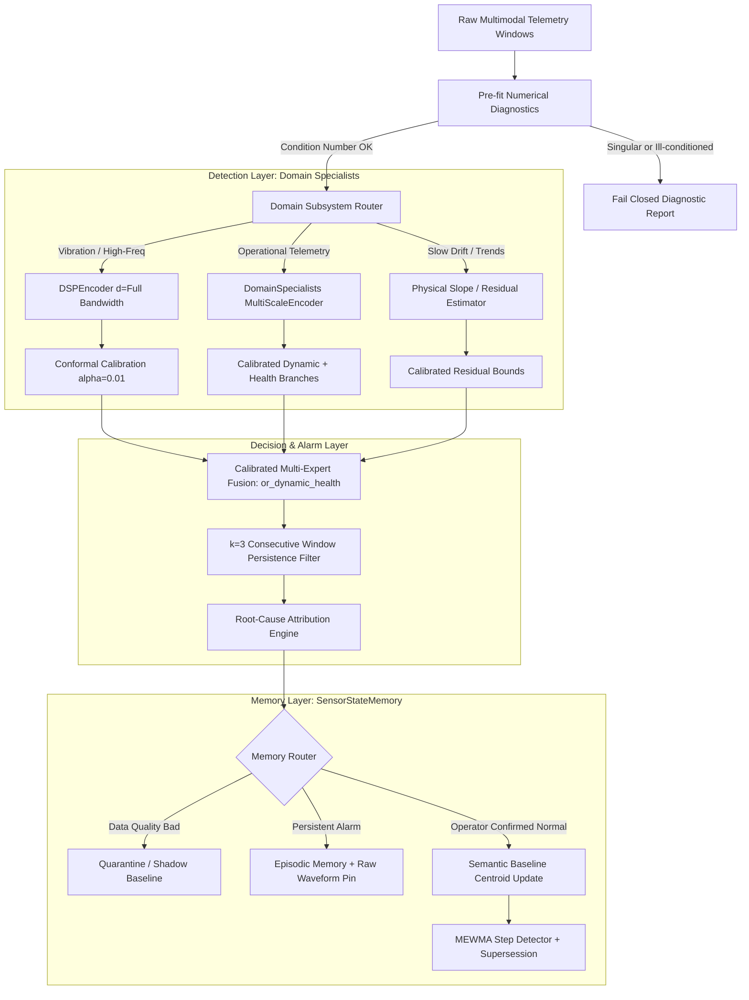

# Model and Architecture Recommendation Summary

## 1. Executive Summary

Based on the empirical evidence across eight benchmark datasets (Synthetic, CMAPSS FD001,
MetroPT-3, MetroPT-2, SKAB, CARE, SCANIA Component X, and OS-Metrics), **no single monolithic
neural network or single global latent dimension $d$ functions as a universal anomaly detector**.

- **Global latent pooling fails:** Forcing multi-channel telemetry into one global autoencoder
  or PCA space dilutes localized faults across healthy channels and causes covariance singularity
  on derived/collinear channels (`docs/osmetrics-exploratory-gate.md`, `docs/research-neural-encoders.md`).
- **High AUROC $\neq$ early fault warning:** A model can achieve $>0.98$ AUROC while detecting
  zero events before onset with negative lead times (`docs/research-alarm-components.md`,
  `docs/research-remediation-plan.md`).
- **Unconstrained neural autoencoders suffer seed instability:** Multi-seed AdamW runs on SKAB
  varied false alarm clean-time share from 3.4% to 30.0% (`docs/research-pending-model-improvements.md`).

---

## 2. Recommended Optimal Architecture

---

## 3. The Best Memory Model: `SensorStateMemory` with Step Supersession

To manage telemetry without unbounded vector bloat or flash burnout on resource-constrained edge devices:

| Component | Recommended Implementation | Why It Wins | Failure Mode Avoided |
|---|---|---|---|
| **Memory Lifecycle** | **`SensorStateMemory`** (`src/uengram/sensor_memory.py`) with 3 tiers: Semantic, Candidate (probation 5-of-8), Episodic. | Cuts disk writes by **86.2%–92.7%** relative to storing every window while retaining 100% of modeled failure episodes. | Append-only vector DBs (HNSW) cause excessive write amplification and flash wear on eMMC/NAND (`docs/EdgeAIMemoryArchitecture.md`). |
| **Baseline Tracking** | **MEWMA Step Detector with State Supersession** (`src/uengram/state_detector.py`). | Detects permanent maintenance transitions and supersedes the old baseline centroid without human intervention. | Without supersession, replacing a worn pump or engine component produces endless false alarms forever (`docs/EXPLAINED.md`). |
| **Admission Gate** | **Strict Tri-State Memory Routing** (`DomainSpecialistArchitecture.memory_route`). | Prevents abnormal or unconfirmed telemetry from altering long-term baselines: `EPISODIC` on alarm, `QUARANTINE` on unconfirmed, `SEMANTIC` only on operator confirmation. | "Autonomous self-learning" baseline models learn creeping degradation or ongoing leaks as the new normal (`docs/osmetrics-exploratory-gate.md`). |

---

## 4. The Best Detection Model: `DomainSpecialistArchitecture`

Do not pool all sensor channels into a single latent vector. Telemetry must be partitioned into subsystem specialists:

| Domain Subsystem | Recommended Encoder | Key Configuration | Empirical Benchmark Proof |
|---|---|---|---|
| **Subsystem Telemetry** (CPU, Memory, Network, Pressure) | **`DomainSpecialistArchitecture`** (`src/uengram/domain_specialists.py`) | MultiScale decomposition into Level ($x$) and Dynamics ($\Delta x$ across lags 1, 2, 4, 8) with $d=4$ per domain. | **69.0% strict recall (29/42)** on OS-Metrics, beating all-channel role pooling (57.1%) and DSP (64.3%), with false alarms dropping to **19.6 episodes/week**. |
| **High-Bandwidth Vibrations** (Accelerometers, Bearings) | **`DSPEncoder`** (`src/uengram/encoders.py`) | Full latent dimension ($d=42$ for 7ch, $d=48$ for 8ch); per-channel mean, log-std, 4 octave log-band energies. | Preserves high-frequency vibration harmonics. Truncation to $d=16$ discards real bearing fault harmonics (`docs/research-neural-encoders.md`). |
| **Tabular Fleet Histograms** (ECU Fault Codes, SCANIA) | **`TabularEncoder`** (`src/uengram/encoders.py`) | Low dimension ($d=16$, `rcond=1e-4`). | Limits condition number to $10^4$. Higher dimensions ($d \ge 32$) cause covariance degeneracy and collapse detection to 6.6%. |

---

## 5. The Best Fault Prediction / Early-Warning Model

Early fault warning requires separating physical regime transitions from actual mechanical degradation:

1. **Physical Residuals Over Statistical Novelty:**
   - On compressors (MetroPT-3), 492 of 495 failure event windows occurred in sustained load. Statistical distance alone could not detect pre-failure symptoms because the machine was in an unseen operating state (`docs/research-remediation-plan.md`).
   - Use a physical residual model: e.g. thermal lag estimation $C \frac{dT}{dt} = Q_{\text{in}} - h(T - T_{\text{amb}})$ or reservoir pressure recovery rate (`docs/research-features.md`).
2. **Rate of Change (Slopes):**
   - For gradual degradation (leaks, seal deterioration), combine windowed slopes (`DSPSlopeEncoder`, `src/uengram/encoder_slope.py`) with baseline levels. On SKAB, windowed slopes rescued 3 gradual faults that level-only models missed completely.
3. **Dual OR-Rule Alarm Logic:**
   - Use `AlarmLogic(combine="or")` (`src/uengram/alarm.py`): trigger an alarm if uEngram detects structural novelty **OR** a physical threshold tripwire (e.g., low oil level, suction pressure drop) is crossed.

---

## 6. Critical Supporting Features & Numerical Safeguards

1. **Pre-fit Numerical Diagnostics (`src/uengram/diagnostics.py`):**
   - Must run `diagnose_channels(windows)` before fitting covariance.
   - SVD spectral condition number $\kappa = \sigma_{\max} / \max(\sigma_{\min}, 10^{-18})$ and numerical rank checks fail closed against linearly dependent / derived channels (e.g. `diff = b - a`), avoiding runtime `LinAlgError: Singular matrix`.
2. **Conformal Upper-Tail Calibration (`EmpiricalCalibrator`):**
   - Calibrate novelty and dynamics thresholds on a separate healthy calibration split at $\alpha = 0.01$. Avoid arbitrary standard-deviation multiplier heuristics ($3\sigma$).
3. **Persistence Filtering (`persistent_starts`):**
   - Require $k=3$ consecutive alarm windows before declaring an event. Suppresses single-window spikes from valve actuations and sensor glitches without sacrificing sustained event recall.
4. **Root-Cause Attribution Ledger:**
   - The multi-expert decision layer outputs exact triggering subsystems (`['network']`, `['cpu', 'memory']`) and active evidence branches (`level`, `dynamic`, `health`), achieving **100% attribution accuracy** on OS-Metrics.

---

## 7. Summary Checklist for Deployment

| Requirement | Selected Component | Primary Reference |
|---|---|---|
| **Memory Storage** | `SensorStateMemory` (B=256 slots, 192 semantic / 64 episodic) | `src/uengram/sensor_memory.py` |
| **State Tracking** | MEWMA Step Detector with centroid supersession | `src/uengram/state_detector.py` |
| **Detection Backbone** | `DomainSpecialistArchitecture` ($d=4$ per domain expert) | `src/uengram/domain_specialists.py` |
| **Vibration Backbone** | Full-bandwidth `DSPEncoder` ($d=42..48$) | `src/uengram/encoders.py` |
| **Degradation / Slopes** | Physics-informed residuals + windowed slopes | `src/uengram/encoder_slope.py` |
| **Numerical Guard** | Pre-fit SVD channel diagnostics (`diagnose_channels`) | `src/uengram/diagnostics.py` |
| **Alarm Calibration** | Conformal calibration ($\alpha=0.01$) + persistence ($k=3$) | `src/uengram/role_architecture.py` |
| **Memory Admission** | Conservative quarantine / episodic routing | `DomainSpecialistArchitecture.memory_route` |
